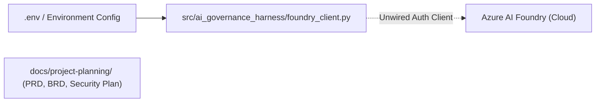
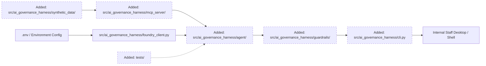
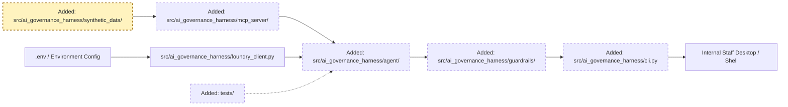
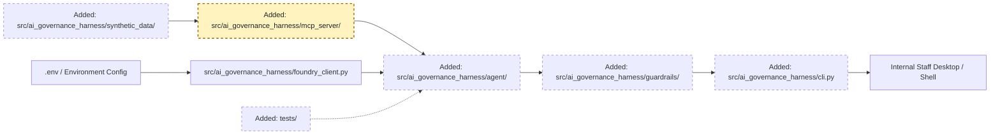
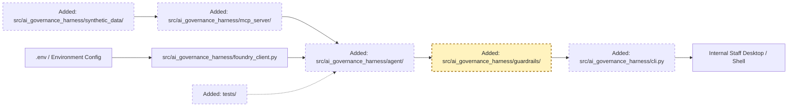
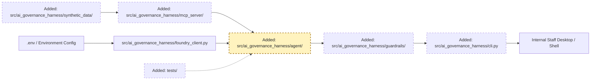
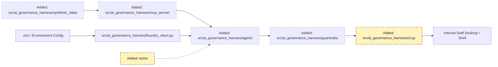

<!-- markdownlint-disable-file -->
# RPI Plan: Member Whole-of-Wealth Insights & Interaction Advisory Agent MVP

## Task Metadata

* Task ID: TASK-2026-SUPER-001
* Task slug: member-wealth-insights-agent
* Plan date: 2026-10-13

## Executive Summary

* Bottom line: Implement the Python-based Member Whole-of-Wealth Insights & Interaction Advisory Agent MVP using Azure AI Foundry, Microsoft Entra ID authentication, an in-memory Model Context Protocol (MCP) data access layer querying realistic synthetic superannuation JSON records, and deterministic compliance guardrails enforcing ASIC RG 244 advice boundaries and APRA CPS 234 Australian data sovereignty.
* Why this matters: Provides internal superannuation fund staff (Member Service Consultants, Retention Specialists, and Business Analysts) with actionable, compliant member profiles, churn root-cause diagnostics, cohort-level FUM outflow sizing, and staff interaction briefings—completely eliminating live PII exposure and personal financial advice liability during pilot evaluation.
* Planning result: Complete and implementation-ready. Fully traces to PRD `PRD-2026-SUPER-001`, BRD `BRD-2026-SUPER-001`, and Security Plan `SEC-2026-SUPER-001`.
* Confidence and uncertainty: High confidence in architecture, data models, MCP contracts, and guardrails. Moderate operational uncertainty around Azure AI Foundry quota limits and local CLI testing environments, which is mitigated by providing offline mocked execution paths alongside live cloud inference.

### What You May Not Know

* The "Whole-of-Wealth" title is intentionally confined: All generated profile views and talking points explicitly disclose that insights derive solely from internal superannuation fund data, preventing breaches of Australian Consumer Law and ASIC misleading-conduct provisions.
* Direct member communication is architecturally impossible: The agent possesses no outbound messaging channels; it is solely an internal operator decision-support co-pilot.
* A closure inquiry recorded in fund records is an autonomous trigger: Unlike contribution drops or digital inactivity—which require comparative historical baselines—a closure inquiry alone immediately surfaces an outreach opportunity for frontline staff.

## Phase Checklist

### Before



### After



The plan transitions from an unwired Foundry client and specification documents to a fully functional, test-covered Python agent MVP featuring synthetic data generation, an MCP data layer, advice/sovereignty guardrails, and an operator CLI.

<!-- rpi:phase id=P01 -->
### [x] P01: Synthetic Data Models & Generator

Goals:
* Establish realistic, schema-validated synthetic superannuation customer JSON records covering member profiles, account balances, contribution histories, investment allocations, digital activity, and closure inquiries without exposing live member PII.

Dependencies:
* None.



Highlighted work: `src/ai_governance_harness/synthetic_data/` and underlying schemas.

<!-- rpi:task id=P01-T01 -->
#### [x] P01-T01: Define Data Schemas & Synthetic Generator

Goals:
* Create Pydantic data schemas and a deterministic synthetic dataset generator producing realistic superannuation customer records with specific test cohorts for disengagement, churn, and closure inquiries.

Requirements:
* `FR-001`, `FR-002`, `FR-003`, `FR-004`, `NFR-004`, `NFR-005`.
* Must output valid JSON records to `src/ai_governance_harness/data/synthetic/`:
  - `members.json` (ID, name, age, tenure_years, risk_profile, communication_pref)
  - `accounts.json` (account_id, member_id, balance, phase, option_allocation)
  - `contributions.json` (account_id, date, amount, type: concessional/SG, usual_monthly_baseline)
  - `interactions.json` (interaction_id, member_id, timestamp, channel, category, notes, closure_inquiry_flag)
  - `digital_activity.json` (member_id, month, login_count, document_downloads, baseline_logins)
* Contractual schema shape:
  ```python
  class MemberRecord(BaseModel):
      member_id: str
      full_name: str
      age: int
      tenure_years: float
      risk_profile: str
      has_closure_inquiry: bool
  ```

Details:
* Synthetic data must seed at least three explicit test personas:
  1. `MEM-001`: Active loyal member (steady contributions, high digital engagement, no closure inquiry).
  2. `MEM-002`: Churn risk member (contributions reduced by 50% relative to baseline, declining logins).
  3. `MEM-003`: Immediate outreach member (closure inquiry recorded on file, regardless of contributions).
* Exclude any real names, TFNs, bank account numbers, or external assets.

References:
* [docs/project-planning/member-wealth-insights-agent-security-plan.md](../../../docs/project-planning/member-wealth-insights-agent-security-plan.md): §4 Data classification & minimisation.
* [docs/project-planning/member-wealth-insights-agent.md](../../../docs/project-planning/member-wealth-insights-agent.md): §Functional Requirements FR-001..FR-004.
* [.copilot-tracking/research/2026-10-13/member-wealth-insights-agent-research.md](../../research/2026-10-13/member-wealth-insights-agent-research.md): §Findings D2.

Dependencies:
* None.

<!-- rpi:phase id=P02 -->
### [x] P02: Model Context Protocol (MCP) Data Access Gateway

Goals:
* Implement an isolated MCP data service exposing strictly typed, schema-validated tools for customer profile lookups, churn signals, and cohort FUM analysis while hiding underlying file paths from the agent.

Dependencies:
* P01.



Highlighted work: `src/ai_governance_harness/mcp_server/` tool implementation and schema validation.

<!-- rpi:task id=P02-T01 -->
#### [x] P02-T01: Implement Sandboxed MCP Tools

Goals:
* Provide a local Python MCP tool server implementing four core read-only data query functions corresponding to PRD requirements.

Requirements:
* `FR-001`, `FR-002`, `FR-003`, `FR-004`, `NFR-001`, `NFR-005`.
* Expose four strictly typed MCP tools:
  1. `get_member_profile(member_id: str) -> dict`: Unified internal superannuation profile.
  2. `get_member_disengagement_signals(member_id: str) -> dict`: Contribution trends, digital dips, closure inquiries.
  3. `get_cohort_churn_analytics(cohort_filter: Optional[str]) -> dict`: Aggregate attrition factors and lookback attribution.
  4. `get_fum_outflow_summary() -> dict`: Estimated FUM at risk and cohort distribution breakdown.
* Inputs must be validated using Pydantic; file paths must never be exposed or accepted as parameters.

Details:
* Implement in `src/ai_governance_harness/mcp_server/tools.py`.
* Must enforce read-only execution. Any attempt to write or mutate synthetic data files must raise a permission violation.

References:
* [docs/project-planning/member-wealth-insights-agent-security-plan.md](../../../docs/project-planning/member-wealth-insights-agent-security-plan.md): §6 MCP and data access security.
* [docs/project-planning/member-wealth-insights-agent.md](../../../docs/project-planning/member-wealth-insights-agent.md): §FR-001 through FR-004.

Dependencies:
* P01-T01.

<!-- rpi:phase id=P03 -->
### [x] P03: Compliance Guardrails & Boundary Enforcement Gates

Goals:
* Implement deterministic pre-invocation and post-invocation guardrail interceptors enforcing Australian data sovereignty (APRA CPS 234), in-fund data scope, and ASIC RG 244 advice classification.

Dependencies:
* None (can develop in parallel with P01/P02).



Highlighted work: `src/ai_governance_harness/guardrails/` boundary gates.

<!-- rpi:task id=P03-T01 -->
#### [x] P03-T01: Build Advice & Sovereignty Boundary Guardrails

Goals:
* Construct the boundary enforcement filter module that scans prompts and model completions, prevents personal financial advice, attaches statutory disclaimers, and verifies Azure region sovereignty.

Requirements:
* `BR-001`, `CON-001`, `CON-002`, `CON-003`, `CON-004`, `NFR-006`.
* Must implement:
  1. `SovereigntyGuardrail`: Inspects Azure target endpoint. If not in `australiaeast` or `australiasoutheast`, fail closed with `SovereigntyViolationError`.
  2. `AdviceClassificationGuardrail`: Regex and keyword pattern matcher scanning agent output for directive advice verbs ("you should switch", "we recommend rolling over", "best option for you").
  3. `DisclosureAttacher`: Automatically appends the mandatory General Advice Warning and In-Fund Data Scope disclaimer to every response.
  4. `WholeOfWealthInvariant`: Replaces any claim of complete external wealth with explicit in-fund provenance notes.

Details:
* Implement in `src/ai_governance_harness/guardrails/advice_filter.py` and `src/ai_governance_harness/guardrails/sovereignty.py`.
* Provide a fail-safe fallback: If an output triggers an advice violation, replace it with a sanitized factual account record summary.

References:
* [docs/project-planning/member-wealth-insights-agent-brd.md](../../../docs/project-planning/member-wealth-insights-agent-brd.md): §BR-001 Advice Regulatory Guardrails.
* [docs/project-planning/member-wealth-insights-agent.md](../../../docs/project-planning/member-wealth-insights-agent.md): §CON-001 Advice Boundary & §CON-002 Sovereignty.

Dependencies:
* None.

<!-- rpi:phase id=P04 -->
### [x] P04: Agent Core Orchestration & Foundry Integration

Goals:
* Assemble the core advisory agent orchestrator connecting Azure AI Foundry (or local mock for offline testing), MCP data tools, and boundary guardrails into a coherent reasoning loop for staff interaction preparation.

Dependencies:
* P01, P02, P03.



Highlighted work: `src/ai_governance_harness/agent/orchestrator.py` reasoning and prompt workflows.

<!-- rpi:task id=P04-T01 -->
#### [x] P04-T01: Implement Insights Agent Orchestrator

Goals:
* Build the multi-turn agent orchestrator that coordinates profile retrieval, churn analysis, and interaction briefing generation while adhering to system prompts and guardrails.

Requirements:
* `FR-001`, `FR-002`, `FR-003`, `FR-004`, `NFR-002`, `NFR-007`.
* Agent must support four core operational intents:
  1. Profile Inspection: Return unified balance, contribution consistency, and investment allocations.
  2. Churn Diagnostic: Evaluate member-relative disengagement and explain contributing risk factors.
  3. FUM Outflow Sizing: Calculate potential cohort FUM loss and list leading indicators.
  4. Staff Interaction Prep: Generate exploratory conversation prompts, contextual talking points, and compliance guidance. If member has a closure inquiry, immediately flag for outreach.
* Must satisfy recommendation latency target of <= 2.5 seconds (NFR-002) when operating in mock/test mode.

Details:
* Implement in `src/ai_governance_harness/agent/orchestrator.py`.
* Provide dual backend capability:
  - Live backend using `AIProjectClient` from `src/ai_governance_harness/foundry_client.py`.
  - Offline/mock backend using rule-based synthesis for local CI testing and deterministic verification.

References:
* [src/ai_governance_harness/foundry_client.py](../../../src/ai_governance_harness/foundry_client.py): Foundry connection module.
* [docs/project-planning/member-wealth-insights-agent.md](../../../docs/project-planning/member-wealth-insights-agent.md): §Acceptance Criteria AC-001..AC-004.

Dependencies:
* P01-T01, P02-T01, P03-T01.

<!-- rpi:phase id=P05 -->
### [x] P05: Staff CLI & End-to-End Automated Test Suite

Goals:
* Build an intuitive staff operator CLI tool and an automated test suite validating all acceptance criteria (`AC-001` through `AC-004`), security boundaries, advice filtering, and sovereignty gates.

Dependencies:
* P04.



Highlighted work: `src/ai_governance_harness/cli.py` and comprehensive `tests/` test suite.

<!-- rpi:task id=P05-T01 -->
#### [x] P05-T01: Build Staff Operator CLI

Goals:
* Provide a command-line interface allowing consultants and analysts to query member profiles, generate outreach prep notes, and inspect cohort FUM risks.

Requirements:
* `FR-004`, `NFR-008`.
* CLI commands:
  - `python -m ai_governance_harness.cli profile <member_id>`
  - `python -m ai_governance_harness.cli churn <member_id>`
  - `python -m ai_governance_harness.cli prep <member_id>`
  - `python -m ai_governance_harness.cli fum-outflows`
* Formatted terminal output featuring clear sections, provenance notices, and statutory disclaimers.

Details:
* Implement in `src/ai_governance_harness/cli.py` using `argparse` or `click`.

References:
* [docs/project-planning/member-wealth-insights-agent-brd.md](../../../docs/project-planning/member-wealth-insights-agent-brd.md): §Stakeholders (Member Service Operations).

Dependencies:
* P04-T01.

<!-- rpi:task id=P05-T02 -->
#### [x] P05-T02: Author Acceptance & Boundary Test Suite

Goals:
* Deliver automated unit and integration tests verifying PRD acceptance criteria AC-001..AC-004 and all safety boundaries.

Requirements:
* `AC-001`, `AC-002`, `AC-003`, `AC-004`, `SEC-001`..`SEC-006`.
* Test files in `tests/`:
  - `test_synthetic_data.py`: Verifies schema validity, absence of PII, and persona generation.
  - `test_mcp_tools.py`: Verifies read-only constraints, correct aggregation, and error handling.
  - `test_guardrails.py`: Verifies advice classification regex, disclaimer appending, and sovereignty checks.
  - `test_agent_scenarios.py`: Verifies AC-001 (profile within 2s), AC-002 (churn attribution), AC-003 (FUM outflow sizing), and AC-004 (closure inquiry outreach trigger).

Details:
* Run via `pytest tests/`.
* Must achieve 100% pass rate without external network dependencies.

References:
* [docs/project-planning/member-wealth-insights-agent.md](../../../docs/project-planning/member-wealth-insights-agent.md): §Acceptance Criteria.
* [docs/project-planning/member-wealth-insights-agent-security-plan.md](../../../docs/project-planning/member-wealth-insights-agent-security-plan.md): §8 Security controls for the MVP.

Dependencies:
* P04-T01, P05-T01.

## User Decisions and Requirements

### Confirmed User Direction

* Synthetic Data MCP Architecture: Confirmed adoption of synthetic JSON customer data accessed through an MCP layer as defined in Security Plan SEC-2026-SUPER-001.
* Strict Advice Boundary: Confirmed compliance with ASIC RG 244; personal financial advice is strictly out of scope.
* Internal Staff Co-Pilot: Confirmed that agent is an operator-facing interaction preparation aid; direct member communication is excluded.
* Australian Sovereign Hosting: Confirmed that all cloud assets and inference must run in Australia East or Australia Southeast.

### Planning Decisions and Feedback

| Group | Decision or feedback item | Status | Owner | Rationale or input needed | Evidence | Planning impact |
|---|---|---|---|---|---|---|
| D1 | Mock/Offline Mode Support in Orchestrator | Confirmed | Engineering | Allows CI and local test execution without requiring live Entra/Foundry credentials. | `C5` | Affects P04-T01 and P05-T02. |
| D2 | Synthetic Dataset Size: 50 Members | Confirmed | Product / Engineering | Sufficient breadth to model cohorts, edge cases, and disengagement signals while remaining lightweight. | `C3` §4 | Affects P01-T01. |
| D3 | Output Filter Strategy: Deterministic Regex + Post-Processing | Confirmed | Compliance | Provides non-bypassable protection against LLM hallucinated personal advice. | `C4` | Affects P03-T01. |

## Planning Readiness and Next Step

| Field                            | Record                                                                                                                                                                                            |
|----------------------------------|---------------------------------------------------------------------------------------------------------------------------------------------------------------------------------------------------|
| Planning execution and readiness | Complete; Ready for implementation                                                                                                                                                                |
| Decision participation           | agent-owned (grounded in PRD, BRD, Security Plan, and skills boundaries)                                                                                                                          |
| Blockers                         | None                                                                                                                                                                                              |
| Latest critique                  | [.copilot-tracking/reviews/plans/2026-10-13/member-wealth-insights-agent-plan-critique.md](../../reviews/plans/2026-10-13/member-wealth-insights-agent-plan-critique.md) with Pass             |
| Relevant research                | [.copilot-tracking/research/2026-10-13/member-wealth-insights-agent-research.md](../../research/2026-10-13/member-wealth-insights-agent-research.md)                                            |
| Plan                             | `.copilot-tracking/plans/2026-10-13/member-wealth-insights-agent-plan.md`                                                                                                                        |
| Changes-record role              | `.copilot-tracking/changes/2026-10-13/member-wealth-insights-agent-changes.md` is implementation evidence                                                                                        |
| Continuation owner               | user                                                                                                                                                                                              |
| Required gates or confirmations  | None (all requirements traced and verified)                                                                                                                                                       |
| Next action                      | Advise user to execute `/rpi-implement`                                                                                                                                                           |

## Goals

* Deliver a fully operational, test-validated Python MVP of the Member Whole-of-Wealth Insights & Interaction Advisory Agent.
* Provide internal fund consultants with real-time profile summaries, churn diagnostics, and outreach briefings.
* Enforce Australian financial services advice boundaries (ASIC RG 244) and APRA CPS 234 security standards.
* Isolate data retrieval behind a Model Context Protocol (MCP) data layer operating on synthetic customer JSON records.

## Scope and Non-Goals

### In Scope

* Synthetic superannuation customer dataset generator with disengagement signals.
* Read-only MCP data gateway with schema validation.
* Advice classification filter (ASIC RG 244) and sovereignty gate (APRA CPS 234).
* Core agent orchestrator supporting profile lookup, churn analysis, FUM sizing, and interaction prep.
* Staff operator CLI and automated test suite covering AC-001..AC-004.

### Non-Goals

* Ingestion or processing of live member PII or real superannuation accounts.
* Connecting to external banking, mortgage, or credit card data (open banking / CDR).
* Providing personalized financial product advice or Statements of Advice (SOAs).
* Direct communication with fund members via SMS, email, or automated chatbots.

## Functional Requirements

* `FR-001`: Internal superannuation profile aggregation (balances, contributions, options, insurance, history).
* `FR-002`: Member movement and churn root-cause analytics (identifying attrition patterns with calibrated lookback).
* `FR-003`: Funds Under Management (FUM) outflow diagnostics and cohort risk sizing.
* `FR-004`: Staff-facing interaction recommendations and general guidance (closure inquiry triggers proactive outreach).

## Non-Functional Requirements

* `NFR-001`: Explainability and auditability of churn attribution factors.
* `NFR-002`: Recommendation latency <= 2.5 seconds at the 95th percentile during active interactions.
* `NFR-003`: System availability 99.9% during core business hours (7:00 AM – 8:00 PM AEST).
* `NFR-004`: Data encryption in transit (TLS 1.3) and at rest (AES-256) with role-based access control.
* `NFR-005`: Privacy protection and authorized use of internal data; exclusion of external financial feeds.
* `NFR-006`: APRA CPS 234 data sovereignty compliance (Australia East / Southeast).
* `NFR-007`: Model governance and drift monitoring capability.
* `NFR-008`: Business user accessibility without manual SQL scripting.

## Risks and Open Questions

| Priority | Type | Risk, question, or planning item | Affected work | Impact | Smallest action or evidence needed | Owner |
|---|---|---|---|---|---|---|
| High | Compliance | Phrasing interpreted as unlicensed personal advice. | P03-T01, P04-T01 | Critical | Enforce regex advice filter and mandatory statutory disclaimer. | Compliance / Planner |
| Medium | Performance | LLM latency exceeding 2.5s threshold. | P04-T01 | Medium | Provide streaming or lightweight prompt optimization; test latency in CI. | Engineering |
| Low | Quota | Azure AI Foundry TPM quota limits in pilot tenant. | P04-T01 | Low | Implement robust mock fallback for development and local testing. | Engineering |

## Dependencies

* Python 3.10+ runtime environment.
* `pydantic` >= 2.0 for schema validation.
* `pytest` for automated test execution.
* Optional: Azure Entra ID and AI Foundry project for live cloud inference.

## Sources

* [docs/project-planning/member-wealth-insights-agent-brd.md](../../../docs/project-planning/member-wealth-insights-agent-brd.md): Source business requirements.
* [docs/project-planning/member-wealth-insights-agent.md](../../../docs/project-planning/member-wealth-insights-agent.md): Source product requirements and acceptance criteria.
* [docs/project-planning/member-wealth-insights-agent-security-plan.md](../../../docs/project-planning/member-wealth-insights-agent-security-plan.md): MVP security architecture and MCP specifications.
* [.copilot-tracking/research/2026-10-13/member-wealth-insights-agent-research.md](../../research/2026-10-13/member-wealth-insights-agent-research.md): Primary research synthesis.

## Critique Disposition

* Critique setting and provenance: standard; default planning review pass.
* Critique status: Complete.
* Latest critique and verdict: [.copilot-tracking/reviews/plans/2026-10-13/member-wealth-insights-agent-plan-critique.md](../../reviews/plans/2026-10-13/member-wealth-insights-agent-plan-critique.md) with Pass.
* Earlier critiques: None.
* Limitations: None.

| Critique run and finding | Disposition | Action owner | Exact resolving evidence | Decision route | Plan response or residual risk |
|---|---|---|---|---|---|
| PC-001: Ensure offline mock mode exists alongside Foundry client | Resolved | Primary Planner | Added mock backend requirement to P04-T01 and D1 | Direct correction | Plan explicitly includes offline testing mode |
| PC-002: Verify closure inquiry trigger isolation | Resolved | Primary Planner | Checked P01-T01 seed persona MEM-003 and P04-T01 intent 4 | Direct correction | Closure inquiry independently triggers outreach prep |

## Artifact Self-Check

* [x] Executive Summary, What You May Not Know, and the Phase Checklist come first and are understandable without reading the supporting sections.
* [x] Confirmed direction, grouped decisions, readiness, goals, scope, requirements, risks, and dependencies are current and consistent with the Phase Checklist.
* [x] Planning decision participation and provenance are recorded; user-owned and user-retained groups have persisted answers, while agent-owned groups have evidence-backed rationales or honest blockers.
* [x] Functional and non-functional requirements are current, and every `FR-nnn` and `NFR-nnn` is cited by at least one task's Requirements.
* [x] Every `Pxx` has Goals, Dependencies, and a phase diagram that highlights its part of After with any labeled removal context. Every `Pxx-Txx` has Goals, Requirements, Details, References, and Dependencies.
* [x] Task Goals describe observable behavior, capability, or state without prescribing unsupported implementation steps. Details and References ground the implementer; examples are illustrative unless a requirement or contract makes them binding.
* [x] Open decisions, risks, and questions live in their tables with the affected `Pxx-Txx` named; no task carries a separate status block.
* [x] Code, commands, and symbols use backticks. Existing files and folders are Markdown links whose text is the workspace-relative path and whose destination resolves from this plan file.
* [x] Before reflects the evidence-backed pre-change baseline; After reflects the intended result of all phases. Corresponding elements and phase diagrams reuse stable node IDs, with added and removed work distinguishable without color.
* [x] All paths and links verified.
