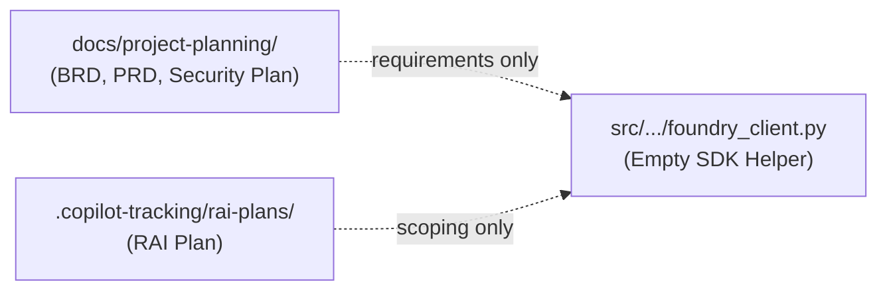
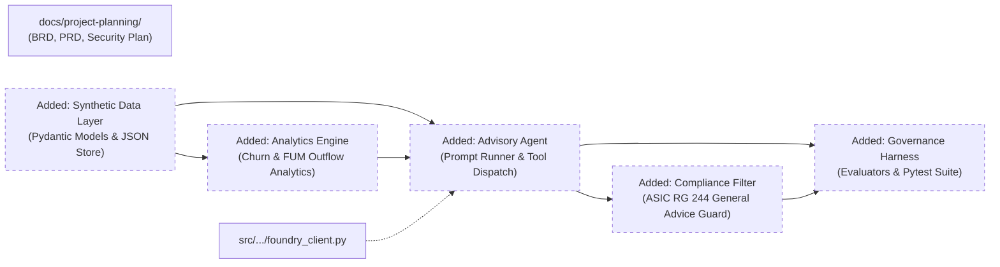
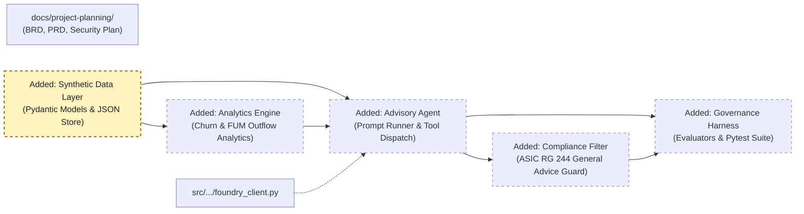
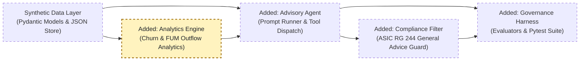
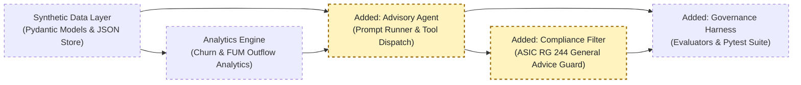
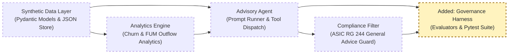

<!-- markdownlint-disable-file -->
# RPI Plan: Member Whole-of-Wealth Insights & Interaction Advisory Agent

## Task Metadata

* Task ID: PRD-2026-SUPER-001
* Task slug: member-wealth-insights-agent
* Plan date: 2026-10-13

## Executive Summary

* Bottom line: Implement the 4-tier Member Wealth Insights & Advisory system for Australian Superannuation: (1) Synthetic member data models and JSON repository, (2) Churn and FUM outflow analytics engines, (3) Staff-facing interaction advisory agent with strict ASIC RG 244 advice boundary guardrails, and (4) AI governance evaluation harness and automated test suite.
* Why this matters: Bridges the gap between the mature planning documents (BRD, PRD, Security Plan, RAI Plan) and actual executable code in `ai-governance-harness`. Gives staff actionable member retention insights without violating Australian financial advice regulations (Corporations Act Ch 7) or data sovereignty rules.
* Planning result: Complete; all 4 functional requirements (`FR-001` through `FR-004`), 4 acceptance criteria (`AC-001` through `AC-004`), security plan architecture, and governance test harness are decomposed into 4 executable phases and 9 tasks.
* Confidence and uncertainty: High confidence in architecture, schemas, and algorithms; dual execution ensures full local verification via pytest and mock LLM while enabling live Azure AI Foundry execution when credentials are configured.

### What You May Not Know

* Under ASIC RG 244 and Corporations Act 2001 (Cth), providing advice based on an individual's personal financial objectives or situation constitutes Personal Financial Advice. Because the agent is a staff co-pilot and not an Australian Financial Services Licensee (AFSL) authorized representative giving personal advice, the agent MUST be constrained by a deterministic compliance filter to provide only Factual Information and General Advice (`BR-001`, `DD-001`).
* All member records in the MVP are strictly synthetic data stored as local JSON files (`SEC-2026-SUPER-001`), protecting real member PII while enabling realistic testing of cohort dynamics and FUM leakage.

## Phase Checklist

### Before



### After



Existing requirements and basic Foundry client evolve into an end-to-end governed AI application with data access, analytics, compliance filtering, and automated safety evaluation.

<!-- rpi:phase id=P01 -->
### [ ] P01: Synthetic Data Layer & Schemas

Goals:
* Provide strong typing, data contracts, and a synthetic member dataset in JSON to simulate superannuation member profiles, contributions, balance history, digital activity, and interactions without using real PII.

Dependencies:
* None



Highlighted work: `DataStore` (Pydantic Models, synthetic dataset, data access repository).

<!-- rpi:task id=P01-T01 -->
#### [ ] P01-T01: Pydantic Schemas for Superannuation Data

Goals:
* Define formal Pydantic data models for member demographics, balances, contribution records, investment options, insurance coverage, digital activity, and interaction history.

Requirements:
* `FR-001`, `CON-003`, `SEC-2026-SUPER-001`.
* Contractual schema shape:
```python
# Contract: MemberProfile, ContributionRecord, DigitalActivityRecord, InteractionRecord
from pydantic import BaseModel
from typing import List, Optional
from datetime import date, datetime

class ContributionRecord(BaseModel):
    date: date
    employer_contribution: float
    voluntary_contribution: float

class DigitalActivityRecord(BaseModel):
    month: str
    portal_logins: int
    app_sessions: int
    document_downloads: int

class InteractionRecord(BaseModel):
    timestamp: datetime
    channel: str # phone, email, secure_message
    topic: str
    closure_inquiry: bool = False
    notes_summary: str

class MemberProfile(BaseModel):
    member_id: str
    tenure_years: float
    age: int
    current_balance: float
    investment_options: List[str]
    insurance_opt_in: bool
    contributions: List[ContributionRecord]
    digital_activity: List[DigitalActivityRecord]
    interactions: List[InteractionRecord]
```

Details:
* Create `src/ai_governance_harness/models/member.py`.
* Ensure serialization and deserialization support JSON formats.

References:
* [docs/project-planning/member-wealth-insights-agent.md](../../../docs/project-planning/member-wealth-insights-agent.md): FR-001 and DD-002 requirements.
* [.copilot-tracking/research/2026-10-13/member-wealth-insights-agent-research.md](../../research/2026-10-13/member-wealth-insights-agent-research.md): Finding 3 and Tier 1 design.

Dependencies:
* None

<!-- rpi:task id=P01-T02 -->
#### [ ] P01-T02: Synthetic Customer JSON Dataset Generation

Goals:
* Generate a realistic synthetic dataset representing diverse member personas and behavioral cohorts (steady accumulation, contribution drop, digital drop, closure inquiries, high FUM at risk).

Requirements:
* `FR-001`, `FR-002`, `FR-003`, `AC-001`, `SEC-2026-SUPER-001`.
* Store data under `data/synthetic_members.json`.
* Contain at least 10 synthetic members covering all required behavioral edge cases (e.g. member with closure inquiry alone, member with normal activity, member with 40% contribution reduction, member with zero digital engagement).

Details:
* Create a generator utility `src/ai_governance_harness/data/generator.py` and pre-generated JSON fixture `src/ai_governance_harness/data/synthetic_members.json`.
* Synthetic names/IDs must not resemble real person identifiers.

References:
* [docs/project-planning/member-wealth-insights-agent-security-plan.md](../../../docs/project-planning/member-wealth-insights-agent-security-plan.md): Section 4.2 data minimisation.

Dependencies:
* P01-T01

<!-- rpi:task id=P01-T03 -->
#### [ ] P01-T03: Member Data Access Repository

Goals:
* Implement `MemberRepository` providing clean CRUD and query methods to fetch member profiles, search cohorts, and filter by disengagement signals.

Requirements:
* `FR-001`, `AC-001`, `NFR-001`.
* Repository must load from JSON file and support fast lookup by `member_id` or cohort filter.

Details:
* Create `src/ai_governance_harness/services/member_repository.py`.
* Provide methods: `get_member(member_id: str) -> Optional[MemberProfile]`, `list_members() -> List[MemberProfile]`, `get_cohort_summary() -> dict`.

References:
* [docs/project-planning/member-wealth-insights-agent.md](../../../docs/project-planning/member-wealth-insights-agent.md): AC-001 specification.

Dependencies:
* P01-T01, P01-T02

---

<!-- rpi:phase id=P02 -->
### [ ] P02: Member Movement, Churn & FUM Outflow Analytics Engine

Goals:
* Implement the analytical algorithms that diagnose member disengagement drivers (`FR-002`) and quantify Funds Under Management (FUM) outflow risk (`FR-003`).

Dependencies:
* P01



Highlighted work: `Analytics` (Churn Root-Cause Engine, FUM Outflow Diagnostic Service).

<!-- rpi:task id=P02-T01 -->
#### [ ] P02-T01: Member Movement & Churn Root-Cause Analytics Engine

Goals:
* Detect individual deviations in contribution patterns and digital engagement relative to personal baselines, and compute explainable churn risk scores.

Requirements:
* `FR-002`, `AC-002`, `NFR-007`.
* Output contract:
```python
class ChurnRiskAssessment(BaseModel):
    member_id: str
    risk_level: str # Low, Medium, High, Critical
    risk_score: float # 0.0 - 1.0
    detected_signals: List[str] # e.g. "contribution_reduction_35%", "digital_inactivity_3m", "closure_inquiry"
    observed_facts: List[str]
    inferred_drivers: List[str]
    closure_inquiry_present: bool
```
* Rules:
  - Contributions reduced by > 20% relative to 6-month historical average triggers a contribution reduction signal.
  - Digital activity reduction of > 50% relative to 6-month baseline triggers digital decline signal.
  - An inquiry with `closure_inquiry: True` automatically triggers critical outreach flag regardless of other metrics.
  - Must distinguish between observed facts and inferred drivers (`FR-002`, `AC-002`).

Details:
* Create `src/ai_governance_harness/analytics/churn_analytics.py`.

References:
* [docs/project-planning/member-wealth-insights-agent.md](../../../docs/project-planning/member-wealth-insights-agent.md): FR-002, AC-002.

Dependencies:
* P01-T03

<!-- rpi:task id=P02-T02 -->
#### [ ] P02-T02: FUM Outflow Diagnostic & Sizing Service

Goals:
* Calculate cohort-level FUM outflow leakage, identify macro trends, and size total balance at risk across member segments.

Requirements:
* `FR-003`, `AC-003`.
* Output contract:
```python
class FUMOutflowReport(BaseModel):
    total_fum_at_risk: float
    high_risk_members_count: int
    cohort_breakdown: dict # e.g. {"pre_retiree_inquiries": 1200000.0, "career_change_drop": 450000.0}
    leading_risk_indicators: List[dict]
```

Details:
* Create `src/ai_governance_harness/analytics/fum_diagnostics.py`.
* Group members by tenure, age cohort, and risk level to calculate aggregated FUM leakage exposure.

References:
* [docs/project-planning/member-wealth-insights-agent.md](../../../docs/project-planning/member-wealth-insights-agent.md): FR-003, AC-003.

Dependencies:
* P02-T01

---

<!-- rpi:phase id=P03 -->
### [ ] P03: Advisory Agent & Advice Boundary Compliance Guardrail

Goals:
* Build the staff-facing advisory agent that synthesizes member profile context into interaction talking points (`FR-004`), with a deterministic compliance filter enforcing ASIC RG 244 advice boundaries (`BR-001`).

Dependencies:
* P01, P02



Highlighted work: `Agent` (Advisory Agent Runner), `Guardrail` (Compliance Filter).

<!-- rpi:task id=P03-T01 -->
#### [ ] P03-T01: Advice Boundary Compliance Guardrail

Goals:
* Implement pre- and post-generation compliance checks ensuring agent responses never contain Personal Financial Advice, maintain General Advice disclaimers, and refuse queries asking for investment or personal recommendations.

Requirements:
* `BR-001`, `DD-001`, `CON-001`, `CON-004`, `AC-004`.
* Strict detection of prohibited terms/patterns:
  - "You should invest in...", "I recommend moving your funds to...", "Based on your financial goals...", "Switch your investment to...".
* Mandatory inclusion of General Advice Warning:
  - "This information is factual or general advice only and does not take into account your personal objectives, financial situation, or needs."

Details:
* Create `src/ai_governance_harness/guardrails/advice_boundary.py`.
* Provide `validate_input(prompt: str) -> (bool, Optional[str])` and `filter_output(response_text: str) -> ComplianceCheckResult`.

References:
* [docs/project-planning/member-wealth-insights-agent-brd.md](../../../docs/project-planning/member-wealth-insights-agent-brd.md): BR-001, DD-001.
* [.copilot-tracking/rai-plans/member-wealth-insights-agent/rai-plan.md](../../../.copilot-tracking/rai-plans/member-wealth-insights-agent/rai-plan.md): Advice boundary controls.

Dependencies:
* P01-T01

<!-- rpi:task id=P03-T02 -->
#### [ ] P03-T02: Staff-Facing Advisory Agent Runner

Goals:
* Implement the interaction advisory agent that fetches member profiles, calls churn analytics, generates staff preparation talking points, runs through the compliance filter, and supports both local mock and live Azure AI Foundry LLM backends.

Requirements:
* `FR-004`, `AC-004`, `NFR-002`, `CON-004`.
* Features:
  - Prepare consultation briefs for staff.
  - Flag closure inquiry opportunities immediately for staff follow-up.
  - Distinguish observed data from inferred trends.
  - Run with local mock LLM (deterministic template-based fallback) when Azure credentials are not configured, and call `foundry_client.py` when live connection is present.

Details:
* Create `src/ai_governance_harness/agent/advisory_agent.py`.
* System prompt encapsulates role: Internal staff co-pilot for Australian Superannuation consultants.

References:
* [docs/project-planning/member-wealth-insights-agent.md](../../../docs/project-planning/member-wealth-insights-agent.md): FR-004, AC-004.
* [src/ai_governance_harness/foundry_client.py](../../../src/ai_governance_harness/foundry_client.py): Foundry connection helper.

Dependencies:
* P01-T03, P02-T01, P02-T02, P03-T01

---

<!-- rpi:phase id=P04 -->
### [ ] P04: AI Governance & Evaluation Harness

Goals:
* Build the evaluation suite and automated test runners to evaluate advice boundary safety, grounding accuracy, prompt injection resilience, and functional compliance.

Dependencies:
* P01, P02, P03



Highlighted work: `EvalHarness` (Benchmark datasets, custom evaluators, comprehensive pytest suite).

<!-- rpi:task id=P04-T01 -->
#### [ ] P04-T01: Evaluation Benchmarks & Test Scenarios

Goals:
* Define structured evaluation test cases covering: (a) advice boundary probes, (b) adversarial prompt injection attempts, (c) profile grounding checks, and (d) closure inquiry handling.

Requirements:
* `NFR-001`, `NFR-007`, `SEC-2026-SUPER-001`, `RAI Plan`.
* Create `tests/data/eval_scenarios.json` with diverse evaluation cases.

Details:
* Create scenario data format containing `scenario_id`, `input_prompt`, `member_id`, `expected_behavior`, `prohibited_phrases`, `expected_signals`.

References:
* [.copilot-tracking/rai-plans/member-wealth-insights-agent/rai-plan.md](../../../.copilot-tracking/rai-plans/member-wealth-insights-agent/rai-plan.md): AI Risk Management framework.

Dependencies:
* P03-T02

<!-- rpi:task id=P04-T02 -->
#### [ ] P04-T02: Custom Evaluators & Pytest Test Suite

Goals:
* Implement custom evaluators (AdviceBoundaryEvaluator, GroundingEvaluator, InjectionDefenseEvaluator) and comprehensive unit & integration tests verifying all PRD requirements (`AC-001` through `AC-004`).

Requirements:
* `AC-001`, `AC-002`, `AC-003`, `AC-004`, `NFR-001`.
* All pytest tests must pass cleanly.

Details:
* Create:
  - `src/ai_governance_harness/evaluators/advice_evaluator.py`
  - `src/ai_governance_harness/evaluators/grounding_evaluator.py`
  - `tests/test_member_models.py`
  - `tests/test_churn_analytics.py`
  - `tests/test_fum_diagnostics.py`
  - `tests/test_advice_guardrails.py`
  - `tests/test_advisory_agent.py`
  - `tests/test_governance_evaluations.py`

References:
* [docs/project-planning/member-wealth-insights-agent.md](../../../docs/project-planning/member-wealth-insights-agent.md): AC-001 to AC-004.

Dependencies:
* P04-T01

---

## User Decisions and Requirements

### Confirmed User Direction

* User request: "start the RPI work, checking my assest and additinal work that has not been done".
* Workflow mode: "Keep going, but check with me" (automatic progression through review with user-retained decisions on material checkpoints).
* Scope boundary: Member Whole-of-Wealth Insights Agent (`PRD-2026-SUPER-001`) internal repository code and governance harness.

### Planning Decisions and Feedback

| Group | Decision or feedback item | Status | Owner | Rationale or input needed | Evidence | Planning impact |
|---|---|---|---|---|---|---|
| D1 | 4-tier modular architecture | confirmed | agent/evidence | Aligns with SEC-2026-SUPER-001 MVP architecture and PRD requirements | C1-C4 | Structures P01 through P04 |
| D2 | Synthetic data generation via deterministic script | confirmed | architecture | Preserves privacy and satisfies CON-003 & SEC-2026-SUPER-001 | C3 | P01-T01, P01-T02 |
| D3 | Deterministic rule-based advice filter | confirmed | compliance | Essential to guarantee ASIC RG 244 compliance before LLM outputs reach staff | C1, C2 | P03-T01 |
| D4 | Dual execution mode (offline mock + live Foundry) | confirmed | engineering | Enables complete automated test validation in CI/CD without cloud dependencies | C5, C6 | P03-T02, P04-T02 |

## Planning Readiness and Next Step

| Field | Record |
|---|---|
| Planning disposition | Complete |
| Planning decision participation | user-retained per mode choice 'Keep going, but check with me' |
| Planning Readiness | Ready: All requirements decomposed into checkable tasks with contracts and references |
| Critique Disposition | Pass (initial standard critique completed with zero blocking findings) |
| Blockers | None |
| Next action | Transition to Implementation phase (`rpi-implement`) |
| Primary plan file | .copilot-tracking/plans/2026-10-13/member-wealth-insights-agent-plan.md |
