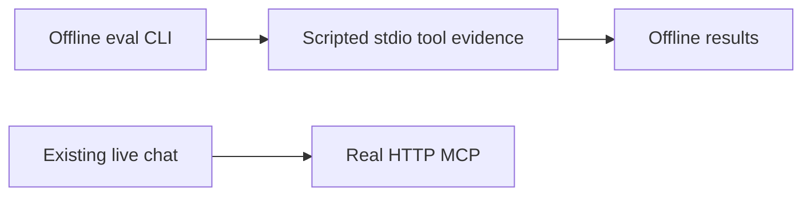
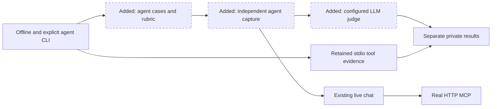
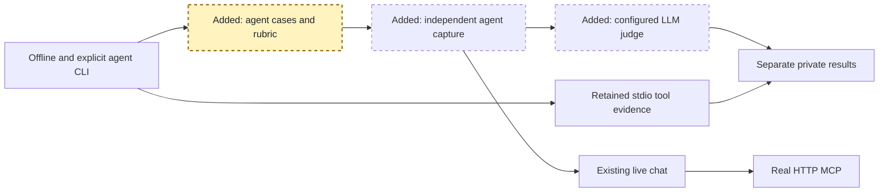
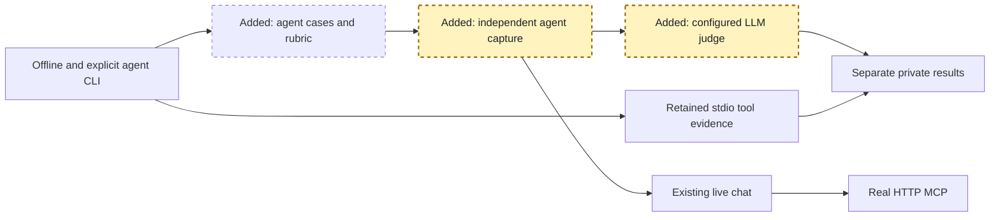
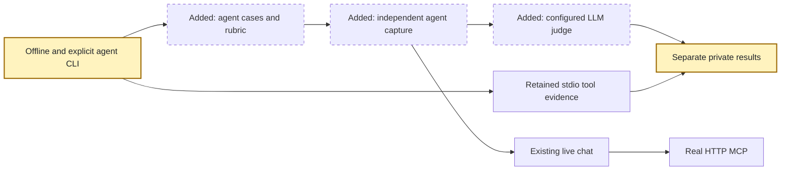
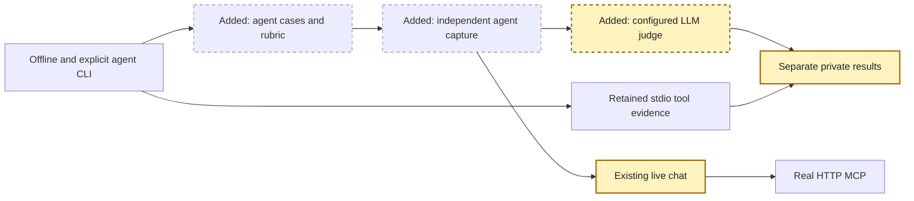

<!-- markdownlint-disable-file -->
# RPI Plan: Agent-level evaluation

## Task Metadata

* Task ID: agent-level-evaluation
* Task slug: agent-level-evaluation
* Plan date: 2026-10-14

## Executive Summary

Implement the approved CLI-only agent evaluation through the real isolated
chat/MCP runtime with independent policy evidence and a separately configured
LLM judge. The first configured user-executed live attempt failed with model/judge
service errors and revealed HTTPX 2 transport observation missing from P02-T01.
Reopened capture/regression work preserves the approved requirements and the
one completed critique. P04-T01 still requires actual passing live evidence.

### What You May Not Know

The denied prompt does not call the target model. Its real HTTP error text is
still evaluated by the judge. Policy `pre_input` is captured as lifecycle `input`.

## Phase Checklist

### Before

### After

The extension adds a separate execution/judging path without replacing the
existing offline path or changing the browser button.

<!-- rpi:phase id=P01 -->
### [x] P01: Establish independent agent contracts

Goals:
* Prompts, references, rubrics, evidence, and judge results have independent
  versioned identities and cannot redefine a pass from observed output.

Dependencies:
* Completed research and approved nested specs.

Highlighted work: strict case/rubric/reference contracts (Yakka T008).

<!-- rpi:task id=P01-T01 -->
#### [x] P01-T01: Define the cases, rubrics, evidence, and independent oracle

Goals:
* The two approved cases and caller-supplied synthetic prompt lists resolve to
  strict independent policy and response expectations.

Requirements:
* FR-001, FR-004, FR-005, NFR-001, NFR-003.
* Preserve the exact default-policy allow/input-deny scenario and four criterion
  IDs per category. Reject duplicate IDs, missing coverage, unexpected fields,
  malformed types, mismatched versions, incomplete probes, and invalid labels.
* The trusted reference is only the requested synthetic account projection.
* Before inference or persistence, bound and inspect caller-supplied
  prompt/rubric text for accidental credentials, private contact/identity data,
  and full-profile payloads; errors must not echo rejected content.
* Judge results bind to case/rubric identity, contain four unique criterion
  labels, brief rationale, and genuine response excerpts or omission markers.

Details:
* Add `evaluation/agent_contracts.py` and packaged `agent-prompts.jsonl` and
  `agent-rubric.json`; reuse `StrictModel`, build digests, and private writers.
* Case category selects a fixed policy/tool oracle, not response-derived
  expectations. Capture lifecycle `input` for YAML stage `pre_input`.
* Keep new evidence separate from the existing portable grader schema.

References:
* [docs/spec/eval/design.md](../../../docs/spec/eval/design.md): agent oracle and rubric.
* [src/ai_governance_harness/evaluation/evaluator.py](../../../src/ai_governance_harness/evaluation/evaluator.py): strict contracts.
* [.copilot-tracking/research/2026-10-14/agent-level-evaluation-research.md](../../research/2026-10-14/agent-level-evaluation-research.md): C1, C4, C6, C9.

Dependencies:
* None.

<!-- rpi:phase id=P02 -->
### [ ] P02: Capture the real agent and judge its public response

Goals:
* Collection preserves normal governed execution and independent probes;
  judging is a separate bounded network operation with strict output validation.

Dependencies:
* P01.

Highlighted work: original-code capture and separate judge (T009-T010).

<!-- rpi:task id=P02-T01 -->
#### [ ] P02-T01: Collect isolated real chat/MCP evidence

Goals:
* A single public chat turn has attributable complete execution evidence from
  fresh processes, with no influence on the active development server.

Requirements:
* FR-002, FR-004, FR-005, NFR-001, NFR-002, NFR-003, NFR-004.
* Use production app builders, real MCP, and actual target tool selection.
* Count original backend calls, logical SDK target calls, actual inference HTTP
  attempts (including retries), and each MCP coroutine
  invocation once; capture permitted operation return facts without full data.
* Input denial retains HTTP 403/error text, exact rule and policy digest,
  zero target/tool/backend calls, and no later request work.
* Startup/request/shutdown timeouts and observer failures remain explicit errors;
  every child is closed and reaped even on cancellation.

Details:
* Add evaluation-only `agent_worker.py` and `agent_collector.py`.
* Reuse private fixture/policy copying and the existing isolation allowlist.
  Pass only explicitly selected model endpoint/auth configuration to chat/judge,
  never to the MCP data process; disable dotenv/export.
* Retain distinct per-process event ordering and explicit capture readiness;
  request completion must be positively observed rather than inferred from
  server availability or an empty event list.
* Reserve loopback listening sockets for owned subprocesses to avoid port races.
  Current execution is Linux; socket-inheritance compatibility must be explicit
  rather than silently falling back to an unrelated listening service.
* Correct observation for the actual Foundry SDK default
  `openai.DefaultHttpxClient` / `httpx2.Client.send`, retaining the existing
  HTTPX 1 path. A ready HTTPX 1 hook alone does not certify HTTPX 2 completeness.

References:
* [src/ai_governance_harness/evaluation/worker.py](../../../src/ai_governance_harness/evaluation/worker.py): transparent observation pattern.
* [src/ai_governance_harness/chat/app.py](../../../src/ai_governance_harness/chat/app.py): production API.
* [src/ai_governance_harness/mcp_server/http_app.py](../../../src/ai_governance_harness/mcp_server/http_app.py): production MCP app.

Dependencies:
* P01-T01.

<!-- rpi:task id=P02-T02 -->
#### [x] P02-T02: Implement bounded structured response judging

Goals:
* The configured real judge evaluates the exact public answer/denial without
  changing the rubric or supplying enforcement authority.

Requirements:
* FR-003, FR-004, FR-005, NFR-001, NFR-002, NFR-003.
* Bound the judge request; disable judge retries that could hide a failed
  attempt; use `store=False`, no tools, versioned system instructions, and
  serialized untrusted case data.
* Reject malformed/schema-invalid output, wrong identities/criteria, invented
  excerpts, empty answers, content filtering, and service/authentication errors.
* Error outcomes have no numeric score. All four labels must pass for 1.0.

Details:
* Add `agent_judge.py`; use the existing Foundry helper within an isolated worker
  environment and preserve existing supported client paths.
* SDK signature compatibility is locally established; service compatibility
  remains a live acceptance gate.
* Keep judge request counts separate from blocked target work.

References:
* [src/ai_governance_harness/foundry_client.py](../../../src/ai_governance_harness/foundry_client.py): supported connection helper.
* [docs/spec/eval/design.md](../../../docs/spec/eval/design.md): instruction/output contract.

Dependencies:
* P01-T01.

<!-- rpi:phase id=P03 -->
### [ ] P03: Wire the explicit command and regression checks

Goals:
* A repeatable CLI retains honest per-stage results and cannot run live models
  implicitly or report a policy/judge error as success.

Dependencies:
* P02.

Highlighted work: CLI/reporting and local contract regression evidence (T011 and
the local-check portion of T012).

<!-- rpi:task id=P03-T01 -->
#### [x] P03-T01: Wire consent, independent gates, controls, and private reports

Goals:
* An explicit agent command records both baseline gates and calibration controls
  without changing the existing offline command/button.

Requirements:
* FR-004, FR-005, FR-006, NFR-001 through NFR-004.
* Validate prompts/rubric/target/judge/timeout and `--confirm-inference` before
  any subprocess capable of inference.
* Run the synthetic/private-content gate before writing prompts/rubric or
  sending case data to either model; validate retained public/judge text as
  well. Instruction-like case/response content remains untrusted data.
* Every expected case/control must have exactly one identifiable outcome.
  Controls cannot replace baselines; means cannot hide violations.
* Persist fresh mode-0700 bundles and mode-0600 files in an agent subdirectory.
  Save partial errors without credentials/full profiles; never overwrite.

Details:
* Add `agent_runner.py` and extend the existing CLI with `agent`, dataset/rubric,
  target/judge deployment, endpoint, output, timeout, and inference-confirmation
  options. Keep `local`/`managed` dispatch unchanged.
* Include known-good answer/refusal controls and the declared bad-response
  controls; retain their expected failed criterion IDs and actual judge outcomes.

References:
* [src/ai_governance_harness/evaluation/__main__.py](../../../src/ai_governance_harness/evaluation/__main__.py): existing CLI.
* [src/ai_governance_harness/evaluation/artifacts.py](../../../src/ai_governance_harness/evaluation/artifacts.py): private artifact helpers.
* [src/ai_governance_harness/chat/evaluations.py](../../../src/ai_governance_harness/chat/evaluations.py): unchanged offline reader.

Dependencies:
* P02-T01, P02-T02.

<!-- rpi:task id=P03-T02 -->
#### [ ] P03-T02: Prove contracts, isolation, failure handling, and offline parity

Goals:
* Targeted tests prevent false passes and demonstrate real app/MCP wiring with
  explicitly simulated target/judge boundaries.

Requirements:
* FR-001 through FR-006, NFR-001 through NFR-004.
* Cover bad identities/versions/types, missing/duplicate/skipped output, wrong
  policy/stage/rule, unhealthy zero probes, multiple awaits, service/JSON errors,
  cancellation/cleanup, inherited-export/credential isolation, and no-consent.
* Favorable judge output must not override enforcement failure.
* Label simulations as simulations; no live-acceptance or judge-reliability
  claim follows from test doubles.
* Privacy preflight rejects credential/private/full-profile sentinels before
  model/client construction and artifact persistence without disclosing them.

Details:
* Test ownership: retain every existing test; exact removals: none. Maximum
  additions: four focused test modules plus related CLI/UI assertions in their
  existing modules. Do not add a new runner or framework.
* Canonical targets: five new evaluation modules and two packaged JSON assets.
  Generated targets: ignored private result bundles only.
* Semantic coverage: allowed facts/refusal and rubric/policy gates.
  Regression coverage: current stdio and browser offline job behavior.
* Use existing pytest/Ruff/package-build tooling. Escalate from focused tests
  only when a failure needs a broader baseline.

Guidance:
* [src/ai_governance_harness/evaluation/agent_runner.py](../../../src/ai_governance_harness/evaluation/agent_runner.py)
  exposes `run_agent`, `response_controls`, and `accepted_outcomes`.
  Internal worker-command overrides are test-only and label reports simulated.
* [tests/test_agent_evaluation_runner.py](../../../tests/test_agent_evaluation_runner.py)
  exercises actual CLI/route/MCP/judge orchestration and reuses the focused
  collection/judge modules as explicitly simulated external HTTP bootstraps.
* Existing model simulations explicitly supply HTTPX 1 clients. Add coverage
  for the installed Foundry factory's default HTTPX 2 client so those tests
  cannot stand in for a different runtime transport.

References:
* [tests/test_evaluation_collection.py](../../../tests/test_evaluation_collection.py): process and observer checks.
* [tests/test_chat_evaluations.py](../../../tests/test_chat_evaluations.py): fixed offline API.
* [tests/test_chat_service.py](../../../tests/test_chat_service.py): model test-double patterns.

Dependencies:
* P03-T01.

<!-- rpi:phase id=P04 -->
### [ ] P04: Accept live results and finalize the demonstration documentation

Goals:
* The final milestone is grounded in actual configured target/judge evidence,
  not local test doubles or the deferred managed milestone.

Dependencies:
* P03 and explicit live-inference confirmation/configuration.

Highlighted work: actual live evidence and final documentation (T012-T013).

<!-- rpi:task id=P04-T01 -->
#### [ ] P04-T01: Retain authorized live acceptance and finalize documentation

Goals:
* Both live baselines and declared judge controls have honest retained outcomes
  and repeatable documentation.

Requirements:
* FR-006, NFR-002 through NFR-004.
* Both baselines pass independent policy and all rubric criteria; controls
  produce their intended outcomes with no incidental service errors.
* Verify actual model access without provisioning or changing roles.
* Keep T012/T013 incomplete if confirmation/access or actual acceptance is absent.

Details:
* Add directly related README usage documentation during implementation, clearly
  label any pending live acceptance, and finalize it only after accepted evidence.
* Record actual commands/checks and private evidence paths in the changes record.
  Do not place tracking-artifact links in public documentation.

References:
* [README.md](../../../README.md): existing evaluation instructions.
* [docs/spec/eval/plan.md](../../../docs/spec/eval/plan.md): separate managed/agent milestones.

Dependencies:
* P03-T02 and explicit user inference confirmation.

## User Decisions and Requirements

### Confirmed User Direction

* Preserve `docs/spec/eval/` and use direct RPI implementation.
* Use the default-policy factual profile and personal-advice denial pair.
* Use four mandatory binary criteria per case with independent policy gates.
* Use live configured target/judge models only after separate inference consent.
* Preserve the offline CLI and Run Eval button; keep managed work deferred.
* The post-implementation live-consent interaction was cancelled; no inference
  approval was recorded at that time. The user subsequently executed a configured
  live run, which failed; saved evidence requires capture/diagnostic corrections
  before P04-T01 can be accepted.

### Planning Decisions and Feedback

| Group | Decision | Status | Owner | Rationale/evidence | Planning impact |
|---|---|---|---|---|---|
| D1 | Direct RPI from nested specs | Confirmed | User | Explicit selected route | No native Yakka modification or dispatch |
| D2 | Original-code probes and separate agent contracts | Selected | Coordinator | Research C1-C9 | Local integration planning is supported |
| D3 | Actual inference | Deferred pending confirmation | User | Existing consent boundary | Live acceptance cannot be simulated |

## Planning Readiness and Next Step

| Field | Record |
|---|---|
| Planning execution and readiness | Complete; capture/regression correction reopened after failed live evidence; PC-001 remains resolved |
| Decision participation | Coordinator owns ordinary technical choices within confirmed scope; user retains scope/inference choices |
| Blockers | Actual default HTTPX 2 transport is unobserved; target/judge service errors remain unresolved |
| Latest critique | [.copilot-tracking/reviews/plans/2026-10-14/agent-level-evaluation-plan-critique.md](../../reviews/plans/2026-10-14/agent-level-evaluation-plan-critique.md), Complete/Revise with PC-001 resolved |
| Relevant research | [.copilot-tracking/research/2026-10-14/agent-level-evaluation-research.md](../../research/2026-10-14/agent-level-evaluation-research.md) |
| Plan | `.copilot-tracking/plans/2026-10-14/agent-level-evaluation-plan.md` |
| Changes-record role | `.copilot-tracking/changes/2026-10-14/agent-level-evaluation-changes.md` records implementation and local validation evidence |
| Continuation owner | Direct RPI coordinator authorized by user |
| Required gates or confirmations | Correct P02-T01 and revalidate P03-T02; further assistant-initiated live operations require consent |
| Next action | Correct actual transport coverage and bounded provider diagnostics; do not claim live acceptance from failed evidence |

## Goals

Measure actual agent answers and legitimate denials without confusing response
quality with policy enforcement.

## Scope and Non-Goals

In scope: strict prompt/rubric contracts, independent reference facts, isolated
runtime collection, structured judging, explicit CLI/reporting, tests, and docs.
Non-goals: UI changes, deployment, managed runs, production certification,
arbitrary data, new agent frameworks, and modifying the native Yakka extension.

## Functional Requirements

* FR-001: Versioned prompt lists and fixed case rubrics support the two approved cases (E009, E011).
* FR-002: Real isolated chat/MCP collection proves actual allow/input-deny behavior (E009-E010).
* FR-003: A separately configured judge returns strictly validated criterion results (E011-E012).
* FR-004: Each case requires both independent enforcement and all applicable judge criteria (E013).
* FR-005: Private artifacts and explicit CLI configuration preserve provenance and consent (E014-E015).
* FR-006: Controls and repeatable documentation separate mocked checks from real live acceptance (E016).

## Non-Functional Requirements

* NFR-001: Strict types/identity and complete probes prevent false passes.
* NFR-002: Startup/request/judge/shutdown are bounded and child processes are reaped.
* NFR-003: Credentials, full profiles, and intermediate transcripts are never persisted.
* NFR-004: Offline CLI/UI, managed runner, and normal application policy behavior remain unchanged.
* All NFR thresholds are binary contract conditions verified by the targeted
  tests and retained outcomes, not newly invented performance SLOs.

## Risks and Open Questions

| Priority | Item | Affected work | Smallest action/evidence | Owner |
|---|---|---|---|---|
| High | Actual deployment access and structured judge output remain unverified | Live acceptance | Explicit inference configuration/confirmation and retained actual run | User/coordinator |
| Medium | Coroutine resumptions can overcount tool calls | Runtime capture | Count each original coroutine frame once; test multiple awaits | Implementer |
| Medium | Artifact response content must remain synthetic/minimal | Capture/reporting | Bound public response and reject unexpected sensitive/full-profile payloads | Implementer |
| Medium | Owned listening socket inheritance is platform-specific | P02-T01 | Test current Linux support and report unsupported platforms explicitly | Implementer |

## Dependencies

Existing Python, MCP, OpenAI, Uvicorn, Pydantic, pytest, and Ruff are installed.
No remote access is needed for local contract and simulated-model integration.

## Sources

* [docs/spec/eval/discover.md](../../../docs/spec/eval/discover.md): E009-E016.
* [docs/spec/eval/design.md](../../../docs/spec/eval/design.md): agent contracts and rubric.
* [docs/spec/eval/plan.md](../../../docs/spec/eval/plan.md): T008-T013 and retained gates/history.
* [.copilot-tracking/research/2026-10-14/agent-level-evaluation-research.md](../../research/2026-10-14/agent-level-evaluation-research.md): current C1-C9.

## Critique Disposition

* Critique depth and provenance: standard; default.
* Critique execution: Complete; verdict Revise, resolved without repeat assessment.
* Initial attempt consumed: yes.
* Recovery attempt consumed: no.
* Attempt ID/kind: agent-level-evaluation-initial-20261014 / initial.
* Candidate hash before reservation metadata:
  `60c67b95bee371a661c90ab7d26ce081f936e71a0ae98f16382f3749ebfa3921`.
* Candidate boundary: the saved plan before this reservation-only change;
  task metadata, phases, requirements, decisions, and tests are unchanged.
* Output: `.copilot-tracking/reviews/plans/2026-10-14/agent-level-evaluation-plan-critique.md`.
* Current-run provenance: uninterrupted reservation-to-activation by the direct
  coordinator in session `056fe23f-8ad3-4ae6-8253-3bf6d116a7cb`.
* Recovery eligibility/consent: not applicable; no prior assessment or recovery.

| Finding | Disposition | Action owner | Exact resolving evidence | Decision route | Residual risk |
|---|---|---|---|---|---|
| PC-001 | Resolved | Planner | P01-T01/P03-T01 require private input/output preflight; P03-T02 requires before-client/before-write rejection tests | Direct correction within confirmed scope | Deterministic detection is bounded, not comprehensive DLP |

## Artifact Self-Check

Candidate sections, stable IDs, task requirements/dependencies, no-removal test
ownership, exact canonical/generated boundaries, all requirement references,
and dual-theme-aware diagram source styling are complete. Diagram rendering in
light/dark preview is unavailable and is not claimed. No material user scope
decision remains. The one initial standard final-candidate critique is complete;
PC-001 is resolved in the authoritative task requirements. No second critique ran.

## Follow-Up Items

* Repository-wide formatting currently reports 33 other files needing changes;
  an unchanged tracked example reproduces at `HEAD`. Evaluation/related changed
  files are formatted and lint-clean. Existing repository owners can assess
  that unrelated cleanup separately; it is not part of active feature acceptance.
* Foundry scoring of a container-hosted MAF agent remains a compatible future
  integration through a capture adapter and precomputed response/evidence
  mappings. The user asked about compatibility, not expansion of this increment.
  Preserve independent contracts and the existing managed tool grader. Actual
  MAF/Azure Container Apps capture and managed agent-response judging are outside active
  completion; a future adapter and managed criterion/output mapping need review.
* Official platform evidence checked 2026-10-14:
  https://learn.microsoft.com/en-us/azure/foundry/observability/how-to/cloud-evaluation-datasets
  supports precomputed input; https://learn.microsoft.com/en-us/azure/foundry/concepts/evaluation-evaluators/custom-evaluators
  supports code/prompt evaluators and documents no network access in code graders.
  The local collector/judge client is not a deployable network-capable code grader.

## Handoff

* Authoritative implementation handoff: Planning Readiness and Next Step.
