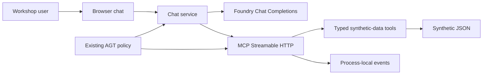
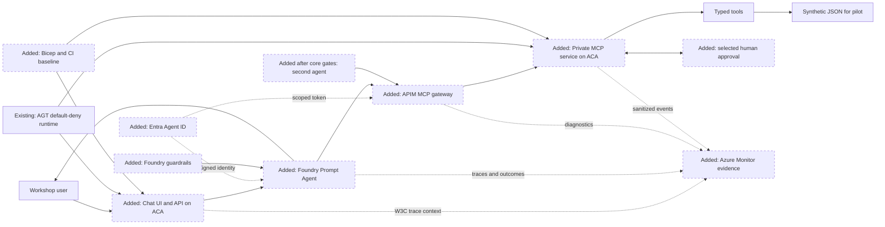
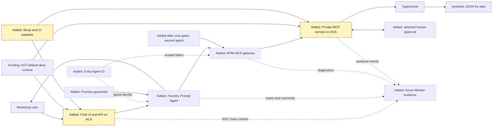
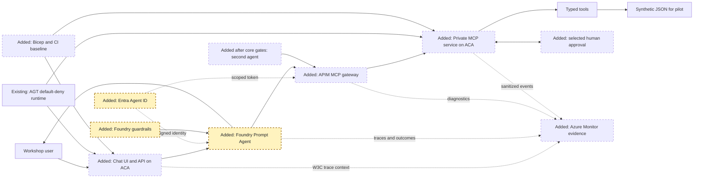
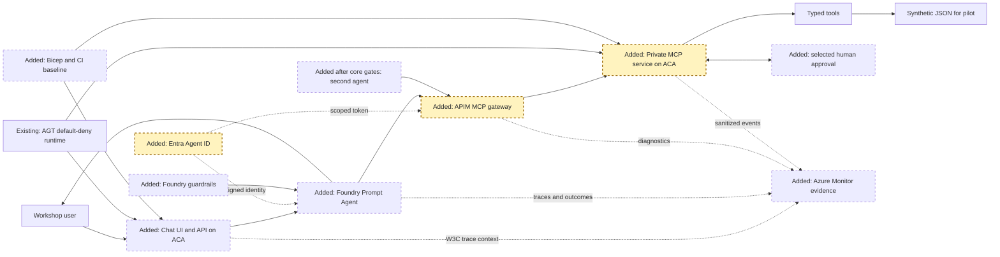
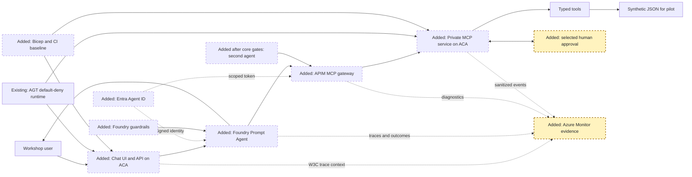
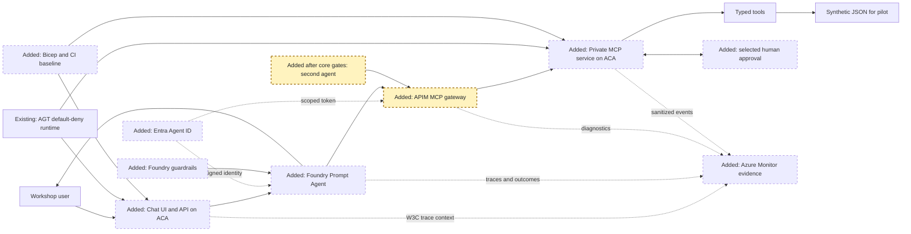

<!-- markdownlint-disable-file -->
# RPI Plan: Align Harness with Azure-Native Workshop Architecture

## Task Metadata

* Task ID: `azure-native-migration-2026-10-14`
* Task slug: `azure-native-services-migration`
* Plan date: 2026-10-14

## Executive Summary

* Bottom line: Extend the current synthetic-data harness toward the workshop architecture by adopting a Foundry Prompt Agent, Entra agent identity, an APIM-backed MCP gateway, and correlated Azure Monitor evidence in gated releases.
* Why this matters: The current code is a local-style chat orchestrator with direct Foundry and MCP calls. The target architecture places Azure-native identity, guardrails, gateway controls, approval, and evidence across that flow.
* Planning result: Partial and not ready for implementation. Existing ACA and MCP security work is still planned, while Foundry agent, gateway feature availability, identity propagation, and audit-retention decisions need a deployment preflight.
* Confidence and uncertainty: High confidence in the repo delta and release order. Azure region, tenant, Foundry agent/MCP feature availability, Entra Agent ID support, APIM MCP streaming and elicitation behavior, and business-approved audit retention are not established by repository evidence.

### What You May Not Know

* The existing `real-mcp-server` plan already owns the baseline ACA, Bicep, remote MCP authentication, and App Insights work. This plan depends on that baseline and avoids duplicating it.
* The Dockerfile still starts the local two-process supervisor. It is not the final hosted workload entrypoint.
* The current chat calls Foundry Chat Completions and directly calls MCP. It does not invoke a Foundry Prompt Agent or pass an authenticated agent token to MCP.
* The image describes some gateway capabilities as preview. The deployment must verify current tenant, region, protocol, and client support before selecting the Foundry AI Gateway path; APIM remains the concrete gateway fallback.

## Phase Checklist

### Before

### After

The target keeps the synthetic MCP business-service boundary and existing AGT
policy. It adds a Foundry-hosted agent, agent identity, a single APIM-backed
gateway, Foundry guardrails, explicit approval for selected actions, and
correlated Azure-native evidence. The second agent is conditional stretch work.

The release sequence is incremental: P01 validates platform capability and the
inherited host baseline; P02 moves the synthetic pilot to the Foundry agent and
agent identity; P03 routes MCP through APIM; P04 verifies approval and evidence
before core promotion; P05 adds another agent only after core gates pass. Each
release keeps synthetic data and a rollback path.

<!-- rpi:phase id=P01 -->
### [ ] P01: Preflight and hosted baseline gate

Goals:
* Establish evidence-backed service choices and confirm that the existing hosted MCP foundation is complete before any new Azure service or production identity is introduced.

Dependencies:
* None. Existing deployment-plan work is a prerequisite to later phases, not assumed complete.

Highlighted work: confirm the existing ACA, Bicep, CI, and MCP boundaries before extending them.

<!-- rpi:task id=P01-T01 -->
#### [ ] P01-T01: Verify Foundry and gateway capabilities

Goals:
* Select an agent-to-MCP route only after proving support in the intended tenant, region, and protocol combination.

Requirements:
* `FR-001`, `FR-002`, `FR-004`, `NFR-002`, `NFR-005`.
* Acceptance: The decision record names the Foundry Agent Service type, Entra Agent ID capability, APIM or Foundry AI Gateway option, supported region, token audience/scope, and any preview dependency. It records an explicit supported fallback or a stop condition.
* Acceptance: The selected route supports the required MCP Streamable HTTP/session behavior and the selected approval interaction without bypassing the gateway.
* Verification: Platform owner confirms current product/region availability and quota; run a synthetic-tool protocol spike through the proposed Foundry-to-gateway-to-MCP route, including authentication failure and unsupported elicitation behavior.

Details:
* The supplied architecture describes Foundry AI Gateway MCP support as preview and identifies APIM as its implementation. Treat current availability and compatibility as a release gate, not as a guaranteed feature.
* If the agent service cannot invoke the MCP endpoint through the gateway with the required identity and session behavior, retain the direct Chat Completions path for the pilot and return the architecture decision for owner review. Do not silently claim target alignment.

References:
* [src/ai_governance_harness/chat/service.py](../../../src/ai_governance_harness/chat/service.py): Current direct Foundry and MCP call path.
* [src/ai_governance_harness/mcp_server/config.py](../../../src/ai_governance_harness/mcp_server/config.py): Current hosted MCP auth and region requirements.
* Workshop architecture supplied in the conversation: Foundry Prompt Agent, Entra Agent ID, and APIM-backed MCP gateway target.

Dependencies:
* None.

<!-- rpi:task id=P01-T02 -->
#### [ ] P01-T02: Verify the inherited ACA foundation

Goals:
* Use one evidenced and repeatable ACA deployment baseline instead of creating competing infrastructure plans.

Requirements:
* `FR-002`, `FR-006`, `NFR-001`, `NFR-002`, `NFR-005`.
* Acceptance: The existing plan's remote-security and deployment tasks are completed with implementation evidence for Bicep, container build, Entra ingress protection, private or protected MCP ingress, health probes, managed identity, and rollback.
* Acceptance: Chat and MCP use packaged synthetic data only; no `.env` file, key, connection string, or credential is present in the image or deployment artifact.
* Verification: Review the existing plan's changes record and deployed resource configuration; run container scan, readiness/liveness probes, authenticated ingress smoke tests, and an MCP call using the selected identity.

Details:
* The current [real-mcp-server plan](../../plans/2026-10-14/real-mcp-server-plan.md) owns baseline ACA, Bicep, remote MCP security, and deployment. Its P03/P04 tasks are unchecked in the available artifact. Complete or explicitly supersede that work before treating ACA as an available platform.
* Do not duplicate the existing plan's infrastructure tasks here. Any necessary change to its topology belongs in a reviewed update to that plan or a superseding architecture decision.

References:
* [.copilot-tracking/plans/2026-10-14/real-mcp-server-plan.md](../../plans/2026-10-14/real-mcp-server-plan.md): Baseline security and ACA deployment task ownership.
* [Dockerfile](../../../Dockerfile): Current image starts the development supervisor and is not yet a hosted startup contract.
* [README.md](../../../README.md): Current local services and Azure hosting status.

Dependencies:
* None; must complete before `P02-T01` deployment.

<!-- rpi:task id=P01-T03 -->
#### [ ] P01-T03: Approve audit and retention requirements

Goals:
* Distinguish operational telemetry from durable business audit evidence before enabling retention or exporting sensitive events.

Requirements:
* `FR-005`, `FR-006`, `NFR-003`, `NFR-004`, `NFR-006`; product `NFR-007`.
* Acceptance: Business data and security/compliance owners approve event categories, permitted attributes, retention, access roles, deletion, incident retrieval, and whether immutable storage is required.
* Acceptance: The policy explicitly separates Application Insights/Log Analytics operational diagnostics from any durable audit system and retains the repository rule that prompts, tool payloads, member identifiers, credentials, and raw claims are excluded.
* Verification: Review the approved data-classification and retention record; test representative serialized events against a denylist of prohibited fields before any Azure export is enabled.

Details:
* Product `NFR-007` says audit events, retention periods, and record access remain to be specified. Do not take retention durations from an earlier plan as approved policy.
* Use Application Insights and Log Analytics for operational traces, metrics, and logs. Add Azure Storage with immutability only if owners require tamper-resistant audit retention and approve its access, deletion, and residency model.

References:
* [docs/project-planning/member-wealth-insights-agent.md](../../../docs/project-planning/member-wealth-insights-agent.md): `NFR-007` and its open audit requirements.
* [docs/planning/adrs/0003-minimize-identity-and-governance-telemetry.md](../../../docs/planning/adrs/0003-minimize-identity-and-governance-telemetry.md): Existing in-memory, privacy-safe telemetry boundary.
* [src/ai_governance_harness/mcp_server/telemetry.py](../../../src/ai_governance_harness/mcp_server/telemetry.py): Current allowlisted log attributes and optional Azure Monitor export.

Dependencies:
* None.

<!-- rpi:phase id=P02 -->
### [ ] P02: Foundry agent and identity pilot release

Goals:
* Move model orchestration behind the selected Foundry Prompt Agent while preserving user-visible behavior, the exact MCP tool allowlist, and default-deny governance.

Dependencies:
* `P01-T01` confirms feature compatibility.
* `P01-T02` confirms the hosted application baseline.

Highlighted work: `AGENT`, `ID`, and `GUARD` establish the hosted model and identity control plane.

<!-- rpi:task id=P02-T01 -->
#### [ ] P02-T01: Configure the Foundry Prompt Agent

Goals:
* Make a versioned Foundry Prompt Agent the model-facing component for the existing chat workflow.

Requirements:
* `FR-001`, `FR-004`, `NFR-001`, `NFR-003`, `NFR-005`.
* Acceptance: The agent has bounded instructions and only the approved MCP tool definitions; unknown or unregistered tools cannot execute.
* Acceptance: Foundry-native guardrails are configured at supported agent/model intervention points, with the existing advice, scope, disclosure, and AGT checks retained as complementary controls.
* Acceptance: The previous direct Chat Completions path remains available for rollback until the hosted-agent vertical slice meets parity checks.
* Verification: Run synthetic conversation evaluations for each tool, unknown-tool denial, advice-boundary cases, unsupported whole-of-wealth claims, refusal/content-filter cases, and empty or malformed model output; compare expected outcomes to the direct-call baseline.

Details:
* This task changes the current orchestration boundary, not the synthetic MCP data contract. Keep the MCP tool schema and policy action names stable unless a separately reviewed contract change is required.
* Do not represent Foundry guardrails as replacing the repository's runtime governance policy. Record model, agent version, evaluation set, and guardrail configuration in deployment evidence.

References:
* [src/ai_governance_harness/chat/service.py](../../../src/ai_governance_harness/chat/service.py): Existing Chat Completions tool loop and output sanitization.
* [src/ai_governance_harness/governance/policies/default.yaml](../../../src/ai_governance_harness/governance/policies/default.yaml): Exact default-deny action policy.
* [src/ai_governance_harness/guardrails/advice_filter.py](../../../src/ai_governance_harness/guardrails/advice_filter.py): Existing deterministic advice and scope guardrails.

Dependencies:
* `P01-T01`
* `P01-T02`

<!-- rpi:task id=P02-T02 -->
#### [ ] P02-T02: Bind the agent to Entra Agent ID

Goals:
* Give each deployed agent a distinct authenticated identity that can be authorized downstream without exposing raw identity claims to telemetry.

Requirements:
* `FR-003`, `FR-005`, `NFR-001`, `NFR-002`, `NFR-003`.
* Acceptance: Agent identity, token issuer, tenant, audience, scope, token lifetime, and authorized tool/resource mapping are documented and enforced; an unrecognized identity or token fails closed.
* Acceptance: The workload's Foundry permissions use managed identity or the supported agent identity mechanism with least privilege; secrets are not stored in application settings when identity-based access is available.
* Verification: Exercise valid, missing, expired, wrong-tenant, wrong-audience, wrong-scope, and revoked-authorization cases in an integration environment; verify logs contain only approved authentication outcomes or opaque identifiers.

Details:
* `DefaultAzureCredential` currently authenticates the application to Foundry; it is not itself an Entra Agent ID. Do not infer per-agent identity from the app's managed identity.
* Confirm how the hosted agent obtains and presents a token to the chosen MCP gateway. If the product supplies an identity bridge, validate its trust and claim contract; never authorize from arbitrary caller-supplied headers.

References:
* [src/ai_governance_harness/foundry_client.py](../../../src/ai_governance_harness/foundry_client.py): Current application credential path.
* [src/ai_governance_harness/governance/context.py](../../../src/ai_governance_harness/governance/context.py): Existing bounded workload and identity context.
* [src/ai_governance_harness/governance/agt-runtime-evidence.yaml](../../../src/ai_governance_harness/governance/agt-runtime-evidence.yaml): Current hosted principal propagation limitation.

Dependencies:
* `P01-T01`
* `P02-T01`

<!-- rpi:task id=P02-T03 -->
#### [ ] P02-T03: Adapt chat to invoke the hosted agent

Goals:
* Keep the current browser experience while switching its backend from direct model/tool orchestration to a versioned Foundry agent invocation.

Requirements:
* `FR-001`, `FR-005`, `NFR-001`, `NFR-005`.
* Acceptance: The chat API preserves request bounds, safe error responses, output guardrails, readiness reporting, and the current synthetic-data user journey.
* Acceptance: Hosted startup is non-interactive, binds only required interfaces, does not open a browser, and reports readiness only when required configuration and dependencies are valid.
* Verification: Run existing chat and governance tests plus hosted-agent contract tests; start the container without `.env`, verify `/health/live` and `/health/ready`, and complete profile, cohort/FUM, refusal, and policy-denial smoke scenarios.

Details:
* Replace the development supervisor as the production container command. The current [Dockerfile](../../../Dockerfile) starts `ai-governance-dev`, which is designed for local orchestration.
* Keep the browser-facing same-origin API. The browser must not call Foundry, APIM, or MCP directly.

References:
* [Dockerfile](../../../Dockerfile): Current local supervisor entrypoint.
* [src/ai_governance_harness/chat/__main__.py](../../../src/ai_governance_harness/chat/__main__.py): Current Uvicorn startup contract.
* [src/ai_governance_harness/chat/app.py](../../../src/ai_governance_harness/chat/app.py): Current browser API and health routes.

Dependencies:
* `P01-T02`
* `P02-T01`
* `P02-T02`

<!-- rpi:phase id=P03 -->
### [ ] P03: Gateway-integrated core release

Goals:
* Give the Foundry agent one authenticated, policy-controlled MCP entry point and prevent bypass of the gateway to the business service.

Dependencies:
* `P01-T01` confirms gateway/protocol support.
* `P01-T02` confirms private backend deployment.
* `P02-T01` and `P02-T02` establish the agent and its identity.

Highlighted work: `ID`, `GATE`, and `MCP` enforce the authenticated, non-bypassable tool route.

<!-- rpi:task id=P03-T01 -->
#### [ ] P03-T01: Publish the MCP API through APIM

Goals:
* Route agent MCP discovery and calls through one gateway while keeping the business service private.

Requirements:
* `FR-002`, `FR-005`, `FR-006`, `NFR-001`, `NFR-002`, `NFR-005`.
* Acceptance: Foundry agent configuration points to the APIM MCP endpoint; no public direct route to the backend is available, and APIM applies the approved authentication, rate, network, and diagnostic policies.
* Acceptance: The gateway preserves the required MCP protocol version, session behavior, streaming, and approval channel; no policy rewrite changes tool names, schemas, or error semantics.
* Verification: Through the gateway, test tool listing and invocation, valid and invalid tokens, rate limit, backend outage, connection reset, protected-resource discovery, and approval elicitation. Repeat the direct-backend test from an untrusted network and confirm it is unreachable.

Details:
* Prefer APIM as the stable API boundary. Enable a Foundry AI Gateway MCP integration only when `P01-T01` proves its support and operations contract for this tenant and region.
* If APIM cannot proxy the necessary MCP protocol behavior, stop this release for architecture review. A temporary direct route may be used only in a non-production private spike and must not be described as satisfying the target gateway control.

References:
* [src/ai_governance_harness/chat/service.py](../../../src/ai_governance_harness/chat/service.py): Current direct MCP URL and client behavior.
* [src/ai_governance_harness/mcp_server/http_app.py](../../../src/ai_governance_harness/mcp_server/http_app.py): Current Streamable HTTP endpoint and discovery routes.
* [docs/planning/adrs/0005-present-governance-through-a-same-origin-observability-panel.md](../../../docs/planning/adrs/0005-present-governance-through-a-same-origin-observability-panel.md): Current same-origin browser-to-chat boundary.

Dependencies:
* `P01-T01`
* `P01-T02`
* `P02-T01`
* `P02-T02`

<!-- rpi:task id=P03-T02 -->
#### [ ] P03-T02: Authorize agent identity at MCP

Goals:
* Ensure the MCP business service authorizes the verified agent identity and requested tool rather than trusting network location alone.

Requirements:
* `FR-003`, `NFR-001`, `NFR-002`, `NFR-003`.
* Acceptance: The backend validates a cryptographically authenticated identity or a documented trusted gateway token contract, validates issuer/tenant/audience/scope, and maps identity to an explicit tool permission set.
* Acceptance: Missing, invalid, replayed, or over-privileged identity requests fail before tool execution; bypass attempts cannot call the backend directly.
* Verification: Integration tests cover each invalid token/claim case and each tool permission; deployed tests prove the gateway forwards only the validated identity contract and that MCP rejects spoofed headers.

Details:
* The current `MCP_HOSTED` validation trusts platform identity headers in its intended platform boundary. Reassess that trust when APIM becomes the front door; do not retain a header contract whose issuer is no longer the trusted authenticator.
* Preserve the default-deny policy in [default.yaml](../../../src/ai_governance_harness/governance/policies/default.yaml). Keep identity attributes bounded and avoid adding raw claims, member IDs, or tokens to governance events.

References:
* [src/ai_governance_harness/mcp_server/security.py](../../../src/ai_governance_harness/mcp_server/security.py): Current hosted principal validation.
* [src/ai_governance_harness/mcp_server/config.py](../../../src/ai_governance_harness/mcp_server/config.py): Current audience, tenant, scope, and resource configuration.
* [src/ai_governance_harness/governance/policies/default.yaml](../../../src/ai_governance_harness/governance/policies/default.yaml): Exact action allowlist and default deny.

Dependencies:
* `P02-T02`
* `P03-T01`

<!-- rpi:phase id=P04 -->
### [ ] P04: Core controls and promotion gate

Goals:
* Demonstrate guardrails, selected human approval, privacy-safe distributed evidence, and operational recovery across the complete Azure request path.

Dependencies:
* `P02` and `P03` are complete.
* `P01-T03` audit/retention decisions are approved.

Highlighted work: `HUMAN` and `MON` make approval outcomes and service evidence visible.

<!-- rpi:task id=P04-T01 -->
#### [ ] P04-T01: Gate selected high-risk tools with approval

Goals:
* Require an explicit, attributable human decision before configured high-risk tool actions proceed.

Requirements:
* `FR-004`, `FR-005`, `NFR-001`, `NFR-003`.
* Acceptance: Product/security owners name the protected actions and approver roles; no blanket approval is inferred from chat access or agent identity.
* Acceptance: Decline, cancellation, timeout, invalid response, unsupported elicitation client, and missing approval all prevent execution and return a clear sanitized outcome.
* Verification: Run end-to-end approval accept/decline/cancel/timeout/unsupported-client scenarios through the selected Foundry/APIM/MCP path; assert the protected operation executes only after approved authorization and is recorded without approval form contents.

Details:
* The current `prepare_member_outreach_case` flow is an elicitation example for a synthetic read-only preparation action; it performs no member contact. Keep that property unless a separately approved business capability and threat model authorize a side effect.
* If Foundry Agent Service cannot complete MCP elicitation, define an explicit approval API/UI at the chat boundary. Never silently retry without approval or treat tool annotations as enforcement.

References:
* [src/ai_governance_harness/mcp_server/server.py](../../../src/ai_governance_harness/mcp_server/server.py): Existing approval annotations and elicitation flow.
* [src/ai_governance_harness/chat/static/index.html](../../../src/ai_governance_harness/chat/static/index.html): Current browser UI has no general approval workflow.
* Workshop architecture supplied in the conversation: human approval cross-cutting control.

Dependencies:
* `P02-T01`
* `P03-T01`
* `P03-T02`

<!-- rpi:task id=P04-T02 -->
#### [ ] P04-T02: Correlate Azure-native operational evidence

Goals:
* Let operators follow one request across chat, Foundry, APIM, and MCP while keeping telemetry privacy-safe and separating diagnostics from regulated audit records.

Requirements:
* `FR-005`, `FR-006`, `NFR-003`, `NFR-004`, `NFR-006`; product `NFR-007`.
* Acceptance: W3C trace context is propagated across every network boundary; the user-safe response exposes a trace reference, and logs join to the trace without using raw prompts, member identifiers, tool arguments/results, tokens, or raw claims.
* Acceptance: Azure Monitor/Application Insights receives service traces, metrics, and logs for the chat, Foundry agent, APIM, and MCP components with `service.name`, `service.version`, `deployment.environment`, `telemetry.sdk.name`, `telemetry.sdk.language`, and `telemetry.sdk.version`; metric attributes remain bounded and durations use seconds.
* Acceptance: Operational retention, audit retention, access roles, deletion, and optional immutable storage match the owner-approved `P01-T03` decision.
* Verification: Execute one synthetic request and retrieve one end-to-end trace with Foundry, APIM, and MCP spans plus the approved tool outcome; inject unique synthetic PII markers and prove they are absent from logs, spans, metric dimensions, and audit records.

Details:
* Current MCP telemetry optionally configures Azure Monitor, while chat and MCP correlation IDs are generated independently and governance history is process-local. Add context propagation and configure export for each service rather than assuming the existing event panel is durable evidence.
* Follow OpenTelemetry semantic conventions where available, W3C Trace Context for propagation, and the repository telemetry vocabulary. Use low-cardinality metrics; place per-request correlation only in traces/logs, not metric labels.
* Use Azure Monitor/Application Insights and Log Analytics for operations. Use immutable Azure Storage only if the approved audit requirements require it; do not treat ordinary diagnostic logs as tamper-proof audit records.

References:
* [src/ai_governance_harness/mcp_server/telemetry.py](../../../src/ai_governance_harness/mcp_server/telemetry.py): Current MCP-only Azure Monitor setup and allowlist.
* [src/ai_governance_harness/governance/events.py](../../../src/ai_governance_harness/governance/events.py): Bounded process-local governance events.
* [docs/planning/adrs/0003-minimize-identity-and-governance-telemetry.md](../../../docs/planning/adrs/0003-minimize-identity-and-governance-telemetry.md): Privacy and non-persistence constraints.
* [OpenTelemetry semantic conventions](https://opentelemetry.io/docs/specs/semconv/): Standard instrumentation vocabulary.
* [W3C Trace Context](https://www.w3.org/TR/trace-context/): Cross-service trace propagation contract.

Dependencies:
* `P01-T03`
* `P02-T03`
* `P03-T01`
* `P03-T02`

<!-- rpi:task id=P04-T03 -->
#### [ ] P04-T03: Pass core release security and operations gates

Goals:
* Promote only a tested synthetic-data release with known access, failure, latency, scaling, and rollback behavior.

Requirements:
* `FR-001` through `FR-006`; `NFR-001` through `NFR-006`; product `NFR-001`, `NFR-002`, `NFR-003`, `NFR-004`, and `NFR-007` where their measurement conditions are approved.
* Acceptance: CI passes unit, contract, policy, security, container, and integration suites; a deployed smoke suite proves the complete identity-to-agent-to-gateway-to-MCP path and denies unknown tools and invalid identities.
* Acceptance: Readiness/liveness, APIM/backend outage, Foundry timeout, gateway throttling, replica restart, deployment rollback, and alert routing behave as documented; no release uses real member data.
* Acceptance: Product latency and availability targets are measured against an approved workload and observation window; do not claim NFR conformance while BRD measurement conditions remain open.
* Verification: Record test results, image digest/SBOM, deployment revision, configuration references without secrets, sample trace IDs, alert test result, and rollback evidence in the changes record; obtain engineering, security, and business-owner approval before pilot promotion.

Details:
* The BRD gives initial latency and availability targets but leaves measurement boundaries and load profile open. Resolve those before using them as release gates.
* Keep rollout staged by environment and revision. Maintain a tested rollback to the prior direct-chat pilot until the new Foundry agent and gateway path has passed the same synthetic scenario suite.

References:
* [docs/project-planning/member-wealth-insights-agent.md](../../../docs/project-planning/member-wealth-insights-agent.md): Product latency, availability, privacy, and audit requirements.
* [tests/](../../../tests/): Existing automated verification suite.
* [security/vex/README.md](../../../security/vex/README.md): Existing dependency and exception-management posture.

Dependencies:
* `P02-T01`
* `P02-T02`
* `P02-T03`
* `P03-T01`
* `P03-T02`
* `P04-T01`
* `P04-T02`

<!-- rpi:phase id=P05 -->
### [ ] P05: Add multi-agent orchestration as a stretch release

Goals:
* Add a second bounded business agent only after the single-agent architecture has passed all core release gates, reusing the same identity, APIM, MCP, approval, and evidence contracts.

Dependencies:
* `P04-T03` is complete and core release gates are green.

Highlighted work: `A2` adds an agent; `GATE` remains the common approved tool path.

<!-- rpi:task id=P05-T01 -->
#### [ ] P05-T01: Add the second business agent

Goals:
* Support a second narrowly scoped agent without introducing a new data-access or governance bypass.

Requirements:
* `FR-001`, `FR-002`, `FR-003`, `FR-006`, `NFR-001`, `NFR-003`, `NFR-004`.
* Acceptance: Each agent has its own registered identity, policy scope, instructions, evaluation suite, and explicitly allowed tools; both route through the same APIM MCP gateway and backend authorization contract.
* Acceptance: Sequential or handoff orchestration cannot elevate privileges, transfer unapproved data, bypass human approval, or lose the end-to-end trace reference.
* Verification: Run cross-agent authorization tests, wrong-agent/wrong-tool denials, synthetic data separation checks, handoff failure tests, and trace queries for each orchestration pattern; compare latency and error rates to the approved single-agent baseline.

Details:
* Candidate agents are Member Insights and FUM Insights from the workshop architecture. Keep multi-agent orchestration out of core scope until `P04-T03` is green.
* Prefer the Microsoft Agent Framework only after validating its hosting, identity, and tracing compatibility with the selected Foundry/APIM path.

References:
* Workshop architecture supplied in the conversation: sequential or handoff multi-agent stretch goal.
* [src/ai_governance_harness/mcp_server/server.py](../../../src/ai_governance_harness/mcp_server/server.py): Shared current MCP tool catalog.
* [src/ai_governance_harness/governance/policies/default.yaml](../../../src/ai_governance_harness/governance/policies/default.yaml): Current workload-bound default-deny policy.

Dependencies:
* `P04-T03`

## User Decisions and Requirements

### Confirmed User Direction

* Create a new implementation plan from the prior repository findings and supplied workshop architecture.
* Prefer native Azure services where practical and deliver the work through incremental releases.
* Give implementation tasks checkable acceptance conditions and verification methods.
* Do not change application source or deploy Azure resources as part of this planning task.

### Planning Decisions and Feedback

| Group | Decision or feedback item | Status | Owner | Rationale or input needed | Evidence | Planning impact |
|---|---|---|---|---|---|---|
| D1 | Use ACA as the workload host and APIM as the MCP gateway; enable Foundry AI Gateway only if its MCP feature set is available and verified. | Confirmed direction | User/platform owner | The existing deployment plan selects ACA and the supplied diagram selects APIM-backed gateway control. Tenant, region, protocol, and preview availability remain verification gates. | Existing MCP deployment plan and workshop architecture | Gates `P01-T01`, `P01-T02`, `P03-T01`, and `P03-T02`; stop or return for review if required protocol/security behavior is unsupported. |
| D2 | Target a Foundry Prompt Agent with Entra Agent ID; verify the supported invocation and token flow before replacing direct Chat Completions. | Confirmed direction | User/platform owner | The supplied diagram specifies these components. Repository evidence only establishes direct Chat Completions with `DefaultAzureCredential`; it does not establish Agent Service MCP transport, elicitation, identity, or authorization support in the target tenant. | Workshop architecture, current Foundry client and chat service | Gates `P01-T01`, `P02-T01`, and `P02-T02`; preserve the existing path until a passing vertical slice. |
| D3 | Approve audit event scope, retention, access, and whether immutable storage is required. | Deferred | Business data owner and security/compliance owner | Product NFR `NFR-007` explicitly leaves audit events, retention, and access unspecified. Operational telemetry and compliance evidence may need different stores and retention. | Product requirements and telemetry ADR | Gates `P01-T03` and `P04-T02`; no claim of a durable audit trail before approval. |

### Planning Participation

* Decision participation: User-owned, standalone planning default. Material Azure feature and retention decisions remain explicit gates rather than assumed approvals.
* Planning delegation: Adaptive, default provenance. The phases are sequential and share one architecture boundary, so the primary planner authors them together without delegation.

## Planning Readiness and Next Step

| Field | Record |
|---|---|
| Planning execution and readiness | Partial; not ready for implementation because D1-D3 require tenant/platform and business-owner evidence. |
| Blockers | Foundry/APIM MCP capability and identity support; approved audit retention/access posture. |
| Latest critique | Not run. |
| Relevant research | Not activated; supplied architecture, prior planning artifacts, and repository code establish the current design delta. |
| Plan | `.copilot-tracking/plans/2026-10-14/azure-native-services-migration-plan.md` |
| Changes-record role | `.copilot-tracking/changes/2026-10-14/azure-native-services-migration-changes.md` will record implementation evidence if this plan proceeds. |
| Continuation owner | User, standalone planning. |
| Required gates or confirmations | Resolve D1-D3 through `P01` preflight before committing to Azure resources or production evidence claims. |
| Next action | Complete the preflight tasks, record confirmed service choices and audit requirements, then reassess readiness. |

## Goals

* Establish an incremental migration path from direct local-style Foundry calls to the supplied Foundry Prompt Agent and MCP gateway architecture.
* Preserve the typed, default-deny MCP tool boundary and synthetic-data scope while Azure-native identity, gateway, and observability controls are added.
* Make each release independently verifiable and prevent preview-feature assumptions from becoming production dependencies.

## Scope and Non-Goals

### In Scope

* A prerequisite-aware release plan building on the existing ACA/MCP deployment plan.
* Azure Container Apps, Azure AI Foundry, Microsoft Entra Agent ID, Azure API Management, Azure Monitor/Application Insights, and optional Key Vault or immutable Storage where requirements justify them.
* Changes needed to startup, configuration, identity propagation, gateway routing, approval, trace correlation, privacy-safe telemetry, deployment automation, and operational verification.
* Synthetic-data pilot validation before any live member data integration.

### Non-Goals

* Provisioning Azure resources, changing application code, or deploying during planning.
* Connecting production member data, choosing business risk thresholds, or claiming regulatory approval.
* Making multi-agent orchestration part of the core release; it remains a stretch goal.

## Functional Requirements

* FR-001: Route user requests through the selected Foundry Prompt Agent and only its explicitly approved MCP tools.
* FR-002: Route remote MCP traffic through one governed APIM boundary, or a verified Foundry AI Gateway backed by APIM, before the business service.
* FR-003: Authenticate and authorize the agent identity at the gateway and MCP service; do not trust caller-supplied identity headers.
* FR-004: Require explicit human approval for configured high-risk tools and fail closed on decline, cancellation, unsupported client, timeout, or invalid approval.
* FR-005: Return a user-safe result, block reason, or approval outcome with a trace/correlation reference that joins the service flow.
* FR-006: Make approved tool calls, governance decisions, outcomes, and service health observable through Azure-native operational services without collecting raw prompts or member payloads.

## Non-Functional Requirements

* NFR-001: Governance remains default-deny at model, gateway, and tool execution boundaries; missing identity, policy, or dependency readiness blocks protected actions.
* NFR-002: All user-facing ingress uses HTTPS; private MCP connectivity and deployment region meet the approved data-residency boundary.
* NFR-003: Logs, spans, metrics, and audit records exclude raw prompts, tool arguments/results, member identifiers, tokens, and raw identity claims unless an approved redaction contract explicitly permits a field.
* NFR-004: Cross-service traces use W3C trace context and bounded attributes; metrics use low-cardinality dimensions and UCUM units; telemetry resources identify service, version, environment, and SDK.
* NFR-005: Container health probes, scaling, session behavior, dependency timeouts, rollback, and alerting are validated before production promotion.
* NFR-006: Audit retention, access, deletion, and immutability are explicitly approved by data and security owners before durable audit evidence is enabled.

## Risks and Open Questions

| Priority | Type | Risk, question, or planning item | Affected work | Impact | Smallest action or evidence needed | Owner |
|---|---|---|---|---|---|---|
| High | Open question | Does the target Foundry Agent Service support the required MCP Streamable HTTP/session and elicitation behavior, Entra Agent ID, and required region? | `P01-T02`, `P02-T01` | Could change the agent-to-MCP integration and approval design. | Run a tenant/region feature check and protocol spike with a synthetic tool before decommissioning direct Chat Completions. | Platform owner |
| High | Open question | Does APIM or the selected Foundry AI Gateway preserve MCP streaming, sessions, protected-resource discovery, and elicitation? | `P01-T01`, `P03-T01` | Gateway may need a supported APIM configuration or a staged direct-to-private-MCP fallback. | Verify product support and run protocol conformance tests through the gateway. | Platform owner |
| High | Open question | What audit events, retention period, access roles, deletion process, and tamper-resistance level are required? | `P01-T03`, `P04-T02` | Determines Application Insights/Log Analytics scope versus a dedicated audit store. | Obtain approved requirements from business data owner and security/compliance. | Business/security owners |
| Medium | Risk | The existing development launcher and Dockerfile are not suitable as a hosted production startup contract. | `P02-T03` | Browser launch, loopback binds, and coupled process lifecycle may prevent reliable ACA health and scaling. | Define explicit hosted entrypoints and test container lifecycle/probes. | Engineering |
| Medium | Risk | A Foundry-hosted agent, APIM gateway, and MCP backend can each emit overlapping telemetry with different identifiers. | `P04-T01` | Evidence may be incomplete or misleading if trace context is not propagated. | Define end-to-end trace contract and prove one trace through all hops. | Observability owner |
| Medium | Open question | Does the human-approval client path exist in the Foundry Prompt Agent experience, or is a separate business UI required? | `P04-T03` | Elicitation currently exists for a single synthetic read-only action, not universal approval. | Verify client support and define explicit high-risk action list and approval UX. | Product/security owner |

## Dependencies

* [`.copilot-tracking/plans/2026-10-14/real-mcp-server-plan.md`](../../plans/2026-10-14/real-mcp-server-plan.md): Its P03/P04 work owns baseline hosted MCP security, telemetry, ACA, Bicep, and deployment. Confirm completion and implementation evidence before using those controls as deployed facts.
* [`.copilot-tracking/plans/2026-10-14/integrate-agent-governance-toolkit-plan.md`](../../plans/2026-10-14/integrate-agent-governance-toolkit-plan.md): Defines the current required default-deny runtime layer. Keep it complementary to Foundry guardrails unless maintainers explicitly revise that architecture.
* [docs/project-planning/member-wealth-insights-agent.md](../../../docs/project-planning/member-wealth-insights-agent.md): Product needs synthetic-data pilot, advice boundaries, regional controls, and currently unresolved audit requirements.

## Sources

* [README.md](../../../README.md): Current local run model, direct Foundry/MCP flow, synthetic-data boundary, and statement that Azure hosting automation is planned.
* [Dockerfile](../../../Dockerfile): Current container starts the development supervisor.
* [src/ai_governance_harness/chat/service.py](../../../src/ai_governance_harness/chat/service.py): Current Chat Completions, direct MCP calls, and snapshot proxy.
* [src/ai_governance_harness/foundry_client.py](../../../src/ai_governance_harness/foundry_client.py): Current project client and `DefaultAzureCredential` integration.
* [src/ai_governance_harness/mcp_server/config.py](../../../src/ai_governance_harness/mcp_server/config.py): Hosted MCP configuration, region checks, and auth contract.
* [src/ai_governance_harness/mcp_server/server.py](../../../src/ai_governance_harness/mcp_server/server.py): Current typed MCP tools and one elicitation-based approval example.
* [docs/planning/adrs/0003-minimize-identity-and-governance-telemetry.md](../../../docs/planning/adrs/0003-minimize-identity-and-governance-telemetry.md): Privacy and bounded-retention contract.
* [docs/planning/adrs/0005-present-governance-through-a-same-origin-observability-panel.md](../../../docs/planning/adrs/0005-present-governance-through-a-same-origin-observability-panel.md): Current same-origin operator panel and partial-state behavior.
* Workshop architecture supplied in the conversation: target flow, cross-cutting controls, and stretch goals.

## Critique Disposition

* Critique candidate identity: `azure-native-migration-2026-10-14`, initial implementation-plan draft.
* Critique depth and provenance: Standard is the default; no critique dispatched because planning readiness is partial and material Azure capability and audit decisions remain gated.
* Critique execution: Not run.
* Single invocation consumed: No.

| Critique run and finding | Disposition | Action owner | Exact resolving evidence | Decision route | Plan response or residual risk |
|---|---|---|---|---|---|
| None | Not applicable | Planner | No critique execution | Not applicable | Reassess critique only after P01 decisions are resolved and the plan is implementation-ready. |

## Artifact Self-Check

* [x] Executive summary, What You May Not Know, and Phase Checklist precede supporting planning details.
* [x] User direction, decisions, readiness, goals, scope, requirements, risks, dependencies, and sources align with the phase checklist.
* [x] Each functional and non-functional requirement is cited by at least one task.
* [x] Each phase has Goals, Dependencies, a phase diagram, and tasks; each task has Goals, Requirements, Details, References, and Dependencies.
* [x] Every implementation task includes acceptance conditions and a verification method inside its Requirements block.
* [x] Before shows only the existing local flow; After shows the target architecture and labels planned components as added.
* [x] Phase diagrams reuse After nodes and relationships and identify highlighted work in prose.
* [x] Mermaid initialization uses the required font family and size; highlighted nodes have explicit readable colors.
* [ ] Mermaid diagram rendering was not visually checked in light and dark themes in this planning task.
* [x] Decision gates, risks, owners, and next actions are recorded; no Azure availability or audit-retention assumptions are presented as confirmed facts.
* [x] Delegation is recorded as adaptive; sequential phases were authored together without delegation.
* [x] No source code or Azure resources were changed by this plan-authoring task.
* Checked sections: `Task Metadata`, `Executive Summary`, `Phase Checklist`, `User Decisions and Requirements`, `Planning Readiness and Next Step`, `Goals`, `Scope and Non-Goals`, `Functional Requirements`, `Non-Functional Requirements`, `Risks and Open Questions`, `Dependencies`, `Sources`, `Critique Disposition`, `Follow-Up Items`, and `Handoff`.
* Missing or limited sections: Tenant-specific Azure capability evidence and owner approval for audit retention remain required before implementation readiness.

## Follow-Up Items

* Plan live member-data integration separately after the synthetic pilot, with approved source systems, data access roles, privacy review, and operational ownership. This plan intentionally stops at packaged synthetic data; business data and platform owners must define the next scope.

## Handoff

* Implementation handoff is blocked pending `D1`-`D3` evidence and decisions captured through `P01`.
* Do not start `/rpi-implement` yet. After the preflight updates this plan to implementation-ready, use `/rpi-implement` with `.copilot-tracking/changes/2026-10-14/azure-native-services-migration-changes.md` as the changes-record path.