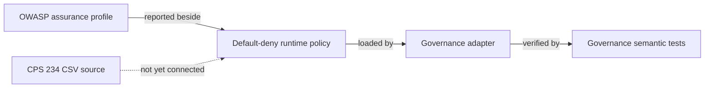
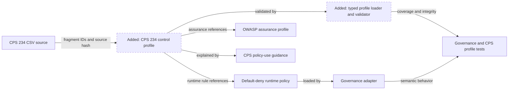
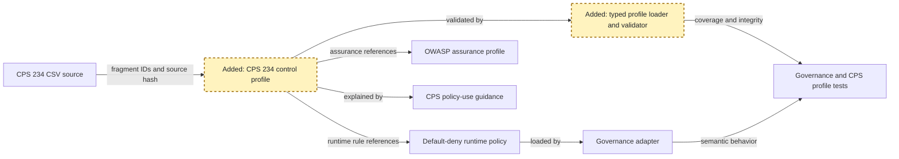
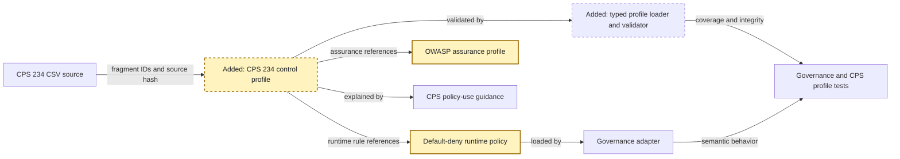
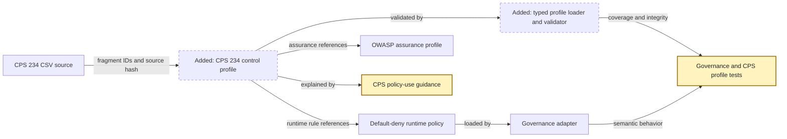

<!-- markdownlint-disable-file -->
# RPI Plan: CPS 234 policy reuse pilot

## Task Metadata

* Task ID: cps-standards-policy-reuse
* Task slug: cps-standards-policy-reuse
* Plan date: 2026-10-14

## Executive Summary

* Bottom line: Plan a CPS 234 pilot that preserves the standard as source evidence, maps applicable clauses to a machine-readable control profile, and derives only deterministic runtime rules that the harness can evaluate and test.
* Why this matters: The pilot can improve policy traceability without claiming that action-level YAML proves broad regulatory compliance.
* Planning result: Complete and implementation-ready after resolving the standard critique findings.
* Confidence and uncertainty: The architecture and repository boundaries are well supported. Legal applicability, authoritative-source validation, and accountable control approval remain human-owned gates.

### What You May Not Know

* CPS 234 obligations extend beyond runtime access decisions into accountability, asset classification, third-party oversight, incident response, testing, audit, and notification.
* CPS 230 is intentionally outside the pilot and remains a follow-up after the CPS 234 model is validated.

## Phase Checklist

### Before



### After



The pilot adds a traceable CPS 234 control profile and validation contract around the existing runtime policy. It does not rewrite regulatory prose into action conditions or change allow/deny behavior by default.

<!-- rpi:phase id=P01 -->
### [ ] P01: Establish the CPS 234 profile contract

Goals:
* Establish a typed, reviewable contract that separates source clauses, derived controls, implementation references, evidence, applicability, and approval state.

Dependencies:
* Confirmed CPS 234 pilot direction and completed research.



Highlighted work: the profile schema, source identity, clause mapping contract, and validator boundary.

<!-- rpi:task id=P01-T01 -->
#### [ ] P01-T01: Define typed source and control-profile models

Goals:
* Provide a loader that can parse the non-standard CPS CSV preamble and validate a machine-readable profile without executing or interpreting untrusted source text.

Requirements:
* `FR-001`, `FR-002`, `NFR-001`, `NFR-002`, `NFR-005`
* Add no more than one production Python module, expected at `src/ai_governance_harness/governance/cps_profile.py`.
* The profile contract must represent source identity, clause references, relationship type, applicability, control objective, enforcement class, implementation references, evidence references, status, limitation, owner, and review metadata.
* Relationship type must distinguish `direct`, `derived`, `supporting`, and `not_applicable`.
* Enforcement class must distinguish `runtime_policy`, `application_control`, `operational_process`, `assurance`, and `manual_governance`.
* Source text must remain inert data and must never be evaluated as a condition or instruction.
* Cross-layer references must use this contract:

```yaml
kind: runtime_rule | repository_path | python_symbol | assurance_control
path: repository/relative/path
id: optional-rule-or-control-id
symbol: optional-qualified-symbol
```

* `runtime_rule` resolves `id` in the rules of [src/ai_governance_harness/governance/policies/default.yaml](../../../src/ai_governance_harness/governance/policies/default.yaml); `repository_path` requires an existing repository-relative path; `python_symbol` requires an existing Python path and resolvable qualified symbol; `assurance_control` resolves `id` in a safe-loaded evidence file.

Details:
* Parse the standard title and generated timestamp before the CSV header, then preserve fragment IDs and content hashes.
* Reject duplicate fragment IDs, missing referenced fragments, unsupported enum values, invalid relative references, and approval-shaped states without reviewer metadata.
* Keep profile validation independent of Toolkit internals so ADR 0001's adapter boundary remains intact.

References:
* [src/ai_governance_harness/governance/policies/CPS_Standards/cps_234_information_security _2026-10-14.csv](../../../src/ai_governance_harness/governance/policies/CPS_Standards/cps_234_information_security%20_2026-10-14.csv): source shape and clause identity.
* [src/ai_governance_harness/governance/context.py](../../../src/ai_governance_harness/governance/context.py): typed, privacy-minimized governance model pattern.
* [.copilot-tracking/research/2026-10-14/cps-standards-policy-reuse-research.md](../../research/2026-10-14/cps-standards-policy-reuse-research.md):
  * Findings establish the source, interpretation, and enforcement separation.

Dependencies:
* None.

<!-- rpi:task id=P01-T02 -->
#### [ ] P01-T02: Author the CPS 234 pilot control profile

Goals:
* Map every substantive CPS 234 clause in the pilot to an explicit control disposition so no requirement silently disappears or becomes an unsupported runtime rule.

Requirements:
* `FR-002`, `FR-003`, `NFR-001`, `NFR-004`
* Add one canonical profile at `src/ai_governance_harness/governance/evidence/cps-234.yaml`.
* The control-coverage denominator is every fragment from `Item-13` through `Item-36`, including lettered child fragments. Each denominator fragment requires at least one control mapping or an explicit, reasoned exclusion.
* Catalogue `Item-a`, the objectives fragment, and heading-only rows as source context, but exclude them from the control-coverage denominator.
* Preserve parent-child clause relationships and avoid duplicating child requirements as independent obligations without rationale.
* Mark all mappings as draft until an accountable compliance or legal reviewer validates source authority, applicability, and interpretation.
* Label exact technologies such as TLS 1.3 or AES-256 as derived organisational controls unless an authoritative clause directly establishes them.

Details:
* Group controls by accountability, capability and policy framework, asset classification, control implementation, incident response, testing, audit, third parties, and notification.
* Permit many-to-many mappings between clauses and controls.
* Record CPS 230 extension candidates only in Follow-Up Items, not in this profile.

References:
* [src/ai_governance_harness/governance/evidence/owasp-agentic.yaml](../../../src/ai_governance_harness/governance/evidence/owasp-agentic.yaml): existing status, evidence, and limitation pattern.
* [docs/project-planning/member-wealth-insights-agent-brd.md](../../../docs/project-planning/member-wealth-insights-agent-brd.md): existing CPS 234 claims that need direct-versus-derived traceability.
* [.copilot-tracking/research/2026-10-14/cps-standards-policy-reuse-research.md](../../research/2026-10-14/cps-standards-policy-reuse-research.md):
  * C2 and C10 identify clause domains and the derived-control wording risk.

Dependencies:
* `P01-T01`.

<!-- rpi:phase id=P02 -->
### [ ] P02: Connect controls to enforcement and assurance

Goals:
* Make the control profile verifiably refer to real runtime rules, application controls, operational evidence, and known gaps without changing runtime semantics by implication.

Dependencies:
* `P01`.



Highlighted work: clause-to-control classification and verified references to existing enforcement and assurance surfaces.

<!-- rpi:task id=P02-T01 -->
#### [ ] P02-T01: Classify clause enforcement and evidence

Goals:
* Ensure each mapped control says how it is implemented or evidenced and what the harness cannot prove.

Requirements:
* `FR-003`, `FR-004`, `FR-005`, `NFR-001`, `NFR-003`, `NFR-004`
* Runtime-policy mappings must reference an existing rule name in [src/ai_governance_harness/governance/policies/default.yaml](../../../src/ai_governance_harness/governance/policies/default.yaml).
* Application-control mappings must reference an existing symbol or repository path.
* Assurance and operational mappings must name the required evidence type, accountable owner, review cadence, and current limitation.
* Gaps must remain explicit and must not be converted into `implemented` status because related telemetry exists.
* Exact removals: none.
* Runtime policy semantic changes: none by default in the pilot. Any discovered need for a new condition becomes a separately approved follow-up unless it is already supported by confirmed requirements and current policy inputs.

Details:
* Candidate existing supporting controls include exact-agent default deny, authenticated hosted transport, bounded governance context, sandbox gating, privacy-safe telemetry, incident-shaped logs, timeout and circuit breaking, approval elicitation, and semantic deny tests.
* Classify these as supporting or derived controls rather than claiming that any one mechanism satisfies a whole CPS clause.
* Do not add CPS-specific fields to `GovernanceContext` unless a selected deterministic rule requires them and the data source, privacy boundary, and test contract are all approved.

References:
* [src/ai_governance_harness/governance/policies/default.yaml](../../../src/ai_governance_harness/governance/policies/default.yaml): runtime rule names and current semantics.
* [src/ai_governance_harness/governance/engine.py](../../../src/ai_governance_harness/governance/engine.py): action, context, and data evaluation boundary.
* [src/ai_governance_harness/governance/evidence/owasp-agentic.yaml](../../../src/ai_governance_harness/governance/evidence/owasp-agentic.yaml): current assurance evidence and limitations.
* [docs/planning/adrs/0002-enforce-default-deny-at-every-execution-boundary.md](../../../docs/planning/adrs/0002-enforce-default-deny-at-every-execution-boundary.md): binding default-deny architecture.

Dependencies:
* `P01-T02`.

<!-- rpi:task id=P02-T02 -->
#### [ ] P02-T02: Validate cross-layer references and coverage

Goals:
* Fail validation when the CPS profile drifts from its source, references missing runtime rules or evidence, or leaves a substantive clause without a disposition.

Requirements:
* `FR-004`, `FR-005`, `NFR-002`, `NFR-004`
* Validation must compare source metadata and fragment hashes, clause coverage, unique control IDs, profile references, and runtime policy rule names.
* Validation must apply the kind-specific cross-layer reference contract from `P01-T01`.
* Validation must reject absolute paths and repository traversal.
* A profile may report only `draft`, `implemented`, `partial`, `gap`, or `not_applicable`; any future approved or attested state requires explicit reviewer identity and review date fields.
* Validation output must identify the control or fragment ID without echoing unrestricted source text.
* Canonical targets are the supplied CPS 234 CSV for raw source and `src/ai_governance_harness/governance/evidence/cps-234.yaml` for interpreted controls. Generated targets: none.

Details:
* Reuse YAML safe loading and bounded summaries where appropriate.
* Keep validation callable from tests without starting chat, MCP, Foundry, or the Toolkit engine.

References:
* [src/ai_governance_harness/governance/snapshot.py](../../../src/ai_governance_harness/governance/snapshot.py): safe YAML loading and bounded evidence summary pattern.
* [src/ai_governance_harness/governance/policies/default.yaml](../../../src/ai_governance_harness/governance/policies/default.yaml): canonical runtime-rule target.

Dependencies:
* `P01-T01`, `P02-T01`.

<!-- rpi:phase id=P03 -->
### [ ] P03: Prove semantics and document the governance boundary

Goals:
* Provide regression evidence and operator guidance showing what the CPS profile proves, what it does not prove, and how future policy changes remain controlled.

Dependencies:
* `P01`, `P02`.



Highlighted work: profile tests, unchanged runtime semantic proof, and CPS usage guidance.

<!-- rpi:task id=P03-T01 -->
#### [ ] P03-T01: Add profile and regression tests

Goals:
* Prove source parsing, complete mapping, cross-layer integrity, failure behavior, and preservation of current runtime policy semantics.

Requirements:
* `FR-001`, `FR-003`, `FR-004`, `FR-005`, `NFR-002`, `NFR-003`, `NFR-004`, `NFR-005`
* Add no more than one test module, expected at `tests/test_cps_profile.py`.
* Semantic coverage must include valid profile load, malformed preamble, duplicate or missing fragments, stale hash, each cross-layer reference kind, missing policy rule, missing Python symbol, missing evidence record, incomplete `Item-13` through `Item-36` coverage including a missing child fragment, unsupported status, traversal rejection, and bounded error output.
* Regression coverage must continue to prove known-action allow, unknown-action deny, evaluation-failure deny, and shared-gateway enforcement through [tests/test_governance.py](../../../tests/test_governance.py).
* Validation evidence must include targeted pytest results, strict Toolkit policy lint for the unchanged or deliberately changed runtime policy, and repository lint for touched Python.

Details:
* Prefer small fixtures built from temporary files for negative cases rather than duplicating the full CPS source.
* If implementation changes `default.yaml`, add exact semantic tests for every changed rule and run the existing governance suite. Otherwise record the policy digest and strict-lint result as unchanged-runtime evidence.

References:
* [tests/test_governance.py](../../../tests/test_governance.py): existing semantic and privacy test patterns.
* [pyproject.toml](../../../pyproject.toml): pytest and Ruff toolchain.
* [README.md](../../../README.md): strict Toolkit policy-lint command.

Dependencies:
* `P02-T02`.

<!-- rpi:task id=P03-T02 -->
#### [ ] P03-T02: Document CPS policy use and approval gates

Goals:
* Give maintainers a clear workflow for updating source material, reviewing mappings, adding deterministic runtime rules, collecting evidence, and avoiding compliance overclaims.

Requirements:
* `FR-006`, `NFR-001`, `NFR-003`
* Update [README.md](../../../README.md) rather than adding a separate general-purpose guide.
* Document the three layers, direct-versus-derived mapping, human review boundary, validation command, source refresh process, and the rule that runtime telemetry is supporting evidence rather than full CPS conformance proof.
* State that legal applicability, source authority, interpretation approval, and regulatory notification decisions remain owned by accountable human functions.
* Correct or qualify CPS 234 wording in [docs/project-planning/member-wealth-insights-agent-brd.md](../../../docs/project-planning/member-wealth-insights-agent-brd.md) only if its current wording is in the approved implementation scope; otherwise record it as a follow-up for the BRD owner.

Details:
* Explain that new runtime conditions require explicit policy inputs, semantic tests, strict lint, and adherence to ADR 0001 and ADR 0002.
* Include the CPS 230 extension as future work, not as pilot completion.

References:
* [README.md](../../../README.md): current governance and validation guidance.
* [docs/planning/adrs/0001-contain-agent-governance-toolkit-behind-a-versioned-adapter.md](../../../docs/planning/adrs/0001-contain-agent-governance-toolkit-behind-a-versioned-adapter.md): adapter and upgrade boundary.
* [docs/planning/adrs/0002-enforce-default-deny-at-every-execution-boundary.md](../../../docs/planning/adrs/0002-enforce-default-deny-at-every-execution-boundary.md): runtime-policy requirements.

Dependencies:
* `P03-T01`.

## User Decisions and Requirements

### Confirmed User Direction

* Research and planning only. Do not implement or modify policy behavior.
* Use a CPS 234 pilot rather than planning CPS 230 and CPS 234 together.
* Use separate source, control-profile, and executable-enforcement layers.
* Stop before Implementation and wait for an explicit user request.

### Planning Decisions and Feedback

| Group | Decision or feedback item | Status | Owner | Rationale or input needed | Evidence | Planning impact |
|-------|---------------------------|--------|-------|---------------------------|----------|-----------------|
| D1 | CPS 234 pilot architecture and scope | Confirmed | User | Selected after comparison with full-scope, documentation-only, and stop alternatives | Research C1-C10 | Defines all active phases |
| D2 | Legal applicability and authoritative-source approval | Deferred gate | Compliance or legal owner | Must be resolved before any conformance status is approved | Research risks | Affects control approval, not plan drafting |

## Planning Readiness and Next Step

| Field | Record |
|-------|--------|
| Planning execution and readiness | Complete and Ready; both standard critique findings were resolved directly in the plan |
| Decision participation | User-retained through the selected research-and-plan mode |
| Blockers | None for drafting |
| Latest critique | [.copilot-tracking/reviews/plans/2026-10-14/cps-standards-policy-reuse-plan-critique.md](../../reviews/plans/2026-10-14/cps-standards-policy-reuse-plan-critique.md); `Revise`, with PC-001 and PC-002 resolved |
| Relevant research | [.copilot-tracking/research/2026-10-14/cps-standards-policy-reuse-research.md](../../research/2026-10-14/cps-standards-policy-reuse-research.md) |
| Plan | `.copilot-tracking/plans/2026-10-14/cps-standards-policy-reuse-plan.md` |
| Changes-record role | `.copilot-tracking/changes/2026-10-14/cps-standards-policy-reuse-changes.md` is reserved for a future explicit Implementation phase |
| Continuation owner | Manual RPI Agent |
| Required gates or confirmations | Planning gates passed; implementation requires explicit user advancement; compliance review remains an implementation-time approval gate |
| Next action | Stop before Implementation and wait for an explicit `/rpi-implement` request |

## Goals

* Preserve the supplied CPS 234 source and make every substantive clause traceable to a control disposition.
* Separate regulatory source, organisational interpretation, runtime enforcement, and assurance evidence.
* Validate mappings against real repository rules and evidence without changing runtime behavior by implication.
* Provide tests and guidance that prevent stale mappings, missing coverage, unsafe references, and compliance overclaims.

## Scope and Non-Goals

### In Scope

* CPS 234 source normalization, control mapping, selected runtime-policy derivation, assurance evidence, semantic tests, documentation, and approval gates.
* Mapping existing runtime and application controls as direct, derived, or supporting evidence.
* A typed loader and validator plus one canonical CPS 234 profile.

### Non-Goals

* CPS 230 implementation.
* Legal advice, APRA attestation, certification, or automated conformance approval.
* Production changes during this Planning phase.
* A new GRC platform, incident-management system, asset register, service-provider register, or notification workflow.
* Runtime policy semantic changes unless a separately reviewable deterministic gap is supported by existing inputs and confirmed requirements.

## Functional Requirements

* `FR-001`: The system must parse the supplied CPS 234 source metadata and fragments deterministically while preserving stable source identity and content hashes.
* `FR-002`: The system must represent CPS 234 controls in a machine-readable profile that distinguishes clause text, interpretation, applicability, enforcement class, implementation, evidence, status, limitation, ownership, and review metadata.
* `FR-003`: Every fragment from `Item-13` through `Item-36`, including lettered child fragments, must have at least one mapped control or an explicit, reasoned exclusion; determination, objective, and heading-only rows remain catalogued context outside this denominator.
* `FR-004`: Runtime-policy and repository implementation references must resolve to existing rules, symbols, or paths.
* `FR-005`: Validation must fail explicitly for source drift, incomplete coverage, invalid status, unsafe paths, and broken cross-layer references.
* `FR-006`: Maintainer guidance must explain source refresh, mapping review, runtime-rule selection, evidence collection, human approval, and CPS 230 extension boundaries.

## Non-Functional Requirements

* `NFR-001`: The profile must not represent draft mappings, supporting controls, or telemetry as regulatory certification or full conformance.
  * Objective threshold or evaluation condition: Every mapping has an explicit relationship, status, limitation, and owner; approval-shaped state requires reviewer metadata.
* `NFR-002`: Profile loading and validation must fail closed with bounded, actionable errors.
  * Objective threshold or evaluation condition: All malformed, stale, incomplete, and unsafe-reference fixtures are rejected without executing source content.
* `NFR-003`: Existing runtime policy behavior must remain backward compatible unless a deliberate policy delta is separately evidenced.
  * Objective threshold or evaluation condition: Existing governance semantic tests pass, and strict Toolkit policy lint reports no errors or warnings.
* `NFR-004`: CPS 234 clause traceability must be complete and reproducible.
  * Objective threshold or evaluation condition: 100 percent of fragments from `Item-13` through `Item-36`, including lettered children, have a mapping or explicit exclusion, with source hashes matching the supplied CSV.
* `NFR-005`: Validation and reporting must preserve the repository's privacy boundary.
  * Objective threshold or evaluation condition: Errors and summaries identify bounded IDs and paths without member data, prompts, tool arguments, raw results, credentials, or unrestricted clause dumps.

## Risks and Open Questions

| Priority | Type | Risk, question, or planning item | Affected work | Impact | Smallest action or evidence needed | Owner |
|----------|------|----------------------------------|---------------|--------|------------------------------------|-------|
| High | Risk | The supplied CSV may not be the authoritative or currently applicable legal source | P01-T02 and plan-wide | Mappings could be technically valid but legally unreliable | Verify source authority, version, effective date, and organisational applicability before approving profile status | Compliance or legal owner |
| High | Risk | A supporting control may be overstated as satisfying an entire CPS clause | P02-T01, P03-T02 | False compliance assurance | Require relationship, limitation, owner, and evidence fields; keep mappings draft until reviewed | Implementer and compliance owner |
| Medium | Risk | Parent-child fragments or extraction artefacts may distort clause coverage | P01-T01, P01-T02 | Duplicate or missing controls | Parser tests plus manual mapping review against authoritative source | Implementer and compliance owner |
| Medium | Open question | Whether BRD NFR-006 wording is in implementation write scope | P03-T02 | Derived encryption controls may remain ambiguously attributed | BRD owner confirms whether the implementation may qualify the wording | BRD owner |
| Low | Further planning | CPS 230 adoption sequence | Follow-up only | No effect on pilot readiness | Reassess after pilot validation and review evidence | Product and compliance owners |

## Dependencies

* Accountable compliance or legal reviewer: validates authoritative source, applicability, interpretations, and any approval state.
* Existing Agent Governance Toolkit 4.1 contract: runtime policy remains within the repository adapter and strict lint workflow.
* Existing default-deny and semantic test baseline: proves the pilot does not weaken enforcement.
* Existing raw CPS 234 CSV: remains the source input and must not be silently rewritten by the profile.

## Sources

* [.copilot-tracking/research/2026-10-14/cps-standards-policy-reuse-research.md](../../research/2026-10-14/cps-standards-policy-reuse-research.md): Completed evidence, alternatives, confirmed pilot direction, and readiness.
* [src/ai_governance_harness/governance/policies/CPS_Standards/cps_234_information_security _2026-10-14.csv](../../../src/ai_governance_harness/governance/policies/CPS_Standards/cps_234_information_security%20_2026-10-14.csv): Pilot source material.
* [src/ai_governance_harness/governance/policies/default.yaml](../../../src/ai_governance_harness/governance/policies/default.yaml): Current executable policy contract.
* [src/ai_governance_harness/governance/engine.py](../../../src/ai_governance_harness/governance/engine.py): Current runtime evaluation inputs and Toolkit containment.
* [src/ai_governance_harness/governance/evidence/owasp-agentic.yaml](../../../src/ai_governance_harness/governance/evidence/owasp-agentic.yaml): Existing assurance-profile precedent.
* [tests/test_governance.py](../../../tests/test_governance.py): Existing semantic, fail-closed, and privacy validation baseline.
* [docs/planning/adrs/0001-contain-agent-governance-toolkit-behind-a-versioned-adapter.md](../../../docs/planning/adrs/0001-contain-agent-governance-toolkit-behind-a-versioned-adapter.md): Binding adapter boundary.
* [docs/planning/adrs/0002-enforce-default-deny-at-every-execution-boundary.md](../../../docs/planning/adrs/0002-enforce-default-deny-at-every-execution-boundary.md): Binding runtime enforcement architecture.

## Critique Disposition

* Critique setting and provenance: Standard; default required by the RPI planning workflow.
* Critique status: Complete.
* Latest critique and verdict: [.copilot-tracking/reviews/plans/2026-10-14/cps-standards-policy-reuse-plan-critique.md](../../reviews/plans/2026-10-14/cps-standards-policy-reuse-plan-critique.md); `Revise`.
* Earlier critiques: None.
* Limitations: The critique did not assess legal applicability or source authority, which remain accountable human-review gates.

| Critique run and finding | Disposition | Action owner | Exact resolving evidence | Decision route | Plan response or residual risk |
|--------------------------|-------------|--------------|--------------------------|----------------|--------------------------------|
| Initial PC-001 | Resolved | Planning parent | P01-T01 defines a kind-specific reference contract; P02-T02 and P03-T01 validate every kind | Direct correction | No residual implementation ambiguity |
| Initial PC-002 | Resolved | Planning parent | FR-003, NFR-004, P01-T02, P02-T02, and P03-T01 use `Item-13` through `Item-36`, including children, as the denominator | Direct correction | Determination, objective, and heading rows remain catalogued context |

## Artifact Self-Check

* [x] Executive Summary, What You May Not Know, and the Phase Checklist come first and are understandable without reading the supporting sections.
* [x] Confirmed direction, grouped decisions, readiness, goals, scope, requirements, risks, and dependencies are current and consistent with the Phase Checklist.
* [x] Planning decision participation and provenance are recorded.
* [x] Functional and non-functional requirements are current, and every requirement is cited by at least one task.
* [x] Every phase has Goals, Dependencies, and a phase diagram; every task has Goals, Requirements, Details, References, and Dependencies.
* [x] Task Goals describe observable outcomes without unsupported implementation choreography.
* [x] Open decisions, risks, and questions name affected work.
* [x] Code, commands, and symbols use code formatting; existing paths use relative Markdown links.
* [x] Before and After diagrams use stable nodes and distinguish added work without relying on color.
* [x] Mermaid initialization values and custom text colors follow the required contract.
* [x] Risks and open questions have owners and next actions.
* [x] The standard critique has completed and every finding has a disposition.
* [x] Planning execution, readiness, and final handoff are synchronized after critique.
* [x] Follow-Up Items remain outside active completion claims.
* Checked sections: Executive summary, diagrams, all phases and tasks, decisions, readiness, requirements, risks, dependencies, sources, additions and removals, validation ownership, and follow-up boundary.
* Missing or limited sections: Legal applicability and authoritative-source approval remain implementation-time human gates by design.

## Follow-Up Items

* Extend the proven control-profile model to CPS 230 after pilot evidence is reviewed.
* Qualify BRD NFR-006's CPS 234 attribution if the BRD owner does not include that document in the pilot implementation write scope.

## Handoff

* Authoritative implementation handoff: Planning Readiness and Next Step.
* Eligible command when the user chooses to proceed: `/rpi-implement`.
* Future changes record: `.copilot-tracking/changes/2026-10-14/cps-standards-policy-reuse-changes.md`.
