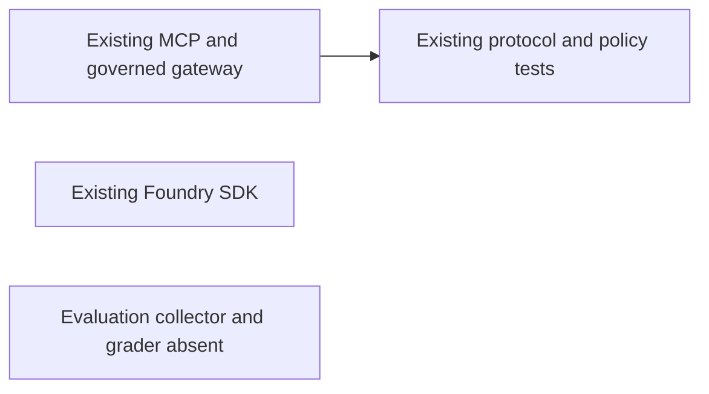
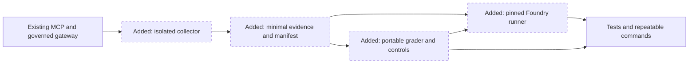
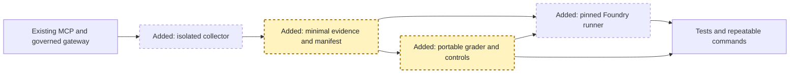
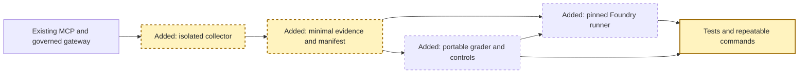
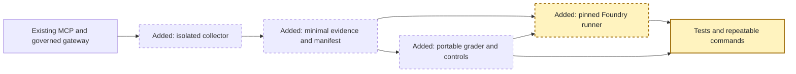

<!-- markdownlint-disable-file -->
# RPI Plan: Custom Governance Evaluation

## Task Metadata

* Task ID: custom-governance-evaluation
* Task slug: custom-governance-evaluation
* Plan date: 2026-10-14

## Executive Summary

Implement a small evaluation package that runs the actual synthetic profile tool
in isolated stdio children, proves allow/deny enforcement with independent
observations, and grades versioned evidence locally and in Foundry. Keep
production policy, tool execution, chat, and telemetry behavior unchanged.

Local evidence/grading and collection/control phases are implemented and accepted.
The managed runner and its failure-boundary checks are accepted.
The one independent standard
critique returned two planner-owned revisions; both are resolved in this
candidate without a second critique. Local handoff/review can proceed even if
managed access blocks, and the runner's supported connection/API floors are
explicit. The user now requests local-only delivery for now; actual managed
execution is deferred and no Azure operation is authorized.

The local handoff and one standard RPI outcome Review are now complete.
The review found no substantive implementation defects in the delivered scope;
overall outcome is Residual work because actual managed acceptance remains deferred.

### What You May Not Know

The separately approved direct implementation route does not use `yakka-execute`
or require moving the nested specs. Local collection/grading needs no Azure
deployment or authentication. The managed runner is retained but unexecuted;
the original full-plan cloud acceptance remains unfinished until separately resumed.

## Phase Checklist

### Before



### After



The runtime is retained. Evaluation-only observation, independent expectations,
and managed scoring are added around it rather than replacing enforcement.

<!-- rpi:phase id=P01 -->
### [x] P01: Establish independent evidence and portable grading

Goals:
* Define a minimal, strict, versioned contract and independent oracle so recorded
  behavior cannot redefine its own expected result.

Dependencies:
* None.



Highlighted work: independent manifest, strict evidence, and shared grader.

<!-- rpi:task id=P01-T01 -->
#### [x] P01-T01: Define manifest, evidence models, and policy fixtures

Goals:
* Give both `MEM-001` variants independently authored expectations and attributable
  evidence without storing profiles, identities, or credentials.

Requirements:
* `FR-001`, `FR-002`, `NFR-001`, `NFR-002`; evaluation `T001`.
* Exactly two baseline variants; fixed action/member; allow counts one entry,
  deny counts zero; exact gateway rule/lifecycle sequence and policy-byte digests.
* Strict extra-field/type validation; healthy event/operation/response observers;
  versioned application source/revision, fixture, toolkit, schema, and grader.
* Independent test-deny policy preserves other rules and never alters default
  policy bytes. Unique baseline/control row identities are distinct.

Details:
* Use existing Pydantic dependency for one self-contained schema/grader module
  compatible with its documented managed sandbox. Keep declaration generation
  and local validation derived from the same models.
* Generate the named deny fixture from the packaged policy in an evaluation-owned
  artifact directory. Create a new directory rather than overwrite existing runs.
* Use a framed deterministic digest for fixture/source files and an independent
  manifest bundled into the grader; never derive expectations from runtime events.

References:
* [docs/spec/eval/design.md](../../../docs/spec/eval/design.md): Evidence and request expectations.
* [src/ai_governance_harness/governance/policies/default.yaml](../../../src/ai_governance_harness/governance/policies/default.yaml): Exact allow rules.
* [.copilot-tracking/research/2026-10-14/custom-governance-evaluation-research.md](../../research/2026-10-14/custom-governance-evaluation-research.md): Current contracts and rejected self-certification.

Dependencies:
* None.

<!-- rpi:task id=P01-T02 -->
#### [x] P01-T02: Implement shared grading and portable code definition

Goals:
* Produce deterministic, locally/managed-identical grading that detects violations
  without disguising malformed evidence as a normal failure.

Requirements:
* `FR-003`, `FR-004`, `NFR-001`, `NFR-002`; evaluation `T003`.
* Baselines score `1.0`; schema-valid contract violations score `0.0`; malformed,
  unsupported, or unhealthy/failed collection raises a sanitized identifiable error.
* Row expectations are compared with the grader's bundled manifest. Changed
  expected values cannot redefine a pass; boolean execution counts are invalid.
* Managed code is self-contained, below 256 KB, uses no toolkit/local package
  imports or network, and retains the same validation/grading logic.
* This is the binding managed function contract:

```python
def grade(sample: dict, item: dict) -> float:
    ...
```

Details:
* Implement under `src/ai_governance_harness/evaluation/evaluator.py`.
* Local bound grading and a generated top-level adapter may share one evaluator
  class/function; the adapter is not separate scoring logic.
* Generated code contains only trusted repository source plus validated manifest
  data. Verify code packaging without executing user-supplied evaluator code.
* Missing event field is malformed; a schema-valid list missing/extra/reordered
  events is a violation. Unknown cases/schema versions are explicit errors.
* Preserve the documented distinction between a managed completed `0.0` result
  and a raising grader's `0.0` with item error.

References:
* [docs/spec/eval/discover.md](../../../docs/spec/eval/discover.md): E004/E006/E008.
* [.copilot-tracking/research/2026-10-14/custom-governance-evaluation-research.md](../../research/2026-10-14/custom-governance-evaluation-research.md): Findings on managed grading and error preservation.
* https://learn.microsoft.com/en-us/azure/foundry/concepts/evaluation-evaluators/custom-evaluators: Sandbox packages/limits and code contract.

Dependencies:
* `P01-T01`.

<!-- rpi:phase id=P02 -->
### [x] P02: Collect actual stdio evidence and prove local detection

Goals:
* Demonstrate real gateway enforcement through MCP with independent operation and
  response observation, plus repeatable baseline/control artifacts.

Dependencies:
* `P01`.



Highlighted work: collector and its local end-to-end/control evidence.

<!-- rpi:task id=P02-T01 -->
#### [x] P02-T01: Observe fresh stdio children without replacing enforcement

Goals:
* Capture actual policy events and original backend entry for one request per
  process, with explicit observer/process failure states.

Requirements:
* `FR-001`, `FR-002`, `NFR-001` through `NFR-003`; evaluation `T002`.
* Both variants call the real MCP `get_member_profile` once. Allow has exactly
  the two gateway allow events, one original operation entry, and successful
  returned profile. Deny has explicit matched-rule denial, zero operation entries,
  no request-level post event, and an MCP error without a profile.
* Unhealthy probes, incomplete capture, startup/request/shutdown timeout, abnormal
  child exit, or unrelated tool failure cannot certify enforcement.
* Inspect structured/text response representations in memory; persist only minimal
  return-state evidence. Reap every child; do not change live policy or production
  gateway/event/telemetry code.

Details:
* Implement a dedicated evaluation worker/bootstrap and collector, reusing
  `mcp.Client` / `StdioServerParameters` and the existing server entrypoint.
* Research verified `sys.setprofile` plus `threading.setprofile` observing original
  method code and real event-store returns. Install before worker threads spawn,
  verify hook state, and scope counts/events to the one request.
* Child environment is explicit local/non-hosted with governance enabled.
  Prevent dotenv loading before package import and omit export/credential settings.
* Use evaluation-owned intermediate files, not new MCP tools/endpoints or stdout
  logs. Existing MCP sanitized errors remain unchanged.

References:
* [tests/test_mcp_transports.py](../../../tests/test_mcp_transports.py): Real stdio client lifecycle.
* [src/ai_governance_harness/mcp_server/__main__.py](../../../src/ai_governance_harness/mcp_server/__main__.py): Startup/shutdown and transport entrypoint.
* [src/ai_governance_harness/mcp_server/tools.py](../../../src/ai_governance_harness/mcp_server/tools.py): Decorator and original operation.
* [src/ai_governance_harness/governance/events.py](../../../src/ai_governance_harness/governance/events.py): Actual event recording.
* [.copilot-tracking/research/2026-10-14/custom-governance-evaluation-research.md](../../research/2026-10-14/custom-governance-evaluation-research.md): Q1 observation probe and environment isolation.

Dependencies:
* `P01-T01`.

<!-- rpi:task id=P02-T02 -->
#### [x] P02-T02: Deliver the local command and regression controls

Goals:
* Make the actual baseline and independently expected controls reproducible from
  the installed package, with truthful nonzero failure exits and minimal artifacts.

Requirements:
* `FR-004`, `FR-007`, `NFR-001` through `NFR-003`; evaluation `T005`.
* Both actual baseline rows pass. Controlled wrong decisions/allowed flags,
  execution/data after deny, wrong digest/rule, disabled enforcement, missing/
  extra/reordered events, and altered expectations fail with completed `0.0`.
* Missing fields, invalid types, unsupported schema, or unhealthy/incomplete
  collection produces the intended explicit error. An unrelated timeout/error
  is not acceptable control-detection evidence.
* Add the `ai-governance-eval` entrypoint, local artifact/result summary, and local
  README command. Default outputs are ignored under `.local/evaluations/`.
* Normal MCP/chat behavior remains covered by existing tests.

Details:
* Generate controls from validated baseline rows with stable control IDs and
  independently declared expected score/error outcomes; keep baselines immutable.
* Baseline errors must not be hidden by successful controls or aggregate means.
* Tests may use mocks for failures but must also collect both real stdio cases.

References:
* [docs/spec/eval/plan.md](../../../docs/spec/eval/plan.md): T005 done condition.
* [pyproject.toml](../../../pyproject.toml): Existing entrypoint/dev-tool patterns.
* [README.md](../../../README.md): User-facing installation and validation guidance.

Dependencies:
* `P01-T02`, `P02-T01`.

<!-- rpi:phase id=P03 -->
### [x] P03: Implement versioned managed scoring and honest result reporting

Goals:
* Submit the same trusted grading definition and minimal rows to Foundry with
  explicit version mapping, bounded API work, and complete result/error evidence.

Dependencies:
* `P01`; real demonstration additionally requires `P02`.



Highlighted work: managed runner and SDK-boundary regression coverage.

<!-- rpi:task id=P03-T01 -->
#### [x] P03-T01: Register, submit, poll, and reconcile managed results

Goals:
* Provide a real SDK implementation that preserves version/run/report identity
  and never substitutes local success for remote failure.

Requirements:
* `FR-005`, `FR-007`, `NFR-001` through `NFR-003`; evaluation `T004`.
* Use verified projects 2.8 direct evaluator APIs and explicit returned
  `evaluator_version`, item schema/mappings, `deployment_name`, and threshold `1.0`.
* Same source/manifest grader definition locally and remotely; no agent target.
* Retain baseline/control runs, evaluation IDs, evaluator IDs/versions/digests,
  all row scores/error states, and report URLs. Never delete cloud runs.
* Deadline and per-request bounds cover polling/result pagination. Failed,
  canceled, timed-out, missing, duplicate, skipped, or malformed results are errors.
* Baseline gate checks every expected identity/metric/score/status; control gate
  verifies intended score or identifiable schema-error parity.
* Mocked SDK tests cover request serialization and each failure boundary; these
  are not managed execution evidence.

Details:
* Declare `azure-ai-projects>=2.8.0`, `openai>=3.29.0,<4.0.0`, and
  `python-dotenv>=1.2.4`: the exact installed API/isolation contracts verified by
  Research. Do not add services/frameworks or change application connection code.
* The evaluation runner supports only an explicit HTTPS project endpoint
  (`--endpoint` or `AZURE_AI_PROJECT_ENDPOINT`) and a valid deployment
  (`--deployment` or `AZURE_AI_MODEL_DEPLOYMENT_NAME`). Construct
  `AIProjectClient(endpoint=..., credential=get_azure_credential())` directly;
  reuse only the existing credential helper, not `get_foundry_client()` and its
  incompatible connection-string branch. No implicit coordinate/string fallback.
* Tests using the declared installed SDK must verify endpoint client construction,
  typed registration serialization, version binding, and clear missing-endpoint/
  deployment errors. No managed task starts before those tests are green.
* Document this runner-specific prerequisite without claiming that legacy helper
  connection-string/coordinate modes have been restored or removed.
* Upload only strict baseline rows and known generated controls. An arbitrary
  edited malformed artifact must not become an unrestricted data-upload path.
* Preserve minimized failure reports as well as completed reports; CLI exits
  nonzero on blocked/error/failed acceptance.
* README documents the managed command and prerequisites without claiming a run.

References:
* [src/ai_governance_harness/foundry_client.py](../../../src/ai_governance_harness/foundry_client.py): Existing credential/endpoint boundary.
* [.copilot-tracking/research/2026-10-14/custom-governance-evaluation-research.md](../../research/2026-10-14/custom-governance-evaluation-research.md): Q2 exact APIs, pinning, and preserved error metadata.
* https://learn.microsoft.com/en-us/azure/foundry/observability/how-to/cloud-evaluation-results: Pagination/run-terminal contracts.

Dependencies:
* `P01-T01`, `P01-T02`.

<!-- rpi:phase id=P04 -->
### [ ] P04: Demonstrate managed parity and finalize truthful handoff

Goals:
* Obtain actual managed baseline/control evidence when authorized, preserve
  blockers otherwise, and review the implementation against the full contract.

Dependencies:
* `P02`, `P03`.


Highlighted work: real managed acceptance, documented outcome, and review.

<!-- rpi:task id=P04-T01 -->
#### [ ] P04-T01: Verify access and execute retained managed demonstrations

Goals:
* Prove local/managed parity through actual service results, or state the exact
  access/API blocker without making a completion claim.

Requirements:
* `FR-006`, `NFR-001` through `NFR-003`; evaluation `T006`.
* Confirm externally visible registration/submission before performing it.
  Verify actual configured access; do not request secrets, provision resources,
  change roles, or infer authentication from construction.
* Both baseline rows have completed error-free `1.0` managed results. Every
  control has its intended completed `0.0` or identifiable malformed-evidence
  error, matching local results, with retained identities/versions/report URLs.
* If required access or API behavior is unavailable, preserve Blocked evidence
  and keep dependent final acceptance unfinished.
* Current execution decision: User deferred Azure operations in favor of local
  delivery for now. Do not authenticate, check cloud deployment, register, or
  submit while this deferral is active; leave this task unchecked.

Details:
* Use real artifacts from `P02-T02`; SDK mocks never fulfill this task.
* Complete local delivery and review it even when this managed task is blocked;
  that is a partial overall outcome, not a waiver of E005/E008.

Guidance:
* Submit a fresh bundle from the installed `ai-governance-eval local` command.
  Source/manifest binding makes earlier bundles stale after implementation changes.
* Use `run_managed` in
  [src/ai_governance_harness/evaluation/foundry.py](../../../src/ai_governance_harness/evaluation/foundry.py);
  it verifies trusted artifacts before authentication and deployment before registration.

References:
* [docs/spec/eval/discover.md](../../../docs/spec/eval/discover.md): Managed completion boundary.
* [docs/spec/eval/plan.md](../../../docs/spec/eval/plan.md): T006 prerequisite and actual-evidence rule.

Dependencies:
* `P02-T02`, `P03-T01`.

<!-- rpi:task id=P04-T02 -->
#### [x] P04-T02: Record delivered evidence, partial/full handoff, and RPI review

Goals:
* Make delivered commands/evidence reproducible and preserve an honest partial
  or complete handoff after outcome review, even if managed access blocks.

Requirements:
* `FR-007`, `NFR-001`, `NFR-002`; evaluation `T007`.
* Repeatable local/managed commands, local results, and actual cloud results or
  the concrete managed blocker are documented. No MAF/container/HTTP or
  production-assurance claim is added.
* Update T001-T007 only from actual accepted results; preserve IDs and blocked
  prerequisites, and distinguish direct RPI from native Yakka execution.
* Relevant tests/lint/build pass and RPI Review records actual completion or
  partial/blocker state. Retain a minimized `managed-results.json` error/blocked
  report in the run's artifact directory when managed execution is unavailable.
* This RPI handoff task may complete with recorded local evidence and a managed
  blocker. Evaluation T006 and dependent T007 remain unfinished until real
  managed baseline/control acceptance and its final documentation pass. Overall
  P04/MVP completion cannot follow from partial handoff alone.

Details:
* Earlier tasks own directly related local/runner usage docs. This task owns the
  actual result/blocker handoff and review independently from P04-T01 success.
  The managed-evidence subsection and T007 completion remain conditional on
  P04-T01 accepted results.
* Review any delivered subset even if P04-T01 blocks; do not mark P04 done.

References:
* [README.md](../../../README.md): Repeatable commands and scope limitations.
* [docs/spec/eval/plan.md](../../../docs/spec/eval/plan.md): Canonical delivery history.

Dependencies:
* `P02-T02`, `P03-T01`; managed-evidence acceptance is conditional on `P04-T01`.

## User Decisions and Requirements

### Confirmed User Direction

* Keep and implement from `docs/spec/eval/`; do not recreate the root MVP specs.
* User approved the evaluation spec and selected direct repository implementation.
* Retain both local collection/grading and managed Foundry scoring.
* Exercise isolated stdio MCP subprocesses, not hosted HTTP or live MAF inference.
* User confirmed automatic RPI, stopping for required decisions/approvals/blockers.
* Latest direction: Finish this original evaluation first, then take the selected
  existing live chat `/api/chat` agent into a separate single-case evaluation.
* Current delivery decision: Keep evaluation local for now without Azure
  deployment or execution. Accept local delivery/review while retaining managed
  execution as deferred work, not as completed service evidence.
* Follow-up execution decision: User selected fully offline and deferred the
  live `/api/chat` agent case rather than allowing existing Foundry inference.
  Do not substitute mock reasoning as live-agent acceptance.

### Planning Decisions and Feedback

| Group | Item | Status | Owner | Rationale | Evidence | Impact |
|---|---|---|---|---|---|---|
| D1 | Continue through RPI directly, not Yakka native dispatch. | Confirmed | User | Explicit route and continuation selections. | Conversation | Folder routing is not an implementation prerequisite. |
| D2 | Child-only profiling, independent manifest, pinned SDK evaluator versions. | Resolved | Agent | Verified observation and SDK contracts preserve approved boundaries. | Research findings | Task drafting can proceed. |
| D3 | Keep normal runtime modules unchanged; add a bounded evaluation package. | Resolved | Agent | Avoids widening production observer/telemetry surface. | E007/C6 | All phases. |
| D4 | Use existing Pydantic schemas in portable source and declare supported SDK/dotenv floors. | Resolved | Agent | Sandbox lists Pydantic; project already depends on it; installed versions verify APIs and isolation flag. | Research C3/C7/W1/W3 | P01-T01/P03-T01. |
| D5 | Actual cloud execution. | Deferred by user | User | User explicitly requested keeping things local for now. No Azure authentication, access check, registration, or submission is authorized. | Latest conversation decision | P04-T01 remains unchecked; local delivery and P04-T02 review may finish. |
| D6 | Endpoint-only evaluation runner; preserve existing application helper unchanged. | Resolved | Agent | Avoids known unsupported legacy branch without changing application capabilities. | PC-002/C3/W3 | P03-T01 connection tests and explicit dependency floors. |
| D7 | Review/handoff delivered subset independently of managed acceptance. | Resolved | Agent | Required truthful partial delivery without waiving T006/T007. | PC-001/E006 | P04-T02 can record managed Blocked status; overall completion remains gated. |

## Planning Readiness and Next Step

| Field | Record |
|---|---|
| Planning execution and readiness | Complete; Ready. One standard critique is Complete/Revise with PC-001/PC-002 resolved by direct planner corrections. |
| Decision participation | Agent-owned ordinary decisions; user-approved automatic RPI. |
| Blockers | No local planning blocker; actual managed access is a downstream execution gate. |
| Latest critique | [.copilot-tracking/reviews/plans/2026-10-14/custom-governance-evaluation-plan-critique.md](../../reviews/plans/2026-10-14/custom-governance-evaluation-plan-critique.md): Complete/Revise; both findings resolved below; no closure critique. |
| Relevant research | [.copilot-tracking/research/2026-10-14/custom-governance-evaluation-research.md](../../research/2026-10-14/custom-governance-evaluation-research.md) |
| Plan | `.copilot-tracking/plans/2026-10-14/custom-governance-evaluation-plan.md` |
| Changes-record role | `.copilot-tracking/changes/2026-10-14/custom-governance-evaluation-changes.md` will record actual implementation evidence. |
| Continuation owner | Confirmed automatic RPI parent. |
| Required gates | Research/plan, single critique, implementation checks and one standard Review satisfied for local delivery; managed execution deferred by user. |
| Next action | No active work. Local handoff is complete; actual managed scoring and the live-agent case are user-deferred under the fully offline boundary. |

## Goals

Demonstrate actual synthetic profile policy enforcement and its deterministic
evaluation locally and in Foundry, without weakening the normal runtime.

## Scope and Non-Goals

In scope: Approved evaluation collector, schema/manifest/grader, controls, runner,
commands, relevant tests/documentation, and truthful evidence/task outcomes.

Non-goals: Yakka extensions/routing, cloud provisioning, production telemetry,
MVP features, MAF/container/HTTP execution, live data, and comprehensive assurance.

## Functional Requirements

* FR-001: Actual allow/deny profile requests through isolated stdio and real toolkit
  enforcement, with independent original-operation and response observation.
* FR-002: Minimal versioned schema, independent manifest/fixtures, exact event/
  rule/digest/count/return/MCP-state expectations, and attributable baseline/control rows.
* FR-003: Portable deterministic code grading, strict validation, and explicit
  distinction between completed violation grades and malformed/collection errors.
* FR-004: Known regression controls, exact two-row baseline acceptance, and
  reproducible local artifacts without mean-score shortcuts.
* FR-005: Versioned managed registration, precomputed mappings, bounded polling,
  complete identity/score/error results and retained report metadata.
* FR-006: Actual authorized managed demonstration and local/cloud parity, not mocks.
* FR-007: Installed commands, related documentation, stable spec history, and
  honest evidence-backed implementation/review outcomes.

## Non-Functional Requirements

* NFR-001: No credentials, raw claims, real member data, full profiles, or
  unapproved telemetry export in evaluation artifacts. Production behavior and
  policy bytes remain unchanged. Verify minimal schema and child-environment isolation.
* NFR-002: Fail closed on malformed/unsupported inputs, unhealthy capture, wrong
  expectations/version, duplicate/missing/error rows, or managed failure. CLI
  acceptance exits nonzero and preserves minimized explicit failure evidence.
* NFR-003: Configurable finite deadlines bound subprocess lifecycle and managed
  polling/pagination; bound individual API calls too. Reap children and close SDK
  clients. Tests cover timeout/cancellation/abnormal cleanup and prevent hangs.

## Risks and Open Questions

| Priority | Type | Item | Affected work | Impact | Smallest evidence/action | Owner |
|---|---|---|---|---|---|---|
| H | Risk | Missing/thread-local observation can falsely report zero operation entries. | P02-T01 | Invalid denial proof | Real stdio tests plus original-code/thread readiness assertions. | Implementer |
| H | Execution prerequisite | Managed credentials/permissions/deployment are unknown. | P04-T01/P04-T02 | Overall completion may be blocked | Actual read-only access check and user approval for registration/submission. | User/implementer |
| M | Risk | Managed service error status/shape may differ from SDK examples. | P03-T01/P04-T01 | Control parity cannot be inferred | Preserve raw minimal status/error fields and reject unsupported results. | Implementer |
| M | Risk | Dotenv/package import precedes worker setup. | P02-T01 | Inherited secrets/export configuration | Set supported disable flag and explicit environment before child import. | Implementer |
| L | Preview limitation | Mermaid dual-theme preview is unavailable. | Plan-wide | Visual rendering unverified | Source styling/labels checked; do not claim rendered validation. | Planner |

## Dependencies

* Existing Python 3.11-3.13, MCP 2.3, toolkit 4.1, Pydantic, pytest, Ruff, and
  packaged synthetic fixtures remain the application baseline.
* Verified projects 2.8.0/OpenAI 3.29.0 direct evaluator API and dotenv 1.2.4
  disable support are explicit dependency floors, not accidental developer installs.
* Managed execution requires user-confirmed external action and configured
  authorized project/deployment, not resource provisioning.

## Sources

* [docs/spec/eval/discover.md](../../../docs/spec/eval/discover.md): Approved scope and E001-E008.
* [docs/spec/eval/design.md](../../../docs/spec/eval/design.md): Evidence/grader/runtime contracts.
* [docs/spec/eval/plan.md](../../../docs/spec/eval/plan.md): Stable T001-T007 delivery identities.
* [.copilot-tracking/research/2026-10-14/custom-governance-evaluation-research.md](../../research/2026-10-14/custom-governance-evaluation-research.md): Current observation and SDK evidence.

## Critique Disposition

* Critique depth and provenance: standard; default.
* Critique execution: Complete; verdict Revise; both findings resolved below.
* Initial attempt consumed: yes.
* Recovery attempt consumed: no.
* Task: custom-governance-evaluation; candidate revision: v1.
* Attempt ID: `55ab3cbf-e649-4190-bb4a-79172cb329cc`; kind: initial.
* Candidate saved-content hash:
  `a4d9ffa9a7ed811deb89552120e8fbee17fef727c0fb2afcc7f0edd888c719df`.
* Hash boundary: saved UTF-8 plan after removing only the metadata between
  `## Critique Disposition` and `Test/change boundary locked for the candidate:`;
  retain the heading, test/change boundary, and all other sections.
* Output: `.copilot-tracking/reviews/plans/2026-10-14/custom-governance-evaluation-plan-critique.md`.
* Current-run provenance: uninterrupted planner reservation, saved-hash
  verification, then immediate synchronous native reviewer activation. No prior
  task attempt/output existed during preflight.
* Recovery eligibility/consent: not applicable; no recovery authorized.

| Finding | Disposition | Action owner | Resolving evidence | Decision route |
|---|---|---|---|---|
| PC-001 | Resolved | Planning parent | P04-T02 depends on local delivery/runner rather than managed success, records actual managed blocker, and explicitly leaves T006/T007 and overall completion unfinished. | Direct correction preserving approved scope. |
| PC-002 | Resolved | Planning parent | P03-T01 declares verified projects/OpenAI/dotenv floors and endpoint-only construction using the existing credential helper, with real installed-SDK serialization/construction tests before managed work. Existing application helper is not altered. | Direct correction; no application connection migration authorized. |

Test/change boundary locked for the candidate:

* Existing tests are preserved; exact removals: none.
* Maximum additions: four focused test files under `tests/` and seven evaluation
  Python modules under `src/ai_governance_harness/evaluation/`.
* Canonical production targets: evaluation package, `pyproject.toml` entrypoint/
  compatibility floors, `.gitignore` local artifacts, and README usage.
* Validation-only supporting cleanup: Remove the pre-existing unused
  `typing.Optional` import in the member model, with no model behavior change.
* Production governance/gateway/chat/telemetry source changes: none.
* Generated targets: evaluation-owned policy/manifest/JSONL/local reports/portable
  grader definition and managed metadata under `.local/evaluations/`; never raw profiles.
* Semantic coverage: exact evidence/grader/managed acceptance contracts.
* Regression coverage: real stdio allow/deny plus existing MCP/governance/chat
  tests; focused fake SDK error/page/version cases.
* Validation intent: `.venv/bin/python -m pytest` focused evaluation/MCP/governance
  selectors, Ruff on changed Python, actual installed local command, and package
  build. Broader tests only when changed dependencies/runtime integration require it.
* Managed mocks establish SDK-boundary behavior only; real retained service
  evidence is separately required for full completion.

## Artifact Self-Check

* Candidate identity, confirmed direction, automatic participation, requirements,
  task/phase dependencies, scope, and research pointers are synchronized.
* All four phases have Goals, Dependencies, and an After-based highlighted diagram.
  All seven tasks have Goals, Requirements, Details, References, Dependencies.
* Every FR/NFR is consumed by at least one task. T001-T007 remain unchanged in
  the source specification; this plan uses its own stable Pxx-Txx markers.
* Before is pre-change evidence, and new nodes remain identifiable without color.
  Font/theme settings match the template; dual-theme rendering was not available.
* No unresolved material design decision blocks local implementation. Managed
  access/action confirmation remains a scoped downstream gate.
* Test ownership, exact removals, maximum additions, canonical/generated targets,
  and semantic/regression validation boundaries are locked above.
* One independent standard critique completed. Both material findings have
  explicit dispositions and corrected task/dependency/SDK contracts. No closure
  critique was run; implementation tests remain required evidence.

## Follow-Up Items

* Existing legacy `foundry_client.py` connection-string/coordinate branches are
  incompatible with the currently installed SDK constructor surface. They are
  not used by the endpoint-only evaluation runner and remain unchanged. A
  separate reviewed application-connection migration owns those pre-existing
  modes; this task makes no claim that they work.
* After this initial plan, author one live-agent evaluation through `/api/chat`.
  User selected the existing repository chat agent; prompt/rubric confirmation
  belongs to that subsequent work, not the current governance completion gate.
  The user subsequently selected fully offline and deferred this live case;
  resume only after its real model-execution boundary is separately authorized.
* Resume actual managed baseline/control acceptance only after a separate user
  decision lifts the local-only execution deferral. Current local delivery does
  not fulfill P04-T01/T006 or dependent managed-documentation acceptance.

## Handoff

Planning Readiness and Next Step owns continuation. Local phases P01/P02 are
accepted; P03 is accepted. P04-T01 is deferred by the local-only user decision;
P04-T02 local handoff/Review is accepted without claiming full managed completion.
The one outcome record is
[.copilot-tracking/reviews/logs/2026-10-14/custom-governance-evaluation-review.md](../../reviews/logs/2026-10-14/custom-governance-evaluation-review.md).
