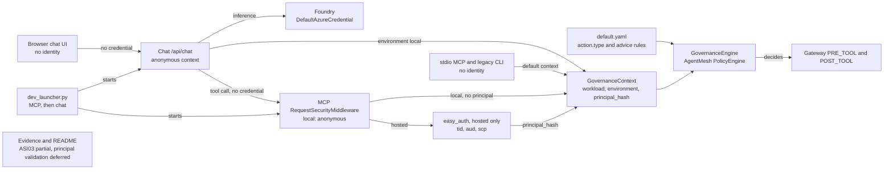
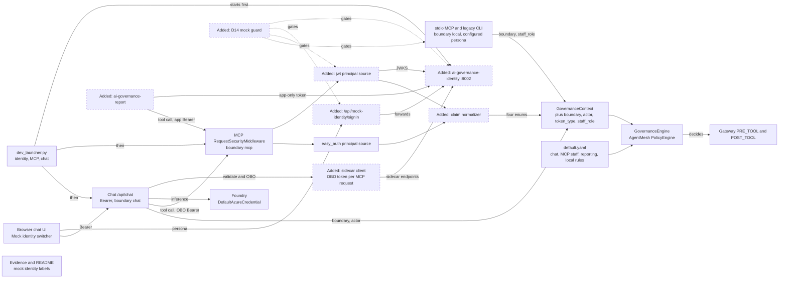
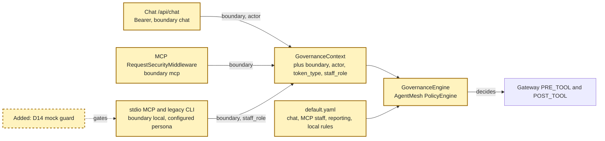
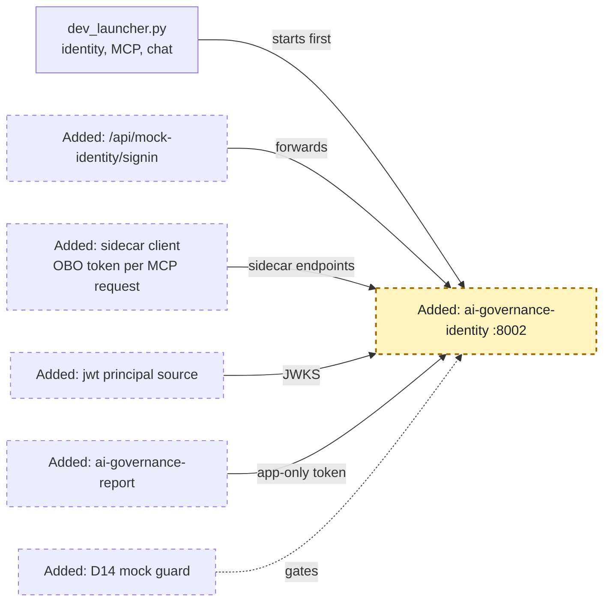
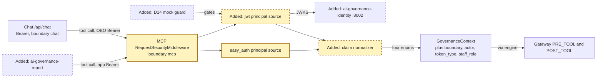
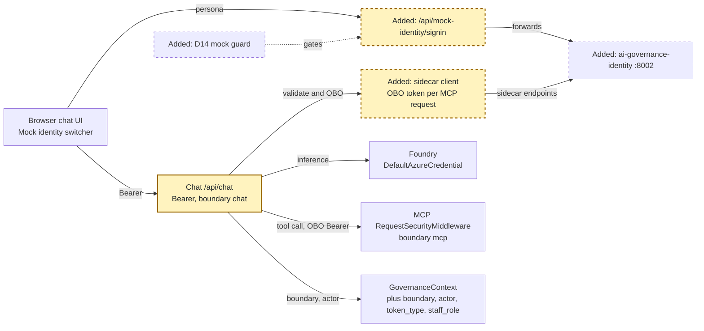
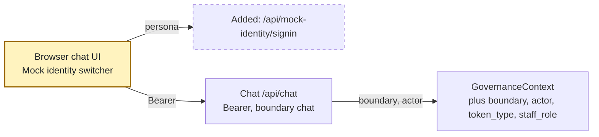
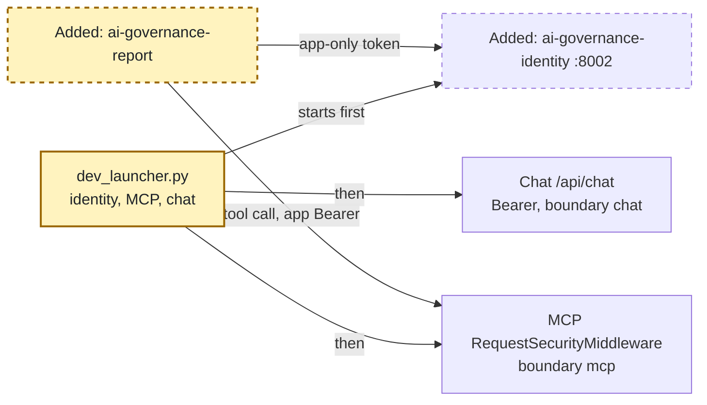
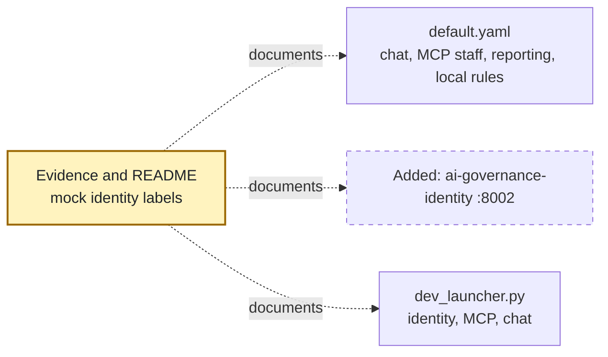

<!-- markdownlint-disable-file -->
# RPI Plan: Local MVP of agent identity (mock Entra Agent ID)

## Task Metadata

* Task ID: entra-agent-id-mvp
* Task slug: entra-agent-id-mvp
* Plan date: 2026-10-14
* Implementation: Complete, full plan P01 through P07. The P01 full-suite gate passed before P02. Post-rebase suite: 298 passed. User authorized local implementation on 2026-10-14, with focused contract tests and no weakening of default deny or privacy. Review remains a separate user-owned phase.
* Repository and branch: `pw-ms-collaboration/ai-governance-harness`, `willvelida/entra-agent-id-spike` (PR #6)

## Executive Summary

* Bottom line: The plan makes staff and agent identity drive governance decisions locally, using a mock of Microsoft Entra Agent ID.
  * First, governance context gains four closed-enum fields (`boundary`, `actor`, `token_type`, `staff_role`). The packaged policy then enforces the ADR 0009 staff role matrix at the MCP boundary, plus explicit chat and local rules.
  * Second, a local-only `ai-governance-identity` service signs real RS256 tokens shaped like Entra Agent ID. Chat validates them and obtains an OBO-shaped token for every MCP request. MCP verifies signatures through a new `jwt` principal source. The UI gains a labelled "Mock identity" persona switcher.
  * An `ai-governance-report` command demonstrates the app-only reporting agent.
* Why this matters: Today every tool call is anonymous at both chat and MCP (C8, C24), and the policy checks only `action.type` (C15). After this work, the same allow and deny outcomes that real Entra would produce are demonstrable end to end. Moving to real Entra later is a configuration change (ADR 0010).
* Planning result: Complete. Seven phases. Governance context and policy (P01) land and pass tests before any mock service, chat, or UI work (P02 to P07). All user-owned decisions G1 to G3 are answered.
* Confidence and uncertainty: High for the context, policy, and mock claim contracts, which are grounded in installed code (C13 to C16, C24 to C30) and Learn claim shapes (W7, W12). There are two items to verify early:
  * Middleware `ContextVar` propagation into session-based MCP tool handlers. MCP SDK 2.3 forwards per-message sender contexts, but no existing test proves it. P03-T05 adds that end-to-end test.
  * `agt lint-policy --strict` acceptance of the new conditions (R13). P01-T06 runs it.

### What You May Not Know

* **Turning on role rules breaks every anonymous caller by design** (R20). After P01, the stdio MCP server, the legacy CLI, and tests need `MOCK_IDENTITY_LOCAL_PERSONA` or a fixture. The local HTTP MCP server denies tool calls until P03 adds `jwt`. The live chat UI denies tools until P04 adds Bearer authentication. Each phase leaves the suite green, but the UI demo works only after P05.
* **The mock proves enforcement, not assignment** (R18). In the mock, the persona you pick decides the role; in real Entra, app-role assignment does. Every surface labels the identity as mock. `hosted_principal_validation` stays `deferred`, and ASI03 stays `partial`.
* **The mock is an authentication bypass if it ever runs outside local mode** (R19). One shared guard gates all four mock components: identity service, chat mock routes, MCP mock trust, and local persona. It refuses to start unless `MOCK_IDENTITY_ENABLED=true`, every configured environment variable is `local`, `development`, or `test`, nothing indicates hosting, and the bind address is loopback.
* **Foundry still uses your `az login`** through `DefaultAzureCredential` (D16). The mock can't mint Azure tokens.
* **Restarting the identity service resets the signing key.** Earlier tokens stop validating, MCP refetches the JWKS on an unknown `kid`, and the UI must sign in again.
* **`ai-governance-audit` scans every file under `src/` for forbidden strings**, including `cryptography.x509.verification`, `build_client_verifier`, and `build_server_verifier`. New identity code must not contain them, even in comments, or the VEX exception breaks (ADR 0006).
* **Switching persona clears the conversation** (agent decision A1), so member data shown to one persona isn't replayed to the model under another.

## Phase Checklist

### Before



### After



Before, every caller is anonymous outside hosted Easy Auth, and the policy allows any tool by name. After:

* A guarded mock identity service issues signed tokens.
* Chat authenticates staff and forwards an OBO-shaped token on every MCP request.
* MCP verifies the token, and one claim normalizer turns `jwt` or Easy Auth claims into four enums.
* The shared policy enforces boundary-specific rules over those enums.
* Token-less local callers carry a configured persona.

<!-- rpi:phase id=P01 -->
### [x] P01: Make governance decisions identity-aware (ADR 0009, D15)

Goals:
* Governance context carries four closed-enum identity fields, every process sets its `boundary`, and the packaged policy enforces the ADR 0009 staff role matrix with boundary-specific chat, MCP, reporting, and local rules. Default deny holds for anything else.
* The phase lands and passes the full suite before any mock service work. Identity-aware enforcement is therefore proven by policy tests alone, independent of how tokens are later produced.

Dependencies:
* None



Highlighted work: context fields and events (`CTX`, `ENG`), policy rules (`POL`), the shared guard (`GUARD`), local persona (`LOCAL`), and `boundary` population in chat and MCP middleware (`CHAT`, `MCPMW`). Chat sets `actor` only after P04; MCP sets `actor`, `token_type`, and `staff_role` only after P03.

<!-- rpi:task id=P01-T01 -->
#### [x] P01-T01: Add closed-enum identity fields to governance context

Goals:
* `GovernanceContext` holds optional `boundary`, `actor`, `token_type`, and `staff_role` values. `to_policy_context()` exposes them under `governance.*` only when set, so an absent field evaluates false and identity-aware allow rules fall through to default deny.

Requirements:
* FR-001, NFR-001, NFR-002; ADR 0009 Decision Outcome; ADR 0003 2026-10-14 amendment.
* Contract: field names, types, and values below are binding. Existing fields and defaults are unchanged.

  ```python
  Boundary = Literal["chat", "mcp", "local"]
  Actor = Literal["interactive", "reporting"]
  TokenType = Literal["user", "app"]
  StaffRole = Literal["analyst", "retention_specialist", "compliance_reviewer", "administrator", "none"]

  class GovernanceContext(BaseModel):  # still frozen
      boundary: Boundary | None = None
      actor: Actor | None = None
      token_type: TokenType | None = None
      staff_role: StaffRole | None = None
  ```

* Constructing a context with any value outside these literals raises a validation error. No free-text identity field is added.
* `to_policy_context()` returns only strings and omits `None` fields.

Details:
* [context.py](../../../src/ai_governance_harness/governance/context.py) already has a frozen, bounded model and a `to_policy_context()` that omits absent optional fields; follow that pattern.
* Export the literal aliases from `ai_governance_harness.governance` so later phases share one definition.
* Validated literals prevent the evaluation exceptions that AgentMesh treats as a match (R10, C16).

References:
* [src/ai_governance_harness/governance/context.py](../../../src/ai_governance_harness/governance/context.py): model to extend
* [src/ai_governance_harness/governance/__init__.py](../../../src/ai_governance_harness/governance/__init__.py): public exports
* [docs/planning/adrs/0009-enforce-agent-and-staff-identity-through-governance-policy-context.md](../../../docs/planning/adrs/0009-enforce-agent-and-staff-identity-through-governance-policy-context.md): field table
* [.copilot-tracking/research/2026-10-14/entra-agent-id-architecture-research.md](../../research/2026-10-14/entra-agent-id-architecture-research.md):
  * "Identity-aware policy needs four bounded context fields" under `## Findings`; C13, C16

Dependencies:
* None

<!-- rpi:task id=P01-T02 -->
#### [x] P01-T02: Carry the identity enums into events, logs, and spans

Goals:
* Governance events in the panel, MCP structured logs, and the policy-evaluation span show which boundary, actor, token type, and staff role a decision applied to. No other identity data appears.

Requirements:
* FR-001, NFR-002; ADR 0003 amendment items on the four enums.
* `GovernanceEvent` gains the four optional fields with the same literal types. `extra="forbid"` stays.
* `GovernanceEngine` records the enums from the context it evaluated (`context or get_governance_context()`).
* The MCP JSON log allowlist may add the four field names. `principal_hash` is not added to events or logs.
* Decision metric attributes stay unchanged, to keep cardinality bounded.
* `merge_governance_snapshots` still rejects remote events carrying unknown or sensitive fields.

Details:
* [events.py](../../../src/ai_governance_harness/governance/events.py) builds `GovernanceEvent` from the decision only; pass the evaluated context's enums through `GovernanceEventStore.record`.
* [snapshot.py](../../../src/ai_governance_harness/governance/snapshot.py) validates remote events with the same model, so chat and MCP stay compatible because they share the code.
* D15 requires events to mark the configured persona. `boundary = local` already marks it, so no new field is needed (agent decision A2; ADR 0003 item 6 forbids extra identity fields).
* Extend `test_snapshot_merge_rejects_malformed_remote_events_and_sensitive_fields` in [tests/test_governance.py](../../../tests/test_governance.py) with a remote event that carries `oid` or a raw `azp`.

References:
* [src/ai_governance_harness/governance/events.py](../../../src/ai_governance_harness/governance/events.py): event model and store
* [src/ai_governance_harness/governance/engine.py](../../../src/ai_governance_harness/governance/engine.py): `evaluate` and `_record_decision`
* [src/ai_governance_harness/mcp_server/telemetry.py](../../../src/ai_governance_harness/mcp_server/telemetry.py): `_ALLOWED_EVENT_ATTRIBUTES`
* [docs/planning/adrs/0003-minimize-identity-and-governance-telemetry.md](../../../docs/planning/adrs/0003-minimize-identity-and-governance-telemetry.md): amendment

Dependencies:
* P01-T01

<!-- rpi:task id=P01-T03 -->
#### [x] P01-T03: Add the shared mock-identity guard and local persona resolution

Goals:
* One guard decides whether any mock identity component may run, and the configured local persona resolves to a `StaffRole` only when that guard passes. Every later mock component reuses it.

Requirements:
* FR-004, FR-005, NFR-001; D14, D15; ADR 0010 Guard.
* Contract: the names and behaviour below are binding. The module location is the implementer's choice, outside `governance/` because it isn't toolkit code.

  ```python
  class MockIdentityGuardError(ValueError): ...  # ValueError so the existing configuration handlers exit 2 (PC-004)

  def require_mock_identity_allowed(component: str, *, bind_host: str | None = None) -> None:
      """Raise MockIdentityGuardError unless every condition below holds."""

  def resolve_local_persona() -> StaffRole | None:
      """None when MOCK_IDENTITY_LOCAL_PERSONA is unset; the role when set and guarded; raise otherwise."""
  ```

* The guard passes only when all of the following hold:
  * `MOCK_IDENTITY_ENABLED` parses true;
  * every set value of `GOVERNANCE_ENVIRONMENT` and `MCP_ENVIRONMENT` is `local`, `development`, or `test`;
  * `MCP_HOSTED` is not true;
  * no Container Apps runtime indicator such as `CONTAINER_APP_NAME` is present;
  * `bind_host`, when given, is a loopback address.
* `MOCK_IDENTITY_LOCAL_PERSONA` accepts exactly `analyst`, `retention_specialist`, `compliance_reviewer`, or `administrator`. An unknown value, or a set value when the guard fails, raises. The guard error messages contain no environment values other than the failing variable name.

Details:
* [governance/config.py](../../../src/ai_governance_harness/governance/config.py) has `_parse_bool` and the environment fallback (`GOVERNANCE_ENVIRONMENT`, then `MCP_ENVIRONMENT`), and its `validate_enforcement` is the precedent for environment-gated relaxations (C26). Reuse the parsing approach rather than duplicating semantics.
* Conflicting values, for example `GOVERNANCE_ENVIRONMENT=local` with `MCP_ENVIRONMENT=production`, must fail. That is why the guard checks every set variable.
* [mcp_server/config.py](../../../src/ai_governance_harness/mcp_server/config.py) already reads `CONTAINER_APP_REVISION`, which is evidence that hosting sets Container Apps variables.
* Tests belong to P01-T08 (guard matrix) and later phases (component refusals).

References:
* [src/ai_governance_harness/governance/config.py](../../../src/ai_governance_harness/governance/config.py): boolean and environment parsing
* [docs/planning/adrs/0010-use-a-local-only-mock-entra-agent-id-issuer-for-the-mvp.md](../../../docs/planning/adrs/0010-use-a-local-only-mock-entra-agent-id-issuer-for-the-mvp.md): Guard
* [.copilot-tracking/research/2026-10-14/entra-agent-id-architecture-research.md](../../research/2026-10-14/entra-agent-id-architecture-research.md):
  * D14, D15 under `## Decisions and Feedback`; R19

Dependencies:
* P01-T01

<!-- rpi:task id=P01-T04 -->
#### [x] P01-T04: Set the boundary at every governance entry point

Goals:
* Chat requests evaluate with `boundary = chat`, and MCP HTTP requests with `boundary = mcp`. stdio MCP and the legacy CLI evaluate with `boundary = local`, plus `staff_role` from the configured persona when it is set; when it is unset, they get no `staff_role` and are denied.

Requirements:
* FR-002, FR-005, NFR-001; D15; G2.
* Chat `BrowserSecurityMiddleware` sets `boundary="chat"`. MCP `RequestSecurityMiddleware` sets `boundary="mcp"`. Neither sets `actor`, `token_type`, or `staff_role` in this phase.
* stdio MCP (`run_server` when `transport == "stdio"`) and `run_cli` set a process context with `boundary="local"` and the resolved persona. They never set `actor` or `token_type` (G2).
* A `MockIdentityGuardError` at stdio MCP startup exits with code `2`. The legacy CLI already uses `2` for member-not-found, so it exits with a distinct code `4`. Messages are sanitized.

Details:
* [chat/app.py](../../../src/ai_governance_harness/chat/app.py) builds `GovernanceContext` per request in `BrowserSecurityMiddleware.dispatch`. [mcp_server/security.py](../../../src/ai_governance_harness/mcp_server/security.py) does the same in `RequestSecurityMiddleware.dispatch` (C24, C25).
* For stdio, set the context before `mcp.run("stdio")`. The SDK runner falls back to `contextvars.copy_context()` for streams that don't carry a sender context, so handlers inherit it.
* [cli.py](../../../src/ai_governance_harness/cli.py) calls the governed gateway in-process through [agent/orchestrator.py](../../../src/ai_governance_harness/agent/orchestrator.py), so a process-level context in `run_cli` covers every CLI command.
* After this task, local HTTP MCP tool calls and live chat tool calls are denied. That is expected fail-closed behaviour until P03 and P04.

References:
* [src/ai_governance_harness/chat/app.py](../../../src/ai_governance_harness/chat/app.py): chat middleware
* [src/ai_governance_harness/mcp_server/security.py](../../../src/ai_governance_harness/mcp_server/security.py): MCP middleware
* [src/ai_governance_harness/mcp_server/__main__.py](../../../src/ai_governance_harness/mcp_server/__main__.py): `run_server`, exit codes
* [src/ai_governance_harness/cli.py](../../../src/ai_governance_harness/cli.py): `run_cli`

Dependencies:
* P01-T01, P01-T03

<!-- rpi:task id=P01-T05 -->
#### [x] P01-T05: Stop aggregate tools from re-entering member-level governance

Goals:
* `get_cohort_churn_analytics` and `get_fum_outflow_summary` compute per-member signals through an ungoverned private helper. Analysts, the reporting agent, and local analysts can then use the aggregate tools without needing member-tool permission (critique PC-001).

Requirements:
* FR-003, NFR-001; ADR 0009 matrix; ADR 0002 (no widened rules).
* The public `get_member_disengagement_signals` stays governed. The aggregate tools call a private, undecorated signal computation, and their output is unchanged.
* A gateway-level test asserts an analyst context gets allowed aggregate calls and a denied member call.

Details:
* In [mcp_server/tools.py](../../../src/ai_governance_harness/mcp_server/tools.py), both aggregate methods loop `self.get_member_disengagement_signals(m_id)`, which is wrapped by `governed_read_only_tool`. Under role rules, that inner call would deny analysts.

References:
* [src/ai_governance_harness/mcp_server/tools.py](../../../src/ai_governance_harness/mcp_server/tools.py): `SuperannuationDataGateway`

Dependencies:
* None

<!-- rpi:task id=P01-T06 -->
#### [x] P01-T06: Encode the staff role matrix as boundary-specific pre-tool rules

Goals:
* [default.yaml](../../../src/ai_governance_harness/governance/policies/default.yaml) allows each data tool only for the callers in the ADR 0009 matrix, at the right boundary, and denies everything else by default.

Requirements:
* FR-003, NFR-001; ADR 0009 matrix and rule conventions; D10; G2; ADR 0002.
* Contract: the allow set below is binding. Rule names are illustrative; the existing kebab-case convention is preferred.

  | Boundary | Required context | Aggregate tools (`get_cohort_churn_analytics`, `get_fum_outflow_summary`) | Member tools (`get_member_profile`, `get_member_disengagement_signals`) | `prepare_member_outreach_case` |
  |----------|------------------|------------------------------------------|----------------------------------------|----------------------------------|
  | `chat` | `actor == 'interactive'` | allow | allow | allow |
  | `mcp` | `actor == 'interactive'`, `token_type == 'user'`, `staff_role == 'analyst'` | allow | deny | deny |
  | `mcp` | `actor == 'interactive'`, `token_type == 'user'`, `staff_role == 'retention_specialist'` | allow | allow | allow (elicitation still required) |
  | `mcp` | `actor == 'reporting'`, `token_type == 'app'` | allow | deny | deny |
  | `local` | `staff_role == 'analyst'` | allow | deny | deny |
  | `local` | `staff_role == 'retention_specialist'` | allow | allow | allow (elicitation still required) |
  | any | anything else, including `compliance_reviewer`, `administrator`, `none`, or missing fields | deny | deny | deny |

* The bare pre-tool rules `allow-member-profile`, `allow-member-signals`, `allow-cohort-analytics`, `allow-fum-summary`, and `allow-approved-outreach-case` are removed. Every other existing rule is unchanged, byte for byte in its condition, including `deny-personal-advice-request`, `deny-personal-advice-tool-response`, `allow-chat-input`, and all `post_tool` advice-scan rules.
* Staff, reporting, chat, and local access are separate rules. No condition mixes ` or ` with ` and `. `in [...]` may be used for a role list only if `agt lint-policy --strict` accepts it (R13).
* `uv run agt --json lint-policy --strict src/ai_governance_harness/governance/policies/default.yaml` passes with `PYTHONUTF8=1`.

Details:
* The condition grammar is `==`, `!=`, `in [...]`, and `and`/`or` over dotted paths. A missing path evaluates false (C16). The parser splits on ` or ` before ` and `, so OR-ing compound conditions is unsafe.
* The chat process evaluates `PRE_TOOL` for every model-selected tool in [chat/service.py](../../../src/ai_governance_harness/chat/service.py). MCP evaluates it in `governed_read_only_tool` in [mcp_server/tools.py](../../../src/ai_governance_harness/mcp_server/tools.py), and again for outreach in [mcp_server/server.py](../../../src/ai_governance_harness/mcp_server/server.py). The outreach case also invokes the governed member-signals gateway call, so the retention-specialist rules must cover both actions.
* Do not widen any rule to work around a later identity defect (ADR 0002, ADR 0009 Rollback).

References:
* [src/ai_governance_harness/governance/policies/default.yaml](../../../src/ai_governance_harness/governance/policies/default.yaml): policy to edit
* [docs/architecture/member-wealth-insights-architecture.md](../../../docs/architecture/member-wealth-insights-architecture.md): §6.3 staff role matrix
* [.copilot-tracking/research/2026-10-14/entra-agent-id-architecture-research.md](../../research/2026-10-14/entra-agent-id-architecture-research.md):
  * illustrative YAML under "Identity-aware policy needs four bounded context fields"; C15, C16; R10, R11, R13

Dependencies:
* P01-T01

<!-- rpi:task id=P01-T07 -->
#### [x] P01-T07: Add identity fixtures and migrate existing tests

Goals:
* Every existing test that reaches a data tool runs under an explicit identity, so the suite stays green and documents which identity each flow uses (R20).

Requirements:
* NFR-001, NFR-007; R20.
* A new `tests/conftest.py` provides fixtures for an MCP caller (`boundary="mcp"` with a parameterizable actor, token type, and role), a chat caller (`boundary="chat"`, `actor="interactive"`), and a local persona (`boundary="local"` with a role, or the guarded environment with `MOCK_IDENTITY_ENABLED` and `MOCK_IDENTITY_LOCAL_PERSONA`).
* Existing tests are migrated, not deleted:
  * [tests/test_mcp_server.py](../../../tests/test_mcp_server.py) runs as an MCP retention specialist.
  * [tests/test_mcp_tools.py](../../../tests/test_mcp_tools.py) and [tests/test_agent_scenarios.py](../../../tests/test_agent_scenarios.py) run as a local retention specialist, including `test_cli_execution_commands`.
  * [tests/test_chat_service.py](../../../tests/test_chat_service.py) runs as a chat interactive caller.
  * `test_policy_allows_known_tool_and_denies_unknown_action` in [tests/test_governance.py](../../../tests/test_governance.py) asserts the new rule name under an explicit context.
* In [tests/test_mcp_transports.py](../../../tests/test_mcp_transports.py), the stdio test sets `MOCK_IDENTITY_ENABLED=true` and `MOCK_IDENTITY_LOCAL_PERSONA=retention_specialist`. The HTTP test asserts that an anonymous local tool call is denied; P03-T05 replaces this interim assertion with token-based allow and deny.
* Exact removals: none. Assertion changes are limited to rule names and the interim HTTP denial.

Details:
* No `conftest.py` exists today. Tests use module-level fixtures and `monkeypatch`.
* In-process `Client(mcp)` tests start the server inside the client context, so a context set before entering `Client` propagates to the handlers.
* Keep `reset_governance_engine()` usage consistent wherever environment variables change governance settings.

References:
* [tests/](../../../tests/): affected test modules
* [tests/test_mcp_transports.py](../../../tests/test_mcp_transports.py): subprocess transports

Dependencies:
* P01-T02, P01-T03, P01-T04, P01-T06

<!-- rpi:task id=P01-T08 -->
#### [x] P01-T08: Prove the matrix, fail-closed behaviour, boundary separation, and import boundary

Goals:
* Tests show that the policy allows exactly the ADR 0009 matrix, denies every malformed or missing identity on every identity-aware rule, and separates chat, MCP, and local boundaries. The repository imports no AgentMesh identity APIs.

Requirements:
* FR-003, FR-004, FR-005, NFR-001, NFR-003; R10, R11; ADR 0009 Confirmation; ADR 0001.
* The matrix test enumerates every combination of boundary (three values plus missing), actor (two plus missing), token type (two plus missing), staff role (five plus missing), and the five tools. It asserts allow only for the contract in P01-T06.
* The R10 negative test evaluates every identity-aware allow rule through `GovernanceEngine` with snapshots containing a missing field, a non-string value (list, dict, number, `None`), an unknown string, and mixed-case or whitespace variants. Each must not be allowed. It goes through a test double so it bypasses model validation.
* The R11 test loads the same policy file and asserts:
  * a chat context with a staff role but no actor is denied;
  * an MCP context with an actor but no staff role is denied;
  * a local context with an actor but no staff role is denied.
* The guard test covers every D14 condition: flag unset, `staging` and `production` in each variable, conflicting variables, `MCP_HOSTED=true`, `CONTAINER_APP_NAME` set, non-loopback host, and unknown persona.
* The import-boundary test walks `src/` with `ast`. It fails on any import of `agentmesh`, `agent_os`, `agent_sre`, or `agent_sandbox` outside `governance/`, and on any import of `agentmesh.identity`, `agent_os.integrations.citadel`, or `agentmesh.integrations.mcp` anywhere.
* The existing `test_policy_evaluation_p95_is_below_100_ms` still passes.

Details:
* [tests/test_governance.py](../../../tests/test_governance.py) shows engine construction with `environment="test"`, and parametrization patterns.
* The R10 risk is that `PolicyRule.evaluate` treats an exception as a match (C16). The negative test is the evidence that our allow rules never reach that path with bad input.
* Prefer new modules such as `tests/test_identity_policy.py` and `tests/test_import_boundary.py` over growing `test_governance.py`. Maximum new test modules for P01: three.

References:
* [tests/test_governance.py](../../../tests/test_governance.py): engine test patterns
* [docs/planning/adrs/0001-contain-agent-governance-toolkit-behind-a-versioned-adapter.md](../../../docs/planning/adrs/0001-contain-agent-governance-toolkit-behind-a-versioned-adapter.md): import boundary
* [.copilot-tracking/research/2026-10-14/entra-agent-id-architecture-research.md](../../research/2026-10-14/entra-agent-id-architecture-research.md):
  * C16, C22, C23; R10, R11

Dependencies:
* P01-T06, P01-T07

<!-- rpi:phase id=P02 -->
### [x] P02: Stand up the local mock identity service (ADR 0010)

Goals:
* A guarded, loopback-only `ai-governance-identity` service signs Entra-shaped user, OBO, and app-only tokens with an in-memory RS256 key. It publishes discovery and a JWKS, and exposes sidecar-compatible endpoints. Chat, MCP, and the reporting command can then exercise real signature and claim validation.

Dependencies:
* P01 (guard from P01-T03, enums from P01-T01)



Highlighted work: the identity service (`IDS`). Its consumers are shown as neighbours and arrive in later phases.

<!-- rpi:task id=P02-T01 -->
#### [x] P02-T01: Declare the token dependency and the identity console script

Goals:
* The project declares `PyJWT[crypto]` directly and exposes `ai-governance-identity`. The dependency audit still passes with `cryptography` 48.0.1.

Requirements:
* NFR-005; ADR 0006; R22.
* [pyproject.toml](../../../pyproject.toml) adds `PyJWT[crypto]` with a range that admits the locked 2.15.1 and excludes the next major version. `uv.lock` is refreshed so that `cryptography` stays at 48.0.1.
* `[project.scripts]` adds `ai-governance-identity`, pointing at the service's `main`.
* `uv run ai-governance-audit` passes: `expected_packages` still matches, and no forbidden symbol from [security/vex/audit-policy.yaml](../../../security/vex/audit-policy.yaml) appears in any file under `src/`.

Details:
* PyJWT 2.15.1 and cryptography 48.0.1 are already installed transitively (C27), and `pyjwt` is already in the audit's `scan_distributions`.
* If PyPI TLS fails on Windows, set `UV_DEFAULT_INDEX=https://packagefeedproxy.microsoft.io/pypi/simple/`. The lockfile already resolves from that proxy.

References:
* [pyproject.toml](../../../pyproject.toml): dependencies and scripts
* [security/vex/audit-policy.yaml](../../../security/vex/audit-policy.yaml): pinned versions, forbidden symbols
* [src/ai_governance_harness/security_audit.py](../../../src/ai_governance_harness/security_audit.py): reachability scan over `src/`

Dependencies:
* None

<!-- rpi:task id=P02-T02 -->
#### [x] P02-T02: Serve discovery, JWKS, and health from an in-memory key behind the guard

Goals:
* Starting `ai-governance-identity` in an allowed local environment serves Entra v2-shaped discovery, a JWKS with one public RS256 key, and `/healthz` on `127.0.0.1:8002`. Starting it anywhere else exits non-zero before binding a port.

Requirements:
* FR-004, FR-006, NFR-006; D11, D12, D14; ADR 0010.
* The service calls `require_mock_identity_allowed("identity", bind_host=host)` before generating a key or binding. On failure it exits with code `2` and binds nothing.
* `MOCK_IDENTITY_HOST` defaults to `127.0.0.1` and must be loopback. `MOCK_IDENTITY_PORT` defaults to `8002`.
* The service generates a 2048-bit or larger RSA key per process start, keeps it only in memory, and never writes it to disk, environment, or logs. The JWKS exposes only public parameters (`kty`, `n`, `e`, `kid`, `use`, `alg`).
* Contract: the routes and issuer shape below are binding. `{tenant}` is a synthetic mock tenant ID.

  ```text
  GET /{tenant}/v2.0/.well-known/openid-configuration  -> {"issuer": "http://127.0.0.1:8002/{tenant}/v2.0", "jwks_uri": ".../{tenant}/discovery/v2.0/keys", "id_token_signing_alg_values_supported": ["RS256"], ...}
  GET /{tenant}/discovery/v2.0/keys                    -> {"keys": [ {public RS256 JWK} ]}
  GET /healthz                                         -> 200 {"status": "ready"}
  ```

* Synthetic identifiers live in one module of mock constants: tenant, chat web client ID, blueprint app ID, MCP API app ID, interactive and reporting agent IDs, and the reporting agent object ID. They are GUID-shaped and documented as synthetic.
* The service never configures Application Insights export.

Details:
* Follow the Starlette and uvicorn patterns in [chat/app.py](../../../src/ai_governance_harness/chat/app.py) and [chat/__main__.py](../../../src/ai_governance_harness/chat/__main__.py). Use a new package (for example `src/ai_governance_harness/identity/`) with a `__main__` so the launcher can run it with `python -m`.
* Real Entra discovery and JWKS shapes are summarized in C19 and W12. The mock uses `http://` loopback because it is local only; MCP's guard keys on that (P03-T01).

References:
* [src/ai_governance_harness/chat/__main__.py](../../../src/ai_governance_harness/chat/__main__.py): service entry-point pattern
* [docs/planning/adrs/0010-use-a-local-only-mock-entra-agent-id-issuer-for-the-mvp.md](../../../docs/planning/adrs/0010-use-a-local-only-mock-entra-agent-id-issuer-for-the-mvp.md): Decision Outcome
* [.copilot-tracking/research/2026-10-14/entra-agent-id-architecture-research.md](../../research/2026-10-14/entra-agent-id-architecture-research.md):
  * endpoint table under "For the MVP, a local mock issuer can stand in"; C19, C27, W7, W12

Dependencies:
* P01-T03, P02-T01

<!-- rpi:task id=P02-T03 -->
#### [x] P02-T03: Sign in four synthetic staff personas

Goals:
* `POST /mock/signin` with a persona name returns a short-lived user token whose audience is the mock blueprint, as Entra issues for `api://<blueprint>/access_agent`.

Requirements:
* FR-006, NFR-006, NFR-008; D13; W5.
* Contract: the request, response, and claims below are binding.

  ```text
  POST /mock/signin  {"persona": "analyst" | "retention_specialist" | "compliance_reviewer" | "administrator"}
  200 {"access_token": "<jwt>", "token_type": "Bearer", "expires_in": <seconds>, "persona": "<persona>"}
  400 {"error": "unknown_persona"}

  user token claims: iss, aud = blueprint app ID, tid, sub, oid = persona's fixed synthetic object ID,
                     scp = "access_agent", idtyp = "user", azp = chat web client ID, ver = "2.0", iat, nbf, exp
  ```

* The user token carries no `roles`. Staff role is looked up server-side from the persona `oid` at OBO time, mirroring app-role assignment on the MCP API.
* The request body is size-limited, and the endpoint accepts only `application/json`.

Details:
* Fixed persona `oid` values keep `principal_hash` stable across restarts for the demo.
* Display labels such as "Analyst (mock)" belong to the UI (P05), not to token claims.

References:
* [docs/architecture/member-wealth-insights-architecture.md](../../../docs/architecture/member-wealth-insights-architecture.md): §6.2 and §6.3
* [.copilot-tracking/research/2026-10-14/entra-agent-id-architecture-research.md](../../research/2026-10-14/entra-agent-id-architecture-research.md):
  * W5, W6; D13

Dependencies:
* P02-T02

<!-- rpi:task id=P02-T04 -->
#### [x] P02-T04: Emulate the sidecar validate, OBO, and app-only endpoints

Goals:
* Chat and the reporting command can call the same three sidecar endpoints they would call on the real Entra SDK for AgentID sidecar, and receive correctly shaped tokens. Misuse is rejected.

Requirements:
* FR-006, NFR-001, NFR-006, NFR-008; D11; W7, W12; ADR 0008 claim shapes.
* Contract: the routes, responses, and claims below are binding. Staff app roles are `Staff.Analyst`, `Staff.RetentionSpecialist`, `Staff.ComplianceReviewer`, and `Staff.Administrator`. The reporting app role is `Reports.Aggregate.Read`. The MCP scope is `Tools.Read`.

  ```text
  GET /Validate                               Authorization: Bearer <user token>
    200 {"protocol": "Bearer", "claims": {"oid", "tid", "aud", "scp", "idtyp", "azp", "exp"}}   # token never echoed
    401 {"error": "invalid_token"}

  GET /AuthorizationHeader/mcp?AgentIdentity=<interactive agent ID>   Authorization: Bearer <user token>
    200 {"authorizationHeader": "Bearer <jwt>"}
    OBO claims: iss, aud = MCP API app ID, tid, sub, oid = user oid, idtyp = "user", scp = "Tools.Read",
                roles = ["Staff.<Persona>"], azp = interactive agent ID, xms_act_fct = "11",
                xms_par_app_azp = blueprint app ID, ver = "2.0", iat, nbf, exp

  GET /AuthorizationHeaderUnauthenticated/mcp?AgentIdentity=<reporting agent ID>
    200 {"authorizationHeader": "Bearer <jwt>"}
    app claims: iss, aud = MCP API app ID, tid, sub = oid = reporting agent object ID, idtyp = "app",
                roles = ["Reports.Aggregate.Read"], azp = reporting agent ID, xms_act_fct = "11",
                xms_sub_fct = "11", xms_par_app_azp = blueprint app ID, ver = "2.0", iat, nbf, exp
  ```

* Rejections:
  * Missing, invalid, or expired user tokens, and tokens with the wrong audience (for example an MCP token sent as the subject token), return `401`.
  * A missing or unknown `AgentIdentity`, the reporting ID on the OBO endpoint, and the interactive ID on the app-only endpoint return `400 {"error": "invalid_agent_identity"}`.
  * Any API name other than `mcp` returns `404`.
* The service logs only route, status, and a bounded reason code. It never logs tokens, claims, or persona `oid` values.

Details:
* Real sidecar semantics are in W7; the claim facets are in W12. The OBO token keeps the user `oid` and adds the persona's single `Staff.*` role. Compliance reviewer and administrator still receive their role, and policy denies them (P01-T06).
* Token lifetimes follow NFR-008.

References:
* [docs/planning/adrs/0008-use-microsoft-entra-agent-id-for-agent-identity.md](../../../docs/planning/adrs/0008-use-microsoft-entra-agent-id-for-agent-identity.md): target claim contract
* [.copilot-tracking/research/2026-10-14/entra-agent-id-architecture-research.md](../../research/2026-10-14/entra-agent-id-architecture-research.md):
  * "Token flows" and "The MCP server can enforce staff roles" under `## Findings`; W7, W12

Dependencies:
* P02-T03

<!-- rpi:task id=P02-T05 -->
#### [x] P02-T05: Test the identity service contract, misuse, guard, and key hygiene

Goals:
* Tests prove the claim shapes, every rejection path, guard refusals, and that no private key material is written or exposed.

Requirements:
* FR-004, FR-006, NFR-002, NFR-006; R19; ADR 0010 Confirmation.
* The claim tests decode every issued token against the served JWKS and assert the contracts in P02-T03 and P02-T04.
* The misuse tests cover every rejection listed in P02-T04 and the unknown persona.
* The guard tests assert a non-zero exit and no bound port for:
  * `MOCK_IDENTITY_ENABLED` unset;
  * `staging` and `production` in either environment variable;
  * `MCP_HOSTED=true`;
  * `CONTAINER_APP_NAME` set;
  * a non-loopback `MOCK_IDENTITY_HOST`.
* The key-hygiene tests assert that:
  * the JWKS contains no private parameters (`d`, `p`, `q`, `dp`, `dq`, `qi`);
  * two app instances publish different `kid` and modulus values;
  * running the service in a temporary working directory creates no files.
* The log test asserts that captured logs contain no issued token or persona `oid`.

Details:
* Use Starlette `TestClient` for routes. Run the guard tests through the `main` function with `monkeypatch`, so no real port is needed. Maximum new test modules: one, for example `tests/test_identity_service.py`.

References:
* [tests/test_chat_app.py](../../../tests/test_chat_app.py): Starlette `TestClient` patterns

Dependencies:
* P02-T04

<!-- rpi:phase id=P03 -->
### [x] P03: Verify tokens at MCP and derive identity for governance

Goals:
* MCP authenticates every `/mcp` request through a configured principal source. The new `jwt` source verifies signed tokens against the mock JWKS, while `easy_auth` keeps the hosted header validation (G1). Both pass claims through one normalizer that produces `actor`, `token_type`, `staff_role`, and `principal_hash`, or rejects with `401` before governance.
* Readiness reports the JWKS state.

Dependencies:
* P01 (context, policy, guard), P02 (identity service and claim contract)



Highlighted work: the middleware integration (`MCPMW`), the `jwt` source (`JWT`), the `easy_auth` change (`EA`), and the shared normalizer (`NORM`).

<!-- rpi:task id=P03-T01 -->
#### [x] P03-T01: Add principal-source and token settings with fail-closed validation

Goals:
* `ServerSettings` selects `easy_auth` or `jwt` and carries the issuer, JWKS, audience, tenant, scope, and agent allowlist. Unsafe combinations refuse to start.

Requirements:
* FR-004, FR-007, NFR-001; D11, D14; G1.
* Contract: the environment variables below are binding and are documented in `.env.example` (P07-T02).

  ```text
  MCP_PRINCIPAL_SOURCE      easy_auth | jwt   (default: easy_auth when MCP_HOSTED=true, otherwise jwt)
  MCP_JWT_ISSUER            mock issuer URL from P02-T02
  MCP_JWT_JWKS_URL          mock JWKS URL from P02-T02
  MCP_AUTH_AUDIENCE         MCP API app ID (existing variable, now also used by jwt)
  MCP_AUTH_TENANT_ID        tenant (existing variable)
  MCP_AUTH_REQUIRED_SCOPE   Tools.Read for user tokens (existing variable)
  AGENT_ID_INTERACTIVE_ID   allowlisted interactive agent ID
  AGENT_ID_REPORTING_ID     allowlisted reporting agent ID
  ```

* Validation:
  * `jwt` requires every value above. Its issuer and JWKS URLs must be loopback `http://` mock URLs, and `require_mock_identity_allowed("mcp-jwt")` must pass. A non-mock issuer is rejected in the MVP (see Follow-Up Items).
  * `jwt` with `MCP_HOSTED=true` is rejected.
  * Hosted `easy_auth` keeps today's requirements and additionally requires both agent IDs (G1).
  * Configuration errors exit with code `2` through the existing `main` handling.
* There is no anonymous principal source, so local HTTP without a token is rejected (ADR 0002).
* The principal source applies only to `streamable-http`. stdio keeps its default transport and needs no `jwt` settings (PC-002).
* The MCP guard call passes `bind_host=MCP_HOST` (PC-003).

Details:
* [mcp_server/config.py](../../../src/ai_governance_harness/mcp_server/config.py) has `validate_hosted_requirements` and `from_environment`; extend them (C6).
* Existing tests in [tests/test_mcp_config.py](../../../tests/test_mcp_config.py) cover the defaults. The local default changes from anonymous to `jwt`, so update the assertion and add rejection cases.

References:
* [src/ai_governance_harness/mcp_server/config.py](../../../src/ai_governance_harness/mcp_server/config.py): settings
* [tests/test_mcp_config.py](../../../tests/test_mcp_config.py): settings tests

Dependencies:
* P01-T03, P02-T02

<!-- rpi:task id=P03-T02 -->
#### [x] P03-T02: Normalize validated claims into the four identity fields

Goals:
* One pure function turns a validated claim set, from either source, into a normalized identity, or a bounded rejection reason. Policy therefore sees the same enums regardless of how the token arrived.

Requirements:
* FR-007, NFR-001, NFR-002; ADR 0009 field derivation; W12; G1.
* Contract: the result shape and the derivation rules below are binding.

  ```python
  @dataclass(frozen=True)
  class NormalizedIdentity:
      actor: Actor
      token_type: TokenType
      staff_role: StaffRole
      principal_hash: str  # SHA-256 hex of the user oid (OBO) or the agent oid (app-only)

  def normalize_claims(claims: Mapping[str, object], *, settings: ServerSettings) -> NormalizedIdentity | Rejection
  ```

* Derivation rules:
  * `azp` equal to the interactive ID gives `actor=interactive`; equal to the reporting ID gives `actor=reporting`; anything else rejects with `unknown_agent`.
  * A user token requires all of the following, or it rejects: `idtyp == "user"`, `xms_act_fct` containing `11`, `xms_sub_fct` not containing `13`, the required scope in `scp`, an `oid`, and `actor == interactive`. The result is `token_type=user`.
  * An app token requires all of the following, or it rejects: `idtyp == "app"`, `xms_sub_fct` containing `11`, `Reports.Aggregate.Read` in `roles`, an `oid`, and `actor == reporting`. The result is `token_type=app` and `staff_role=none`.
  * For user tokens, exactly one recognised `Staff.*` role gives that `staff_role`. Zero, more than one, or unrecognised `Staff.*` values give `staff_role=none`, which policy denies.
  * `xms_*` facets are accepted as a space-separated string or a list of strings.
  * `xms_par_app_azp` is never used for a decision and is never returned or emitted.
* Rejection reasons are a closed set, for example `invalid_token`, `unknown_agent`, `invalid_token_shape`, and `missing_scope`, and are safe to emit as `authentication_outcome`.

Details:
* Keep the normalizer free of HTTP and JWT concerns, so `easy_auth` can feed it the claims decoded in `_validate_platform_principal` ([mcp_server/security.py](../../../src/ai_governance_harness/mcp_server/security.py), C5). `_claim_values` returns sets of strings; adapt them to the mapping shape.
* `principal_hash` keeps the existing SHA-256 approach, so ADR 0003 is unchanged.

References:
* [src/ai_governance_harness/mcp_server/security.py](../../../src/ai_governance_harness/mcp_server/security.py): Easy Auth claim decoding
* [.copilot-tracking/research/2026-10-14/entra-agent-id-architecture-research.md](../../research/2026-10-14/entra-agent-id-architecture-research.md):
  * claim table under "The MCP server can enforce staff roles"; W12

Dependencies:
* P01-T01, P03-T01

<!-- rpi:task id=P03-T03 -->
#### [x] P03-T03: Verify signed tokens against a cached JWKS and report readiness

Goals:
* The `jwt` source accepts only RS256 tokens signed by a key in the configured JWKS, with a pinned issuer, audience, and tenant, a valid expiry, and a known `kid`. MCP readiness reports whether the keys are loaded.

Requirements:
* FR-007, NFR-001, NFR-008; R21; D11.
* Verification pins `algorithms=["RS256"]`, `iss`, `aud`, and `tid`, and requires `exp`, `nbf`, and `iat`, with leeway as set by NFR-008. `alg=none`, HMAC algorithms, and any other algorithm are rejected.
* The JWKS loads at startup and is cached. An unknown `kid` triggers at most one rate-limited refetch, which covers an identity service restart. A fetch failure leaves the source unready and rejects every request (`401`).
* Bearer extraction requires exactly one `Authorization: Bearer <token>` header and enforces a maximum token length. Malformed headers reject.
* `/health/ready` includes an `identity` object `{"principal_source": "jwt" | "easy_auth", "jwks": "loaded" | "unavailable" | "not_required"}`. It returns `503` when `jwt` is selected and the JWKS is unavailable.

Details:
* Use PyJWT's JWKS support or an equivalent; the choice belongs to the implementer. Fetch over `urllib` with the governance operation timeout, as [chat/service.py](../../../src/ai_governance_harness/chat/service.py) does for snapshots.
* [mcp_server/http_app.py](../../../src/ai_governance_harness/mcp_server/http_app.py) builds the readiness response. Add the `identity` field there without changing the existing governance and sandbox fields.

References:
* [src/ai_governance_harness/mcp_server/http_app.py](../../../src/ai_governance_harness/mcp_server/http_app.py): readiness
* [.copilot-tracking/research/2026-10-14/entra-agent-id-architecture-research.md](../../research/2026-10-14/entra-agent-id-architecture-research.md):
  * C19, C28; R21

Dependencies:
* P02-T01, P03-T01

<!-- rpi:task id=P03-T04 -->
#### [x] P03-T04: Authenticate MCP requests and set the governance identity

Goals:
* Every `/mcp` request authenticates through the selected source before protocol dispatch. Invalid requests get `401` and never reach governance. Valid requests set `boundary=mcp` plus the normalized fields and `principal_hash` in the request context that the gateway evaluates.

Requirements:
* FR-007, NFR-001, NFR-002; ADR 0009 Architecture; G1.
* Both sources run the normalizer. A rejection returns `401` with `WWW-Authenticate: Bearer` and emits `mcp.authentication` with `outcome="rejected"` and a bounded `authentication_outcome` reason. Success sets `authentication_outcome="authenticated"`.
* The rate-limiter key is `principal_hash`.
* The four enums and `principal_hash` are also stored on `request.state`, so a tool-level fallback can read them if `ContextVar` propagation fails (PC-009).
* Public and local operational paths (`/health/*`, `/.well-known/*`, and `/governance/snapshot` when not hosted) keep their current behaviour.
* The `Authorization` header value and decoded claims are never logged, emitted, or attached to spans.

Details:
* Replace the `principal_key = "local-development"` branch in `_validate_request` ([mcp_server/security.py](../../../src/ai_governance_harness/mcp_server/security.py)), and keep origin, content-type, size, and protocol checks ahead of authentication, as today.
* Elicitation responses for the outreach tool arrive as separate POSTs. They also carry the bearer, because chat's auth hook covers every request (P04-T03).

References:
* [src/ai_governance_harness/mcp_server/security.py](../../../src/ai_governance_harness/mcp_server/security.py): `_validate_request`
* [src/ai_governance_harness/mcp_server/telemetry.py](../../../src/ai_governance_harness/mcp_server/telemetry.py): `emit_audit_event`

Dependencies:
* P03-T02, P03-T03

<!-- rpi:task id=P03-T05 -->
#### [x] P03-T05: Prove token rejection, identity propagation, and MCP telemetry privacy

Goals:
* Tests show that MCP rejects every bad token, that a valid identity reaches the gateway's PRE_TOOL decision over real session-based HTTP, that `easy_auth` derives the same fields, and that no token or raw claim leaks into MCP telemetry.

Requirements:
* FR-007, NFR-001, NFR-002, NFR-007; R10, R19, R21; ADR 0010 Confirmation.
* The rejection tests cover:
  * an unsigned token (`alg=none`) and an HS256 token keyed with the public key;
  * a token signed by another RSA key, and an unknown `kid`;
  * an expired token, and one with a future `nbf`;
  * the wrong issuer, audience, or tenant;
  * an unknown `azp`;
  * the interactive `azp` on an app token, and the reporting `azp` on a user token;
  * missing `xms` facets, and `xms_sub_fct` containing `13`;
  * a missing `scp` or `oid`;
  * a malformed or oversized header, and a missing header.
* The normalizer tests cover every rule in P03-T02, including multiple and unknown `Staff.*` roles.
* The `easy_auth` tests build Easy Auth headers with agent claims. The four personas and the reporting shape yield the same enums as `jwt`, and existing hosted tests in [tests/test_mcp_http.py](../../../tests/test_mcp_http.py) are updated so their valid principals include agent claims.
* The guard tests show that `jwt` with the mock issuer refuses to start under `staging`, `production`, `MCP_HOSTED=true`, or `CONTAINER_APP_NAME`, and that `jwt` with a non-loopback issuer is rejected.
* The end-to-end test runs the identity service and MCP as subprocesses. It replaces the interim HTTP assertion in [tests/test_mcp_transports.py](../../../tests/test_mcp_transports.py) and asserts:
  * an analyst OBO token gets an allowed `get_cohort_churn_analytics` and a denied `get_member_profile`;
  * a retention specialist completes the approved outreach elicitation;
  * a request without a token gets `401`;
  * readiness reports `jwks: loaded`.
* The privacy test injects a bearer token and raw claims (`oid`, `azp`, `preferred_username`, `xms_par_app_azp`). It asserts that none appear in captured JSON logs, governance events and snapshot, or spans from an in-memory OpenTelemetry exporter. It also asserts that no `Authorization` header is recorded when Application Insights export is configured with a test connection string (NFR-002).

Details:
* The end-to-end test is the evidence that the middleware `ContextVar` reaches tool handlers in session-based streamable HTTP. MCP SDK 2.3 forwards per-message sender contexts (`ContextReceiveStream` in the SDK runner).
* If propagation fails, the fallback is to read the identity from the tool's request context (`ctx.request_context.request`) and set the governance context inside the tool wrappers. Record that as a `Guidance:` update and don't weaken the rules.
* [tests/test_telemetry.py](../../../tests/test_telemetry.py) already configures a test Application Insights connection; reuse its pattern.
* Maximum new test modules for P03: two, for example `tests/test_mcp_identity.py` and `tests/test_identity_privacy.py`.

References:
* [tests/test_mcp_transports.py](../../../tests/test_mcp_transports.py): subprocess pattern
* [tests/test_mcp_http.py](../../../tests/test_mcp_http.py): hosted header tests
* [tests/test_telemetry.py](../../../tests/test_telemetry.py): Application Insights test configuration

Dependencies:
* P03-T04, P02-T05

<!-- rpi:phase id=P04 -->
### [x] P04: Authenticate chat callers and forward OBO tokens to MCP

Goals:
* `/api/chat` serves only callers with a valid mock user token, which it validates through the sidecar `/Validate`. It sets `boundary=chat`, `actor=interactive`, `token_type=user`, and `principal_hash` for its own governance decisions.
* Every MCP HTTP request in the turn carries a freshly obtained OBO-shaped token.
* A same-origin sign-in proxy lets the browser reach the mock without leaving `connect-src 'self'`.
* Foundry stays on `DefaultAzureCredential`.

Dependencies:
* P01, P02, P03 (MCP must accept tokens for chat tool calls to succeed)



Highlighted work: the sign-in proxy (`PROXY`), chat authentication and context (`CHAT`), and the sidecar client with the per-request OBO hook (`SC`). Foundry (`FDY`) is unchanged.

<!-- rpi:task id=P04-T01 -->
#### [x] P04-T01: Configure the chat sidecar client and a redacted caller identity

Goals:
* Chat knows the sidecar URL and its interactive agent ID, refuses unsafe mock configuration at startup, and represents an authenticated caller in memory without the token ever appearing in a `repr`, log, or serialized model.

Requirements:
* FR-004, FR-008, NFR-002; D14, D16.
* Contract: `ChatSettings` gains `AGENT_ID_SIDECAR_URL` (a loopback `http://` URL in the MVP) and `AGENT_ID_INTERACTIVE_ID`. Both are required. A missing value fails configuration, which keeps chat fail-closed.
* When `MOCK_IDENTITY_ENABLED` is true, chat startup calls `require_mock_identity_allowed("chat", bind_host=CHAT_HOST)`. A failure exits with code `2` (PC-003).
* Every direct `ChatSettings(...)` construction in tests is updated for the two new required fields. That includes `tests/test_chat_app.py`, `tests/test_chat_service.py`, `tests/test_chat_config.py`, and `tests/test_telemetry.py`; the decision-set assertion in `tests/test_telemetry.py` is updated to match the new rules (PC-005).
* A caller-identity value holds the user token for the duration of one request only. Its `repr` and any serialization omit the token. It exposes `principal_hash` (SHA-256 of the validated `oid`).
* The sidecar client calls `/Validate`, `/AuthorizationHeader/mcp`, and `/AuthorizationHeaderUnauthenticated/mcp`. It enforces the governance operation timeout and a response size limit, and it never logs request headers or response bodies.

Details:
* [chat/config.py](../../../src/ai_governance_harness/chat/config.py) validates URLs in `validate_mcp_url`. Mirror that, and reject credentials, query strings, and fragments.
* The reporting command (P06-T01) reuses this sidecar client, so keep it independent of Starlette.

References:
* [src/ai_governance_harness/chat/config.py](../../../src/ai_governance_harness/chat/config.py): settings
* [src/ai_governance_harness/chat/__main__.py](../../../src/ai_governance_harness/chat/__main__.py): startup and exit codes

Dependencies:
* P01-T03, P02-T04

<!-- rpi:task id=P04-T02 -->
#### [x] P04-T02: Add the same-origin sign-in proxy and Bearer authentication on `/api/chat`

Goals:
* The browser signs in through `/api/mock-identity/signin`, and `/api/chat` rejects any request without a valid user token before any governance or model work. An authenticated request runs under the chat identity context.

Requirements:
* FR-008, NFR-001, NFR-002, NFR-004; D13; ADR 0005.
* `POST /api/mock-identity/signin` exists only when the mock is enabled and guarded; otherwise it returns `404`. It forwards the bounded JSON body to `/mock/signin` and returns the identity service's response unchanged, with `Cache-Control: no-store`. It applies the existing origin, content-type, and size checks.
* `/api/chat` requires exactly one `Authorization: Bearer` header validated through `/Validate`. On success the request context is `boundary="chat"`, `actor="interactive"`, `token_type="user"`, `principal_hash=<hash>`, and `authentication_outcome="authenticated"`; `staff_role` is not set in chat (ADR 0009).
* Contract: authentication failures use the existing structured `ChatServiceError` response. Two codes are added to `ChatErrorCode`:

  ```text
  authentication_required   401, WWW-Authenticate: Bearer   missing, malformed, invalid, or expired token
  identity_unavailable      503                             sidecar unreachable or timed out
  ```

* `/`, the static assets, `/health/*`, `/api/governance/snapshot`, and `/api/governance/demo/deny` stay anonymous. They carry no member data. The CSP and other security headers are unchanged.
* The existing `governance_denied`, `upstream_failure`, and advice-deny responses keep their shape and status codes.

Details:
* [chat/app.py](../../../src/ai_governance_harness/chat/app.py) sets the context in `BrowserSecurityMiddleware` and maps `ChatServiceError` in the `chat` handler. Authenticate in the `chat` handler or a narrowly scoped helper, so anonymous routes are unaffected.
* [chat/service.py](../../../src/ai_governance_harness/chat/service.py) defines `ChatErrorCode` and `ChatServiceError`; extend them rather than adding a second error type.

References:
* [src/ai_governance_harness/chat/app.py](../../../src/ai_governance_harness/chat/app.py): routes, middleware, error mapping
* [src/ai_governance_harness/chat/service.py](../../../src/ai_governance_harness/chat/service.py): error contract
* [docs/planning/adrs/0005-present-governance-through-a-same-origin-observability-panel.md](../../../docs/planning/adrs/0005-present-governance-through-a-same-origin-observability-panel.md): same-origin rule

Dependencies:
* P04-T01

<!-- rpi:task id=P04-T03 -->
#### [x] P04-T03: Send an OBO-shaped MCP token on every MCP request in a turn

Goals:
* For an authenticated turn, the chat MCP client obtains `/AuthorizationHeader/mcp?AgentIdentity=<interactive>` with the caller's user token and attaches the returned header to every MCP HTTP request. That covers tool discovery, each tool call, and elicitation responses. MCP therefore sees the staff identity on every call.

Requirements:
* FR-008, NFR-001, NFR-002; D11, D16; user direction "an OBO-shaped MCP token per tool call".
* `ChatService.complete` receives the caller identity explicitly. The MCP client is built with a transport whose HTTP client applies an auth hook that fetches an OBO header per outgoing request. The token isn't cached across turns or stored on the service.
* If the OBO request fails, the turn fails with `identity_unavailable` (`503`), or with `authentication_required` (`401`) when the sidecar rejects the user token. An MCP `401` also maps to `authentication_required`. No MCP request is sent without a token.
* Identity failures must not count toward the shared MCP circuit breaker. One user's expired token must not open the circuit for everyone (PC-006).
* The chat MCP client has no elicitation callback today, so outreach can't complete through chat. That is existing behaviour; outreach is demonstrated through MCP clients and stdio (PC-008).
* The Foundry client is unchanged and still uses `DefaultAzureCredential` (D16, C7).
* The MCP governance snapshot fetch (`_read_mcp_snapshot`) stays unauthenticated, because `/governance/snapshot` is a local operational path.

Details:
* `mcp.Client` accepts a `Transport`. `streamable_http_client(url, http_client=...)` accepts a preconfigured `httpx2.AsyncClient`, whose `auth` hook can run per request (installed SDK 2.3.0, `.venv/Lib/site-packages/mcp/client/streamable_http.py`).
* The chat process exports to Application Insights with `manual_only=True`, which disables `httpx` and `httpx2` instrumentation ([mcp_server/telemetry.py](../../../src/ai_governance_harness/mcp_server/telemetry.py), `configure_azure_export`). Keep it that way so outbound `Authorization` headers are never instrumented.
* Update `_FakeChatService` and the fake MCP clients in tests for the new `complete` signature.

References:
* [src/ai_governance_harness/chat/service.py](../../../src/ai_governance_harness/chat/service.py): `complete`, MCP client construction
* [src/ai_governance_harness/foundry_client.py](../../../src/ai_governance_harness/foundry_client.py): unchanged credential path
* [.copilot-tracking/research/2026-10-14/entra-agent-id-architecture-research.md](../../research/2026-10-14/entra-agent-id-architecture-research.md):
  * C7, C8; W7; D16

Dependencies:
* P04-T01, P04-T02

<!-- rpi:task id=P04-T04 -->
#### [x] P04-T04: Test chat authentication, the OBO forwarding, the guard, and chat telemetry privacy

Goals:
* Tests prove that chat rejects unauthenticated turns, sets the chat identity context, forwards an OBO token on every MCP request, preserves existing error contracts, refuses unsafe mock configuration, and leaks no token or claim.

Requirements:
* FR-004, FR-008, NFR-001, NFR-002, NFR-004, NFR-007; R19, R20.
* The authentication tests cover `401 authentication_required` for:
  * a missing header;
  * a malformed header;
  * a token the sidecar rejects;
  * an expired token.

  They also cover `503 identity_unavailable` when the sidecar is unreachable, and that an authenticated turn evaluates chat `PRE_TOOL` with `boundary=chat` and `actor=interactive`.
* The forwarding tests use a fake sidecar and a fake or in-process MCP. They assert that `list_tools` and every `call_tool` each carry an OBO bearer, and that no MCP request is sent when OBO fails.
* The regression tests show that existing advice-deny, `governance_denied`, and `upstream_failure` responses are unchanged under authentication. The test fixtures supply a valid caller.
* The sign-in proxy tests cover: `404` when the mock is disabled, forwarding when enabled, origin rejection, and `Cache-Control: no-store`.
* The guard tests show that chat startup with `MOCK_IDENTITY_ENABLED=true` refuses `staging`, `production`, `MCP_HOSTED=true`, and `CONTAINER_APP_NAME`.
* The privacy test injects a bearer token and raw claims through `/api/chat`. It asserts that they appear in no log record, governance event, snapshot, chat error response, or span from an in-memory exporter, with Application Insights configured using a test connection string.

Details:
* [tests/test_chat_app.py](../../../tests/test_chat_app.py) and [tests/test_chat_service.py](../../../tests/test_chat_service.py) already use fake services and fake MCP clients. Extend them rather than adding parallel suites. Maximum new test modules for P04: one.

References:
* [tests/test_chat_app.py](../../../tests/test_chat_app.py): app tests
* [tests/test_chat_service.py](../../../tests/test_chat_service.py): service tests and fakes

Dependencies:
* P04-T03

<!-- rpi:phase id=P05 -->
### [x] P05: Add the labelled mock identity persona switcher to the chat UI

Goals:
* Staff can choose one of four synthetic personas in a clearly labelled "Mock identity" control. They see who they are signed in as, and they see allow and deny outcomes per persona in the governance panel, which labels the identity as mock. The token lives only in page memory, and the page stays within the existing CSP.

Dependencies:
* P04 (sign-in proxy and authenticated `/api/chat`), P01-T02 (enums in events)



Highlighted work: the browser UI and governance panel (`B`), plus the snapshot `identity` section it reads.

<!-- rpi:task id=P05-T01 -->
#### [x] P05-T01: Expose the identity mode in the governance snapshot

Goals:
* The merged governance snapshot tells the panel that identity is a local mock, and the panel's events table can show each decision's boundary, actor, token type, and staff role.

Requirements:
* FR-009, FR-012, NFR-002; R18; ADR 0010 Confirmation.
* Contract: `build_governance_snapshot` adds `"identity": {"mode": "mock" | "easy_auth" | "none", "label": "<bounded text>"}`. `mock` applies when the guarded mock is enabled, and the label states that the identity is a local mock and not Microsoft Entra.
* The privacy section keeps `raw_identity_claims: false`. Merged snapshots keep their existing rejection of unexpected fields.

Details:
* [snapshot.py](../../../src/ai_governance_harness/governance/snapshot.py) builds the privacy and evidence sections; add `identity` alongside them. Events already carry the enums from P01-T02.

References:
* [src/ai_governance_harness/governance/snapshot.py](../../../src/ai_governance_harness/governance/snapshot.py): snapshot builder and merge

Dependencies:
* P01-T02, P04-T01

<!-- rpi:task id=P05-T02 -->
#### [x] P05-T02: Build the persona switcher, page-memory token, and mock labels

Goals:
* A labelled persona control signs in through the proxy, keeps the token in a JavaScript variable, and sends it as `Authorization: Bearer` on `/api/chat`. Chat stays disabled until a persona is chosen. Switching persona clears the conversation. On a `401` the UI drops the token and prompts the user to sign in again. The governance panel shows a "Mock identity" badge and the per-event identity enums.

Requirements:
* FR-009, NFR-002, NFR-004; D13; R18; agent decision A1.
* The control has a visible "Mock identity" label, a persona selector, and a polite live status region such as "Signed in as Analyst (mock identity)". Display names map to the four persona values.
* The token is held only in a module-scoped variable. `app.js` never uses `localStorage`, `sessionStorage`, `indexedDB`, or `document.cookie`, and never calls any origin other than its own (`connect-src 'self'` unchanged).
* No persona is selected by default (ADR 0002), and the send button stays disabled until sign-in succeeds.
* Switching persona clears the visible conversation and the history sent to `/api/chat` (A1).
* The `authentication_required` and `identity_unavailable` errors render through the existing `chatErrorMessage` handling.

Details:
* [app.js](../../../src/ai_governance_harness/chat/static/app.js) already centralizes `fetch` calls, error rendering, and governance rendering (`renderEvents`, `renderGovernance`). [index.html](../../../src/ai_governance_harness/chat/static/index.html) holds the accessible structure that `test_static_ui_has_required_accessible_structure` asserts. [app.css](../../../src/ai_governance_harness/chat/static/app.css) holds the styles.
* Use DOM APIs (`textContent`, `createElement`) as the file does today. Never use `innerHTML` with server data.

References:
* [src/ai_governance_harness/chat/static/app.js](../../../src/ai_governance_harness/chat/static/app.js): client logic
* [src/ai_governance_harness/chat/static/index.html](../../../src/ai_governance_harness/chat/static/index.html): structure
* [src/ai_governance_harness/chat/static/app.css](../../../src/ai_governance_harness/chat/static/app.css): styles

Dependencies:
* P05-T01, P04-T02

<!-- rpi:task id=P05-T03 -->
#### [x] P05-T03: Test the UI structure, storage, origin, and labels

Goals:
* Static and app tests prove the labelled control exists, tokens never reach browser storage or another origin, the CSP is unchanged, and the snapshot reports mock identity.

Requirements:
* FR-009, FR-012, NFR-004; R18.
* The structure test asserts that the labelled "Mock identity" control, persona options, and a live status region are present.
* A test asserts that `app.js` contains no `localStorage`, `sessionStorage`, `indexedDB`, `document.cookie`, `:8002`, or absolute `http` URL.
* The CSP header test still matches the existing string.
* The snapshot test asserts `identity.mode == "mock"` and the mock label when the mock is enabled, and that the mode is not `mock` when it is disabled.
* A manual browser check (recorded in the changes record) confirms that each persona gets the matrix outcomes in the panel.

Details:
* Extend [tests/test_chat_app.py](../../../tests/test_chat_app.py). No new test module is needed.

References:
* [tests/test_chat_app.py](../../../tests/test_chat_app.py): static and header tests

Dependencies:
* P05-T02

<!-- rpi:phase id=P06 -->
### [x] P06: Demonstrate the reporting agent and start all three services together

Goals:
* `ai-governance-report` shows the second agent identity being allowed on the aggregate tools and denied on member tools through the real MCP `jwt` path.
* `ai-governance-dev` starts identity, then MCP, then chat, each with a readiness wait. The local demo is therefore one command.

Dependencies:
* P02, P03, P04 (sidecar client reused by the report command)



Highlighted work: the launcher (`LAUNCH`) and the reporting command (`REP`).

<!-- rpi:task id=P06-T01 -->
#### [x] P06-T01: Add the `ai-governance-report` app-only command

Goals:
* Running `uv run ai-governance-report` obtains an app-only token for the reporting agent and calls `get_cohort_churn_analytics` and `get_fum_outflow_summary`, which are allowed, and `get_member_profile` for a synthetic member, which is denied. It prints a short per-tool outcome summary.

Requirements:
* FR-010, NFR-001, NFR-002; D2a; G3.
* `[project.scripts]` adds `ai-governance-report`. The command runs `require_mock_identity_allowed("report")` and exits with code `2` on failure. It reads `AGENT_ID_SIDECAR_URL`, `AGENT_ID_REPORTING_ID`, and `MCP_SERVER_URL`, all documented in `.env.example` (PC-010).
* It uses the P04 sidecar client against `/AuthorizationHeaderUnauthenticated/mcp?AgentIdentity=<reporting ID>`, and an MCP client whose auth hook applies the app token to every request.
* The output lists each tool with `allowed` or `denied`, and optionally includes the matched rule read from the MCP local `/governance/snapshot`. It never prints tokens or claims. `--json` emits the same summary as JSON.
* Exit codes: `0` when the run completes (regardless of allow or deny outcomes), `1` for MCP or sidecar failures, `2` for configuration or guard failures.

Details:
* The reporting identity holds `Reports.Aggregate.Read` only; the member-tool denial comes from default deny at MCP (P01-T06). The command isn't wired into the chat UI.

Guidance:
* Reuse `SidecarClient` and `AgentAuth` from [src/ai_governance_harness/identity/sidecar.py](../../../src/ai_governance_harness/identity/sidecar.py), and synthetic IDs from [src/ai_governance_harness/identity/constants.py](../../../src/ai_governance_harness/identity/constants.py).

References:
* [pyproject.toml](../../../pyproject.toml): scripts
* [.copilot-tracking/research/2026-10-14/entra-agent-id-architecture-research.md](../../research/2026-10-14/entra-agent-id-architecture-research.md):
  * D2a; "Reporting agent (D2a)" paragraph

Dependencies:
* P04-T01, P03-T04

<!-- rpi:task id=P06-T02 -->
#### [x] P06-T02: Start identity, MCP, and chat in order with readiness

Goals:
* `ai-governance-dev` checks all three ports, starts the identity service and waits for `/healthz`, starts MCP and waits for `/health/ready` (which requires the JWKS), and starts chat and waits for `/health/ready`. It stops all three together.

Requirements:
* FR-011, NFR-001; D12; R21.
* The launcher sets `MOCK_IDENTITY_ENABLED=true` and `MCP_PRINCIPAL_SOURCE=jwt`. It derives the issuer and JWKS URLs from the identity host and port, sets the audience, tenant, and agent IDs from the mock constants, and sets `AGENT_ID_SIDECAR_URL` for chat. A developer's existing `.env` keeps working without new entries.
* The launcher doesn't set `MOCK_IDENTITY_ENABLED` when `GOVERNANCE_ENVIRONMENT` or `MCP_ENVIRONMENT` is outside `local`, `development`, or `test`, and in that case the services fail closed through the guard. The ready message names all three URLs and states that identity is a local mock.

Details:
* [dev_launcher.py](../../../src/ai_governance_harness/dev_launcher.py) already has `Service`, `_port_is_available`, `_wait_until_ready`, and ordered start and stop (C29). Add a third `Service` and extend the environment.

References:
* [src/ai_governance_harness/dev_launcher.py](../../../src/ai_governance_harness/dev_launcher.py): launcher

Dependencies:
* P02-T02, P03-T03, P04-T01

<!-- rpi:task id=P06-T03 -->
#### [x] P06-T03: Test the reporting command and launcher

Goals:
* Tests show the reporting command's allow and deny outcomes and exit codes, and that the launcher starts services in order with the right environment.

Requirements:
* FR-010, FR-011, NFR-007.
* The reporting test runs the identity service and MCP as subprocesses, or reuses the P03-T05 harness. It asserts allowed aggregate tools, a denied member tool, no token in output, and exit code `0`. It also asserts exit code `2` under a guard failure.
* The launcher test patches `subprocess.Popen` and the readiness waits, and asserts:
  * the start order is identity, MCP, chat;
  * the mock environment variables are passed;
  * an unavailable port causes exit code `2`;
  * all processes stop when one fails.

Details:
* No launcher test exists today. Maximum new test modules for P06: two.

References:
* [tests/test_mcp_transports.py](../../../tests/test_mcp_transports.py): subprocess patterns

Dependencies:
* P06-T01, P06-T02

<!-- rpi:phase id=P07 -->
### [x] P07: Label the evidence, update the docs, and validate like CI

Goals:
* The evidence, README, and environment template describe the identity as a local mock, keep hosted principal validation deferred, and explain how to run the new flows.
* The full CI command set passes on the final state.

Dependencies:
* P01 to P06



Highlighted work: the evidence files, README, and `.env.example` (`EVID`).

<!-- rpi:task id=P07-T01 -->
#### [x] P07-T01: Label OWASP and toolkit evidence as mock identity

Goals:
* The OWASP ASI03 entry records mock-identity enforcement as evidence while staying `partial`, with a limitation that names the mock. The toolkit runtime evidence still declares hosted principal validation as deferred.

Requirements:
* FR-012; R18; ADR 0010 Confirmation.
* [owasp-agentic.yaml](../../../src/ai_governance_harness/governance/evidence/owasp-agentic.yaml) ASI03 keeps `status: partial`. It adds evidence items for the staff role matrix and signed-token validation, and its limitation states that identity is a local mock, with role assignment and real Entra Agent ID deferred to ADR 0008.
* [agt-runtime-evidence.yaml](../../../src/ai_governance_harness/governance/agt-runtime-evidence.yaml) keeps `hosted_principal_validation: deferred`.
* `uv run agt --json verify --evidence src/ai_governance_harness/governance/agt-runtime-evidence.yaml` passes with `PYTHONUTF8=1`.

Details:
* The panel renders evidence through `_evidence_summary` in [snapshot.py](../../../src/ai_governance_harness/governance/snapshot.py). Keep the item text short and bounded.

References:
* [src/ai_governance_harness/governance/evidence/owasp-agentic.yaml](../../../src/ai_governance_harness/governance/evidence/owasp-agentic.yaml): ASI03
* [src/ai_governance_harness/governance/agt-runtime-evidence.yaml](../../../src/ai_governance_harness/governance/agt-runtime-evidence.yaml): identity block

Dependencies:
* P05-T01

<!-- rpi:task id=P07-T02 -->
#### [x] P07-T02: Update the README and environment template

Goals:
* A new contributor can run the three-service demo, switch personas, run the reporting command, use stdio MCP and the legacy CLI with a local persona, and understand that the identity is a mock.

Requirements:
* FR-012; R18, R20; ADR 0010 Confirmation.
* [.env.example](../../../.env.example) documents every new variable (P01-T03, P03-T01, P04-T01) with synthetic placeholder values and a comment that the mock is local-only. It contains no real identifiers.
* The [README.md](../../../README.md) changes cover:
  * the start sections: three services, ports, and start order;
  * Run MCP over stdio and the CLI section: `MOCK_IDENTITY_ENABLED` and `MOCK_IDENTITY_LOCAL_PERSONA`, where unset means deny;
  * Local Endpoints: the identity routes and the sign-in proxy;
  * Use the Chat UI and the Governance Panel: the persona switcher and what each persona can do;
  * a reporting command subsection;
  * Troubleshooting: an invalid token after restart, and MCP denying everything when the JWKS is unavailable;
  * Current Scope: mock identity now, real Entra Agent ID post-MVP under ADR 0008.
* Every README mention of the identity states that it is a local mock.

Details:
* Follow the repository's markdown and writing-style conventions. Link ADRs 0008 to 0010 from the Architecture Decisions section if they aren't already listed.

References:
* [README.md](../../../README.md): sections listed above
* [.env.example](../../../.env.example): template

Dependencies:
* P06-T02

<!-- rpi:task id=P07-T03 -->
#### [x] P07-T03: Run the CI-parity validation and the demo check

Goals:
* The final state passes every CI gate locally, and the persona demo behaves as the matrix says.

Requirements:
* NFR-005, NFR-007.
* All of these pass, with `PYTHONUTF8=1` on Windows:
  * `uv run pytest`
  * `uv run ruff check .`
  * `uv run agt --json lint-policy --strict src/ai_governance_harness/governance/policies/default.yaml`
  * `uv run agt --json verify --evidence src/ai_governance_harness/governance/agt-runtime-evidence.yaml`
  * `uv build`
  * `uv run ai-governance-audit`
  * `uv run agt --json doctor` and the CycloneDX SBOM step from CI (PC-007).
* The changes record captures each command's result and a short demo log covering the four personas in the UI, the reporting command, stdio with the local persona set and unset, and a guard refusal under `GOVERNANCE_ENVIRONMENT=staging`.

Details:
* If PyPI TLS fails, set `UV_DEFAULT_INDEX=https://packagefeedproxy.microsoft.io/pypi/simple/`. The CI workflow is [.github/workflows/ci.yml](../../../.github/workflows/ci.yml).

References:
* [.github/workflows/ci.yml](../../../.github/workflows/ci.yml): CI gates

Dependencies:
* P07-T01, P07-T02

## User Decisions and Requirements

### Confirmed User Direction

* Main integration (2026-10-14): user selected preserving the approved MVP tool matrix while retaining main's compatible privacy and guardrail improvements. Rebased onto `origin/main` at `f6e494b`; profile-field minimization, provider denial reporting and persistent UI disclosures retained. No anonymous allowance or role expansion.

* Plan the local MVP of agent identity: ADR 0009 (identity-aware governance context and policy) and ADR 0010 (local-only mock Entra Agent ID issuer). ADR 0008 is the target contract only.
* Use research Decisions D1 to D16, evidence C1 to C30 and W1 to W24, and risks R1 to R22 as the source of truth; do not re-research.
* In scope:
  * the mock service `ai-governance-identity` on `127.0.0.1:8002`;
  * the D14 startup guard;
  * chat: Bearer authentication through `/Validate`, a same-origin sign-in proxy, an OBO-shaped MCP token per tool call, and Foundry on `DefaultAzureCredential` (D16);
  * a labelled UI persona switcher, with the token in page memory under `connect-src 'self'`;
  * the MCP principal source, `easy_auth` or `jwt`;
  * four closed-enum governance fields;
  * the ADR 0009 matrix as MCP-boundary pre-tool rules, with staff and reporting rules kept separate and chat-side rules checking `boundary` and actor only;
  * `MOCK_IDENTITY_LOCAL_PERSONA`, with `boundary = local` and unset meaning deny;
  * an app-only reporting command;
  * the launcher order identity, MCP, chat, with JWKS readiness;
  * mock labels, `hosted_principal_validation: deferred`, `.env.example`, and README.
* Out of scope: real Entra provisioning, the Entra SDK sidecar, Container Apps and Bicep, Foundry agent identity, Conditional Access, and spikes R1, R2, R4, R8, and R16.
* Constraints:
  * ADR 0001: toolkit imports only in `governance/`, and no `agentmesh.identity`.
  * ADR 0002: default deny, and never widen allow rules.
  * ADR 0003 amendment: the four enums plus `principal_hash` only; no raw claims or tokens, including through Application Insights; no `Authorization` header capture.
  * ADR 0005: same-origin.
  * ADR 0006: `cryptography<49`, and `ai-governance-audit` passes.
* Integrate with main's Application Insights export, personal-advice deny rules, and structured `ChatServiceError` responses without regressions.
* Phase order: governance context and policy (ADR 0009) land and pass tests before the mock service, chat, and UI (ADR 0010).
* Tests must cover:
  * the persona and tool matrix, including the reporting agent;
  * unsigned, expired, wrong-issuer, wrong-audience, and unknown-agent rejection;
  * the startup guard;
  * telemetry privacy with an injected bearer and raw claims;
  * the local persona both unset and set;
  * the import boundary.
* Validation mirrors CI. On Windows, set `PYTHONUTF8=1`, and use the Microsoft feed proxy if PyPI TLS fails.
* G1 (2026-10-14): the hosted `easy_auth` source derives the four identity fields through the shared claim normalizer.
* G2 (2026-10-14): `boundary = local` callers are matched by separate local rules that check `staff_role` only. The local context sets no `actor` or `token_type`.
* G3 (2026-10-14): the reporting command is a new console script, `ai-governance-report`, that calls MCP over HTTP.

### Planning Decisions and Feedback

| Group | Decision or feedback item | Status | Owner | Rationale or input needed | Evidence | Planning impact |
|-------|---------------------------|--------|-------|---------------------------|----------|-----------------|
| G1 | Does the hosted `easy_auth` source derive the four identity fields through the shared claim normalizer? | confirmed: reuse the shared normalizer | user | One normalizer for both sources; fixture-tested; real-token verification stays post-MVP (R4, R7) | C5, ADR 0009 | P03-T01, P03-T02, P03-T04, P03-T05 |
| G2 | How are `boundary = local` callers matched in policy? | confirmed: separate `boundary == 'local'` rules checking `staff_role` only | user | The context never asserts token facts that don't exist; matrix tests cover both boundaries | C16, D15 | P01-T04, P01-T06, P01-T08 |
| G3 | Where does the app-only reporting command live? | confirmed: new console script `ai-governance-report` over MCP HTTP | user | Runnable demo through the real `jwt` path | D2a, `pyproject.toml` scripts | P06-T01, P07-T02 |
| A1 | Persona switch behaviour in the UI | confirmed: switching persona clears the conversation and history | agent | Prevents member data shown to one persona from being replayed to the model under another; supports ADR 0003 minimization and demo integrity | ADR 0003, D13 | P05-T02 |
| A2 | How events mark the configured local persona (D15) | confirmed: `boundary = local` is the marker; no extra event field | agent | ADR 0003 item 6 forbids identity fields beyond the four enums | ADR 0003 amendment, D15 | P01-T02 |
| A3 | Local default principal source | confirmed: `jwt` when not hosted, `easy_auth` when hosted; no anonymous source | agent | ADR 0002 default deny. R20 is handled through fixtures, not a carve-out | ADR 0002, C24, R20 | P03-T01 |
| A4 | Non-mock `jwt` issuers in the MVP | confirmed: rejected; the `jwt` source accepts only the guarded loopback mock issuer | agent | Limits untested surface; real Entra `jwt` is post-MVP (Follow-Up Items) | ADR 0010 Exit criterion | P03-T01 |
| A5 | Chat token acquisition granularity | confirmed: fetch an OBO header for every outgoing MCP HTTP request in a turn; no cross-turn cache | agent | Satisfies the user direction "per tool call" literally; the local mock cost is negligible | user direction, W7 | P04-T03 |
| F1 | Supersede the prior real-mcp-server plan P07-T01 managed-identity chat-to-MCP token | carried from research | downstream | Conflicts with Agent ID guidance; this plan's OBO forwarding replaces it locally | C11, W2 | Follow-Up Items |

## Planning Readiness and Next Step

| Field | Record |
|-------|--------|
| Planning execution and readiness | Complete; critique corrections incorporated and implementation validated |
| Decision participation | user-owned; standalone `/rpi-plan`; G1 to G3 answered one at a time with recommendations; A1 to A5 are planner-owned design choices within confirmed direction |
| Planning delegation | adaptive (default provenance). The phases are tightly coupled, so the parent planned them inline without subagents |
| Blockers | None |
| Latest critique | [.copilot-tracking/reviews/plans/2026-10-14/entra-agent-id-mvp-plan-critique.md](../../reviews/plans/2026-10-14/entra-agent-id-mvp-plan-critique.md), Complete; corrections incorporated per implementation authorization |
| Relevant research | [.copilot-tracking/research/2026-10-14/entra-agent-id-architecture-research.md](../../research/2026-10-14/entra-agent-id-architecture-research.md) |
| Plan | `.copilot-tracking/plans/2026-10-14/entra-agent-id-mvp-plan.md` |
| Changes-record role | `.copilot-tracking/changes/2026-10-14/entra-agent-id-mvp-changes.md` is implementation evidence |
| Continuation owner | user |
| Required gates or confirmations | Critique consumed; implementation complete; independent Review and maintainer acceptance remain pending |
| Next action | User may invoke `/rpi-review`; no automatic phase advancement |

## Goals

* Governance decisions depend on validated, closed-enum identity at every boundary, and enforce the ADR 0009 staff role matrix with default deny.
* A guarded local mock reproduces the Entra Agent ID token contract, so chat, MCP, and the reporting agent exercise real signature and claim validation.
* The demo shows allow and deny per persona and for the reporting agent, labelled clearly as mock identity.
* No regressions to privacy, same-origin, dependency audit, Application Insights export, advice-deny rules, or chat error contracts.

## Scope and Non-Goals

### In Scope

* Governance context fields, events, and policy rules (P01).
* The mock identity service and its dependency (P02).
* MCP `jwt` and `easy_auth` normalization and readiness (P03).
* Chat authentication, sign-in proxy, and OBO forwarding (P04).
* The UI persona switcher and identity labels (P05).
* The reporting command and three-service launcher (P06).
* Evidence, README, `.env.example`, and CI-parity validation (P07).

### Non-Goals

* Real Entra tenant objects, the real Entra SDK sidecar, Container Apps, Bicep, Foundry agent identity, and Conditional Access.
* Dev-environment spikes R1, R2, R4, R8, and R16.
* `jwt` against a real Entra issuer (Follow-Up Items).
* Changing ADR statuses.
* Any AgentMesh identity API.

## Functional Requirements

* FR-001: `GovernanceContext` carries optional closed-enum `boundary`, `actor`, `token_type`, and `staff_role`. `to_policy_context()` exposes only set values. Events carry the same enums.
* FR-002: Chat sets `boundary=chat`, MCP HTTP sets `boundary=mcp`, and stdio MCP and the legacy CLI set `boundary=local`.
* FR-003: The packaged policy allows data tools exactly per the P01-T06 matrix. All existing non-tool and post-tool rules are unchanged.
* FR-004: One guard gates every mock component. It requires `MOCK_IDENTITY_ENABLED`, allowed environments in every variable, no hosting indicators, and loopback binding. Failure stops startup.
* FR-005: `MOCK_IDENTITY_LOCAL_PERSONA` gives token-less local callers a staff role under the guard. When it is unset, they are denied.
* FR-006: `ai-governance-identity` serves discovery, a JWKS, `/mock/signin`, `/Validate`, `/AuthorizationHeader/mcp`, `/AuthorizationHeaderUnauthenticated/mcp`, and `/healthz` with the P02 claim contracts, and rejects misuse.
* FR-007: MCP authenticates every `/mcp` request through `jwt` or `easy_auth`, normalizes claims through one function, rejects invalid callers with `401` before governance, and reports JWKS readiness.
* FR-008: Chat proxies mock sign-in same-origin, requires a Bearer on `/api/chat` validated by `/Validate`, sets the chat identity context, and sends an OBO-shaped token on every MCP request. Foundry is unchanged.
* FR-009: The UI provides a labelled "Mock identity" persona switcher with a page-memory token, clears the conversation on switch, and shows identity mode and enums in the governance panel.
* FR-010: `ai-governance-report` demonstrates app-only allow on the aggregate tools and deny on member tools.
* FR-011: `ai-governance-dev` starts identity, MCP, and chat in order with readiness waits and the mock environment.
* FR-012: The UI, governance panel, README, `.env.example`, and OWASP ASI03 state "mock identity", and `hosted_principal_validation` stays `deferred`.

## Non-Functional Requirements

* NFR-001: Fail closed (ADR 0002).
  * Objective threshold or evaluation condition: zero tool calls allowed outside the matrix, and zero identity-aware allow rules matched with a missing, malformed, or unknown field, across the full combination and negative test sets.
  * Operating condition or verification approach: P01-T08, P03-T05, and P04-T04 run in `uv run pytest`.
* NFR-002: Identity privacy (ADR 0003 amendment).
  * Objective threshold or evaluation condition: zero occurrences of injected bearer tokens, `oid`, `azp`, UPN, or `xms_par_app_azp` in logs, events, snapshots, spans, metrics, error responses, or Application Insights export; no `Authorization` header capture.
  * Operating condition or verification approach: privacy tests in P03-T05 and P04-T04, with a test connection string and an in-memory exporter.
* NFR-003: Toolkit containment (ADR 0001).
  * Objective threshold or evaluation condition: zero toolkit imports outside `governance/`, and zero AgentMesh identity imports anywhere.
  * Operating condition or verification approach: the import-boundary test in P01-T08.
* NFR-004: Same-origin browser access (ADR 0005).
  * Objective threshold or evaluation condition: the CSP string is unchanged, the browser makes no requests to another origin, and no token is in browser storage.
  * Operating condition or verification approach: P05-T03.
* NFR-005: Dependency posture (ADR 0006).
  * Objective threshold or evaluation condition: `cryptography` stays at 48.0.1, `uv run ai-governance-audit` passes, and no forbidden symbol appears under `src/`.
  * Operating condition or verification approach: P02-T01 and P07-T03.
* NFR-006: Key hygiene.
  * Objective threshold or evaluation condition: an RSA key of at least 2048 bits generated per start and held in memory only, a JWKS with public parameters only, and no files written.
  * Operating condition or verification approach: P02-T05.
* NFR-007: CI parity and no regressions.
  * Objective threshold or evaluation condition: all six CI commands pass, including the existing policy p95 latency test.
  * Operating condition or verification approach: P07-T03.
* NFR-008: Token lifetimes, as a planner-set default that the implementer may tighten.
  * Objective threshold or evaluation condition: user tokens at most 60 minutes, MCP OBO and app tokens at most 10 minutes, verification leeway at most 60 seconds.
  * Operating condition or verification approach: P02-T05 claim assertions and P03-T05 expiry tests.

## Risks and Open Questions

| Priority | Type | Risk, question, or planning item | Affected work | Impact | Smallest action or evidence needed | Owner |
|----------|------|----------------------------------|---------------|--------|------------------------------------|-------|
| H | risk | R19: the mock becomes an authentication bypass outside local mode | P01-T03, P02-T02, P03-T01, P04-T01, P06-T01 | Unauthorized member data access | Shared guard plus refusal tests per component | planner, implementer |
| H | risk | R10: a condition exception counts as a match and fails open for allow rules | P01-T06, P01-T08 | Policy bypass | Validated literals plus the negative test per identity-aware rule | implementer |
| M | risk | Middleware `ContextVar` may not reach session-based MCP tool handlers | P03-T04, P03-T05 | Identity ignored and every tool denied (fail closed but broken demo) | End-to-end HTTP test; documented fallback through the tool request context | implementer |
| M | risk | R11: chat and MCP share one policy | P01-T06, P01-T08 | Chat-side denial or weakened rules | `boundary` on every identity rule; same-file boundary test | implementer |
| M | risk | R20: anonymous tests and README flows break | P01-T07, P03-T05, P04-T04, P07-T02 | Red suite, stale docs | Fixtures, local persona, and README updates | implementer |
| M | risk | R18: the demo is read as a real Entra integration | P05-T02, P07-T01, P07-T02 | Overstated compliance claim | Mock labels everywhere; ASI03 stays partial | implementer |
| L | open question | R13: does `agt lint-policy --strict` accept the new conditions, especially `in [...]`? | P01-T06 | CI failure | Run lint in P01-T06; fall back to one rule per role | implementer |
| L | risk | R21: JWKS readiness dependency | P03-T03, P06-T02 | MCP not ready | Launcher order and readiness `identity.jwks` | implementer |
| L | risk | R22: dependency audit drift | P02-T01 | Audit failure | Keep the locked versions; run the audit | implementer |
| L | risk | Subprocess end-to-end tests are slow or flaky on Windows ports | P03-T05, P06-T03 | Intermittent CI | Reuse the `_available_port` and bounded-wait patterns from the transport tests | implementer |

## Dependencies

* `PyJWT[crypto]` (already locked at 2.15.1) and `cryptography` 48.0.1: signing and verification without changing the audited dependency set.
* MCP SDK 2.3.0 (`mcp.Client` transports and `httpx2` auth hooks, plus per-message context forwarding): chat token forwarding and identity propagation.
* AgentMesh `PolicyEngine` 4.1.0 condition grammar (C16): the rule shapes.
* Developer `az login` for Foundry (D16): live chat only; tests use fakes.

## Sources

* [.copilot-tracking/research/2026-10-14/entra-agent-id-architecture-research.md](../../research/2026-10-14/entra-agent-id-architecture-research.md): decisions D1 to D16, evidence C1 to C30 and W1 to W24, risks R1 to R22.
* [docs/planning/adrs/0009-enforce-agent-and-staff-identity-through-governance-policy-context.md](../../../docs/planning/adrs/0009-enforce-agent-and-staff-identity-through-governance-policy-context.md): fields, matrix, rule conventions.
* [docs/planning/adrs/0010-use-a-local-only-mock-entra-agent-id-issuer-for-the-mvp.md](../../../docs/planning/adrs/0010-use-a-local-only-mock-entra-agent-id-issuer-for-the-mvp.md): mock service, guard, confirmation.
* [docs/planning/adrs/0003-minimize-identity-and-governance-telemetry.md](../../../docs/planning/adrs/0003-minimize-identity-and-governance-telemetry.md): 2026-10-14 amendment.
* [docs/planning/adrs/0008-use-microsoft-entra-agent-id-for-agent-identity.md](../../../docs/planning/adrs/0008-use-microsoft-entra-agent-id-for-agent-identity.md): target claim contract.
* [docs/architecture/member-wealth-insights-architecture.md](../../../docs/architecture/member-wealth-insights-architecture.md): §6 diagrams and staff role matrix.
* [.github/workflows/ci.yml](../../../.github/workflows/ci.yml): validation gates.
* Installed MCP SDK 2.3.0 (`.venv`, `mcp/server/runner.py` `_sender_context`; `mcp/client/streamable_http.py` `streamable_http_client`): context propagation and client auth seams verified during planning.

## Critique Disposition

* Critique candidate identity: entra-agent-id-mvp, plan revision 1 (2026-10-14, seven phases P01 to P07)
* Critique depth and provenance: standard; default
* Critique execution: Complete; historical verdict Revise, corrections incorporated before implementation
* Single invocation consumed: yes
* Locked inputs:
  * Test ownership: P01-T07 and P01-T08, P02-T05, P03-T05, P04-T04, P05-T03, and P06-T03.
  * Exact test removals: none.
  * Maximum new test modules: nine. P01: three, P02: one, P03: two, P04: one, P06: two.
  * Canonical targets: the files linked in each task. Generated target: `uv.lock`.
  * Semantic coverage: the matrix, negative, guard, rejection, propagation, and privacy tests. Regression coverage: the migrated existing tests.
  * Validation evidence: the P07-T03 command set.

| Critique run and finding | Disposition | Action owner | Exact resolving evidence | Decision route | Plan response or residual risk |
|--------------------------|-------------|--------------|--------------------------|----------------|--------------------------------|
| PC-001 to PC-010 | corrected and implementation-validated | implementer | P01 aggregate helper; P03 HTTP-only source, bind guard and real propagation test; P04 auth/error/elicitation contracts; P06 report configuration; P07 CI commands all passed | direct planner correction, confirmed by user handoff | Single critique preserved; no unresolved implementation finding |

## Artifact Self-Check

* [x] Executive Summary, What You May Not Know, and the Phase Checklist come first and are understandable without reading the supporting sections.
* [x] Confirmed direction, grouped decisions, readiness, goals, scope, requirements, risks, and dependencies are current and consistent with the Phase Checklist.
* [x] Planning decision participation and provenance are recorded. User-owned groups G1 to G3 have persisted answers; agent-owned A1 to A5 have evidence-backed rationales.
* [x] Planning delegation and provenance are recorded: adaptive mode, planned inline.
* [x] Functional and non-functional requirements are current, and every `FR-nnn` and `NFR-nnn` is cited by at least one task's Requirements.
* [x] Every `Pxx` has Goals, Dependencies, and a phase diagram. Every `Pxx-Txx` has Goals, Requirements, Details, References, and Dependencies.
* [x] Task Goals describe outcomes. Contracts are marked binding; other shapes are illustrative.
* [x] Open decisions, risks, and questions live in their tables with the affected `Pxx-Txx` named.
* [x] Code, commands, and symbols use backticks. Existing files are relative links, and not-yet-created paths are in backticks.
* [x] Before reflects the pre-change baseline and After reflects all phases. Phase diagrams reuse stable node IDs, and added nodes use dashed borders and `Added:` labels.
* [x] Every initialization object uses the prescribed `fontFamily` and `fontSize` strings, and highlight fills set explicit text colour. Dual-theme rendering was not verified, because no preview was available.
* [x] Risks and open questions have owners and next actions.
* [x] Critique findings are disposed through corrected task contracts and implementation validation.
* [x] Planning execution, readiness, continuation owner, gates, next action, and implementation paths are recorded.
* [x] Follow-Up Items remain outside active plan completion.
* Checked sections: all
* Missing or limited sections: rendered dual-theme diagram check not performed

## Follow-Up Items

* Real Entra `jwt` issuer support: accept an `https` Entra v2 issuer and JWKS once ADR 0008 tenant access exists. This is outside the MVP (A4, R16). Next action: post-MVP plan under ADR 0008.
* Dev-environment spikes R1, R2, R4, and R8 and tenant access R16: out of scope by user direction. Next action: post-MVP plan.
* Supersede the prior [real-mcp-server plan](../2026-10-14/real-mcp-server-plan.md) P07-T01 managed-identity chat-to-MCP token (F1, C11). Next action: the owner of that plan marks it superseded.
* Move ADRs 0009 and 0010 from `proposed` to `accepted` after implementation acceptance. ADR status changes are out of scope here. Next action: maintainers, after review.

## Handoff

* Authoritative implementation handoff: Planning Readiness and Next Step
