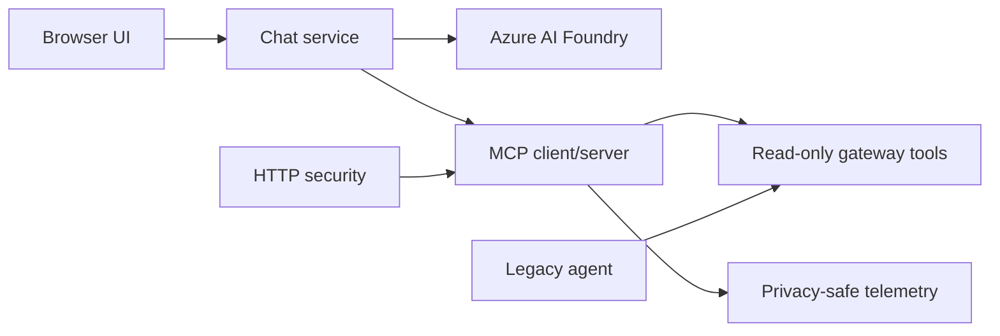
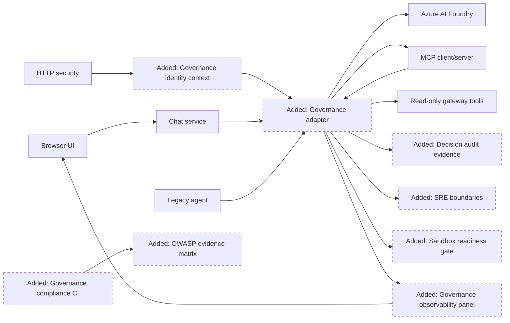
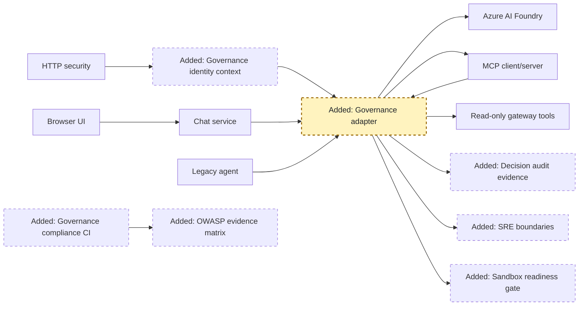
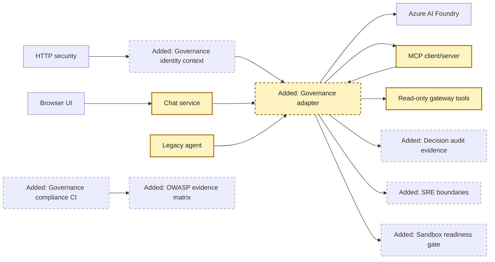
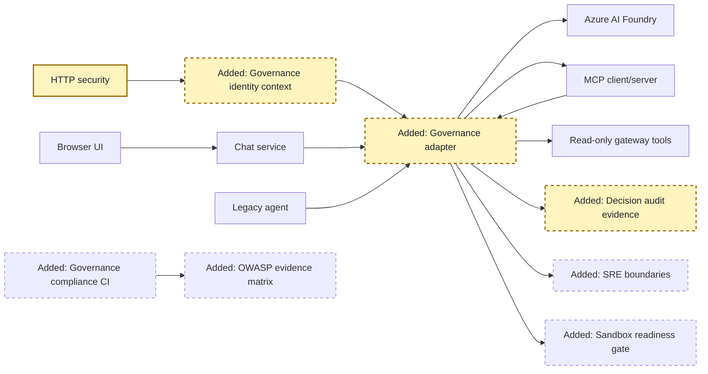
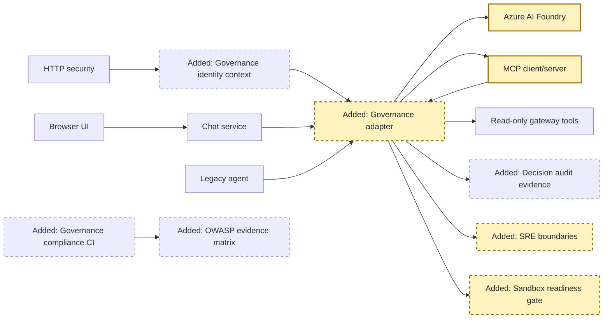
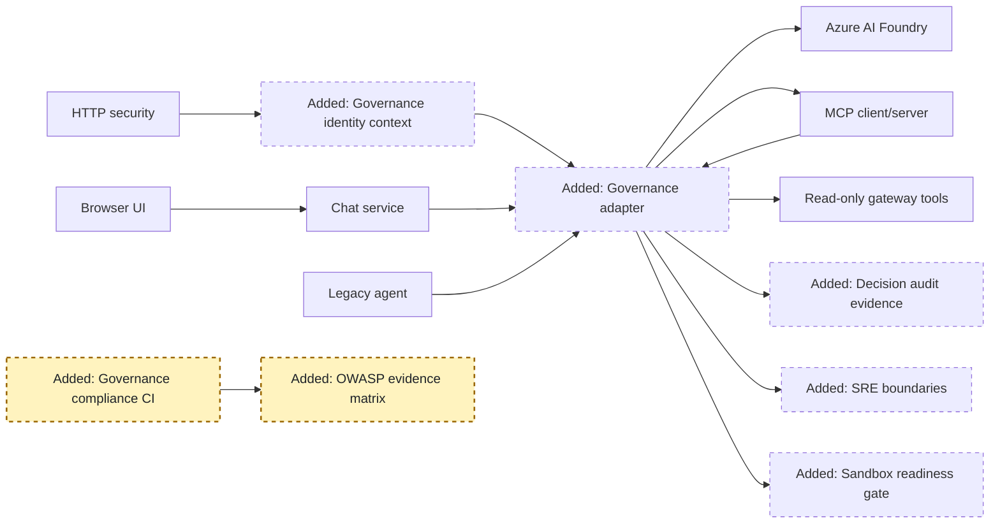
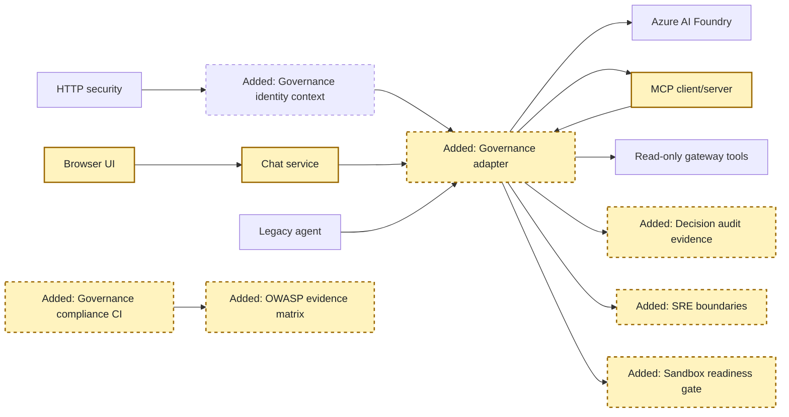

<!-- markdownlint-disable-file -->
# RPI Plan: Integrate Microsoft Agent Governance Toolkit

## Task Metadata

* Task ID: `integrate-agent-governance-toolkit`
* Task slug: `integrate-agent-governance-toolkit`
* Plan date: 2026-10-14

## Executive Summary

* Bottom line: Add the released Agent Governance Toolkit 4.1 line as a pinned,
  local-first governance layer around the existing Foundry chat and MCP tool
  boundaries. Enforce policy before and after model/tool activity, propagate
  bounded identity context, emit privacy-safe decision evidence, add reliability
  controls, establish a fail-closed sandbox contract, and continuously validate
  the resulting OWASP Agentic posture.
* Why this matters: The harness currently has strong typed-tool and request
  controls but lacks a general runtime policy decision point, end-to-end
  governance evidence, model/MCP resilience, and an enforceable rule for future
  code-execution capabilities.
* Planning result: Complete and implementation-ready. The standard critique
  completed with four planner-owned findings, all resolved in this plan.
* Confidence and uncertainty: High confidence in the architecture and released
  dependency baseline. The first implementation task must prove the exact 4.1
  Python APIs because upstream `main` documents an unreleased 5.0 ACS migration.

### What You May Not Know

* Upstream labels the toolkit Public Preview and its OWASP mapping as an internal
  self-assessment, not certification. This plan creates repository-owned evidence
  instead of inheriting upstream ratings.
* `agent-governance-toolkit[full]` does not activate every sandbox or cloud
  provider. Sandboxing remains a separate capability with host prerequisites.
* Current tools do not execute code. The plan therefore adds a fail-closed
  execution-isolation contract and provider readiness checks rather than
  pretending read-only data lookups need a code sandbox.
* Azure identity bridges, APIM, Container Apps sandboxing, HyperLight, and native
  OS sandboxes remain deferred until their infrastructure or host privileges are
  explicitly authorized.

## Phase Checklist

### Before

### After

The target architecture keeps the gateway and MCP protocol surface intact while
placing one typed governance boundary around every model and tool path. It
separates enforceable local controls from infrastructure-backed providers.

<!-- rpi:phase id=P01 -->
### [x] P01: Establish the Supported Toolkit Boundary

Goals:
* Prove a feed-portable 4.1 installation and contain all preview APIs behind one
  repository-owned adapter so later phases do not couple application code to
  unstable upstream modules.

Dependencies:
* Completed research artifact and existing Python 3.11-3.13 support.

Highlighted work: the dependency and adapter boundary represented by `GOV`.

<!-- rpi:task id=P01-T01 -->
#### [x] P01-T01: Prove and Pin the Released Dependency Set

Goals:
* Establish one installable toolkit version range that resolves from both public
  PyPI and Microsoft CFS on supported Python versions.

Requirements:
* FR-001, NFR-001, NFR-002, NFR-005, NFR-008.
* Pin `agent-governance-toolkit[full]` and `agt-sandbox[policy]` to the released
  `>=4.1,<5` line; do not consume GitHub `main`, direct wheel URLs, or 5.0.
* Governance runtime, CLI/protocol, and sandbox policy-contract packages are
  mandatory ordinary runtime dependencies. Only privileged provider extras are
  optional.
* Confirm actual imports, CLI commands, policy parsing, allow/deny behavior, and
  sandbox contract before wiring application code. Identify the released
  package/API that owns circuit-breaker behavior.
* If the released 4.1 line cannot supply the required policy or circuit-breaker
  API without an incompatible dependency, stop and return to Plan before P02.
* Preserve [pyproject.toml](../../../pyproject.toml) as the only dependency source.

Details:
* Use a bounded proof spike in the project virtual environment. Record API
  deviations in the changes record and adapt behind the repository boundary.
* Do not add Docker, HyperLight, native, or Azure sandbox extras to the default
  install.

References:
* [pyproject.toml](../../../pyproject.toml): authoritative dependency contract.
* [.copilot-tracking/research/2026-10-14/integrate-agent-governance-toolkit-research.md](../../research/2026-10-14/integrate-agent-governance-toolkit-research.md):
  * Findings on the 4.1/5.0 split, CFS availability, and sandbox packaging.

Dependencies:
* None.

<!-- rpi:task id=P01-T02 -->
#### [x] P01-T02: Create the Governance Adapter Contract

Goals:
* Give application code a stable typed contract for lifecycle decisions without
  exposing toolkit preview APIs outside one package.

Requirements:
* FR-001, FR-002, NFR-003, NFR-004, NFR-008.
* Create `src/ai_governance_harness/governance/` with typed configuration,
  context, decision, adapter, error, and lifecycle-point models.
* The contract must support `allow`, `deny`, `transform`, and
  `require_approval`/`escalate` outcomes even when a released upstream path lacks
  one outcome.
* Required policy load or evaluation failure must produce a deny result and a
  sanitized public error.
* A temporary rollback switch may disable enforcement only in an explicitly
  named local test/development mode; it must report degraded readiness.
  Production/hosted configuration and ordinary local startup must reject an
  unavailable or disabled governance runtime.

Details:
* Translate upstream objects at the package boundary. No chat, MCP, or gateway
  module may import toolkit internals directly.

References:
* [src/ai_governance_harness/mcp_server/config.py](../../../src/ai_governance_harness/mcp_server/config.py): fail-closed hosted configuration pattern.
* [src/ai_governance_harness/chat/config.py](../../../src/ai_governance_harness/chat/config.py): typed chat configuration pattern.

Dependencies:
* P01-T01.

<!-- rpi:phase id=P02 -->
### [x] P02: Enforce Lifecycle and Tool Policies

Goals:
* Make governance decisions load-bearing across browser chat, model calls, MCP
  calls, direct MCP clients, and the legacy orchestrator without duplicating
  policy logic.

Dependencies:
* P01.

Highlighted work: all model and tool edges pass through `GOV`.

<!-- rpi:task id=P02-T01 -->
#### [x] P02-T01: Add Repository-Owned Policies

Goals:
* Define reviewable default-deny policies for the current agent lifecycle and
  exact read-only tool catalog.

Requirements:
* FR-002, FR-003, FR-008, NFR-003.
* Store canonical policy/manifest files inside the Python package so editable and
  wheel installs behave identically.
* Permit only the four existing read-only tools and their bounded argument
  schemas; deny unknown, destructive, code-execution, shell, filesystem, and
  arbitrary-network capabilities.
* Cover input, pre/post model, pre/post tool, output, startup, and shutdown
  lifecycle points where supported by the 4.1 adapter.
* Decision snapshots may contain the minimum validated prompt, argument, or
  result fields required by a content-aware rule. Sensitive values must be
  classified/redacted before evaluation when the rule can operate on metadata;
  snapshots remain in memory only and must never be emitted or persisted.
* Policy files must pass the toolkit linter and contain no environment secrets.

Details:
* Where 4.1 cannot natively represent a required condition, enforce it in the
  typed adapter and record the compatibility rule rather than weakening the
  policy.

References:
* [src/ai_governance_harness/mcp_server/server.py](../../../src/ai_governance_harness/mcp_server/server.py): canonical remote tool catalog and schemas.
* [src/ai_governance_harness/chat/service.py](../../../src/ai_governance_harness/chat/service.py): current lifecycle seams.

Dependencies:
* P01-T02.

<!-- rpi:task id=P02-T02 -->
#### [x] P02-T02: Wire Model and Tool Enforcement

Goals:
* Ensure every model/tool path evaluates policy and cannot execute after deny,
  missing policy, malformed context, or required-approval outcomes.

Requirements:
* FR-002, FR-003, NFR-003, NFR-006, NFR-007.
* Evaluate policy before and after Foundry calls, before and after MCP tool calls,
  before gateway execution, and before returning final output.
* Apply transforms only to explicitly transformable fields and revalidate the
  transformed value against the existing typed boundary.
* A direct MCP client and `MemberWealthInsightsAgent` must receive the same
  pre-tool decision as the browser chat path.
* Existing advice, sovereignty, provenance, and disclosure guardrails remain
  independently active.

Details:
* Place shared tool enforcement below both MCP and legacy callers. Keep the
  outer lifecycle evaluations in chat/MCP adapters for richer context.

References:
* [src/ai_governance_harness/chat/service.py](../../../src/ai_governance_harness/chat/service.py): bounded model/tool loop.
* [src/ai_governance_harness/mcp_server/tools.py](../../../src/ai_governance_harness/mcp_server/tools.py): shared gateway wrappers.
* [src/ai_governance_harness/agent/orchestrator.py](../../../src/ai_governance_harness/agent/orchestrator.py): legacy direct path.

Dependencies:
* P02-T01.

<!-- rpi:phase id=P03 -->
### [x] P03: Bind Identity and Governance Evidence

Goals:
* Carry a minimal non-PII subject/workload context into decisions and produce a
  privacy-safe evidence trail that explains what was evaluated and enforced.

Dependencies:
* P02.

Highlighted work: `ID` and `AUDIT` enrich decisions without exposing sensitive
inputs.

<!-- rpi:task id=P03-T01 -->
#### [x] P03-T01: Propagate Bounded Identity Context

Goals:
* Give policies stable agent, workload, environment, and opaque principal
  identity while preserving local development and avoiding raw claims.

Requirements:
* FR-004, NFR-001, NFR-004.
* Context may include bounded agent ID, service/workload ID, environment,
  correlation ID, authentication outcome, tenant classification, and a one-way
  principal hash.
* Identity context must exclude raw tokens, claims, names, emails, and member
  IDs. Lifecycle decision snapshots follow the separate minimum-necessary
  in-memory contract in P02; telemetry and durable evidence never include raw
  prompts, arguments, results, or member data.
* Hosted requests reuse the validated platform identity; local requests use an
  explicit local-development workload identity.
* Missing required hosted identity must remain a hard rejection.

Details:
* Keep Azure-specific headers confined to the existing security adapter. The
  governance package consumes normalized context only.

References:
* [src/ai_governance_harness/mcp_server/security.py](../../../src/ai_governance_harness/mcp_server/security.py): current hosted principal validation.
* [src/ai_governance_harness/mcp_server/telemetry.py](../../../src/ai_governance_harness/mcp_server/telemetry.py): privacy allowlist.

Dependencies:
* P02-T02.

<!-- rpi:task id=P03-T02 -->
#### [x] P03-T02: Emit Correlated Decision Evidence

Goals:
* Record enough low-cardinality evidence to reconstruct policy decisions without
  logging sensitive request content.

Requirements:
* FR-005, FR-008, NFR-004, NFR-007.
* Emit policy version/hash, lifecycle point, rule/decision identifier, outcome,
  enforcement mode, latency, error category, and correlation fields.
* Keep toolkit and repository telemetry non-load-bearing; an exporter failure
  must not alter an already-computed deny.
* Add bounded counters and latency histograms without high-cardinality labels.
* Do not claim external action success from an allow decision; distinguish
  attempted, allowed, executed, failed, and unknown outcomes when evidence exists.

Details:
* Extend the current allowlist and reuse OpenTelemetry-aligned names. Persist no
  transcript or raw policy snapshot.

References:
* [src/ai_governance_harness/mcp_server/telemetry.py](../../../src/ai_governance_harness/mcp_server/telemetry.py): existing structured logs and metrics.

Dependencies:
* P03-T01.

<!-- rpi:phase id=P04 -->
### [x] P04: Add Reliability and Sandbox Boundaries

Goals:
* Prevent repeated downstream failure and make execution isolation an explicit,
  fail-closed capability requirement instead of an implicit future assumption.

Dependencies:
* P02 and P03.

Highlighted work: `SRE` protects network boundaries and `SANDBOX` protects any
future executable capability.

<!-- rpi:task id=P04-T01 -->
#### [x] P04-T01: Protect Foundry and MCP Calls with SRE Controls

Goals:
* Bound latency, repeated failure, and resource consumption across remote model
  and MCP operations.

Requirements:
* FR-006, NFR-003, NFR-006, NFR-007.
* Add configurable operation timeouts and toolkit-backed circuit-breaker state
  around Foundry and MCP calls.
* Retain existing tool-round, output-token, message, body, and result-size
  budgets.
* Do not retry policy denies, invalid input, unknown tools, or non-idempotent
  operations. Current read-only calls may use bounded retry only for classified
  transient failures and within the total request deadline.
* Expose readiness degradation without leaking request content.

Details:
* Prefer toolkit SRE implementations proved in P01. If a 4.1 API is unavailable,
  stop P04 and return to Plan. Do not complete FR-006 with a recorded gap or
  silently substitute unreviewed behavior.

References:
* [src/ai_governance_harness/chat/service.py](../../../src/ai_governance_harness/chat/service.py): current resource bounds.
* [src/ai_governance_harness/chat/config.py](../../../src/ai_governance_harness/chat/config.py): configuration source.

Dependencies:
* P02-T02 and P03-T02.

<!-- rpi:task id=P04-T02 -->
#### [x] P04-T02: Establish the Sandbox Readiness Contract

Goals:
* Guarantee that any capability classified as code, shell, filesystem write, or
  unrestricted network execution cannot run without an approved healthy sandbox
  provider.

Requirements:
* FR-007, NFR-001, NFR-003, NFR-005.
* Integrate the `agt-sandbox` policy contract without enabling a privileged
  provider by default.
* Current read-only gateway tools must be classified as non-executable and
  continue through ordinary policy enforcement.
* Unknown or executable capabilities must deny when no provider is configured,
  unhealthy, or unsupported on the host.
* Provider activation must be explicit and readiness-visible. Azure,
  HyperLight, MXC, Nono, and Docker execution are not acceptance requirements in
  this local Windows pass.

Details:
* Add contract tests with a fake provider; do not execute untrusted code during
  unit tests.

References:
* [src/ai_governance_harness/mcp_server/server.py](../../../src/ai_governance_harness/mcp_server/server.py): closed-world tool annotations.
* [.copilot-tracking/research/2026-10-14/integrate-agent-governance-toolkit-research.md](../../research/2026-10-14/integrate-agent-governance-toolkit-research.md):
  * Sandbox applicability and provider-prerequisite finding.

Dependencies:
* P01-T01 and P02-T01.

<!-- rpi:phase id=P05 -->
### [x] P05: Make Compliance and Supply-Chain Evidence Continuous

Goals:
* Convert upstream claims and repository controls into repeatable, reviewable CI
  evidence with explicit gaps rather than inherited badges.

Dependencies:
* P01-P04.

Highlighted work: `CI` continuously regenerates and checks `EVIDENCE`.

<!-- rpi:task id=P05-T01 -->
#### [x] P05-T01: Create the Repository OWASP Agentic Evidence Matrix

Goals:
* Record the status, enforcement point, test, limitation, and residual risk for
  every ASI01-ASI10 category.

Requirements:
* FR-008, NFR-006.
* Create a durable evidence document or machine-readable source plus generated
  Markdown covering all ten OWASP Agentic risks.
* Status values must distinguish implemented, partial, deferred, not applicable,
  and gap; no status may be copied from the upstream self-assessment without
  repository evidence.
* Map each implemented control to a semantic test and each partial/deferred item
  to its smallest completion condition.
* Include upstream Public Preview and limitation caveats.

Details:
* The canonical source must be easy to validate for completeness and duplicate
  IDs. Generated targets, if any, must not be edited manually.

References:
* [.copilot-tracking/research/2026-10-14/integrate-agent-governance-toolkit-research.md](../../research/2026-10-14/integrate-agent-governance-toolkit-research.md):
  * Toolkit coverage and limitation findings.

Dependencies:
* P02-P04.

<!-- rpi:task id=P05-T02 -->
#### [x] P05-T02: Add Governance and Supply-Chain CI Gates

Goals:
* Fail CI on invalid policies, missing evidence, governance regression, known
  vulnerable dependencies, or unbuildable packages.

Requirements:
* FR-008, NFR-002, NFR-005, NFR-006.
* Run toolkit doctor/verification/policy lint commands that are supported by the
  pinned 4.1 release; use strict evidence mode only when the repository evidence
  contract can satisfy it without false claims.
* Retain tests, Ruff, build, and `pip-audit`; generate a CycloneDX dependency
  artifact from the resolved environment.
* Add semantic tests for allow, deny, transform, missing-policy, direct-MCP,
  legacy-path, circuit-open, and sandbox-unavailable behavior.
* Add bounded adversarial fixtures proving user or tool content cannot expand
  the tool catalog, bypass required tool use, escape the synthetic in-fund
  scope, suppress final guardrails, or convert a denied action into execution.
* ASI01 remains partial when evidence proves only action governance or static
  prompt scanning; do not infer reasoning safety.
* CI must remain installable from the repository's neutral package declaration;
  developer feed selection stays outside source control.

Details:
* Do not add an unverified third-party action when an installed Python CLI can
  produce the same evidence.

References:
* [.github/workflows/ci.yml](../../../.github/workflows/ci.yml): current CI lanes.
* [pyproject.toml](../../../pyproject.toml): dependency and tooling declaration.

Dependencies:
* P05-T01.

<!-- rpi:phase id=P06 -->
### [x] P06: Complete Local Operations, Documentation, and Acceptance

Goals:
* Make governance behavior observable and operable in the one-command local
  workflow and prove the complete implementation without claiming deferred
  infrastructure.

Dependencies:
* P01-P05.

Highlighted work: local startup, readiness, tests, and documentation prove the
complete target architecture.

<!-- rpi:task id=P06-T01 -->
#### [x] P06-T01: Expose Governance Readiness and Safe Diagnostics

Goals:
* Let operators distinguish policy-loaded, degraded, denied, and unavailable
  states without exposing policy inputs or secrets.

Requirements:
* FR-005, FR-009, NFR-004.
* Readiness must fail or degrade when required policy cannot load, an enforcement
  adapter is unavailable, or a configured sandbox provider is unhealthy.
* Diagnostics may expose versions, policy digest, enforcement mode, provider
  kind, and aggregate state only.
* Local one-command startup must remain functional with default read-only tools
  and no privileged sandbox provider.

Details:
* Extend existing health/readiness behavior rather than adding a separate admin
  service.

References:
* [src/ai_governance_harness/mcp_server/http_app.py](../../../src/ai_governance_harness/mcp_server/http_app.py): MCP health routes.
* [src/ai_governance_harness/dev_launcher.py](../../../src/ai_governance_harness/dev_launcher.py): combined startup and readiness wait.

Dependencies:
* P03 and P04.

<!-- rpi:task id=P06-T02 -->
#### [x] P06-T02: Document and Validate the Complete Local Flow

Goals:
* Give teammates reproducible setup, policy, troubleshooting, upgrade, rollback,
  evidence, and deferred-provider guidance.

Requirements:
* FR-009, NFR-001, NFR-002, NFR-005, NFR-006.
* Update [README.md](../../../README.md) and [.env.example](../../../.env.example)
  for governance configuration, both package-feed workflows, policy validation,
  readiness, common denials, and safe rollback.
* Document that upstream and repository OWASP mappings are not certification.
* Validate tests, lint, package build, dependency audit, policy lint, toolkit
  verification, evidence completeness, and source/wheel inclusion.
* Run a local service acceptance that proves allowed and denied paths. A live
  Foundry call is required only when current credentials and service availability
  permit it; otherwise record it as pending external validation rather than pass.

Details:
* Preserve the existing local-first and cross-platform documentation.

References:
* [README.md](../../../README.md): current onboarding and operations guide.
* [.env.example](../../../.env.example): safe configuration template.

Dependencies:
* P05 and P06-T01.

<!-- rpi:task id=P06-T03 -->
#### [x] P06-T03: Add the Governance Observability Panel

Goals:
* Give demonstration users an understandable live view of enforcement decisions,
  active policy, reliability, sandbox posture, and OWASP evidence beside chat.

Requirements:
* FR-005, FR-009, FR-010, NFR-004, NFR-009.
* Add a responsive same-origin panel that presents bounded allow/deny counts,
  recent sanitized lifecycle decisions, active policy rules, service and
  circuit state, sandbox readiness, and repository-owned ASI01-ASI10 status.
* Aggregate the chat and MCP process views through the chat backend; do not
  require browser cross-origin access or expose raw server logs.
* Keep a bounded in-memory event window. Never expose prompts, arguments,
  results, member IDs, raw principal claims, credentials, or transcripts.
* Provide an explicitly labelled inert default-deny demonstration that evaluates
  a fixed prohibited action without executing it.
* Meet WCAG 2.2 AA design intent for keyboard operation, visible focus,
  programmatic names and structure, non-color status labels, live-region
  restraint, reflow, reduced motion, and readable contrast.

Details:
* Use a complementary side panel rather than a separate application or pop-up.
  On narrow viewports it must reflow below the chat surface without obscuring
  focus or content.
* Poll only while the document is visible and expose refresh and pause controls.

Guidance:
* Build the bounded process-local event source in
  `src/ai_governance_harness/governance/events.py`.
* Expose the MCP process snapshot at `/governance/snapshot` and proxy the merged
  view through `/api/governance/snapshot`.

References:
* [src/ai_governance_harness/chat/static/index.html](../../../src/ai_governance_harness/chat/static/index.html):
  existing accessible chat surface.
* [src/ai_governance_harness/chat/app.py](../../../src/ai_governance_harness/chat/app.py):
  same-origin API boundary.
* [src/ai_governance_harness/mcp_server/http_app.py](../../../src/ai_governance_harness/mcp_server/http_app.py):
  MCP operational route host.

Dependencies:
* P03-T02 and P06-T01.

## User Decisions and Requirements

### Confirmed User Direction

* Use the Microsoft Agent Governance Toolkit broadly and kick-start the work.
* Handle the task end to end through Research, Plan, Implement, Review, and
  required follow-ups.
* Preserve the earlier local-first direction; do not create Azure resources yet.
* Keep package setup considerate of both public PyPI and Microsoft CFS users.
* Continue without Git push; the current repository work remains local.
* Add a polished UI panel for demonstration and learning that shows allowed,
  denied, and other valuable governance telemetry and policy state.

### Planning Decisions and Feedback

| Group | Decision or feedback item | Status | Owner | Rationale or input needed | Evidence | Planning impact |
|-------|---------------------------|--------|-------|---------------------------|----------|-----------------|
| D1 | Use released `>=4.1,<5` packages instead of unreleased 5.0 | confirmed | agent | 4.1 is the latest release and the complete feed-portable line | W3, W7-W10 | Governs P01 and all API expectations |
| D2 | Interpret "full" as complete applicable-capability disposition and evidence | confirmed | agent | Upstream package presence is not effective deployment and several providers require external infrastructure | W5-W11 | Governs all phases and prevents false completion |
| D3 | Contain toolkit APIs behind one adapter | confirmed | agent | Public Preview and migration churn | W2, W4, W5 | Required by P01-T02 |
| D4 | Default-deny on policy/runtime failure | confirmed | agent | Upstream bypass disclosure and repository hosted fail-closed posture | C5, W4, W5 | Required by P01-P04 |
| D5 | Defer cloud and privileged sandbox providers | confirmed | agent | Existing local-first scope and provider prerequisites | C1, W9, W11 | Narrows P04 acceptance without removing readiness controls |

## Planning Readiness and Next Step

| Field | Record |
|-------|--------|
| Planning execution and readiness | Complete and Ready; standard critique findings PC-001 through PC-004 are resolved |
| Decision participation | agent-owned through confirmed automatic RPI mode |
| Blockers | None before critique |
| Latest critique | [.copilot-tracking/reviews/plans/2026-10-14/integrate-agent-governance-toolkit-plan-critique.md](../../reviews/plans/2026-10-14/integrate-agent-governance-toolkit-plan-critique.md) completed with Revise; all findings applied |
| Relevant research | [.copilot-tracking/research/2026-10-14/integrate-agent-governance-toolkit-research.md](../../research/2026-10-14/integrate-agent-governance-toolkit-research.md) |
| Plan | `.copilot-tracking/plans/2026-10-14/integrate-agent-governance-toolkit-plan.md` |
| Changes-record role | `.copilot-tracking/changes/2026-10-14/integrate-agent-governance-toolkit-changes.md` is implementation evidence |
| Next action | Automatically transition to Implement using the approved plan and changes-record path |

## Goals and Non-Goals

### Goals

* Add real policy enforcement at each applicable agent lifecycle boundary.
* Apply the same tool governance to chat, direct MCP, and legacy call paths.
* Bind decisions to bounded identity and emit privacy-safe evidence.
* Add resilience and an enforceable sandbox requirement for executable tools.
* Continuously validate all ten OWASP Agentic categories with repository evidence.
* Preserve local startup, existing advice/sovereignty controls, and team feed
  portability.

### Non-Goals

* Claiming certification or automatic 10/10 protection.
* Copying the upstream repository or tracking unreleased `main`.
* Creating Azure resources or activating Entra/APIM/ACA integrations.
* Installing every framework adapter, database, blockchain, or privileged
  sandbox backend.
* Adding code-execution tools to this harness.
* Pushing commits or opening a pull request.

## Functional Requirements

| ID | Requirement |
|----|-------------|
| FR-001 | A typed repository adapter must isolate the pinned toolkit and fail closed when required policy cannot load or evaluate. |
| FR-002 | Applicable input, model, tool, output, startup, and shutdown lifecycle points must produce enforceable governance decisions. |
| FR-003 | All gateway paths, including direct MCP and legacy orchestration, must share pre-tool policy enforcement. |
| FR-004 | Identity context must exclude raw credentials, claims, and PII. Content-aware policy snapshots may receive only minimum validated in-memory values required to decide a rule; raw prompts, arguments, results, and member data must never be persisted or emitted as telemetry/evidence. |
| FR-005 | Governance decisions and enforcement outcomes must emit correlated, privacy-safe logs, traces, and metrics. |
| FR-006 | Foundry and MCP boundaries must have configurable timeouts and toolkit-backed circuit-breaker behavior. |
| FR-007 | Executable capabilities must deny unless an explicitly configured supported sandbox provider is healthy. |
| FR-008 | Policies and an ASI01-ASI10 evidence matrix must be machine-checkable in tests and CI. |
| FR-009 | Local startup, readiness, configuration, troubleshooting, rollback, and evidence guidance must be documented and validated. |
| FR-010 | The browser UI must expose a privacy-safe, understandable governance observability view across chat and MCP process boundaries. |

## Non-Functional Requirements

| ID | Requirement |
|----|-------------|
| NFR-001 | Default local operation must require no Azure resource creation or privileged sandbox runtime. |
| NFR-002 | Dependencies must resolve from public PyPI and Microsoft CFS without mixing indexes. |
| NFR-003 | Missing, invalid, or failed required governance must deny rather than silently allow. |
| NFR-004 | Telemetry and durable evidence must exclude secrets, raw identity claims, member data, prompts, arguments, results, and transcripts; temporary policy snapshots must be minimum-necessary and non-persistent. |
| NFR-005 | Support Python 3.11-3.13 and preserve existing MCP 2.x, Starlette, Uvicorn, and Foundry behavior. |
| NFR-006 | Semantic tests must decide enforcement behavior; source-presence checks cannot establish runtime coverage. |
| NFR-007 | Local policy evaluation must add no more than 100 ms p95 in a deterministic benchmark, excluding model, network, and sandbox execution. |
| NFR-008 | Preview APIs must be confined to `ai_governance_harness.governance` and covered by adapter contract tests. |
| NFR-009 | The governance panel must meet WCAG 2.2 AA-oriented keyboard, structure, status, contrast, motion, and responsive-reflow requirements. |

## Risks and Open Questions

| Priority | Type | Risk, question, or item | Impact | Affected work | Response |
|----------|------|-------------------------|--------|---------------|----------|
| H | risk | 4.1 APIs may differ from current upstream docs | Broad wiring could target the wrong contract | P01-T01, P01-T02 | Complete proof spike before application edits |
| H | risk | Default/permissive policy configuration can create false governed status | Unsafe silent allow | P01-T02, P02, P06-T01 | Fail startup/readiness and add deny-path tests |
| H | risk | Legacy gateway path could bypass outer policy | Uneven enforcement | P02-T02 | Place shared enforcement below both callers |
| H | risk | SRE or sandbox API may be absent from the released bundle | Required capability cannot complete | P01-T01, P04 | Stop and return to Plan before broad wiring; do not fake replacement behavior |
| M | risk | Additional dependencies may conflict with current MCP or OpenTelemetry bounds | Install or runtime breakage | P01-T01 | Resolve before edits and pin compatible 4.1 packages |
| M | risk | Toolkit compliance output may overstate repository coverage | False assurance | P05 | Use repository-owned evidence and explicit statuses |
| M | open question | Live Foundry acceptance depends on credentials and service availability | External validation may remain pending | P06-T02 | Run when available; never convert unavailability into pass |

## Dependencies and Sequencing

* P01 is the gate for all implementation because it proves the released APIs and
  dependency graph.
* P02 creates the load-bearing enforcement boundary.
* P03 and P04 depend on P02 but may proceed independently after the adapter and
  policy contracts stabilize.
* P05 consumes implementation evidence from P01-P04.
* P06 completes local operations, the governance demonstration panel, and final
  validation.

## Test Ownership and Validation Contract

* Existing test ownership:
  * [tests/test_chat_service.py](../../../tests/test_chat_service.py) owns model
    and MCP orchestration regression behavior.
  * [tests/test_mcp_server.py](../../../tests/test_mcp_server.py) and
    [tests/test_mcp_http.py](../../../tests/test_mcp_http.py) own protocol,
    security, and transport behavior.
  * [tests/test_guardrails.py](../../../tests/test_guardrails.py) owns advice and
    disclosure behavior.
* New test ownership:
  * Add at most eight focused governance test modules for adapter/config, policy,
    lifecycle, identity/audit, SRE, sandbox, evidence, and package acceptance.
* Exact removals: none. Existing guardrail, MCP, chat, CLI, and transport tests
  remain authoritative.
* Canonical authored targets: toolkit dependency declarations, governance Python
  package, policy manifests, configuration, evidence source, tests, README, and
  `.env.example`.
* Generated targets: build distributions, CycloneDX output, toolkit verification
  output, and any rendered evidence matrix; do not edit generated output by hand.
* Semantic coverage: execute allow/deny/transform/failure/circuit/sandbox paths.
  Add adversarial goal-hijack fixtures that decide observable boundary outcomes;
  static scans remain informative only. Regression coverage: preserve existing
  tests and local launcher readiness.
* Required validation evidence:
  * `python -m pytest`
  * `python -m ruff check .`
  * `python -m build`
  * `python -m pip_audit`
  * supported 4.1 toolkit doctor, policy lint, and verification commands
  * source and wheel inspection for policies/evidence
  * deterministic policy latency benchmark
  * local combined-service readiness and allowed/denied acceptance

## Source Summary

* [Research artifact](../../research/2026-10-14/integrate-agent-governance-toolkit-research.md)
  is the canonical evidence and recommendation.
* Upstream license: MIT.
* Latest released line: v4.1.0 Public Preview/Beta.
* Current upstream `main`: in-progress 5.0 with a newer alpha ACS dependency and
  active breaking migration.
* Upstream OWASP status: internal self-assessment of 7 Full and 3 Partial.

## Critique Disposition

| Field | Record |
|-------|--------|
| Setting | standard |
| Provenance | RPI default; no user override |
| Status | completed |
| Output | [.copilot-tracking/reviews/plans/2026-10-14/integrate-agent-governance-toolkit-plan-critique.md](../../reviews/plans/2026-10-14/integrate-agent-governance-toolkit-plan-critique.md) |
| Verdict | Revise; all blocking findings resolved by direct planner corrections |
| Findings | PC-001 resolved by separating in-memory policy snapshots from emitted evidence; PC-002 resolved by mandatory runtime/startup requirements; PC-003 resolved by a hard P01 SRE gate and return-to-Plan rule; PC-004 resolved by adversarial runtime evidence and partial-status rules |
| Limitations | none recorded |

## Artifact Self-Check

| Check | Status |
|-------|--------|
| Stable task, phase, and task IDs | passed |
| Executive summary matches current decisions and scope | passed |
| Before/After and phase diagrams use stable nodes | passed |
| Every task contains goals, requirements, details, references, and dependencies | passed |
| Requirements are measurable and cite FR/NFR IDs | passed |
| Test ownership, removals, additions, targets, and evidence are locked | passed |
| Standard critique completed and blocking findings resolved | passed |

## Follow-Up Items

* Activate and validate Entra/APIM identity bridging only when hosted deployment
  resumes.
* Evaluate Docker, HyperLight, MXC, Nono, or Azure Container Apps sandbox
  providers if an executable tool is introduced or deployment authorizes the
  required host capabilities.
* Reassess migration to toolkit 5.x after an official release and full CFS
  dependency availability.

## Handoff

When critique findings are resolved, implementation will use:

* Plan: `.copilot-tracking/plans/2026-10-14/integrate-agent-governance-toolkit-plan.md`
* Research: `.copilot-tracking/research/2026-10-14/integrate-agent-governance-toolkit-research.md`
* Changes record: `.copilot-tracking/changes/2026-10-14/integrate-agent-governance-toolkit-changes.md`
* Review record: `.copilot-tracking/reviews/2026-10-14/integrate-agent-governance-toolkit-review.md`
