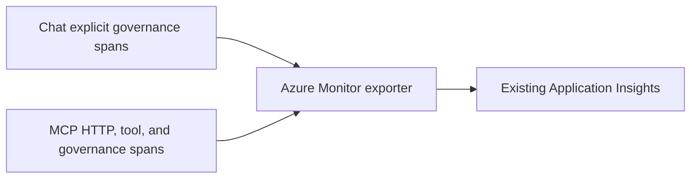
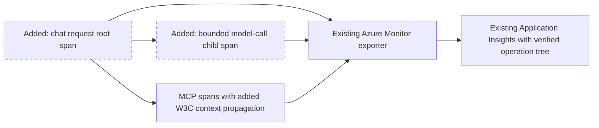
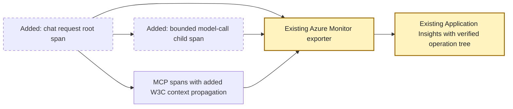
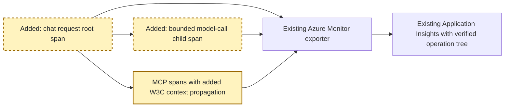
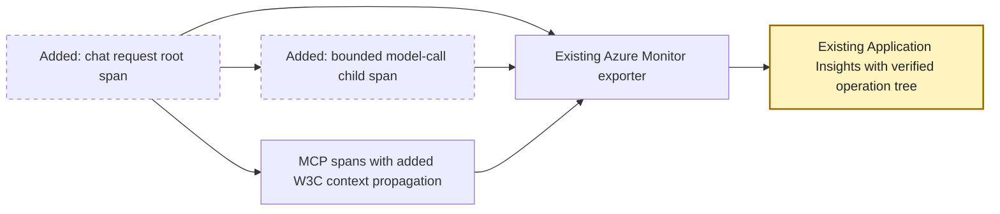

<!-- markdownlint-disable-file -->
# RPI Plan: OpenTelemetry traces in Application Insights

## Task Metadata

* Task ID: otel-appinsights-2026-10-14
* Task slug: otel-appinsights
* Plan date: 2026-10-14

## Executive Summary

* Existing code exports OpenTelemetry spans directly through Azure Monitor from both processes. No collector or new Azure resource is needed to use this path.
* Proposed work verifies trace ingestion separately from metrics and, if selected, connects chat, model, and MCP work into one distributed trace.
* Planning result: draft awaiting a user-owned scope decision. No application changes or service restarts are authorized in this planning turn.
* Confidence: existing export configuration and explicit spans are confirmed from code. Complete cross-process correlation is not demonstrated.

### What You May Not Know

* The Application Insights `traces` table stores log records, not OTel spans. Query `requests` and `dependencies` for spans; use `operation_Id` and `operation_ParentId` for relationships.
* `configure_azure_monitor` translates OTel spans into Azure Monitor telemetry. Application Insights ingestion is not a generic OTLP receiver; do not point an OTLP exporter at the Insights ingestion URL.
* Metrics ingestion alone does not prove a correlated trace.
* A governance correlation ID is not automatically a W3C trace context.

## Phase Checklist

### Before

### After

Proposed correlated-tracing scope, not yet approved:

<!-- rpi:phase id=P01 -->
### [ ] P01: Establish the trace baseline

Goals:
* Distinguish working span export from missing trace coverage or correlation.

Dependencies:
* Confirmed scope decision D1.

<!-- rpi:task id=P01-T01 -->
#### [ ] P01-T01: Verify existing OTel span ingestion

Goals:
* Obtain live evidence of exported spans for both service roles.

Requirements:
* FR-001, NFR-001, NFR-002.
* Query span tables after an inert demonstration; report role, span name, timestamps, IDs, and sampling effects without querying payloads.

Details:
* Reuse the existing ignored local connection string and approved corporate CA bundle.
* Inspect current provider initialization, sampler, shutdown/flush behavior, and export errors before proposing changes.
* Use a bounded ingestion wait. Missing data is a failure or explicit blocker, never evidence of success.

References:
* [src/ai_governance_harness/mcp_server/telemetry.py](../../../src/ai_governance_harness/mcp_server/telemetry.py)
* [src/ai_governance_harness/chat/__main__.py](../../../src/ai_governance_harness/chat/__main__.py)

Dependencies:
* D1.

<!-- rpi:phase id=P02 -->
### [ ] P02: Connect application work into a distributed trace

Goals:
* Make one chat turn navigable across governance, model, and MCP boundaries without content capture.

Dependencies:
* P01; D1 must authorize correlated tracing.

<!-- rpi:task id=P02-T01 -->
#### [ ] P02-T01: Add bounded spans and context propagation

Goals:
* Trace chat request handling, model-call duration/outcome, and MCP tool activity as related spans.

Requirements:
* FR-002, NFR-001, NFR-002.
* One valid parent-child tree across chat and MCP for a synthetic tool turn.
* No prompts, responses, tool arguments/results, member identifiers, tokens, credential headers, query strings, or exception text containing input.
* Preserve governance enforcement, service behavior, and export-disabled operation.

Details:
* Prefer existing span helpers and OTel W3C context propagation over custom trace IDs.
* Verify MCP SDK transport hooks and request context lifetime before selecting an implementation; cover initialization and tool requests, not only one HTTP call.
* Keep GenAI content tracing disabled; add narrowly scoped manual spans instead of broad automatic instrumentation.
* Establish server/client/internal span kinds and bounded attributes. Sanitize errors rather than automatically recording raw exception messages.
* Use parent-based sampling. Recommend all synthetic demo traces during verification; ongoing sampling remains a user decision.

References:
* [src/ai_governance_harness/chat/service.py](../../../src/ai_governance_harness/chat/service.py)
* [src/ai_governance_harness/chat/app.py](../../../src/ai_governance_harness/chat/app.py)
* [src/ai_governance_harness/mcp_server/security.py](../../../src/ai_governance_harness/mcp_server/security.py)
* [src/ai_governance_harness/mcp_server/server.py](../../../src/ai_governance_harness/mcp_server/server.py)
* [src/ai_governance_harness/governance/engine.py](../../../src/ai_governance_harness/governance/engine.py)

Dependencies:
* P01-T01.

<!-- rpi:phase id=P03 -->
### [ ] P03: Prove ingestion, privacy, and operator visibility

Goals:
* Establish repeatable tests and Azure evidence rather than relying on exporter configuration.

Dependencies:
* P02 for correlated scope; P01 for verification-only scope.

<!-- rpi:task id=P03-T01 -->
#### [ ] P03-T01: Validate trace contracts and document querying

Goals:
* Demonstrate correct span export, bounded attributes, and trace correlation where authorized.

Requirements:
* FR-001, FR-002 when applicable, NFR-001, NFR-002.
* Tests cover success, policy denial, sanitized failure, concurrent-request isolation, valid/invalid context, and export disabled.
* Azure evidence includes both roles and matching operation/parent IDs for correlated scope.
* Documentation distinguishes span tables from log tables.

Details:
* Test owner: implementation phase; extend existing telemetry and related chat/MCP tests.
* Removals: none. Maximum additions: one focused test file only if existing tests cannot hold the cases; no collector, infrastructure, or dependency additions without a new decision.
* Canonical targets: application telemetry and startup files plus relevant chat/MCP boundaries. Generated targets: none.
* Semantic coverage: privacy, span kinds, parentage, sampling, and concurrency. Regression coverage: current governance and chat/MCP behavior.
* Run targeted pytest and Ruff, restart only task-owned services after approval, and query bounded Azure span metadata with TLS verification enabled.
* Update README trace-query instructions; metrics must not serve as a proxy for trace acceptance.

References:
* [tests/test_telemetry.py](../../../tests/test_telemetry.py)
* [tests/test_chat_service.py](../../../tests/test_chat_service.py)
* [tests/test_mcp_http.py](../../../tests/test_mcp_http.py)
* [README.md](../../../README.md)

Dependencies:
* P02-T01 for correlated scope; otherwise P01-T01.

## User Decisions and Requirements

### Confirmed User Direction

* Plan first and explain how to send OTel traces to Application Insights; do not implement in this turn.
* Reuse the existing Application Insights resource and subscription from the current setup.
* The application currently runs locally through uv and Python 3, not Podman.

### Planning Decisions and Feedback

| Group | Decision | Status | Owner | Rationale | Evidence | Impact |
|---|---|---|---|---|---|---|
| D1 | Verification-only versus correlated tracing versus collector architecture | Input requested | User | Existing direct export works; full trace correlation is not demonstrated | Current exporter and span sites | Blocks scope finalization and critique |
| D2 | Ongoing sampling rate | Deferred | User | Demo validation should not imply production cost policy | Existing distro configuration | Resolve before changing sampler in P02-T01 |

## Planning Readiness and Next Step

* Execution: draft created; planning only.
* Readiness: Not ready pending D1 and independent critique.
* Participation: user-owned, standalone request.
* No implementation handoff or service restart yet.

## Functional Requirements

* FR-001: Demonstrate OTel spans in existing Application Insights using span-table evidence.
* FR-002: If selected, correlate a synthetic chat/model/MCP tool turn under one operation.

## Non-Functional Requirements

* NFR-001: No user content, credentials, or personal/member data in added telemetry.
* NFR-002: Preserve TLS validation, default-deny enforcement, optional export, and local service behavior.

## Scope and Non-Goals

* Proposed: reuse Azure Monitor direct export and extend only missing span coverage/correlation.
* No new Azure resources, Bicep, cloud hosting, logs expansion, dashboards, collector, or GenAI payload tracing unless explicitly selected.

## Risks and Open Questions

| Risk | Affected task | Treatment |
|---|---|---|
| MCP transport context may not propagate across requests by default | P02-T01 | Verify SDK hooks and span parentage with transport-level tests |
| Sampling or ingestion delay produces incomplete evidence | P01-T01, P03-T01 | Bounded waits and explicit sampling configuration for demonstration |
| Exceptions contain user data | P02-T01, P03-T01 | Sanitize status and test span events as well as attributes |
| Shutdown drops buffered spans | P01-T01, P03-T01 | Verify flush behavior without weakening startup/readiness |
| Collector request changes architecture materially | All | Revise this draft before implementation |

## Dependencies

* Existing Azure Monitor/OpenTelemetry packages, approved Insights resource, Azure query permissions, and managed CA bundle.

## Sources

* [src/ai_governance_harness/mcp_server/telemetry.py](../../../src/ai_governance_harness/mcp_server/telemetry.py)
* [docs/planning/adrs/0003-minimize-identity-and-governance-telemetry.md](../../../docs/planning/adrs/0003-minimize-identity-and-governance-telemetry.md)
* Earlier session queries confirmed chat governance metrics and a dependency item; this draft does not assert current end-to-end trace correlation.

## Critique Disposition

* Setting: standard, default.
* Status: not started; scope decision must precede an implementation-ready critique.
* Verdict: none.

## Artifact Self-Check

* Planning artifact only; no secrets, production changes, or infrastructure mutation.
* Phase/task markers, requirements, dependencies, diagrams, and test ownership recorded.
* Executive summary labels the proposed architecture and outstanding decision explicitly.

## Follow-Up Items

* Bicep provisioning and production retention/access policies remain outside this request.

## Handoff

* Resolve D1, revise the affected phases, then conduct the standard independent critique.
* Implementation changes record, if later authorized: `.copilot-tracking/changes/2026-10-14/otel-appinsights-changes.md`.
