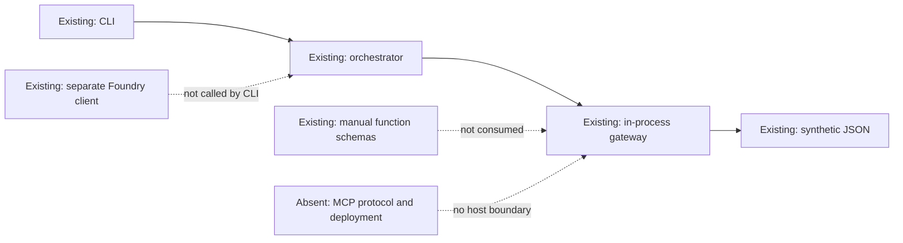
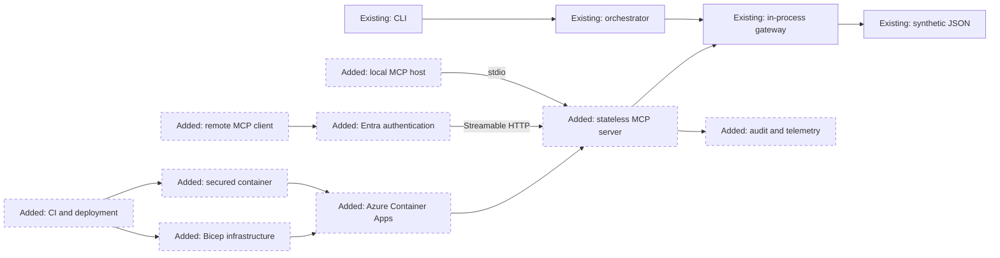
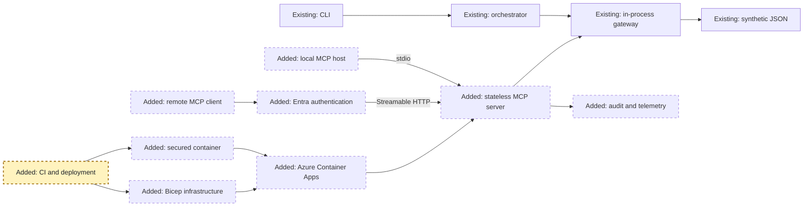
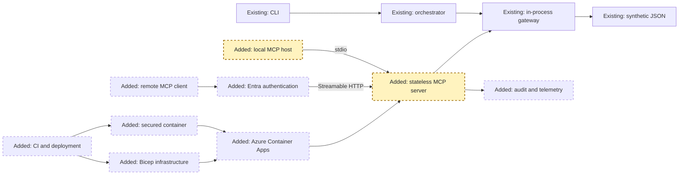
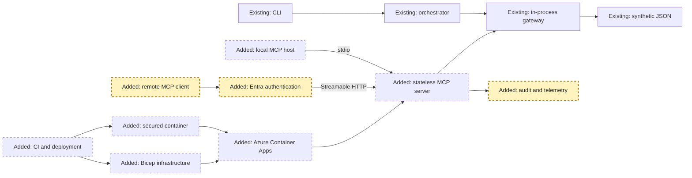
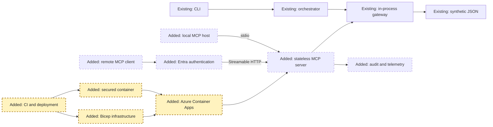
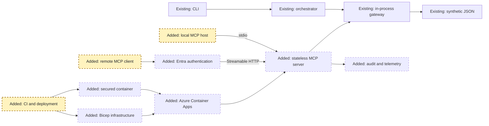
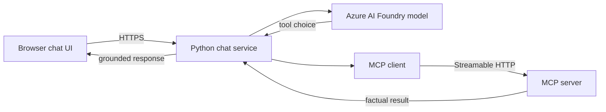

<!-- markdownlint-disable-file -->
# RPI Plan: Deployable MCP Server

## Task Metadata

* Task ID: RPI-REAL-MCP-SERVER-2026-10-14
* Task slug: real-mcp-server
* Plan date: 2026-10-14

## Executive Summary

* Bottom line: Implement a protocol-compatible MCP server plus a simple Foundry-powered chat UI, with separate service boundaries and one local convenience launcher.
* Why this matters: The repository started with reusable tool logic but no MCP transport, remote endpoint, deployable boundary, or browser experience.
* Planning result: The original MCP architecture passed independent critique; the user-approved UI expansion is recorded as implementation-time scope in P06 and P07.
* Confidence and uncertainty: High confidence in the MCP, Azure Container Apps, security, test, and deployment boundaries. Live region and SKU availability must still be checked at deployment time.

### What You May Not Know

* The current MCP Python SDK requires Python 3.11+, while the project declares Python 3.10+.
* Local stdio and deployed Streamable HTTP are different launch modes for the same server object.
* A remotely reachable MCP endpoint requires authentication, origin validation, secret handling, health checks, logs, and deployment controls beyond calling `mcp.run(port=...)`.

## Phase Checklist

### Before

### After

The implementation adds protocol and deployment boundaries around the existing gateway while preserving the CLI and deterministic business logic.

<!-- rpi:phase id=P01 -->
### [x] P01: Establish the runtime and dependency contract

Goals:
* Establish a reproducible Python 3.11+ foundation for the current MCP SDK and an automated compatibility baseline before exposing a network service.

Dependencies:
* None

Highlighted work: Python support, dependency ownership, and continuous validation represented by `pipeline`.

<!-- rpi:task id=P01-T01 -->
#### [x] P01-T01: Update Python and dependency metadata

Goals:
* Make the package install the current MCP SDK on every supported developer and build environment.

Requirements:
* `FR-001`, `FR-002`
* `NFR-007`, `NFR-009`, `NFR-013`, `NFR-014`
* Raise `requires-python` to `>=3.11`.
* Add a reviewed, bounded MCP SDK version constraint with the CLI extra only when its commands are used by project scripts or documentation.
* Declare [pyproject.toml](../../../pyproject.toml) as the dependency source of truth and remove or generate duplicate dependency declarations rather than allowing drift.
* Preserve editable development installation through `python -m pip install -e ".[dev]"`.

Details:
* Record the supported Python range as 3.11 through 3.13 initially.
* Retain `MCP_TOOL_DEFINITIONS` until its separate Foundry/OpenAI function-calling role is explicitly removed by another task.

References:
* [pyproject.toml](../../../pyproject.toml): Current Python and dependency contract
* [README.md](../../../README.md): Current environment setup
* [.copilot-tracking/research/2026-10-14/real-mcp-server-research.md](../../research/2026-10-14/real-mcp-server-research.md):
  * `What You May Not Know` records the Python 3.11+ constraint.

Dependencies:
* None

<!-- rpi:task id=P01-T02 -->
#### [x] P01-T02: Add continuous integration and dependency checks

Goals:
* Make supported runtimes, tests, linting, dependency integrity, and container scanning repeatable merge gates.

Requirements:
* `NFR-004`, `NFR-006`, `NFR-007`, `NFR-013`
* Add `.github/workflows/ci.yml` with Python 3.11, 3.12, and 3.13 test coverage.
* Run `pytest`, Ruff, package build validation, and dependency vulnerability scanning.
* Add container scanning after P04 creates the image.
* Use pinned major versions for third-party workflow actions and least-privilege workflow permissions.

Details:
* This repository currently has no CI workflow, so this task owns the initial baseline rather than extending an existing pipeline.

References:
* [tests/](../../../tests/): Existing 22-test baseline
* [pyproject.toml](../../../pyproject.toml): Test and lint dependencies

Dependencies:
* `P01-T01`

<!-- rpi:phase id=P02 -->
### [x] P02: Add the MCP protocol and local runtime

Goals:
* Expose the existing read-only gateway as discoverable MCP tools over stdio and configurable stateless Streamable HTTP without changing current CLI behavior.

Dependencies:
* `P01`

Highlighted work: `local` and `server` establish tool discovery, calls, and both local transports.

<!-- rpi:task id=P02-T01 -->
#### [x] P02-T01: Implement the typed MCP server adapter

Goals:
* Make all four gateway operations discoverable and callable through the current MCP protocol.

Requirements:
* `FR-001`, `FR-004`
* `NFR-001`, `NFR-006`, `NFR-007`, `NFR-014`
* Create `src/ai_governance_harness/mcp_server/server.py` with one module-level `MCPServer`.
* Register exactly four read-only tools that delegate to the existing gateway functions.
* Derive schemas from typed parameters and docstrings rather than duplicating `MCP_TOOL_DEFINITIONS`.
* Map `MemberNotFoundError`, validation errors, and unexpected failures to explicit sanitized MCP errors.
* Keep caller-controlled paths, arbitrary filters, and write operations out of the MCP surface.

Details:
* The adapter owns protocol translation only. Risk scoring, aggregation, and data access remain in [src/ai_governance_harness/mcp_server/tools.py](../../../src/ai_governance_harness/mcp_server/tools.py).
* Raw factual tools do not produce financial recommendations, so the narrative advice filter remains in the orchestrator. The adapter must still attach or preserve data provenance and must not claim that narrative guardrails protect raw tool data.

References:
* [src/ai_governance_harness/mcp_server/tools.py](../../../src/ai_governance_harness/mcp_server/tools.py): Existing gateway operations
* [src/ai_governance_harness/mcp_server/__init__.py](../../../src/ai_governance_harness/mcp_server/__init__.py): Existing public exports
* [src/ai_governance_harness/guardrails/advice_filter.py](../../../src/ai_governance_harness/guardrails/advice_filter.py): Narrative guardrail boundary
* [.copilot-tracking/research/2026-10-14/real-mcp-server-research.md](../../research/2026-10-14/real-mcp-server-research.md):
  * `A Thin Adapter Can Reuse the Existing Business Logic` establishes the adapter boundary.

Dependencies:
* `P01-T01`

<!-- rpi:task id=P02-T02 -->
#### [x] P02-T02: Add validated runtime configuration and startup

Goals:
* Let developers start stdio or local HTTP predictably while hosted mode fails before readiness when required configuration or data is invalid.

Requirements:
* `FR-002`, `FR-003`, `FR-007`
* `NFR-002`, `NFR-005`, `NFR-007`, `NFR-009`, `NFR-010`
* Create `src/ai_governance_harness/mcp_server/config.py` with typed settings for transport, host, port, MCP path, environment, region, allowed origins, and hosted-mode requirements.
* Default local HTTP binding to `127.0.0.1`, a documented configurable port, and `/mcp`.
* Configure Streamable HTTP as stateless and JSON-response capable only when that does not remove a required tool behavior.
* Validate and load the data gateway during explicit application startup rather than relying on an unhandled import-time failure.
* Keep stdio stdout protocol-only and route diagnostics through logging.
* Add a package or module entry point that selects stdio or Streamable HTTP without duplicating the server definition.

Details:
* Hosted mode requires `AZURE_AI_PROJECT_REGION` or an equivalent deployment-region setting and rejects absent or disallowed values.
* Hosted configuration rejects an absent region before calling the shared `SovereigntyGuardrail`; the shared guardrail keeps its permissive offline default so existing CLI and guardrail tests remain compatible.
* The direct gateway API may retain dependency injection through `data_directory`; the remote tool surface must not expose it.

References:
* [src/ai_governance_harness/mcp_server/tools.py](../../../src/ai_governance_harness/mcp_server/tools.py): Current import-time singleton
* [src/ai_governance_harness/guardrails/sovereignty.py](../../../src/ai_governance_harness/guardrails/sovereignty.py): Current region rules
* [README.md](../../../README.md): Existing environment contract

Dependencies:
* `P02-T01`

<!-- rpi:task id=P02-T03 -->
#### [x] P02-T03: Add protocol and transport tests

Goals:
* Prove discovery, tool behavior, errors, stdio framing, and local HTTP behavior at the same boundary clients use.

Requirements:
* `FR-001`, `FR-002`, `FR-003`, `FR-004`
* `NFR-001`, `NFR-005`, `NFR-006`, `NFR-007`, `NFR-014`
* Add `tests/test_mcp_server.py` using the SDK in-memory client for tool listing and all four tool calls.
* Add `tests/test_mcp_transports.py` for stdio subprocess startup and local Streamable HTTP startup.
* Add `tests/test_mcp_http.py` for HTTP configuration and transport behavior that P03 later extends with authentication and hosted-mode coverage.
* Cover unknown member IDs, malformed arguments, rejected path-like inputs, sanitized unexpected errors, and startup configuration failures.
* Assert no ordinary stdout output corrupts stdio.
* Keep [tests/test_mcp_tools.py](../../../tests/test_mcp_tools.py) as direct gateway regression coverage.

Details:
* Protocol tests own semantic MCP behavior. Existing tests remain responsible for deterministic gateway calculations.

References:
* [tests/test_mcp_tools.py](../../../tests/test_mcp_tools.py): Existing direct-call coverage
* [tests/test_agent_scenarios.py](../../../tests/test_agent_scenarios.py): Existing CLI and orchestration coverage

Dependencies:
* `P02-T01`
* `P02-T02`

<!-- rpi:phase id=P03 -->
### [ ] P03: Enforce remote security and operations controls

Goals:
* Make the stateless HTTP boundary safe to expose through Entra-protected Container Apps and observable without leaking member data.

Dependencies:
* `P02`

Highlighted work: `remote`, `entra`, and `telemetry` define the authenticated, privacy-safe operational boundary.

<!-- rpi:task id=P03-T01 -->
#### [ ] P03-T01: Enforce hosted request security

Goals:
* Reject unauthenticated, incorrectly targeted, cross-origin, abusive, or over-sized requests before tool execution.

Requirements:
* `FR-004`, `FR-008`
* `NFR-002`, `NFR-003`, `NFR-004`, `NFR-008`, `NFR-010`, `NFR-012`, `NFR-014`
* Configure Azure Container Apps built-in Microsoft Entra authentication to require authentication for the remote endpoint.
* Define the application registration, accepted audience, tenant restriction, and client access contract.
* Validate trusted platform identity headers only in hosted mode and only behind the configured Container Apps authentication boundary.
* Validate allowed origins, request content types, body sizes, and protocol revision.
* Add a process-local token bucket keyed by authenticated principal for best-effort rate limiting. Document the deployed upper bound as the per-replica limit multiplied by the configured maximum replica count; do not represent it as a strict global quota.
* Return standards-compatible authorization failures without leaking configuration or identity claims.

Details:
* Platform authentication is the first ingress boundary. It does not grant unrestricted tool authorization or replace protocol authorization requirements.
* Localhost development may use an explicit development-only authentication bypass that cannot activate in hosted mode.

References:
* [src/ai_governance_harness/mcp_server/tools.py](../../../src/ai_governance_harness/mcp_server/tools.py): Read-only tool boundary
* https://learn.microsoft.com/azure/container-apps/authentication: Selected platform authentication
* https://modelcontextprotocol.io/specification/2025-11-25/basic/transports: Transport security requirements

Dependencies:
* `P02-T02`

<!-- rpi:task id=P03-T02 -->
#### [ ] P03-T02: Publish MCP authorization discovery

Goals:
* Let standards-compatible non-browser clients discover the Microsoft Entra authorization server and resource audience while Container Apps continues to validate access tokens.

Requirements:
* `FR-004`
* `NFR-003`, `NFR-014`
* Serve OAuth 2.0 Protected Resource Metadata at `/.well-known/oauth-protected-resource/mcp` and the root fallback path.
* Include the MCP resource identifier, Microsoft Entra authorization-server issuer, supported bearer-token method, and required scopes in metadata.
* Configure Container Apps authentication to return HTTP 401 rather than a browser redirect for unauthenticated `/mcp` requests.
* Exclude only the protected-resource metadata and health endpoints from platform authentication; keep `/mcp` protected.
* Document the initial supported remote clients and how they acquire and send an Entra access token.

Details:
* The first deployment uses the well-known discovery mechanism because Container Apps owns the unauthenticated `/mcp` response. The application does not claim to customize the platform-generated `WWW-Authenticate` header.
* If a required client cannot complete Entra discovery through this contract, return to planning before adding API Management or application-managed OAuth.

References:
* https://modelcontextprotocol.io/specification/2025-11-25/basic/authorization: Protected Resource Metadata and client discovery
* https://learn.microsoft.com/azure/container-apps/authentication: Selected token-validation boundary

Dependencies:
* `P03-T01`

<!-- rpi:task id=P03-T03 -->
#### [ ] P03-T03: Add privacy-safe audit and telemetry

Goals:
* Give operators enough evidence to diagnose and audit tool use without logging member data, credentials, arguments, or results.

Requirements:
* `FR-006`, `FR-008`
* `NFR-004`, `NFR-005`, `NFR-011`
* Emit structured events for startup, readiness changes, authentication outcome, tool name, outcome, latency, sanitized error category, deployment revision, and correlation ID.
* Do not log member IDs, request bodies, tool arguments, tool results, tokens, claims, secrets, connection strings, or full endpoint query strings.
* Export OpenTelemetry-compatible traces, metrics, and logs to Azure Monitor or Application Insights.
* Retain application and audit telemetry for 30 days in development and 90 days in production by default, with access restricted to the operations role.
* Alert the configured operations action group when a revision remains unhealthy for 5 minutes or server-side HTTP failures exceed 5% over a 5-minute window; keep thresholds parameterized.

Details:
* Tool names and aggregate outcomes are audit data. Member-specific identifiers and payloads remain excluded even when synthetic.

References:
* [src/ai_governance_harness/agent/orchestrator.py](../../../src/ai_governance_harness/agent/orchestrator.py): Existing latency measurements
* https://learn.microsoft.com/azure/container-apps/log-options: Container Apps log routing

Dependencies:
* `P03-T02`

<!-- rpi:task id=P03-T04 -->
#### [ ] P03-T04: Test security and operational behavior

Goals:
* Prove the remote boundary fails closed and telemetry remains useful and privacy-safe.

Requirements:
* `FR-004`, `FR-006`, `FR-007`, `FR-008`
* `NFR-002`, `NFR-003`, `NFR-004`, `NFR-006`, `NFR-010`, `NFR-011`, `NFR-012`
* Extend `tests/test_mcp_http.py` with authenticated and unauthenticated request cases, protected-resource metadata, 401 behavior, audience and tenant failures, origin rejection, oversized input, per-replica rate-limit semantics, and startup-region failures.
* Capture test logs and assert prohibited fields and values are absent.
* Verify stateless calls can land on different server instances without losing correctness.

Details:
* Authentication tests may mock trusted platform headers for application behavior, but deployed smoke tests must verify the actual Container Apps authentication boundary.

References:
* [tests/test_guardrails.py](../../../tests/test_guardrails.py): Existing fail-closed region examples
* [src/ai_governance_harness/guardrails/sovereignty.py](../../../src/ai_governance_harness/guardrails/sovereignty.py): Region validation behavior

Dependencies:
* `P03-T01`
* `P03-T02`
* `P03-T03`

<!-- rpi:phase id=P04 -->
### [ ] P04: Package and deploy to Azure Container Apps

Goals:
* Produce a hardened, region-constrained, observable Container Apps deployment through repeatable infrastructure and workload-identity automation.

Dependencies:
* `P03`

Highlighted work: `image`, `aca`, `pipeline`, and `iac` create the repeatable deployment path.

<!-- rpi:task id=P04-T01 -->
#### [ ] P04-T01: Build and verify the hardened container

Goals:
* Run the same tested stateless HTTP server in a minimal non-root image with meaningful health semantics.

Requirements:
* `FR-003`, `FR-006`, `FR-007`
* `NFR-002`, `NFR-004`, `NFR-005`, `NFR-013`
* Add `Dockerfile` and `.dockerignore`.
* Use a supported pinned Python 3.11+ base image by digest or controlled update policy.
* Run as a non-root user with a read-only application filesystem where compatible.
* Expose only the configured application port.
* Provide `/health/live` and `/health/ready` outside the MCP protocol path; readiness depends on valid configuration and loaded data.
* Include no `.env`, credentials, caches, development tools, or unnecessary build files.
* Generate and retain an SBOM and pass image vulnerability scanning at the repository-defined severity gate.

Details:
* The health endpoints report process and dependency readiness only. They must not expose member counts, identifiers, environment values, or connection details.

References:
* [pyproject.toml](../../../pyproject.toml): Application package and dependencies
* [src/ai_governance_harness/data/synthetic/](../../../src/ai_governance_harness/data/synthetic/): Runtime data that must be intentionally packaged

Dependencies:
* `P02-T02`
* `P03-T03`

<!-- rpi:task id=P04-T02 -->
#### [ ] P04-T02: Define Azure infrastructure as code

Goals:
* Recreate the Container Apps environment, identity, registry access, authentication, ingress, scaling, probes, telemetry, and region controls without portal-only steps.

Requirements:
* `FR-005`, `FR-006`
* `NFR-002`, `NFR-003`, `NFR-004`, `NFR-008`, `NFR-010`, `NFR-012`
* Add `infra/main.bicep`, focused modules under `infra/modules/`, and non-secret parameter files for development.
* Provision or reference Azure Container Registry, Log Analytics/Application Insights, a Container Apps environment, managed identity, and the Container App.
* Deploy only to `australiaeast` or `australiasoutheast`, with the selected location passed to the application.
* Configure external HTTPS ingress to the application port and `/mcp` endpoint.
* Configure built-in Entra authentication to return HTTP 401 for unauthenticated requests and protect `/mcp`.
* Exclude only `/health/live`, `/health/ready`, `/.well-known/oauth-protected-resource`, and `/.well-known/oauth-protected-resource/mcp` from platform authentication.
* Configure startup, readiness, and liveness probes.
* Use stateless HTTP with no sticky sessions, `minReplicas: 0` for development, bounded maximum replicas, and documented cold-start expectations.
* Use managed identity for registry and downstream Azure access; keep secrets in platform references when a secret is unavoidable.
* Apply least-privilege role assignments and tags.

Details:
* Live Azure region and SKU availability must be checked before deployment.
* Provision separate development and production parameter sets. Development uses `minReplicas: 0`; production defaults to `minReplicas: 1` for latency and can be changed through reviewed parameters without adding session affinity.
* Scaling thresholds and maximum replicas remain environment parameters.

References:
* https://learn.microsoft.com/azure/container-apps/ingress-overview: HTTPS ingress
* https://learn.microsoft.com/azure/container-apps/authentication: Built-in Entra authentication
* https://learn.microsoft.com/azure/container-apps/managed-identity: Managed identity
* https://learn.microsoft.com/azure/container-apps/health-probes: Probe configuration
* https://learn.microsoft.com/azure/container-apps/scale-app: Scaling behavior

Dependencies:
* `P03-T01`
* `P03-T02`
* `P04-T01`

<!-- rpi:task id=P04-T03 -->
#### [ ] P04-T03: Add workload-identity deployment automation

Goals:
* Build, scan, publish, deploy, and verify revisions without long-lived Azure credentials.

Requirements:
* `FR-005`, `FR-006`
* `NFR-004`, `NFR-006`, `NFR-008`, `NFR-013`
* Add `.github/workflows/deploy.yml` using GitHub OpenID Connect federation to Azure.
* Separate build and infrastructure deployment permissions with least privilege.
* Run tests, lint, dependency checks, Bicep validation, and image scanning before deployment.
* Publish immutable image tags and deploy by digest.
* Perform an Azure deployment preview or what-if before apply where supported.
* Verify health, Entra rejection without a token, and one authorized MCP tool call after deployment.
* Stop and surface logs when a probe, authentication, or tool-call check fails.
* Document rollback to the last healthy Container Apps revision.

Details:
* Production deployment approval is a repository-environment control. The implementation must not automatically publish from arbitrary branches.

References:
* [tests/](../../../tests/): Required pre-deployment validation
* `infra/main.bicep`: Planned infrastructure entry point

Dependencies:
* `P01-T02`
* `P04-T02`

<!-- rpi:phase id=P05 -->
### [ ] P05: Complete end-to-end validation and operator guidance

Goals:
* Make local use, remote use, deployment verification, failure diagnosis, and cross-platform onboarding repeatable for the team.

Dependencies:
* `P04`

Highlighted work: local and remote client evidence plus pipeline gates complete the operational handoff.

<!-- rpi:task id=P05-T01 -->
#### [ ] P05-T01: Add end-to-end and deployment contract tests

Goals:
* Verify the container and infrastructure contracts beyond unit and middleware tests.

Requirements:
* `FR-001` through `FR-008`
* `NFR-001` through `NFR-014`
* Add a container smoke test that starts the image, waits for readiness, calls the MCP endpoint, and shuts down cleanly.
* Add Bicep build and lint tests plus policy assertions for region, authentication, managed identity, ingress, probes, scaling, alerting, and secret-free parameters.
* Assert that health and protected-resource metadata paths are the only authentication exclusions and that `/mcp` remains protected.
* Add a deployed smoke script that acquires an Entra token without printing it, verifies unauthenticated rejection, and performs one authorized read-only tool call.
* Run one named-client acceptance test with no pre-supplied token or custom authorization header. Verify that the client discovers Protected Resource Metadata, starts Microsoft Entra authorization, connects to `/mcp`, lists tools, and completes one read-only call.
* Record exact merge-gating tests in CI and environment-gating tests in deployment automation.

Details:
* Live tests must use only synthetic member IDs and must redact remote response payloads from logs.

References:
* [tests/](../../../tests/): Existing and planned test ownership
* `Dockerfile`: Planned container contract
* `infra/main.bicep`: Planned deployment contract

Dependencies:
* `P04-T01`
* `P04-T02`
* `P04-T03`

<!-- rpi:task id=P05-T02 -->
#### [ ] P05-T02: Document local, host, and deployment workflows

Goals:
* Let Windows and macOS contributors start, connect, deploy, validate, and troubleshoot the server without relying on personal paths or undocumented portal state.

Requirements:
* `FR-002`, `FR-003`, `FR-005`, `FR-006`
* `NFR-005`, `NFR-009`, `NFR-014`
* Update [README.md](../../../README.md) with Python 3.11+, installation, stdio, local port, container, Azure login, deployment, smoke-test, and troubleshooting commands.
* Add a portable `.mcp.json` for local stdio when its command can work on Windows and macOS without embedding secrets or absolute personal paths.
* Document the remote MCP URL, Entra prerequisites, supported protocol revision, and client configuration without committing tokens.
* Document health endpoints, logs, correlation IDs, expected cold starts, rollback, and common authentication failures.
* Clearly state that the existing CLI remains local and deterministic, while the new MCP endpoint is a separate host integration surface.

Details:
* Examples must use placeholders for tenant, client, subscription, and endpoint identifiers.

References:
* [README.md](../../../README.md): Existing setup and CLI guide
* [.vscode/settings.json](../../../.vscode/settings.json): Current cross-platform interpreter and Windows terminal behavior
* https://code.visualstudio.com/docs/agent-customization/mcp-servers: Portable workspace MCP configuration

Dependencies:
* `P05-T01`

<!-- rpi:phase id=P06 -->
### [x] P06: Add the Foundry-powered chat experience

Goals:
* Provide a simple browser chat that uses an Azure AI Foundry model to select and call the deployed MCP tools without coupling the UI to tool implementation details.

Dependencies:
* `P02`
* `P03`

<!-- rpi:task id=P06-T01 -->
#### [x] P06-T01: Implement the Foundry chat orchestration service

Goals:
* Turn browser messages into grounded Foundry responses that use the MCP protocol boundary for tool execution.

Requirements:
* `FR-009`, `FR-010`
* `NFR-004`, `NFR-011`, `NFR-015`
* Add a typed chat service that connects to the configured MCP Streamable HTTP URL, discovers tools, presents their schemas to the configured Foundry model, executes bounded read-only tool calls, and returns the final response.
* Use `AZURE_AI_MODEL_DEPLOYMENT_NAME` and the existing Foundry credential/project configuration.
* Cap conversation history, message size, tool rounds, and response size.
* Do not persist chat history or log prompts, tool arguments, tool results, member identifiers, tokens, or model response bodies.
* Surface Foundry, MCP, and configuration failures explicitly with sanitized user-facing errors and operator-safe logs.

Dependencies:
* `P02-T03`
* `P03-T03`

<!-- rpi:task id=P06-T02 -->
#### [x] P06-T02: Add the static chat UI and web API

Goals:
* Let a developer open a browser, submit a message, observe progress, and receive an accessible grounded response.

Requirements:
* `FR-009`
* `NFR-009`, `NFR-015`
* Serve a dependency-free HTML, CSS, and JavaScript interface from a Python web app.
* Add `/api/chat`, `/health/live`, and `/health/ready` endpoints.
* Keep browser state in memory only and provide clear loading, error, empty, and disconnected states.
* Meet keyboard navigation, visible focus, semantic landmark, label, contrast, and live-region requirements for the simple interface.
* Reject cross-origin, malformed, oversized, and unsupported requests before model invocation.

Dependencies:
* `P06-T01`

<!-- rpi:task id=P06-T03 -->
#### [x] P06-T03: Add separate launchers and one convenience launcher

Goals:
* Preserve separately runnable MCP and UI services while making local startup one command.

Requirements:
* `FR-011`
* `NFR-009`
* Add separate cross-platform commands for the MCP service and UI/chat service.
* Add one development launcher that starts both services, verifies readiness, prints the UI URL, and shuts both down cleanly.
* Keep service ports independently configurable and detect port conflicts with actionable errors.
* Add integration tests proving the UI backend calls the MCP service rather than importing gateway functions directly.
* Document Windows PowerShell and macOS/Linux startup and shutdown.

Dependencies:
* `P06-T02`

<!-- rpi:phase id=P07 -->
### [ ] P07: Deploy and validate the chat service

Goals:
* Deploy the UI/chat backend as a separate Container App that authenticates to the protected MCP service while reusing the tested image and infrastructure controls.

Dependencies:
* `P04`
* `P06`

<!-- rpi:task id=P07-T01 -->
#### [ ] P07-T01: Extend container and Bicep deployment for chat

Requirements:
* Add a second Container App entry point for the UI/chat service.
* Use managed identity to acquire the MCP audience token and keep `/mcp` protected.
* Configure HTTPS ingress, probes, secrets, scaling, telemetry, and browser authentication for the chat service.
* Keep development and production replica, retention, and alert settings parameterized.

Dependencies:
* `P04-T01`
* `P04-T02`
* `P06-T03`

<!-- rpi:task id=P07-T02 -->
#### [ ] P07-T02: Add deployed chat acceptance and operator guidance

Requirements:
* Verify browser authentication, one grounded chat turn, MCP authorization, and privacy-safe telemetry in the deployed environment.
* Extend deployment automation and rollback guidance for both Container Apps.
* Document the two-service topology, managed-identity trust, URLs, health endpoints, and common failure modes.

Dependencies:
* `P07-T01`

## User Decisions and Requirements

### Confirmed User Direction

* Preserve the code walkthrough and continue with the orchestrator and compliance-guardrail segment after planning.
* Replace the current MCP-style naming gap with a real protocol-compatible MCP server.
* Support startup on a local TCP port for development and testing.
* Make the server deployable and perform a thorough implementation rather than a minimal demo.
* Update durable planning and actionable todo records before implementation.
* Use Azure Container Apps as the first deployment target for Streamable HTTP.
* Raise the project minimum Python version to 3.11 for the current MCP Python SDK.
* Protect the first remote deployment with Azure Container Apps built-in Microsoft Entra authentication.
* Use stateless Streamable HTTP for the first deployment so replicas can scale without sticky sessions or external session storage.
* Add a simple Foundry-powered browser chat implemented with HTML, CSS, and JavaScript served by Python.
* Keep MCP and chat as separately runnable services, with one convenience launcher that starts both locally.

### Planning Decisions and Feedback

| Group | Decision or feedback item | Status | Owner | Rationale or input needed | Evidence | Planning impact |
|-------|---------------------------|--------|-------|---------------------------|----------|-----------------|
| D1 | Use Azure Container Apps as the first Streamable HTTP deployment target | Confirmed | User | Managed HTTPS ingress, Entra integration, managed identity, probes, and lower operational burden fit the repository | User decision; official Azure Container Apps documentation | Unblocks hosting requirements in P03 and P04 |
| D2 | Raise the project minimum to Python 3.11 | Confirmed | User | The current official MCP SDK requires Python 3.11+, and the repository has no automated Python 3.10 compatibility matrix to preserve | User decision; MCP research W1; `pyproject.toml` | Unblocks dependency and CI contracts in P01 |
| D3 | Use Azure Container Apps built-in Microsoft Entra authentication | Confirmed | User | Platform authentication provides an initial Entra boundary without implementing a custom token service | User decision; Azure Container Apps authentication guidance | Unblocks the ingress authentication contract in P03 |
| D4 | Use stateless Streamable HTTP | Confirmed | User | Current read-only tools do not require session state, sampling, elicitation, or server-to-client progress; stateless mode supports safe scaling | User decision; MCP SDK and Azure Container Apps scaling guidance | Unblocks scaling and ingress requirements in P03 and P04 |
| D5 | Use Azure AI Foundry for chat responses and tool selection | Confirmed | User | The UI should provide a real conversational experience grounded by the MCP tools | User decision during implementation | Adds P06 orchestration and acceptance scope |
| D6 | Use dependency-free HTML, CSS, and JavaScript served by Python | Confirmed | User | A simple UI avoids a Node toolchain and remains easy for Windows and macOS contributors | User decision during implementation | Adds P06 web UI scope |
| D7 | Keep two services and add one convenience launcher | Confirmed | User | Separate boundaries improve deployment and security while the launcher preserves simple local startup | User decision during implementation | Adds P06 launcher and P07 deployment scope |

## Planning Readiness and Next Step

| Field                            | Record |
|----------------------------------|--------|
| Planning execution and readiness | Complete and Ready; the follow-up critique passed and all residual findings have direct corrections |
| Decision participation           | User-owned, from standalone user request |
| Blockers                         | None |
| Latest critique                  | [.copilot-tracking/reviews/plans/2026-10-14/real-mcp-server-plan-critique-2.md](../../reviews/plans/2026-10-14/real-mcp-server-plan-critique-2.md) with `Pass` |
| Relevant research                | [.copilot-tracking/research/2026-10-14/real-mcp-server-research.md](../../research/2026-10-14/real-mcp-server-research.md) |
| Plan                             | `.copilot-tracking/plans/2026-10-14/real-mcp-server-plan.md` |
| Changes-record role              | `.copilot-tracking/changes/2026-10-14/real-mcp-server-changes.md` will hold implementation evidence |

## Goals

* Expose the four existing read-only data functions as discoverable MCP tools.
* Support local Streamable HTTP startup on a configurable host, port, and `/mcp` path.
* Preserve direct in-process calls for the existing CLI and unit tests.
* Provide a secure, observable, repeatable deployment path for a shared MCP endpoint.
* Enforce Australian-region, read-only, provenance, authentication, and privacy boundaries across the remote tool surface while keeping narrative financial-advice filtering in the orchestrator.

## Scope and Non-Goals

### In Scope

* MCP SDK dependency and Python compatibility
* Thin server adapter and typed tool registration
* Local stdio and Streamable HTTP startup
* Configuration validation and explicit startup failures
* Authentication and transport security
* Protocol, integration, and negative-path tests
* Container build and selected Azure deployment target
* Health, logging, telemetry, and operational documentation
* Portable local host configuration where safe
* Azure AI Foundry chat orchestration through the MCP protocol
* Dependency-free browser chat UI and separate local service launchers
* Separate Container Apps deployment for the chat service

### Non-Goals

* Replacing the existing data gateway or deterministic risk rules
* Exposing real member PII
* Adding write-capable MCP tools
* Making the current CLI call through an MCP transport
* Persisting chat transcripts or adding a general-purpose conversation database
* Letting the browser call Foundry or the MCP endpoint directly

## Functional Requirements

* `FR-001`: MCP clients can list and call the four existing read-only tools through the protocol.
* `FR-002`: Developers can run the server locally over stdio and Streamable HTTP.
* `FR-003`: Streamable HTTP uses configurable host, port, and endpoint path values.
* `FR-004`: Remote clients receive structured success results and explicit, sanitized tool errors.
* `FR-005`: The selected Azure hosting target deploys the same tested server artifact.
* `FR-006`: Operators can verify readiness, liveness, authentication, and an authorized tool call.
* `FR-007`: Hosted startup validates the synthetic dataset and all required deployment configuration before becoming ready.
* `FR-008`: Authorized tool invocations produce privacy-safe audit events with correlation identifiers and outcomes.
* `FR-009`: A browser user can submit a chat message and receive a Foundry-generated response grounded by MCP tool results.
* `FR-010`: The chat backend discovers and calls tools through MCP rather than importing gateway functions directly.
* `FR-011`: Developers can start MCP and chat separately or together through one convenience launcher.

## Non-Functional Requirements

* `NFR-001`: The server remains read-only and never accepts caller-provided filesystem paths.
* `NFR-002`: The service fails closed for unsupported regions, missing security configuration, and invalid startup configuration.
* `NFR-003`: Streamable HTTP validates origins, binds safely by default, and requires approved authentication when remotely exposed.
* `NFR-004`: Secrets are not committed, logged, returned in MCP errors, or embedded in images.
* `NFR-005`: Logs use stderr for stdio and structured output for hosted execution without corrupting protocol messages.
* `NFR-006`: Protocol tests cover discovery, all tool calls, invalid identifiers, malformed input, and authorization failures.
* `NFR-007`: Existing CLI behavior and all current tests remain compatible.
* `NFR-008`: Deployment remains in an approved Australian Azure region.
* `NFR-009`: Documentation supports Windows and macOS development workflows.
* `NFR-010`: Hosted mode requires an explicit approved region and fails startup when the region is absent or disallowed.
* `NFR-011`: Hosted logs and telemetry exclude member identifiers, access tokens, request bodies, and tool result payloads.
* `NFR-012`: Remote ingress includes rate limiting or an equivalent abuse-control boundary.
* `NFR-013`: The dependency contract pins the MCP SDK, defines source-of-truth dependency metadata, and scans the application and container image.
* `NFR-014`: The selected MCP protocol revision and supported client compatibility are documented and tested.
* `NFR-015`: Chat history is bounded, remains in browser or request memory only, and is excluded from telemetry and persistent storage.

## Risks and Open Questions

| Priority | Type | Risk, question, or research item | Impact | Smallest action or evidence needed | Owner |
|----------|------|----------------------------------|--------|------------------------------------|-------|
| Medium | Availability | Stateless scale-to-zero introduces cold-start latency | First request after idle may be slower | Measure cold starts and parameterize production minimum replicas | Implementation |
| Medium | Compatibility | Raising the minimum Python version can affect contributor environments | Teammates on Python 3.10 cannot install the updated project | Document the change and validate Python 3.11 through 3.13 in CI | Implementation |
| Medium | Security | Synthetic data could later be replaced with sensitive data | Deployment controls must not assume data remains harmless | Keep least privilege and no-secret logging requirements | Implementation |
| Medium | Protocol | Ordinary stdout output can corrupt stdio | Local host startup can fail unpredictably | Add logging policy and stdio integration test | Implementation |
| Low | Portability | Workspace launch commands can be OS-specific | Teammates may fail to start the server | Prefer portable commands and document prerequisites | Implementation |
| Low | Compliance | Operators may assume raw MCP data tools apply the orchestrator's narrative advice filter | Governance claims could overstate the remote tool boundary | Document that raw factual tools preserve provenance but narrative filtering remains an orchestrator responsibility | Implementation |
| Medium | Availability | Import-time data loading can crash a hosted replica before probes are available | Container can enter a crash loop with weak diagnostics | Move readiness ownership to an explicit startup lifecycle | Implementation |

## Dependencies

* Existing gateway in [src/ai_governance_harness/mcp_server/tools.py](../../../src/ai_governance_harness/mcp_server/tools.py)
* Existing guardrails in [src/ai_governance_harness/guardrails/](../../../src/ai_governance_harness/guardrails/)
* Existing tests in [tests/](../../../tests/)
* Current MCP Python SDK and transport specification
* Selected Azure hosting and identity services
* A container registry, managed deployment identity, and deployment automation for the selected Azure host
* A defined telemetry backend and audit-event schema

## Sources

* [.copilot-tracking/research/2026-10-14/real-mcp-server-research.md](../../research/2026-10-14/real-mcp-server-research.md)
* [pyproject.toml](../../../pyproject.toml)
* [src/ai_governance_harness/mcp_server/tools.py](../../../src/ai_governance_harness/mcp_server/tools.py)
* [src/ai_governance_harness/guardrails/sovereignty.py](../../../src/ai_governance_harness/guardrails/sovereignty.py)
* [tests/test_mcp_tools.py](../../../tests/test_mcp_tools.py)
* https://py.sdk.modelcontextprotocol.io/run/
* https://modelcontextprotocol.io/specification/2025-11-25/basic/transports
* https://modelcontextprotocol.io/specification/2025-11-25/basic/authorization
* https://code.visualstudio.com/docs/agent-customization/mcp-servers
* https://learn.microsoft.com/azure/container-apps/ingress-overview
* https://learn.microsoft.com/azure/container-apps/authentication
* https://learn.microsoft.com/azure/container-apps/managed-identity
* https://learn.microsoft.com/azure/container-apps/health-probes
* https://learn.microsoft.com/azure/container-apps/sticky-sessions
* https://learn.microsoft.com/azure/container-apps/scale-app

## Critique Disposition

* Critique setting: Standard by default.
* Initial critique status: Complete with `Revise`.
* Initial output: [.copilot-tracking/reviews/plans/2026-10-14/real-mcp-server-plan-critique.md](../../reviews/plans/2026-10-14/real-mcp-server-plan-critique.md)
* Follow-up status: Complete with `Pass`.
* Follow-up output: [.copilot-tracking/reviews/plans/2026-10-14/real-mcp-server-plan-critique-2.md](../../reviews/plans/2026-10-14/real-mcp-server-plan-critique-2.md)

| Finding | Disposition | Resolving plan evidence |
|---------|-------------|-------------------------|
| PC-001 | Applied | P04-T02 excludes exact health paths from authentication; P05-T01 asserts exclusions and `/mcp` protection |
| PC-002 | Applied | New P03-T02 owns OAuth Protected Resource Metadata, HTTP 401 behavior, Entra audience, scopes, and supported clients |
| PC-003 | Applied | P03-T01 selects process-local best-effort rate limiting with a documented maximum-replica upper bound; P03-T04 tests those semantics |
| PC-004 | Applied | P02-T03 now creates `tests/test_mcp_http.py` before P03-T04 extends it |
| PC-005 | Applied | The obsolete stateful-session risk is removed; only stateless cold-start risk remains |
| PC-006 | Applied | Goals and risks now state that narrative advice filtering remains an orchestrator responsibility |
| PC-007 | Applied | P02-T02 rejects absent hosted region independently while preserving the shared offline guardrail default |
| PC-008 | Applied | The research artifact now records dated Container Apps evidence W6 through W11 and a second research cycle |
| PC-009 | Applied | P03-T03 defines retention and alert defaults; P04-T02 defines development and production parameter sets |
| PC-010 | Applied | P04-T01 now owns the exact `/health/live` and `/health/ready` paths implemented by its container contract |
| PC-011 | Applied | P05-T01 now requires a named-client, no-token discovery and Entra authorization acceptance test |
| PC-012 | Applied | P02-T03 creates transport-only HTTP coverage; P03-T04 owns later authentication extensions |
| PC-013 | Applied | The authorization specification is now recorded in plan Sources and research evidence W12 |

## Artifact Self-Check

* One stable task ID is assigned.
* Confirmed user direction is preserved.
* Research evidence is linked.
* All material architecture decisions are confirmed.
* No source implementation changes are included.
* Test ownership, exact planned additions, and regression boundaries are explicit.

## Follow-Up Items

* Resume the code walkthrough at Segment 4 after planning.
* Azure deployment work in `P03`, `P04`, `P05`, and `P07` is intentionally deferred by the user while local MCP and chat workflows are validated.

## Handoff

Run `/rpi-implement` to execute this plan and maintain `.copilot-tracking/changes/2026-10-14/real-mcp-server-changes.md`.
