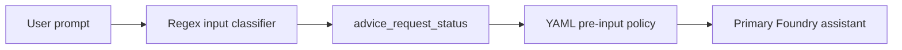
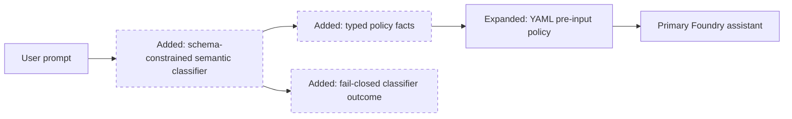
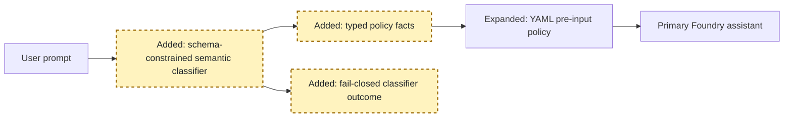
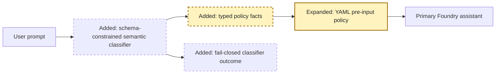
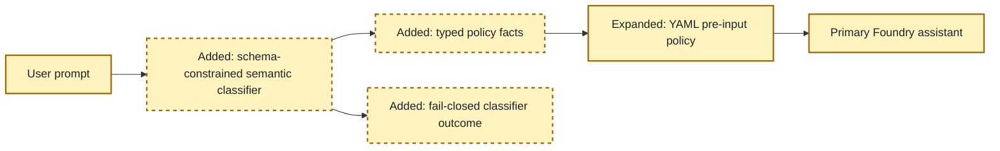

<!-- markdownlint-disable-file -->
# RPI Plan: Semantic Personal-Advice Policy Classification

## Task Metadata

* Task ID: `semantic-advice-policy-2026-10-14`
* Task slug: `semantic-advice-policy`
* Plan date: `2026-10-14`

## Executive Summary

* Bottom line: Replace regex-based input-advice detection with a dedicated, schema-constrained Foundry classification call that emits bounded policy facts. YAML policy will own the allow/deny decision, while output-response scanning remains deterministic and unchanged.
* Why this matters: Personal-advice enforcement becomes semantic, explainable, and resilient to pronouns and mixed intents without exposing raw prompts to policy evaluation or telemetry.
* Planning result: Complete and ready for implementation; standard critique findings are resolved.
* Confidence and uncertainty: High confidence in the repository integration points and installed SDK support. Residual model-classification accuracy risk is controlled through a strict taxonomy, risk-priority instructions, fail-closed invalid/uncertain handling, and an evaluation-style test matrix.

### What You May Not Know

* The policy engine cannot infer meaning from unrestricted text; a classifier must produce typed facts first.
* The classifier will be a separate, tool-free Foundry completion before the primary assistant. It will use `store=False`, strict JSON schema, minimal reasoning, low verbosity, a bounded token budget, existing timeout/circuit protection, and no application telemetry containing prompt text.
* This adds one model call per accepted or denied chat request. Classifier unavailability, invalid output, low confidence, or provider filtering will deny the request before the primary assistant.
* Existing regex output scanning remains necessary because it evaluates generated/tool content at `post_tool`; only input-request regex classification is removed.

## Phase Checklist

### Before



### After



The semantic classifier becomes the only producer of input-advice policy facts. Policy remains the decision authority, and the primary assistant runs only after an allow decision.

<!-- rpi:phase id=P01 -->
### [x] P01: Establish the semantic classification boundary

Goals:
* Introduce a typed, bounded, independently testable classification component that converts raw prompt meaning into policy-safe facts before the main assistant runs.

Dependencies:
* Existing Foundry client and reliability boundary.
* Existing Pydantic and OpenAI dependencies.



Highlighted work: the classifier contract, provider adapter, and fail-closed result mapping.

<!-- rpi:task id=P01-T01 -->
#### [x] P01-T01: Define the typed semantic contract

Goals:
* Provide a closed taxonomy that distinguishes factual requests, general education, retention outreach, personalized financial recommendations, and unknown intent.

Requirements:
* `FR-001`, `FR-003`, `FR-004`, `NFR-001`, `NFR-003`.
* The following JSON shape is a contract; enum values are closed and extra fields are rejected:

```json
{
  "classification_status": "classified",
  "request_intent": "financial_recommendation",
  "advice_subject": "identified_member",
  "financial_action": "invest",
  "product_scope": "external_security",
  "confidence": "high"
}
```

* Safe intents include `factual_information`, `general_education`, `retention_outreach`, and `other_safe`.
* Risk intent is `financial_recommendation`.
* Unknown, invalid, unavailable, filtered, or low-confidence classification must not be represented as safe.

Details:
* Add a focused module under `src/ai_governance_harness/guardrails/` containing Pydantic enums/models, the classifier system instruction, strict response-format construction, parsing, and bounded policy-data projection.
* Mixed requests use risk-priority semantics: if any part asks for an identified member recommendation, classify the request as `financial_recommendation` even when it also asks for an allowed outreach action.
* The classifier response contains no copied prompt text, rationale, names, member IDs, or free-form explanation.
* Classifier input contains the current user turn and, when present, the immediately preceding user turn as separately labelled context. Context selection must not depend on member-ID or advice regex matching.

References:
* [src/ai_governance_harness/guardrails/advice_filter.py](../../../src/ai_governance_harness/guardrails/advice_filter.py): current regex input classifier and retained output scanner.
* [src/ai_governance_harness/chat/service.py](../../../src/ai_governance_harness/chat/service.py): current pre-input orchestration and Foundry error handling.

Dependencies:
* None.

<!-- rpi:task id=P01-T02 -->
#### [x] P01-T02: Integrate the classifier with Foundry reliability and lifecycle governance

Goals:
* Run semantic classification before `chat.input` policy and before the primary assistant, with explicit classifier lifecycle evidence and deterministic cleanup.

Requirements:
* `FR-001`, `FR-003`, `FR-004`, `NFR-001`, `NFR-002`, `NFR-003`.
* Use the configured Foundry deployment with no tools, `store=False`, strict JSON schema, minimal reasoning, low verbosity, and a bounded completion budget.
* Reuse timeout and circuit-breaker protection.
* Record classifier `pre_model` and `post_model` policy events using a distinct action such as `foundry.advice_classifier`.
* Do not include raw prompts, model output, member IDs, or classifier rationale in policy data, logs, errors, or telemetry.
* Map provider filtering, invalid JSON/schema, empty output, low confidence, timeouts, and unavailable dependencies to bounded classification statuses consumed by policy.
* The primary assistant and MCP discovery must not run after classifier policy denial.
* Successful unsafe classifications surface the existing governance denial. Operational or invalid classifier outcomes remain fail closed but surface a structured `classification_unavailable` chat error with a bounded reason and correlation ID.

Details:
* Initialize the Foundry client before `chat.input` evaluation so classification can occur, but preserve `finally` cleanup on every path.
* Add explicit policy rules allowing the classifier model call/result; these rules authorize classification only and do not authorize the user request.
* Use a separate reliability boundary name for classifier failures so its circuit state is independently observable.

References:
* [src/ai_governance_harness/chat/service.py](../../../src/ai_governance_harness/chat/service.py): orchestration, known-error extraction, lifecycle enforcement, and client cleanup.
* [src/ai_governance_harness/governance/reliability.py](../../../src/ai_governance_harness/governance/reliability.py): timeout and circuit-breaker wrapper.
* [src/ai_governance_harness/chat/config.py](../../../src/ai_governance_harness/chat/config.py): bounded chat settings.

Dependencies:
* `P01-T01`.

<!-- rpi:phase id=P02 -->
### [x] P02: Move the decision vocabulary into YAML policy

Goals:
* Make policy rules explicitly decide on semantic intent, subject, action, product scope, confidence, and classifier status instead of a single regex-derived flag.

Dependencies:
* `P01`.



Highlighted work: structured policy vocabulary and explicit deny/allow rules.

<!-- rpi:task id=P02-T01 -->
#### [x] P02-T01: Add semantic input-policy rules

Goals:
* Produce explainable matched rules for personalized recommendations, external-security recommendations, and unsafe classifier outcomes.

Requirements:
* `FR-002`, `FR-003`, `FR-004`, `NFR-003`.
* Add deny rules before the allow rule for:
  * identified-member financial recommendations;
  * external-security recommendations;
  * invalid, unavailable, filtered, unknown, or low-confidence classification.
* Allow `chat.input` only for classified safe intents.
* Add allow rules for classifier pre-model and post-model lifecycle actions.
* Keep default deny and deny-overrides behavior unchanged.
* Strict Agent Governance Toolkit policy lint must report zero errors and warnings.

Details:
* Rule names must describe the semantic reason visible in the governance panel.
* Policy inputs remain bounded enum strings and counts only.

Guidance:
* Use the closed contract in [src/ai_governance_harness/guardrails/advice_classifier.py](../../../src/ai_governance_harness/guardrails/advice_classifier.py) as the canonical source for policy enum values.

References:
* [src/ai_governance_harness/governance/policies/default.yaml](../../../src/ai_governance_harness/governance/policies/default.yaml): current pre-input and model lifecycle rules.
* [tests/test_governance.py](../../../tests/test_governance.py): semantic policy and snapshot assertions.

Dependencies:
* `P01-T01`.

<!-- rpi:task id=P02-T02 -->
#### [x] P02-T02: Remove regex input classification without weakening output controls

Goals:
* Eliminate regex as the source of input-advice policy facts while preserving deterministic generated-content enforcement.

Requirements:
* `FR-005`, `NFR-004`.
* Remove `PERSONAL_ADVICE_REQUEST_PATTERNS`, `advice_request_policy_data`, and regex-dependent `_active_advice_request_text`.
* Preserve `PROHIBITED_ADVICE_PATTERNS`, `tool_response_policy_data`, response sanitization, disclosures, and post-tool denial behavior.
* Remove or rewrite tests that assert regex implementation details; retain behavior tests through semantic classifier fixtures and policy outcomes.

Details:
* This task removes only request-intent regex. Output scanning remains a separate safety boundary and is not migrated.

References:
* [src/ai_governance_harness/guardrails/advice_filter.py](../../../src/ai_governance_harness/guardrails/advice_filter.py): removal and retention boundary.
* [tests/test_guardrails.py](../../../tests/test_guardrails.py): current input and output guardrail coverage.

Dependencies:
* `P01-T01`, `P02-T01`.

<!-- rpi:phase id=P03 -->
### [x] P03: Prove behavior, privacy, and operational readiness

Goals:
* Establish regression evidence for semantic accuracy, fail-closed behavior, policy explainability, existing chat workflows, and packaging quality.

Dependencies:
* `P01`, `P02`.



Highlighted work: classifier contract tests, orchestration tests, policy tests, privacy assertions, documentation, and full validation.

<!-- rpi:task id=P03-T01 -->
#### [x] P03-T01: Add semantic and fail-closed regression coverage

Goals:
* Demonstrate that varied phrasing maps to stable policy facts and that unsafe classifier outcomes never reach the primary assistant.

Requirements:
* `FR-001` through `FR-005`, `NFR-001` through `NFR-004`.
* Test cases must cover:
  * direct identified-member investment recommendation;
  * pronoun-based mixed outreach and stock recommendation;
  * inverted phrasing and external-security recommendation;
  * general educational investment question;
  * factual profile request;
  * retention outreach request;
  * a split-turn personal-advice request whose current turn only supplies a member identifier;
  * malformed schema, empty response, provider content filter, timeout/unavailable path, low confidence, and unknown intent;
  * no primary model/MCP call after policy denial;
  * semantic personal-advice denial is distinct from the `classification_unavailable` technical stop;
  * raw prompt absence from policy details, public errors, and telemetry snapshots.
* Preserve existing profile, outreach approval, tool metadata, output-advice, and browser API regression coverage.

Details:
* Unit tests use deterministic fake classification results rather than live-model assertions.
* One focused runtime check may validate the installed response-format contract without becoming a required network test.

Guidance:
* [tests/test_advice_classifier.py](../../../tests/test_advice_classifier.py) owns strict schema/provider parsing, while [tests/test_chat_service.py](../../../tests/test_chat_service.py) owns orchestration, denial, context, privacy, and technical-stop behavior.

References:
* [tests/test_guardrails.py](../../../tests/test_guardrails.py): guardrail tests.
* [tests/test_chat_service.py](../../../tests/test_chat_service.py): orchestration and denial tests.
* [tests/test_chat_app.py](../../../tests/test_chat_app.py): public API contract.
* [tests/test_governance.py](../../../tests/test_governance.py): policy semantics and privacy-safe evidence.

Dependencies:
* `P01`, `P02`.

<!-- rpi:task id=P03-T02 -->
#### [x] P03-T02: Document and validate the semantic policy boundary

Goals:
* Give operators a clear account of classifier lifecycle, policy inputs, failure semantics, latency trade-off, and privacy posture.

Requirements:
* `NFR-001` through `NFR-004`.
* Update documentation to distinguish classification from enforcement and input semantic classification from output regex scanning.
* Run focused tests, full tests, changed-area Ruff, strict policy lint, JavaScript syntax where affected, and package build.
* Record unrelated baseline failures separately without modifying unrelated code.

Details:
* Documentation must not claim that Foundry classification is deterministic; it must describe schema constraints, fail-closed behavior, and evaluation coverage.

References:
* [README.md](../../../README.md): runtime behavior, errors, policy, and validation documentation.
* [pyproject.toml](../../../pyproject.toml): existing OpenAI and Pydantic dependencies; no new dependency is planned.

Dependencies:
* `P03-T01`.

## User Decisions and Requirements

### Confirmed User Direction

* Replace regex-based input personal-advice recognition with the recommended semantic-classifier architecture.
* Keep the allow/deny decision at policy level.
* Produce a thorough plan and continue directly into implementation.
* Test behavior before accepting the solution.

### Planning Decisions and Feedback

| Group | Decision or feedback item | Status | Owner | Rationale or input needed | Evidence | Planning impact |
|---|---|---|---|---|---|---|
| D1 | Use the configured Foundry deployment for schema-constrained classification | confirmed | agent | Reuses the authenticated project client and installed OpenAI SDK without a new service dependency | Installed `chat.completions.create` supports `response_format`, `reasoning_effort`, `verbosity`, and bounded completion tokens | Establishes `P01` approach |
| D2 | Fail closed on invalid, unavailable, filtered, unknown, or low-confidence classification | confirmed | user direction and agent | Matches the previously recommended architecture and prevents bypass when classification cannot establish safety | User requested the recommended change | Binds `P01-T01`, `P01-T02`, `P02-T01` |
| D3 | Keep output regex scanning | confirmed | evidence | Generated/tool content is a different boundary and remains deterministic | Existing post-tool denial tests and policy | Limits removal in `P02-T02` |
| D4 | Keep browser tool metadata and deterministic outreach routing | confirmed | evidence | This task changes advice classification, not tool authorization or outreach reliability | Current 215-test baseline | Prevents unrelated scope expansion |

## Planning Readiness and Next Step

| Field | Record |
|---|---|
| Planning execution and readiness | Complete and Ready; both standard critique findings are resolved in the plan |
| Decision participation | Agent-owned automatic progression, authorized by “make a thorough plan and go ahead” |
| Blockers | None |
| Latest critique | [.copilot-tracking/reviews/plans/2026-10-14/semantic-advice-policy-plan-critique.md](../../reviews/plans/2026-10-14/semantic-advice-policy-plan-critique.md), `Revise`; `PC-001` and `PC-002` resolved by direct plan corrections |
| Relevant research | Not applicable; repository evidence and installed SDK signature resolve planning-critical questions |
| Plan | `.copilot-tracking/plans/2026-10-14/semantic-advice-policy-plan.md` |
| Changes-record role | `.copilot-tracking/changes/2026-10-14/semantic-advice-policy-changes.md` will hold implementation evidence |

## Goals

* Make input personal-advice enforcement semantic and policy-owned.
* Preserve privacy-safe policy inputs and telemetry.
* Provide explainable policy rules and matched-rule evidence.
* Fail closed before the primary assistant when classification is unsafe or unavailable.
* Preserve existing profile, outreach, MCP, and output-guardrail behavior.

## Scope and Non-Goals

### In scope

* Typed semantic classification contract and Foundry adapter.
* Chat orchestration before `chat.input`.
* YAML policy vocabulary and rules.
* Removal of request-intent regex classification.
* Tests, documentation, and validation.

### Non-goals

* Replacing output-response regex scanning.
* Adding a new Azure resource or third-party model.
* Persisting prompts, classifier responses, or member identifiers.
* Changing MCP tool authorization, browser exposure, or outreach approval semantics.
* Claiming legal or regulatory certification from model classification.

## Functional Requirements

* `FR-001`: Every valid chat request is semantically classified into the closed contract before `chat.input` policy and before the primary assistant.
* `FR-002`: YAML policy denies identified-member financial recommendations and external-security recommendations using typed classifier fields.
* `FR-003`: Invalid, unavailable, filtered, unknown, or low-confidence classification fails closed; operational and invalid outcomes surface as `classification_unavailable` rather than a personal-advice denial.
* `FR-004`: Policy, telemetry, logs, and public errors receive bounded classification metadata only.
* `FR-005`: Input regex classification and regex-dependent context selection are removed while output scanning, bounded two-user-turn semantic context, and existing chat workflows remain functional.

## Non-Functional Requirements

* `NFR-001`: Classification uses strict schema, no tools, `store=False`, minimal reasoning, low verbosity, and bounded tokens.
* `NFR-002`: Classification uses an independent timeout/circuit-breaker boundary and deterministic client cleanup.
* `NFR-003`: No raw prompt or free-form classifier rationale is retained or emitted outside the provider request.
* `NFR-004`: The complete suite, changed-area lint, strict policy lint, and package build pass, aside from explicitly recorded unrelated baseline issues.

## Risks and Open Questions

| ID | Affected task | Risk or question | Disposition |
|---|---|---|---|
| R1 | `P01-T01`, `P03-T01` | Semantic model may misclassify novel phrasing | Closed taxonomy, risk-priority instruction, high-confidence requirement, and evaluation matrix |
| R2 | `P01-T02` | Additional classifier call increases latency and provider dependency | Minimal reasoning, low verbosity, bounded tokens, independent circuit, and documented trade-off |
| R3 | `P01-T02`, `P02-T01` | Provider content filtering could prevent classification | Map to filtered/unavailable status and deny before primary model |
| R4 | `P02-T01` | Policy condition syntax may not support intended compound expressions | Use existing equality, `in`, and conjunction patterns; strict lint and semantic policy tests are binding |
| R5 | `P03-T01` | Fake classifier tests could overstate live model accuracy | Tests prove contracts and enforcement; documentation avoids deterministic accuracy claims and recommends evaluation maintenance |

## Dependencies

* Existing configured Azure AI Foundry deployment and authentication.
* Existing `openai`, `pydantic`, Agent Governance Toolkit, AnyIO, and circuit-breaker dependencies.
* Existing chat correlation, error normalization, policy snapshot, and privacy boundaries.

## Sources

* [src/ai_governance_harness/chat/service.py](../../../src/ai_governance_harness/chat/service.py)
* [src/ai_governance_harness/guardrails/advice_filter.py](../../../src/ai_governance_harness/guardrails/advice_filter.py)
* [src/ai_governance_harness/governance/policies/default.yaml](../../../src/ai_governance_harness/governance/policies/default.yaml)
* [src/ai_governance_harness/governance/reliability.py](../../../src/ai_governance_harness/governance/reliability.py)
* [tests/test_chat_service.py](../../../tests/test_chat_service.py)
* [tests/test_guardrails.py](../../../tests/test_guardrails.py)
* [tests/test_governance.py](../../../tests/test_governance.py)
* [pyproject.toml](../../../pyproject.toml)

## Critique Disposition

* Setting: `standard`, from the default critique requirement.
* Status: `complete`.
* Output: `.copilot-tracking/reviews/plans/2026-10-14/semantic-advice-policy-plan-critique.md`.
* Verdict: `Revise`.
* `PC-001` resolved: `P01-T01`, `P02-T02`, `P03-T01`, and `FR-005` now require a regex-independent two-user-turn context contract and split-turn regression coverage.
* `PC-002` resolved: `P01-T02`, `P03-T01`, and `FR-003` now distinguish a semantic policy denial from the structured `classification_unavailable` technical stop.
* Follow-up critique: not required because the corrections clarify existing behavior without changing requirements scope or architecture.

## Artifact Self-Check

* Executive summary and diagrams precede supporting detail.
* Every phase and task has goals, requirements, references, and dependencies.
* Test ownership is explicit: classifier contract in new focused tests; orchestration in `tests/test_chat_service.py`; policy semantics in `tests/test_governance.py`; public API regressions in `tests/test_chat_app.py`; full suite for integration.
* Exact removals are `PERSONAL_ADVICE_REQUEST_PATTERNS`, `advice_request_policy_data`, regex-dependent `_active_advice_request_text`, and request-classifier tests coupled to regex implementation.
* Maximum production additions are one focused classifier module plus localized orchestration, policy, and documentation changes.
* No new dependency is planned.

## Follow-Up Items

* Optional: establish a durable, versioned semantic-classifier evaluation dataset with production-reviewed edge cases. This is not required for the current implementation contract.

## Handoff

* Implementation scope: Full plan `P01` through `P03`.
* Changes record: `.copilot-tracking/changes/2026-10-14/semantic-advice-policy-changes.md`.
* Review readiness achieved: all task markers are checked, validation evidence is recorded in the changes record, and no blocking critique finding remains.
