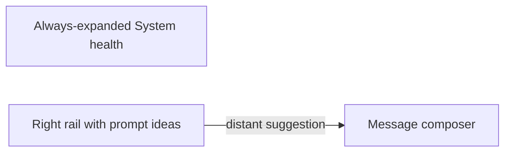
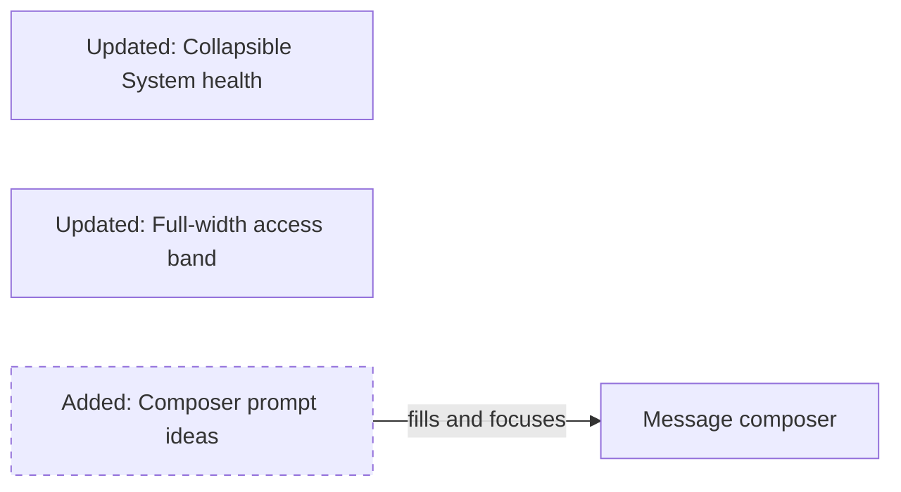
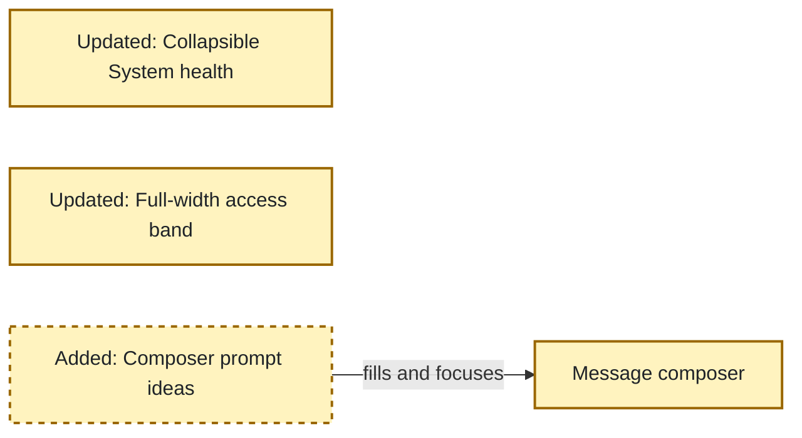

<!-- markdownlint-disable-file -->
# RPI Plan: Collapsible health and composer prompts

## Task Metadata

* Task ID: `collapsible-health-and-composer-prompts`
* Task slug: `collapsible-health-and-composer-prompts`
* Plan date: 2026-10-15

## Executive Summary

* Bottom line: Make System health a native collapsible disclosure, move prompt ideas immediately above the chat textbox, and replace the long right rail with a full-width multi-column access band.
* Why this matters: Observability becomes easier to scan, and prompt suggestions become a familiar composer affordance.
* Planning result: Complete pending standard critique.
* Confidence and uncertainty: High; existing semantics and handlers support both changes. Final chip spacing requires rendered validation.

### What You May Not Know

* No JavaScript behavior change is required because both health updates and prompt handlers target stable descendants rather than parent containers.

## Phase Checklist

### Before

### After

The full-width access band gives identity and access context balanced space, while suggestions become part of message composition and System health adopts the existing native disclosure pattern.

<!-- rpi:phase id=P01 -->
### [x] P01: Refine disclosure and composition flows

Goals:
* Align Observability density and chat prompt affordances with the user’s latest direction while preserving current behavior.

Dependencies:
* Parent review findings RV-001 and RV-002.

Highlighted work: native health disclosure, prompt-group relocation, compact identity/access layout, policy-outcome filtering, regression tests, and rendered reflow checks.

<!-- rpi:task id=P01-T01 -->
#### [x] P01-T01: Update health and prompt markup

Goals:
* Let users collapse System health and access prompt ideas at the point of message composition.

Requirements:
* FR-001, FR-002, NFR-001, NFR-002.
* Preserve all System health IDs and content inside a native `
`/`
` disclosure.
* Remove the Ask step from the right rail and place the existing `.examples` group immediately before the message label in `#chat-form`.
* Preserve `.example`, `data-question`, question text, and factual-information guidance.
* Replace the right rail with a full-width access band above chat, using balanced columns for identity and selected-role access.

Details:
* Use the same native disclosure semantics as adjacent Observability sections.
* Label the composer suggestions “Try a prompt” and keep the factual-information note concise near the group.
* Let the all-role comparison span the access band and use multiple columns when expanded.
* Do not change role preview, identity, chat, or health rendering logic.

References:
* [src/ai_governance_harness/chat/static/index.html](../../../src/ai_governance_harness/chat/static/index.html): current health, rail, and composer markup.
* [.copilot-tracking/research/2026-10-15/collapsible-health-and-composer-prompts-research.md](../../research/2026-10-15/collapsible-health-and-composer-prompts-research.md): C1-C4 and selected recommendation.
* [.copilot-tracking/reviews/logs/2026-10-15/right-side-identity-question-panel-review.md](../../reviews/logs/2026-10-15/right-side-identity-question-panel-review.md): RV-001 and RV-002.

Dependencies:
* None.

<!-- rpi:task id=P01-T02 -->
#### [x] P01-T02: Style compact composer prompt ideas

Goals:
* Present prompt ideas as compact, wrapping composer chips without horizontal overflow.

Requirements:
* FR-002, NFR-001, NFR-002.
* Prompt controls retain at least 44px target height, visible focus, and text labels.
* Chips wrap at narrow widths and do not create horizontal page scrolling.
* Remove sidebar-only question-step styles only when no longer used.

Details:
* Keep existing button tokens and secondary-button visual language while reducing full-width rail treatment.
* Let chip width follow content on desktop and fill available width only when narrow.

References:
* [src/ai_governance_harness/chat/static/app.css](../../../src/ai_governance_harness/chat/static/app.css): existing `.examples`, `.example`, workflow, and breakpoint styles.

Dependencies:
* P01-T01.

<!-- rpi:task id=P01-T03 -->
#### [x] P01-T03: Filter latest decisions by policy outcome

Goals:
* Let users select a policy outcome card to inspect only matching Latest decisions on the Request flow panel.

Requirements:
* Outcome cards support pointer and keyboard activation with an exposed selected state.
* Filtering affects only Latest decisions; counts, live flow, replay, and other panels remain unchanged.
* Selecting the active outcome again, using Show all decisions, or clicking outside the outcome cards clears the filter.

Details:
* Reuse the existing outcome mapping in `flow.js`.
* Keep the current event metadata rendering and avoid HTML injection.

References:
* [src/ai_governance_harness/chat/static/index.html](../../../src/ai_governance_harness/chat/static/index.html): Request flow outcome nodes and ticker.
* [src/ai_governance_harness/chat/static/flow.js](../../../src/ai_governance_harness/chat/static/flow.js): outcome mapping and Latest decisions rendering.

Dependencies:
* None.

<!-- rpi:task id=P01-T04 -->
#### [x] P01-T04: Protect and validate the refinements

Goals:
* Demonstrate that disclosure semantics, prompt placement, and existing shortcut behavior remain correct across desktop and narrow layouts.

Requirements:
* FR-001, FR-002, NFR-001, NFR-002.
* Extend `tests/test_chat_app.py`; no new test file.
* Run targeted chat tests.
* Validate System health expand/collapse, prompt-to-input focus, keyboard order, minimum target size, desktop placement, 375px and 320px wrapping, and no horizontal overflow.

Details:
* Test semantic structure and stable contracts, not decorative class ordering.
* Exact removals: the rail Ask workflow step and numbered identity/access headings. Maximum additions: no files or dependencies.

References:
* [tests/test_chat_app.py](../../../tests/test_chat_app.py): existing static UI contracts.
* [src/ai_governance_harness/chat/static/app.js](../../../src/ai_governance_harness/chat/static/app.js): unchanged example handler contract.

Dependencies:
* P01-T01, P01-T02, and P01-T03.

## User Decisions and Requirements

### Confirmed User Direction

* Make Observability System health collapsible like the other sections.
* Move message prompt buttons immediately above the chat textbox and remove them from the side rail.
* Use a familiar Copilot/Teams-style prompt-idea presentation.
* Replace the long right column with a full-width multi-column identity and access section above chat.
* Reduce mock identity to a single compact control row and keep selected-role access plus role reference in a restrained side panel.
* Filter Latest decisions by clicking or keyboard-activating the policy outcome cards.
* Continue automatically through implementation and review.

### Planning Decisions and Feedback

| Group | Decision or feedback item | Status | Owner | Rationale or input needed | Evidence | Planning impact |
|-------|---------------------------|--------|-------|---------------------------|----------|-----------------|
| D1 | Use native `
`/`
` for System health. | Confirmed | User/agent | Direct direction and existing adjacent pattern. | Research C1-C2; RV-001 | Defines P01-T01. |
| D2 | Use compact wrapping prompt chips above the textarea. | Confirmed | User/agent | Direct direction and portable handlers. | Research C3-C4; RV-002 | Defines P01-T01/T02. |
| D3 | Replace the right rail with a full-width multi-column access band. | Confirmed | User | The long rail lost focus and detail; user selected the recommended full-width option. | Implementation feedback | Expands P01-T01/T02 layout work without changing behavior. |
| D4 | Keep identity as a compact top control and selected-role/reference details in the side panel. | Confirmed | User | The full-width content band remained visually overpowering. | Implementation feedback | Supersedes D3 presentation while retaining full-width identity placement. |
| D5 | Make Request flow outcome cards filter Latest decisions only. | Confirmed | User | Direct interaction request tied to the Request flow panel. | Implementation feedback | Adds P01-T03 and JavaScript behavior. |

## Planning Readiness and Next Step

| Field | Record |
|-------|--------|
| Planning execution and readiness | Complete and Ready; standard critique passed |
| Decision participation | Agent-owned; inherited automatic session |
| Blockers | None |
| Latest critique | [.copilot-tracking/reviews/plans/2026-10-15/collapsible-health-and-composer-prompts-plan-critique.md](../../reviews/plans/2026-10-15/collapsible-health-and-composer-prompts-plan-critique.md) with Pass |
| Relevant research | [.copilot-tracking/research/2026-10-15/collapsible-health-and-composer-prompts-research.md](../../research/2026-10-15/collapsible-health-and-composer-prompts-research.md) |
| Plan | `.copilot-tracking/plans/2026-10-15/collapsible-health-and-composer-prompts-plan.md` |
| Changes-record role | `.copilot-tracking/changes/2026-10-15/collapsible-health-and-composer-prompts-changes.md` is implementation evidence |
| Continuation owner | Confirmed automatic RPI Agent |
| Required gates or confirmations | Passed |
| Next action | Automatic transition to implementation |

## Goals

* Reduce Observability density with native disclosure semantics.
* Put prompt ideas at the point of composition.
* Preserve all existing runtime and shortcut behavior.

## Scope and Non-Goals

### In Scope

* System health container semantics.
* Prompt-group placement and styling.
* Existing static test coverage and rendered validation.

### Non-Goals

* New prompts, prompt generation, carousel behavior, or JavaScript changes.
* Runtime health logic or data changes.
* Identity/access rail redesign beyond removing the Ask step.

## Functional Requirements

* FR-001: System health is collapsible through a native keyboard-accessible disclosure while preserving all existing content and IDs.
* FR-002: Existing prompt idea buttons appear immediately above the message textbox, retain their fill-and-focus behavior, and no longer appear in the right rail.

## Non-Functional Requirements

* NFR-001: Existing handlers, CSP constraints, runtime selectors, and test contracts remain compatible.
  * Objective threshold or evaluation condition: Targeted tests pass without JavaScript or dependency changes.
* NFR-002: Disclosures and prompt ideas remain keyboard accessible, have at least 44px targets, and reflow without horizontal page scrolling.
  * Objective threshold or evaluation condition: Rendered desktop, 375px, and 320px checks pass.

## Risks and Open Questions

| Priority | Type | Risk, question, or planning item | Affected work | Impact | Smallest action or evidence needed | Owner |
|----------|------|----------------------------------|---------------|--------|------------------------------------|-------|
| M | Risk | Composer chips may crowd narrow widths. | P01-T02/P01-T03 | Overflow or cramped labels | Verify wrapping at 375px and 320px. | Implementation |
| L | Risk | Collapsed health hides live state until opened. | P01-T01/P01-T03 | Reduced immediate visibility | Keep clear summary text and verify content remains current after expansion. | Implementation |

## Dependencies

* Existing native disclosure and `.example` contracts in the current static UI.

## Sources

* [.copilot-tracking/research/2026-10-15/collapsible-health-and-composer-prompts-research.md](../../research/2026-10-15/collapsible-health-and-composer-prompts-research.md): follow-up evidence.
* [.copilot-tracking/reviews/logs/2026-10-15/right-side-identity-question-panel-review.md](../../reviews/logs/2026-10-15/right-side-identity-question-panel-review.md): accepted parent findings.
* [src/ai_governance_harness/chat/static/index.html](../../../src/ai_governance_harness/chat/static/index.html): implementation target.
* [src/ai_governance_harness/chat/static/app.css](../../../src/ai_governance_harness/chat/static/app.css): styling target.
* [tests/test_chat_app.py](../../../tests/test_chat_app.py): test target.

## Critique Disposition

* Critique setting and provenance: Standard; default.
* Critique status: Complete.
* Latest critique and verdict: [.copilot-tracking/reviews/plans/2026-10-15/collapsible-health-and-composer-prompts-plan-critique.md](../../reviews/plans/2026-10-15/collapsible-health-and-composer-prompts-plan-critique.md), Pass.
* Earlier critiques: None.
* Limitations: None.

## Artifact Self-Check

* [x] Executive summary and phase checklist lead the plan.
* [x] Direction, decisions, requirements, scope, risks, and dependencies are current.
* [x] Every requirement is cited by a task.
* [x] Phase/task blocks, diagrams, references, and dependencies are complete.
* [x] Test ownership, exact removals, maximum additions, and rendered validation are locked.
* [x] Critique result and readiness are recorded.
* [x] Follow-up items remain outside active scope.
* Checked sections: All implementation-ready sections.
* Missing or limited sections: None.

## Follow-Up Items

* None.

## Handoff

* Authoritative implementation handoff: Planning Readiness and Next Step
