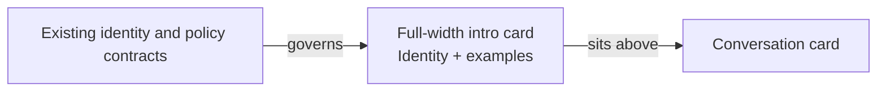
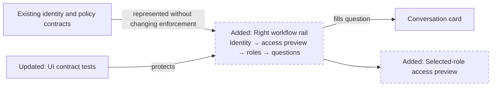
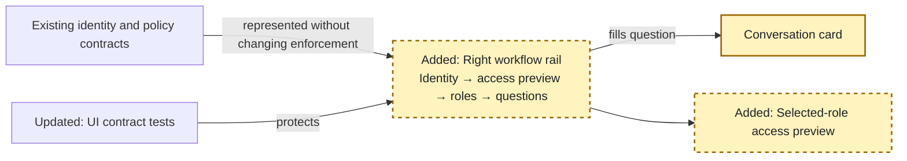
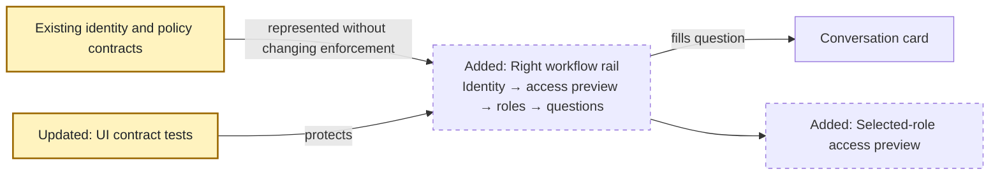

<!-- markdownlint-disable-file -->
# RPI Plan: Right-side identity and question panel

## Task Metadata

* Task ID: `right-side-identity-question-panel`
* Task slug: `right-side-identity-question-panel`
* Plan date: 2026-10-15

## Executive Summary

* Bottom line: Implement a responsive two-column chat workspace with conversation on the left and a task-ordered identity and question rail on the right.
* Why this matters: Users should understand who they are acting as, what that role can access, and which factual questions are appropriate without pushing the conversation below a large introductory card.
* Planning result: Complete pending the standard independent critique.
* Confidence and uncertainty: The source contracts and desired hierarchy are well supported; rendered spacing and breakpoint behavior remain implementation-time validation concerns.

### What You May Not Know

* Reporting agent access will be shown for comparison but will not be offered in mock sign-in because it is app-only.

## Phase Checklist

### Before

### After

The full-width introductory card is replaced by a semantic right rail. Existing controls retain their IDs and endpoint behavior; role access is explanatory and remains subordinate to backend enforcement.

<!-- rpi:phase id=P01 -->
### [x] P01: Build the right-side workflow

Goals:
* Establish the requested desktop hierarchy and narrow-screen reading order while preserving all existing chat and identity interactions.

Dependencies:
* Completed research and existing identity/policy contracts.

Highlighted work: the chat markup, rail information hierarchy, selected-role presentation, desktop grid, and responsive stacking.

<!-- rpi:task id=P01-T01 -->
#### [x] P01-T01: Restructure the Chat markup

Goals:
* Render a semantic right rail containing the complete identity, capability, and factual-question workflow while keeping the conversation primary.

Requirements:
* FR-001, FR-002, FR-003, FR-004, FR-005, NFR-001, NFR-002.
* Preserve `#mock-persona`, `#identity-signin`, `#identity-status`, `.example`, `#messages`, and `#chat-form`.
* Use headings and native controls in logical DOM order; Reporting agent is labelled app-only and is not added to the persona options.
* Represent Allow, Deny, and Requires approval with text, not color alone.

Details:
* Replace the current `.intro` section with an `aside` inside `.workspace`.
* Keep conversation first visually at wide widths while placing the rail first in DOM order so narrow-screen reading and keyboard order begins with identity.
* Use a concise selected-role access preview plus a compact comparison section that includes all supplied role facts.
* Label the preview as explanatory, state that access applies only after successful sign-in and policy evaluation, and keep `#identity-status` authoritative for authentication state.
* Keep question shortcut text factual and reuse existing `data-question` behavior.

References:
* [src/ai_governance_harness/chat/static/index.html](../../../src/ai_governance_harness/chat/static/index.html): current Chat markup and stable control IDs.
* [.copilot-tracking/research/2026-10-15/right-side-identity-question-panel-research.md](../../research/2026-10-15/right-side-identity-question-panel-research.md):
  * Findings establish the task order, semantic boundary, and reporting-agent constraint.

Dependencies:
* None.

<!-- rpi:task id=P01-T02 -->
#### [x] P01-T02: Style the rail and responsive layout

Goals:
* Present a calm, scannable two-column desktop workspace that reflows into a readable single-column flow without clipped controls.

Requirements:
* FR-001, FR-002, FR-005, NFR-002, NFR-003.
* Use the existing design tokens and maintain 44px minimum interactive control height.
* Avoid fixed viewport heights and horizontal page scrolling.
* Preserve visible focus and reduced-motion behavior.

Details:
* Use a flexible conversation column and a bounded 22–24rem rail column at wide widths.
* Use subtle numbered section markers, compact status badges, and full-width shortcut buttons inside the rail.
* Make the rail sticky only at widths where both columns remain comfortable; retain natural document scrolling.
* Correct the existing nested responsive rule structure while touching the breakpoint area so the workspace breakpoint applies independently.

References:
* [src/ai_governance_harness/chat/static/app.css](../../../src/ai_governance_harness/chat/static/app.css): design tokens, current workspace rules, control sizing, and breakpoints.

Dependencies:
* P01-T01.

<!-- rpi:task id=P01-T03 -->
#### [x] P01-T03: Add selected-role access-preview behavior

Goals:
* Update the selected-role access preview immediately when a user changes persona without representing the selection as an authenticated identity.

Requirements:
* FR-002, FR-003, FR-004, NFR-001.
* The role presentation mapping must exactly reflect the supplied capability matrix.
* Empty selection must show neutral guidance; Compliance Reviewer and Administrator must share the denied profile; Reporting must not enter the interactive mapping.
* Persona change must continue clearing the conversation and access token.
* `#identity-status` remains the authoritative sign-in state, and the preview states that actual access requires successful sign-in and policy evaluation.

Details:
* Add a small immutable presentation map and update only text/status classes on existing or newly named rail elements.
* Invoke the presentation update from the existing persona change path and once during initialization.
* Do not infer permissions from button availability and do not replace policy enforcement.

References:
* [src/ai_governance_harness/chat/static/app.js](../../../src/ai_governance_harness/chat/static/app.js): existing identity selectors, reset behavior, and example handlers.
* [src/ai_governance_harness/governance/policies/default.yaml](../../../src/ai_governance_harness/governance/policies/default.yaml): authoritative runtime allow rules.
* [src/ai_governance_harness/identity/constants.py](../../../src/ai_governance_harness/identity/constants.py): interactive persona set.

Dependencies:
* P01-T01.

<!-- rpi:phase id=P02 -->
### [x] P02: Protect and validate the experience

Goals:
* Demonstrate that the new organization preserves behavior, accurately represents access, and remains usable across keyboard and responsive conditions.

Dependencies:
* P01 complete.

Highlighted work: exact capability-content coverage, semantic regression checks, targeted test execution, and rendered interaction evidence.

<!-- rpi:task id=P02-T01 -->
#### [x] P02-T01: Extend UI contract tests

Goals:
* Fail targeted tests if the rail loses its semantic identity, role facts, or existing identity control contract.

Requirements:
* FR-002, FR-003, FR-004, NFR-001.
* Test ownership remains in `tests/test_chat_app.py`; no new test file is added.
* Assert the workflow `aside`, heading relationship, existing identity options, app-only Reporting label, all Allow/Deny/approval capability statements, and the access-preview enforcement disclaimer.
* Preserve existing CSP, storage, endpoint, and disabled-send assertions.

Details:
* Extend the existing HTML parser-based structure test and add focused text assertions where the parser does not retain text.
* Keep tests semantic and contract-focused rather than asserting decorative class lists or exact whitespace.

References:
* [tests/test_chat_app.py](../../../tests/test_chat_app.py): existing static structure and identity safety tests.

Dependencies:
* P01-T01, P01-T03.

<!-- rpi:task id=P02-T02 -->
#### [x] P02-T02: Validate behavior and adaptive rendering

Goals:
* Produce evidence that source-level correctness also holds in the rendered desktop and narrow-screen experience.

Requirements:
* FR-001, FR-004, FR-005, NFR-002, NFR-003.
* Run the targeted chat UI tests.
* Validate persona selection/sign-in state, role-summary updates, question shortcut focus, chat submission availability, clear chat, and keyboard focus order.
* Capture or inspect desktop and narrow-screen layouts, including approximately 320–375px content width, with no clipped or horizontally scrolling page content.

Details:
* Use the repository’s existing local application start path; do not add tooling or dependencies unless validation fails solely because an existing declared dependency is missing.
* Static checks inform but do not decide keyboard and adaptive-rendering requirements; use rendered interaction evidence for those requirements.
* Exact removals: none. Maximum additions: no new files or dependencies; one small role-presentation mapping and targeted assertions in the existing test file.

References:
* [pyproject.toml](../../../pyproject.toml): existing test and application tooling.
* [tests/test_chat_app.py](../../../tests/test_chat_app.py): targeted regression suite.

Dependencies:
* P01 complete, P02-T01.

## User Decisions and Requirements

### Confirmed User Direction

* Move Mock identity and Ask a factual question into a clean, well-organized panel on the right.
* Include these capability facts:
  * Analyst (OBO): aggregate tools allowed; member tools and outreach denied.
  * Retention Specialist (OBO): aggregate and member tools allowed; outreach requires eligibility and explicit approval, including browser approval.
  * Compliance Reviewer / Administrator (OBO): aggregate, member, and outreach tools denied.
  * Reporting agent (app-only): aggregate tools allowed; member tools and outreach denied.
* Preserve the factual-information, not-financial-advice boundary.
* Handle the RPI workflow end to end with agent-owned decisions.

### Planning Decisions and Feedback

| Group | Decision or feedback item | Status | Owner | Rationale or input needed | Evidence | Planning impact |
|-------|---------------------------|--------|-------|---------------------------|----------|-----------------|
| D1 | Use a wide conversation column and a 22–24rem task-ordered right rail with a selected-role access preview, not an authenticated-state claim. | Confirmed | Agent | Best-supported fit for the requested hierarchy; critique PC-001 requires preview terminology because selection precedes sign-in. | Research C1-C3; critique PC-001 | Defines P01 markup, copy, and styling. |
| D2 | Present role access as compact capability rows/cards rather than a literal wide table. | Confirmed | Agent | Prevents horizontal scrolling in the rail while preserving all supplied facts. | Research C3-C5 | Defines P01 information design. |
| D3 | Keep Reporting agent informational and non-selectable. | Confirmed | Agent | Reporting is app-only; mock identities are interactive OBO personas. | Research C5-C6 | Prevents identity-contract drift. |
| D4 | Stack the rail before conversation below the desktop breakpoint. | Confirmed | Agent | Keeps identity selection first in reading and keyboard order on narrow screens. | Research C1-C4; accessibility guidance | Defines P01 responsive order and validation. |

## Planning Readiness and Next Step

| Field | Record |
|-------|--------|
| Planning execution and readiness | Complete and Ready; standard critique finding PC-001 resolved directly |
| Decision participation | Agent-owned; user selected automatic end-to-end RPI mode |
| Blockers | None |
| Latest critique | [.copilot-tracking/reviews/plans/2026-10-15/right-side-identity-question-panel-plan-critique.md](../../reviews/plans/2026-10-15/right-side-identity-question-panel-plan-critique.md) with Revise; PC-001 resolved in the current plan |
| Relevant research | [.copilot-tracking/research/2026-10-15/right-side-identity-question-panel-research.md](../../research/2026-10-15/right-side-identity-question-panel-research.md) |
| Plan | `.copilot-tracking/plans/2026-10-15/right-side-identity-question-panel-plan.md` |
| Changes-record role | `.copilot-tracking/changes/2026-10-15/right-side-identity-question-panel-changes.md` is implementation evidence |
| Continuation owner | Confirmed automatic RPI Agent |
| Required gates or confirmations | Passed; no exceptional confirmation required |
| Next action | Automatic RPI transition to Review |

## Goals

* Make the conversation the primary desktop surface.
* Give the right rail a clear identity → access preview → compare roles → ask flow.
* Preserve mock sign-in, example-question, chat, approval, and governance behavior.
* Maintain semantic structure, visible focus, minimum control sizing, and usable responsive reflow.

## Scope and Non-Goals

### In Scope

* Chat panel markup and information hierarchy.
* Chat-specific layout, panel, role-access, and responsive styles.
* Client-side selected-role access copy where needed.
* Targeted static UI and behavior-contract tests.
* Desktop and narrow-screen rendered validation.

### Non-Goals

* Backend identity, token, policy, or tool authorization changes.
* Making the Reporting agent available for interactive mock sign-in.
* Redesigning Observability or unrelated governance content.
* Introducing a front-end framework or new dependency.

## Functional Requirements

* FR-001: The Chat tab displays the conversation as the primary content area and a right-side workflow panel at desktop widths.
* FR-002: The workflow panel orders mock identity, selected-role access preview, all-role comparison, and factual-question shortcuts.
* FR-003: The panel represents all supplied role capability facts, distinguishes OBO from app-only identity, and states that actual access requires successful sign-in and policy evaluation.
* FR-004: Existing mock sign-in, persona-change reset, question shortcut, chat submission, clear-chat, and browser approval behavior remains functional.
* FR-005: Narrow layouts place the workflow panel before the conversation without horizontal page scrolling.

## Non-Functional Requirements

* NFR-001: Existing stable element IDs, classes, endpoint contracts, and CSP constraints remain compatible.
  * Objective threshold or evaluation condition: Existing targeted tests pass and no new external origin, storage API, or dependency is introduced.
* NFR-002: Interactive controls remain keyboard reachable with visible focus and at least the existing 44px minimum target height.
  * Objective threshold or evaluation condition: Static structure checks pass and a keyboard interaction pass covers persona, sign-in, examples, message input, send, and clear.
* NFR-003: The chat surface reflows without two-dimensional page scrolling on a narrow viewport.
  * Objective threshold or evaluation condition: Rendered validation at desktop and approximately 320–375px content width confirms readable stacking and no clipped controls.

## Risks and Open Questions

| Priority | Type | Risk, question, or planning item | Affected work | Impact | Smallest action or evidence needed | Owner |
|----------|------|----------------------------------|---------------|--------|------------------------------------|-------|
| M | Risk | Intermediate widths may leave too little room for both columns. | P01-T02 | Conversation or rail becomes cramped. | Validate the selected breakpoint in a browser and adjust based on rendered evidence. | Implementation |
| M | Risk | Capability copy can drift from policy. | P01-T01, P02-T01 | Users receive misleading guidance. | Add exact-content assertions tied to the supplied matrix and policy semantics. | Implementation |
| M | Risk | Static checks cannot decide adaptive reflow or keyboard behavior. | P02-T02 | Accessibility regressions could pass unit tests. | Run rendered narrow-screen and keyboard interaction validation. | Implementation |

## Dependencies

* Existing selector contracts in [src/ai_governance_harness/chat/static/app.js](../../../src/ai_governance_harness/chat/static/app.js): identity and example behavior.
* Existing role and policy semantics in [src/ai_governance_harness/governance/policies/default.yaml](../../../src/ai_governance_harness/governance/policies/default.yaml) and [src/ai_governance_harness/identity/constants.py](../../../src/ai_governance_harness/identity/constants.py).

## Sources

* [.copilot-tracking/research/2026-10-15/right-side-identity-question-panel-research.md](../../research/2026-10-15/right-side-identity-question-panel-research.md): completed evidence, alternatives, and selected recommendation.
* [src/ai_governance_harness/chat/static/index.html](../../../src/ai_governance_harness/chat/static/index.html): current chat structure.
* [src/ai_governance_harness/chat/static/app.css](../../../src/ai_governance_harness/chat/static/app.css): current layout and responsive rules.
* [src/ai_governance_harness/chat/static/app.js](../../../src/ai_governance_harness/chat/static/app.js): stable interaction selectors and handlers.
* [tests/test_chat_app.py](../../../tests/test_chat_app.py): current accessible-structure and identity UI tests.
* User-supplied screenshot and role matrix: visual baseline and capability requirements.

## Critique Disposition

* Critique setting and provenance: Standard; default for the automatic RPI session.
* Critique status: Complete.
* Latest critique and verdict: [.copilot-tracking/reviews/plans/2026-10-15/right-side-identity-question-panel-plan-critique.md](../../reviews/plans/2026-10-15/right-side-identity-question-panel-plan-critique.md), Revise.
* Earlier critiques: None.
* Limitations: Rendered visual quality remains implementation-time evidence.

| Critique run and finding | Disposition | Action owner | Exact resolving evidence | Decision route | Plan response or residual risk |
|--------------------------|-------------|--------------|--------------------------|----------------|--------------------------------|
| Initial PC-001 | Resolved | Planning parent | D1, FR-002, FR-003, P01-T01, P01-T03, and P02-T01 distinguish preview from authenticated state and require disclaimer coverage | Direct correction | Terminology and tests now prevent selected persona from being represented as authenticated access |

## Artifact Self-Check

* [x] Executive Summary, What You May Not Know, and the Phase Checklist come first and are understandable without reading the supporting sections.
* [x] Confirmed direction, grouped decisions, readiness, goals, scope, requirements, risks, and dependencies are current and consistent with the Phase Checklist.
* [x] Planning decision participation and provenance are recorded.
* [x] Functional and non-functional requirements are current, and every requirement is cited by at least one task.
* [x] Every phase and task contains the required goals, requirements, details, references, and dependencies.
* [x] Task goals are observable and implementation detail remains evidence-grounded.
* [x] Open risks identify affected work, owners, and smallest resolving evidence.
* [x] Code identifiers use backticks and existing files use relative Markdown links.
* [x] Before and After diagrams use stable nodes and distinguish added work without relying on color alone.
* [x] Mermaid initialization values and custom phase text colors support light and dark themes.
* [x] Test ownership, exact removals, maximum additions, and semantic versus rendered validation are locked.
* [x] Critique result and findings are recorded and resolved.
* [x] Final readiness and handoff are synchronized after critique.
* [x] Follow-up items remain outside the active plan.
* Checked sections: All implementation-ready planning sections.
* Missing or limited sections: None; rendered evidence is intentionally owned by implementation.

## Follow-Up Items

* None

## Handoff

* Authoritative implementation handoff: Planning Readiness and Next Step
