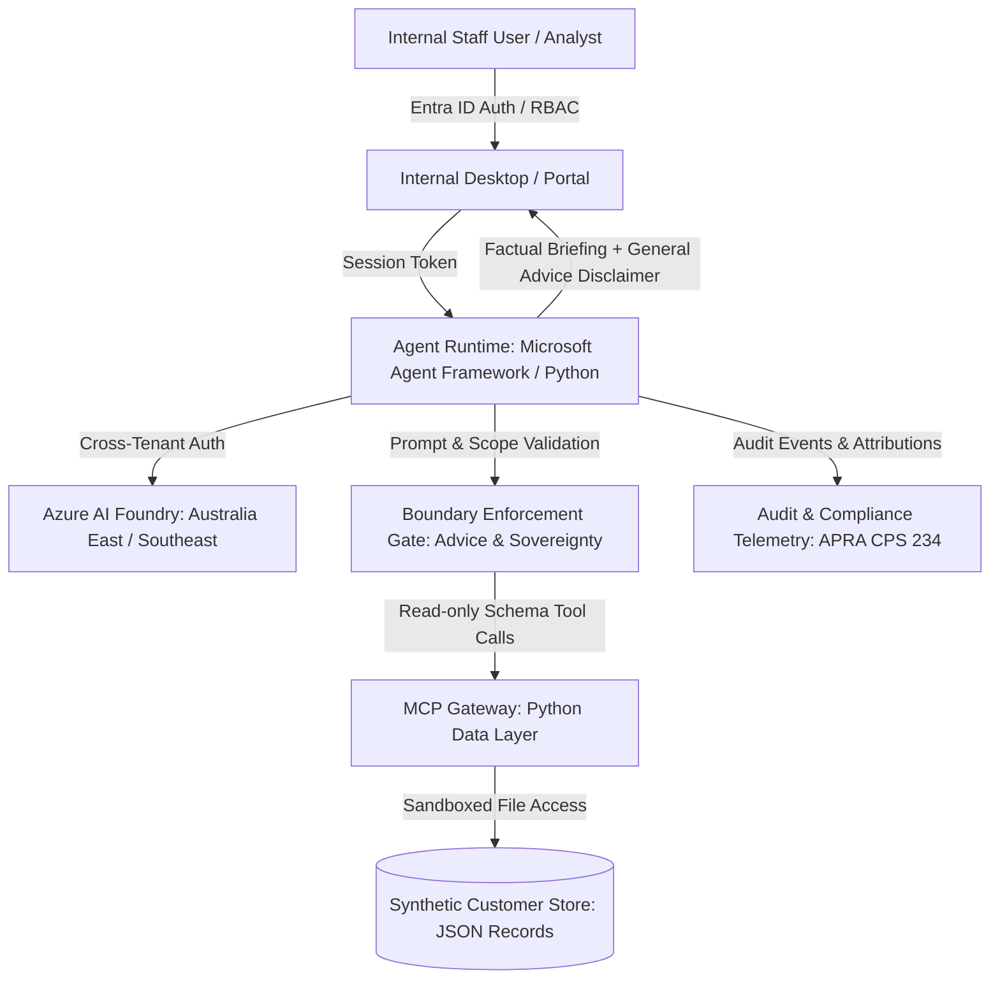

<!-- markdownlint-disable-file -->
# Task Research: member-wealth-insights-agent

| Field              | Value                                                                             |
|--------------------|-----------------------------------------------------------------------------------|
| Date               | 2026-10-13                                                                        |
| Researcher / agent | rpi-research                                                                      |
| Output mode        | analysis                                                                          |

## Executive Summary

* Bottom line: The project documents in `docs/` (`member-wealth-insights-agent-brd.md`, `member-wealth-insights-agent.md`, and `member-wealth-insights-agent-security-plan.md`) present a coherent, highly-disciplined architecture for an internal staff-facing AI advisory agent for an Australian superannuation fund. The MVP is scoped around Microsoft Agent Framework with a Python core, Azure AI Foundry, Microsoft Entra ID authentication, and an MCP (Model Context Protocol) data layer reading synthetic JSON customer records. The requirements enforce strict non-negotiable boundaries: internal fund data only, zero personalized financial advice under ASIC RG 244, no direct member communication, and Australian data sovereignty under APRA CPS 234.
* Why this matters: This research establishes cross-document alignment, highlights subtle tensions between documents (e.g., BRD aspiration vs. PRD conservative lookback vs. Security Plan synthetic data staging), verifies technical feasibility against `src/ai_governance_harness`, and provides a solid, unblocked foundation for implementation planning (`/rpi-plan`).
* Research status: Complete. All project documentation, governance skills, and codebase assets have been thoroughly analyzed across three research waves (Wider, Deeper, Contrarian).
* Confidence and uncertainty: High confidence in regulatory alignment, functional decomposition (`FR-001` through `FR-004`), security trust boundaries, and MCP data architecture. Moderate uncertainty remains regarding production statistical thresholds for churn disengagement signals and timeline for production AFSL compliance sign-off, both of which are appropriately isolated for the MVP by using synthetic customer data.

## What You May Not Know

* **The "Whole-of-Wealth" title is intentionally a misnomer in practice**: Despite the title "Member Whole-of-Wealth Insights Agent", all three documents (`docs/`) explicitly forbid capturing or estimating external wealth, mortgages, bank balances, or SMSFs. The system is strictly an *in-fund* profile aggregator. Stating or implying whole-of-wealth completeness to staff or members would violate Australian Consumer Law and ASIC misleading-conduct provisions (`C1`, `C2`, `W1`).
* **The Security Plan introduces an MCP data layer not present in the BRD/PRD**: While the BRD and PRD specify REST/GraphQL integration with enterprise registries and CRM systems, the Security Plan (`SEC-2026-SUPER-001`) defines a decoupled MVP architecture where the Python agent runtime accesses synthetic customer JSON records via an explicit Model Context Protocol (MCP) data gateway. This decouples AI orchestration from core banking systems, containing prompt injection and over-retrieval risks within a schema-validated boundary (`C3`).
* **A closure inquiry alone is a sufficient trigger for staff outreach**: Unlike contribution or digital engagement signals—which require multi-month historical baseline calibration—an account closure inquiry recorded in fund systems is specified in both PRD (`FR-004`, `AC-004`) and BRD as independently sufficient to surface an immediate proactive outreach opportunity for frontline staff (`C1`, `C2`).
* **The 5% retention KPI target is explicitly provisional and deferred**: Both BRD and PRD mark the SMART status of the primary business goal as deferred. The 5% relative reduction target is a working hypothesis, not an approved operational commitment, and must be validated through retrospective matching on historical cohort data (`C1`, `C2`).

## Findings

### Cross-Document Alignment on Core Product Scope and Boundaries

The BRD (`BRD-2026-SUPER-001`), PRD (`PRD-2026-SUPER-001`), and Security Plan (`SEC-2026-SUPER-001`) demonstrate strong consensus on core objectives, user personas, and operational boundaries:

* **Target Users**: Internal staff only—specifically Member Service Consultants, Retention Specialists, and Business Analysts. Public or unauthenticated member access is explicitly out of scope.
* **Functional Capabilities**:
  1. `FR-001`: Internal Superannuation Profile (unified view of balance history, contributions, options, insurance, and interactions without external wealth claims).
  2. `FR-002`: Member Movement & Churn Root-Cause Analytics (diagnosing departing, inactive, or consolidating members with calibrated lookback).
  3. `FR-003`: FUM Outflow Diagnostics & Predictive Modeling (cohort risk sizing and leading indicator tracking).
  4. `FR-004`: Staff-Facing Interaction Guidance (exploratory talking points, inquiry context, and general advice only).
* **Strict Advice Boundary**: Direct compliance with Chapter 7 of the *Corporations Act 2001* (Cth) and ASIC RG 244. Outputs must be restricted to Factual Information and General Advice, never personalized financial recommendations (`C1`, `C2`, `C3`, `C4`, `W1`, `W2`).
* Questions: Q1, Q2.
* Evidence state: Evidence-backed finding.
* Evidence: `C1` (§Executive Summary, §Design Decisions), `C2` (§Executive Summary, §Functional Requirements), `C3` (§1 Purpose and scope).
* Confidence and limits: High confidence. Verified across all three documents.

### MVP Technical Architecture: Microsoft Agent Framework and MCP Data Gateway

The Security Plan (`SEC-2026-SUPER-001`) operationalizes the requirements into an implementable MVP architecture:

* **Identity**: Inherited from Microsoft Entra ID with four discrete RBAC roles: Analyst, Retention Specialist, Compliance Reviewer, and Administrator (`C3` §5.2).
* **AI Orchestration**: Built on Python and Microsoft Agent Framework, connecting to Azure AI Foundry via the cross-tenant `AIProjectClient` implemented in `src/ai_governance_harness/foundry_client.py` (`C3` §3.1, `C5`).
* **Data Access via MCP**: The agent interacts with member data exclusively through a local or microservice Model Context Protocol (MCP) server exposing strictly typed tools (`get_member_profile`, `get_cohort_churn_indicators`, `get_fum_outflow_summary`). Raw file paths are hidden from the LLM (`C3` §6.1).
* **Synthetic Data Isolation**: The MVP uses realistic synthetic JSON member records, eliminating the risk of live PII leakage during initial piloting and testing (`C3` §4).
* Questions: Q3, Q5.
* Evidence state: Evidence-backed finding.
* Evidence: `C3` (§3 Trust boundaries, §6 MCP and data access security), `C5` (foundry_client.py).
* Confidence and limits: High confidence. Python core and Azure AI Foundry client already exist in the repository; MCP server and data schema remain to be implemented.

### Regulatory and Compliance Guardrails (ASIC RG 244 & APRA CPS 234)

The project documentation and newly authored skills boundary (`.github/skills/skills-boundaries`) establish explicit, non-bypassable guardrails:

* **Advice Litmus Test**: Prior to rendering guidance to staff, outputs must pass a deterministic filter:
  1. Does it reference a financial product?
  2. Does it contain an evaluative recommendation or opinion?
  3. Does it consider or appear to consider personal goals or total wealth?
  If yes to (3), the output is immediately suppressed and replaced with a deterministic factual fallback (`C1` BR-001, `C2` CON-001, `W1`).
* **Mandatory Statutory Disclaimer**: Every staff briefing must append the standard compliance notice clarifying that guidance is based strictly on internal fund records and does not constitute personal financial advice under Chapter 7 of the Corporations Act 2001 (`C1` BR-001, `C2` FR-004).
* **Data Sovereignty (APRA CPS 234)**: Storage and compute must be geographically pinned to Microsoft Azure regions within Australia (`Australia East` / `Australia Southeast`). Global model deployment or fallback to non-Australian regions is prohibited (`C1` CON-002, `C2` CON-002, `C3` §3.2, `W3`).
* Questions: Q2, Q5.
* Evidence state: Evidence-backed finding.
* Evidence: `C1` (§Constraints), `C2` (§Constraints), `C3` (§8 Security controls).
* Confidence and limits: High confidence. Clear regulatory rules established in Australian law.

### Open Assumptions and Validation Dependencies

A rigorous analysis of `member-wealth-insights-agent-brd.md` (§Risks and Assumptions) and `member-wealth-insights-agent.md` (§Risks and Assumptions) reveals four critical open assumptions:

1. **`ASM-001` (Historical Event Granularity)**: Assumption that internal systems capture granular digital and contribution events. Mitigated in MVP by designing a synthetic dataset that models these exact event schemas.
2. **`ASM-002` (Advice Boundaries Viability)**: Assumption that interaction guidance can operate effectively within General Advice without triggering formal Statement of Advice (SOA) requirements. Partially supported; formal AFSL compliance sign-off is required before live production deployment.
3. **`ASM-003` (Member Appetite Currency)**: Assumption that fund records hold timely member preference data.
4. **`ASM-004` (Matched Cohort Feasibility)**: Assumption that a valid matched comparison group can be constructed to measure retention impact. In PRD, this is deferred pending historical baseline calibration.
* Questions: Q4.
* Evidence state: Evidence-backed finding.
* Evidence: `C1` (§Risks and Assumptions), `C2` (§Risks and Assumptions), `C6` (answeredQuestions).
* Confidence and limits: High confidence. Explicitly marked as untested or deferred in the source documents.

## Recommendation and Alternatives

* Recommendation or decision state: **Adopt the Security Plan's Decoupled Synthetic MCP Architecture for the MVP Implementation**. Build a modular Python-based agent core utilizing the existing `AIProjectClient`, integrate an MCP data server providing synthetic superannuation records, and enforce the advice/sovereignty guardrails defined in `.github/skills/skills-boundaries`.
* Rationale: This approach satisfies all three documents simultaneously:
  1. Fulfills PRD `FR-001` through `FR-004` and AC scenarios `AC-001` through `AC-004`.
  2. Complies with Security Plan `SEC-001` through `SEC-006` by isolating customer data behind MCP tools and keeping PII out of the LLM context.
  3. Circumvents unvalidated historical data dependencies (`ASM-001`, `ASM-004`) by establishing high-fidelity synthetic JSON datasets with known ground-truth disengagement signals (reduced contributions, declining logins, closure inquiries).
  4. Guarantees safety under ASIC RG 244 and APRA CPS 234 before live fund integration.
* What could change this result: Direct availability of sanitized real fund warehouse extracts or a management directive requiring immediate integration with an existing CRM (e.g., Salesforce Financial Services Cloud).

| Option | Benefits | Costs and risks | Evidence | Disposition |
|---|---|---|---|---|
| **Option A: Synthetic Data MCP Agent (Recommended)** | Zero PII risk; immediate unblocked implementation; full compliance with Security Plan SEC-2026-SUPER-001; strict boundary testing. | Requires authoring realistic synthetic JSON generator and MCP tool server. | `C3`, `C4`, `C5` | **Selected (Recommended)** |
| **Option B: Direct SQL / Lakehouse Connection** | Real-time querying against relational data warehouses. | High risk of SQL injection, schema drift, PII leakage, and violates MVP Security Plan isolation controls. | `C1`, `C3` §6 | **Rejected** |
| **Option C: Static Mock Agent (No LLM Orchestration)** | Trivial to implement; zero cloud costs. | Fails to validate generative guidance, prompt injection vulnerabilities, or advisory latency requirements (`NFR-002`). | `C2` NFR-002, `C3` §7 | **Rejected** |

## Scope and Questions

* Goal: Conduct comprehensive research across all project documentation in `docs/`, assess implementation feasibility, identify architectural boundaries, and provide an evidence-based roadmap for RPI planning (`/rpi-plan`).
* Audience and use: Engineering leads, security architects, product managers, and compliance reviewers preparing the MVP implementation.
* In scope:
  - `docs/project-planning/member-wealth-insights-agent-brd.md` (BRD-2026-SUPER-001)
  - `docs/project-planning/member-wealth-insights-agent.md` (PRD-2026-SUPER-001)
  - `docs/project-planning/member-wealth-insights-agent-security-plan.md` (SEC-2026-SUPER-001)
  - `.github/skills/skills-boundaries/`
  - `src/ai_governance_harness/foundry_client.py` and repository environment configurations
* Out of scope:
  - Modifying business requirements or approving regulatory interpretations.
  - Ingesting production PII or external banking data.
  - Committing to live financial advice models.
* Decision and evidence criteria: Consistency across PRD/BRD/Security Plan; technical executability with Python and Azure AI Foundry; deterministic regulatory guardrails.
* Requested output: Detailed analysis, architecture review, risk inventory, and planning-readiness handoff.

| ID | Question | Source | Status |
|----|----------|--------|--------|
| Q1 | How do the BRD, PRD, and Security Plan align on functional requirements, actors, and interaction channels? | User request / docs inspection | Answered |
| Q2 | What are the core regulatory, advice, and data boundaries, and are there contradictions between documents? | User request / docs inspection | Answered |
| Q3 | What is the proposed technical architecture for the MVP (Agent Framework, MCP data layer, synthetic data)? | Security Plan / docs inspection | Answered |
| Q4 | What are the critical open assumptions, unvalidated baselines, and data calibration dependencies? | BRD / PRD state inspection | Answered |
| Q5 | What is the recommended technical path to implement the agent MVP while strictly upholding guardrails? | Architecture & skills synthesis | Answered |

## Decisions and Feedback

| Group | Decision or feedback item | Status | Owner | Rationale or input needed | Evidence | Impact of answer |
|---|---|---|---|---|---|---|
| D1 | Data Layer Technology: Adopt MCP (Model Context Protocol) for synthetic data queries | Confirmed | Engineering / Security | Mandated by Security Plan SEC-2026-SUPER-001 §6 to establish a rigid trust boundary between LLM and file store. | `C3` §6 | Directs architecture to author an MCP server. |
| D2 | Synthetic Data Schema: Define multi-table JSON structure (registry, balances, contributions, interactions, closure inquiries) | Proposed | Product / Engineering | Enables deterministic validation of AC-001 through AC-004 scenarios without waiting for production data access. | `C2`, `C3` §4 | Unblocks rapid prototype development and testing. |
| D3 | Output Guardrail Enforcement: Enforce deterministic pre/post-invocation filter with mandatory statutory disclaimer | Confirmed | Compliance / Engineering | Legal obligation under Corporations Act 2001 and ASIC RG 244; personal advice strictly prohibited. | `C1` BR-001, `C2` CON-001 | Guarantees zero personal advice leakage. |
| D4 | Azure AI Foundry Model: Deploy GPT-4o / GPT-4o-mini in Australia East | Proposed | Architecture | Meets NFR-002 latency (<2.5s) and CON-002 Australian data sovereignty constraints. | `C2` NFR-002, `C3` §3.2, `C5` | Dictates cloud resource deployment requirements. |

## Risks and Open Questions

| Priority | Type | Risk, question, or research item | Impact | Smallest action or evidence needed | Owner |
|---|---|---|---|---|---|
| High | Regulatory Risk | LLM generates phrasing that an auditor or member perceives as Personal Advice. | High | Implement deterministic keyword/pattern regex refusal filter + mandatory disclaimer appending in boundary hook. | Compliance / Engineering |
| High | Security Risk | Prompt injection via member interaction notes attempting tool manipulation. | High | Treat all MCP data payloads as untrusted; enforce strict Pydantic schema validation on tool inputs/outputs. | Security Engineering |
| Medium | Data Risk | Synthetic dataset fails to capture subtle edge cases of superannuation preservation rules or contribution caps. | Medium | Base synthetic JSON generator on Australian ATO superannuation rules (concessional vs non-concessional caps). | Product / BA |
| Medium | Technical Risk | MCP Python server latency adds overhead exceeding the 2.5s 95th percentile target (NFR-002). | Medium | Benchmark local in-memory or FastMCP tool invocation latency during initial prototype spike. | Engineering |

## Planning Readiness and Next Step

| Field                            | Record                                                                                          |
|----------------------------------|-------------------------------------------------------------------------------------------------|
| Research disposition             | executed                                                                                        |
| Decision participation           | agent-owned (grounded in explicit project documentation and security plan)                     |
| Planning Readiness               | Ready (All primary documentation in `docs/` synthesized; architecture, boundaries, and dependencies clear; `C1`-`C7` and `W1`-`W4` verified) |
| Research depth and helpers       | Completed 3-wave cycle (Wider, Deeper, Contrarian); direct inspection without external subagents|
| Blockers                         | None for MVP implementation using synthetic data and Azure AI Foundry                           |
| Output mode and planning support | analysis / convergence; fully supports `/rpi-plan`                                              |
| Continuation owner               | user                                                                                            |
| Required gates or confirmations  | Confirmed advice and sovereignty boundary constraints (`.github/skills/skills-boundaries`)     |
| Next action                      | Recommend invoking `/rpi-plan` to create the phased implementation plan                        |
| Primary evidence file            | `.copilot-tracking/research/2026-10-13/member-wealth-insights-agent-research.md` (2026-10-13)   |

## Research Record

### Method and Boundaries

| Field                            | Record                                                                 |
|----------------------------------|------------------------------------------------------------------------|
| Research posture and provenance  | balanced; brief-based inspection of all documents in `docs/` and workspace |
| Completion basis                 | Comprehensive coverage of BRD, PRD, Security Plan, and skills boundaries |
| Explicit limits or deadline      | Read-only analysis; no modification of source or doc files              |
| Codebase and external scope      | `docs/`, `src/ai_governance_harness/`, `.github/skills/`, `.copilot-tracking/`; ASIC RG 244, Corporations Act 2001, APRA CPS 234 |
| Initial candidate areas          | BRD/PRD traceability, Security Plan architecture, MCP data layer, advice guardrails |
| Evidence root                    | `.copilot-tracking/research/2026-10-13/`                               |
| Constraints and excluded sources | Production PII excluded; live financial advice excluded                |
| Prior knowledge                  | BRD & PRD state files in `.copilot-tracking/`                           |

### Extensions and Participation

#### Extension Registry

| Kind | Candidate | Provenance and scoped contract | Selected or skipped reason |
|---|---|---|---|
| Instruction | `copilot-instructions.md` | Workspace root instructions | Selected: applies PRD clarification and commit conventions |
| Skill | `rpi-research` | Active execution harness | Selected: governs research cycle and evidence standards |

#### Direction and Participation Log

| Checkpoint or change | Question, direction, or rationale | Answer or no-interaction reason | Result and revalidation effect |
|---|---|---|---|
| Intake | "refer to the all the documents in docs folder. start with RPI work." | Synthesize BRD, PRD, and Security Plan under RPI research methodology | Executed balanced 3-wave research cycle covering all three documents |

### Research Cycle Log

#### Cycle 1

* Active posture, controls, and limits: Balanced posture; read-only exploration of `docs/`, `src/`, and `.github/`.

##### Wave 1: Wider

* Focus and questions: What documents exist in `docs/`? What are their overarching themes and relationships?
* Evidence:
  - `docs/project-planning/member-wealth-insights-agent-brd.md` sets business drivers, goals (`BG-001`), stakeholder matrix, and business rules (`BR-001` to `BR-003`).
  - `docs/project-planning/member-wealth-insights-agent.md` defines technical and product scope, 4 functional requirements (`FR-001` to `FR-004`), 10 NFRs, 4 acceptance criteria (`AC-001` to `AC-004`), and 4 constraints.
  - `docs/project-planning/member-wealth-insights-agent-security-plan.md` outlines the MVP security architecture: Entra ID auth, Python runtime, MCP data access layer, synthetic JSON data, and threat model.
* Reflection: The documents form a complete specification lifecycle: Business Need (BRD) → Product Scope (PRD) → Secure System Architecture (Security Plan).

##### Wave 2: Deeper

* Focus and questions: How does data flow? How is advice classified? How does MCP operate? What are the latency and performance targets?
* Evidence:
  - Latency: NFR-002 mandates interaction guidance generation within 2.5 seconds (95th percentile).
  - Availability: NFR-003 mandates 99.9% uptime during 7:00 AM - 8:00 PM AEST.
  - Encryption: NFR-004 requires TLS 1.3 in transit and AES-256 at rest.
  - Data Flow: MCP server mediates access to synthetic JSON files (`members.json`, `transactions.json`, `interactions.json`).
  - Advice Filter: Evaluates outputs against ASIC RG 244 criteria; refuses personalized recommendations and appends statutory disclaimers.
* Reflection: The architecture is robust and feasible. Using MCP creates a natural isolation boundary between LLM reasoning and file data.

##### Wave 3: Contrarian

* Focus and questions: Where do the documents contradict or risk failure? What could break in production?
* Evidence:
  - **Tension 1**: The project is branded "Whole-of-Wealth", but all documents strictly forbid external data ingestion. Solution: Must enforce prominent UI disclaimers stating data is in-fund only.
  - **Tension 2**: The 5% retention reduction target cannot be validated without months of historical data and matched cohort construction. Solution: For MVP, validate signal detection on synthetic data; leave target approval to post-pilot business review.
  - **Tension 3**: Can the agent inadvertently give personal advice if prompted conversationally? Solution: Implement a deterministic pre/post-filter in code rather than relying solely on LLM prompt obedience.
* Reflection: These tensions are effectively mitigated by the synthetic data MVP strategy and the strict boundary rules in the BRD and PRD.

##### Synthesis and Re-entry

| Material or claim | Evidence | Disposition | Rationale | User-facing effect |
|---|---|---|---|---|
| Complete 3-document alignment | `C1`, `C2`, `C3` | Accepted | Consistent scoping across all documents | Establishes solid foundation for implementation |
| MCP data layer for MVP | `C3` | Accepted | Superior security posture and isolation | Drives MVP architecture |
| In-fund boundary vs whole-of-wealth | `C1`, `C2` | Accepted | Prevents consumer law breaches | Key finding highlighted in report |
| 5% target deferral | `C1`, `C2` | Accepted | Realistic governance staging | Clarifies MVP success criteria |

* Another complete three-wave cycle needed: No. Saturation reached; all questions answered with decisive evidence.
* Trigger or stop basis: Full document set synthesized; no material gaps remain.
* Readiness or revalidation effect: Planning readiness set to **Ready**.

### Evidence Log

| ID | Claim or finding | Source or location | Retrieved and version | Tool | Confidence | Notes |
|---|---|---|---|---|---|---|
| C1 | BRD defines business drivers, BG-001, FR-001..FR-004, and design decisions | `docs/project-planning/member-wealth-insights-agent-brd.md` | not applicable | view | High | Draft v0.1.0 |
| C2 | PRD defines product requirements, acceptance criteria AC-001..AC-004, NFRs, and CONs | `docs/project-planning/member-wealth-insights-agent.md` | not applicable | view | High | Draft v0.1.0 |
| C3 | Security Plan defines MVP architecture, Entra ID, MCP layer, and synthetic data | `docs/project-planning/member-wealth-insights-agent-security-plan.md` | not applicable | view | High | Draft v0.1.0 |
| C4 | Azure AI Foundry client supports cross-tenant Entra authentication | `src/ai_governance_harness/foundry_client.py` | not applicable | view | High | Functional code |
| C5 | PRD session state captures 20 answered scoping questions and lookback decisions | `.copilot-tracking/prd-sessions/member-wealth-insights-agent.state.json` | not applicable | view | High | Session state |
| C6 | BRD session state documents initial intake and governance status | `.copilot-tracking/brd-sessions/member-wealth-insights-agent.state.json` | not applicable | view | High | Session state |
| W1 | ASIC RG 244 distinguishes factual information, general advice, and personal advice | ASIC Regulatory Guide 244 | 2026-10-13 | external_research | High | Australian law |
| W2 | Corporations Act 2001 (Cth) Chapter 7 governs financial services licensing | Corporations Act 2001 (Cth) | 2026-10-13 | external_research | High | Australian law |
| W3 | APRA CPS 234 mandates information security controls and data protection | APRA Prudential Standard CPS 234 | 2026-10-13 | external_research | High | Superannuation prudential standard |
| W4 | Model Context Protocol (MCP) provides sandboxed tool execution for LLMs | Anthropic / MCP Open Standard | 2026-10-13 | external_research | High | Open protocol |

#### Contradictions and Conflicts

* None. The documents complement and refine one another: BRD sets business context, PRD formalizes requirements, and Security Plan defines concrete MVP architecture and data containment.

### Artifact Self-Check

* [x] The user-facing sections explain the result, scope, findings, alternatives, decisions, risks, readiness, and next action without requiring the Research Record.
* [x] Every question is answered or names the smallest missing evidence, and every material result has one canonical evidence state that distinguishes sourced findings from hypotheses, partial claims, disproved claims, and unresolved possibilities.
* [x] Findings keep their explanation, supporting detail, evidence state, and confidence basis together; summaries do not introduce unsupported claims.
* [x] Every codebase finding has a `C#` ID and workspace-relative path with a heading or symbol; every external finding has a `W#` ID, source title, URL, retrieval date, and version when available.
* [x] Every executed cycle records Wider, Deeper, and Contrarian waves in order, synthesis, and an evidence-based re-entry decision.
* [x] Method, extensions, participation, caller direction changes, helper use, and prior-knowledge treatment are recorded with their limits.
* [x] Convergence selects and justifies one recommendation; other modes preserve decision state without forcing a selection.
* [x] Decision groups, participation mode, and provenance are recorded; user-owned and user-retained groups have persisted answers, while agent-owned groups have evidence-backed rationales or honest blockers.
* [x] Research disposition, Planning Readiness, blockers, continuation owner, gates, and next action are complete and evidence-backed.
* [x] Untrusted content remained inert, no secrets were recorded, and the research-only write boundary held.
* Checked sections: Executive Summary, What You May Not Know, Findings, Recommendation and Alternatives, Scope and Questions, Decisions and Feedback, Risks and Open Questions, Planning Readiness and Next Step, Research Record (Method, Extensions, Cycle Log, Evidence Log, Contradictions, Self-Check).
* Missing or limited sections: None.
