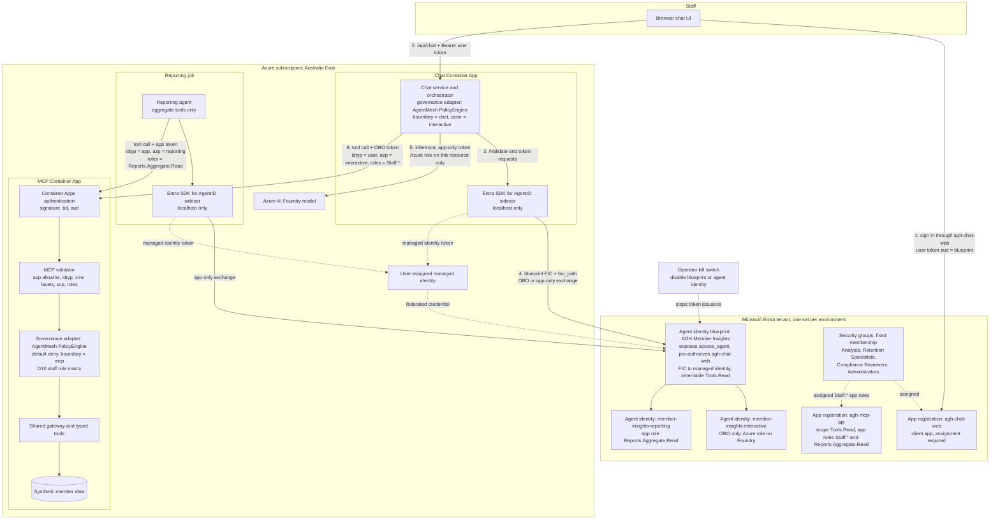
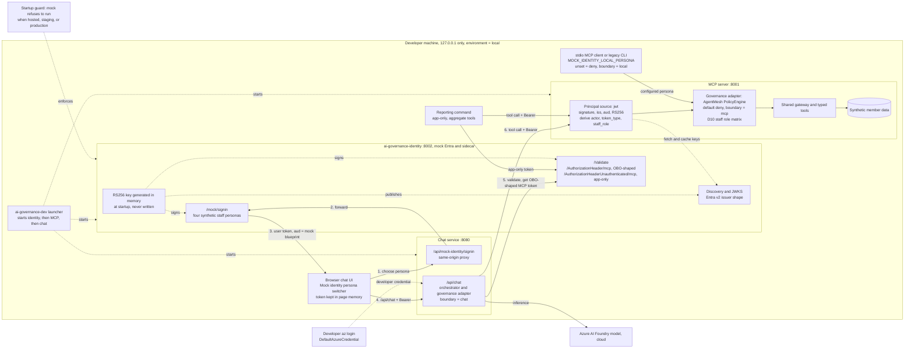
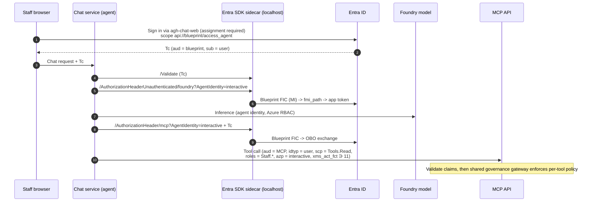
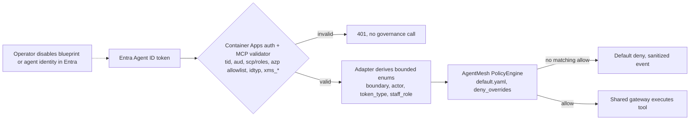
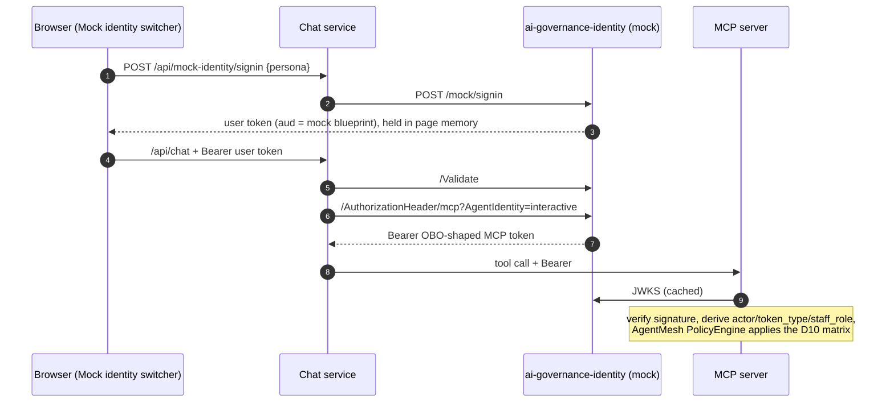

<!-- markdownlint-disable-file -->
# Task Research: entra-agent-id-architecture

| Field              | Value                    |
|--------------------|--------------------------|
| Date               | 2026-10-14               |
| Researcher / agent | rpi-research (RPI Agent) |
| Output mode        | convergence              |

## Executive Summary

* MVP direction (Cycle 4): You can't obtain Entra roles, so the hackathon MVP uses a **mock Entra Agent ID**: a separate local identity service that signs real RS256 tokens shaped exactly like Entra Agent ID OBO and app-only tokens, exposes sidecar-compatible endpoints and a JWKS, and drives a labelled persona switcher in the chat UI (Decisions 11–15).
  * MCP validates the signatures and governance enforces the staff-role matrix exactly as it would with real Entra.
  * The mock is local-only and fails closed elsewhere.
  * Moving to real Entra later is a configuration change for chat and MCP, plus tenant provisioning.

The rest of this summary describes the target Entra architecture the mock emulates.

* Bottom line: Give the harness's chat orchestrator a real Microsoft Entra Agent ID. Use one agent identity blueprint per environment, each with two agent identities:
  * `member-insights-interactive` acts on behalf of signed-in staff through on-behalf-of (OBO).
  * `member-insights-reporting` acts autonomously and is limited to aggregate tools.

  Keep the MCP server as a normal protected API whose app roles carry the four staff roles. Back each blueprint with a managed-identity federated credential, call Foundry with a narrowly scoped agent identity, and acquire all tokens through the Microsoft Entra SDK for AgentID sidecar.
* Why this matters: The design closes the documented gaps: hosted principal validation is deferred, end-user identity is not propagated (ASI03 partial), and chat sends no credential to MCP. It does so without moving orchestration out of the governance gateway, and without client secrets in any environment.
* Research status: Complete, with two cycles of Wider, Deeper, and Contrarian waves and ten user decisions recorded. Cycle 2 added how the design fits the Agent Governance Toolkit (AGT) and AgentMesh.
* AGT and AgentMesh in one sentence: the harness already runs on AgentMesh's policy engine. Entra Agent ID plugs into it as **bounded, identity-aware policy context** (actor, token type, staff role, enforcement boundary). AgentMesh's own identity layer (agent DIDs, `EntraAgentRegistry`, `EntraAgentID`, trust-gated MCP) is not adopted, because it mirrors Entra rather than implementing Agent ID token flows (Decision 9).
* Confidence and uncertainty: High for the identity model, flows, and token claims, which come from current Microsoft Learn primary sources. Medium for hosting mechanics: the sidecar on Azure Container Apps and getting a blueprint-audience token through Container Apps built-in authentication are plausible but undocumented, and need a dev-environment spike.

## What You May Not Know

* MVP mock (Cycle 4):
  * The mock can't issue Azure tokens, so Foundry inference in the MVP still uses your own `az login` through `DefaultAzureCredential`. Decision 5 (agent identity on Foundry) waits for real Entra.
  * In real Entra, staff roles come from app-role assignments to security groups. In the mock, the persona you pick decides the role. The demo proves enforcement of roles, not their assignment.
  * Restarting the identity service generates a new signing key, so earlier tokens stop validating and the UI must sign in again. That's intended (D14).
  * To keep the browser same-origin (ADR 0005, `connect-src 'self'`), the UI should reach mock sign-in through a chat-service route that forwards to the identity service, not by calling port 8002 directly.

* Agent identities cannot hold credentials. The **blueprint** holds them, and every agent identity under it shares that trust. A managed identity should only back the blueprint credential; it should not be the identity that calls MCP or Foundry. This replaces the earlier plan to have the chat Container App use its managed identity for the MCP token (C11).
* For OBO, the staff member's sign-in token must be issued **to the blueprint** (`api://<blueprint>/access_agent`), not to Graph or MCP. Otherwise the exchange fails with `AADSTS50013`. The chat front door therefore has to request that specific scope.
* Child agent identities cannot receive interactive consent (`AADSTS82014`). The MCP delegated scope must be pre-authorized as an **inheritable permission** on the blueprint, with admin consent.
* Conditional Access for agents needs **Microsoft 365 E7**, or **Agent 365 + Entra P1/E3**. Per Decision 8 it is deferred, and the baseline relies on other controls.
* The official sidecar install guide covers Kubernetes, Docker Compose, and AKS, but not Azure Container Apps.
* Because local development uses mocked tokens (Decision 7), no environment needs a blueprint client secret at all. The deployed dev environment becomes the first real Agent ID integration test.
* AgentMesh is already a runtime dependency: `engine.py` evaluates every decision with `agentmesh.governance.PolicyEngine`. "Integrating with AgentMesh" therefore means extending what that engine sees, not adding a new component.
* AgentMesh's Entra helpers sound like a fit but aren't:
  * `EntraAgentID` binds to a managed identity or app registration (which Agent ID guidance tells you not to use as the agent), does not verify signatures, and relies on IMDS, which Container Apps doesn't expose.
  * `EntraAgentRegistry` is a per-process, in-memory copy of Entra state.
* The chat and MCP processes load the **same** policy file, but only the MCP process can see staff roles. Without an enforcement-boundary field, any role-conditioned rule would deny every tool call in the chat process.
* The harness's kill switch is Entra's: disabling the blueprint or an agent identity stops token issuance, and the harness fails closed. AGT cannot do this for you; Tutorial 31's suggested Graph call needs permissions that Entra blocks for agents, so it is an operator action.

## Findings

### Architecture at a glance: target Entra Agent ID design and local MVP

These two diagrams summarise the findings below. The first is the **target** design using real Microsoft Entra Agent ID (Decisions 1–10). The second is how the **MVP runs locally** with the mock identity service (Decisions 11–16). Both render with Mermaid CLI 11.

#### Target: Entra Agent ID (hosted)



Numbered edges follow one staff chat turn. The reporting job follows the app-only path. Dotted edges are credential, assignment, or control relationships rather than request traffic.

#### Local MVP: mock identity



#### How each target component maps to the local MVP

| Target (Entra Agent ID) | Local MVP stand-in | Same code path? |
|-------------------------|--------------------|-----------------|
| Staff sign-in through gh-chat-web (user token for the blueprint) | Persona switcher, then /api/mock-identity/signin to /mock/signin | Chat Bearer handling: yes. Sign-in UX: no |
| Entra SDK for AgentID sidecar (/Validate, /AuthorizationHeader, /AuthorizationHeaderUnauthenticated) | Same endpoints on i-governance-identity :8002 | Yes, by URL |
| Blueprint, managed-identity federated credential, mi_path exchange | In-memory RS256 key; the mock mints OBO-shaped and app-only tokens directly | No (emulated) |
| Agent identities member-insights-interactive and member-insights-reporting | Synthetic agent IDs on the mock's zp allowlist | MCP allowlist check: yes |
| Security groups assigned Staff.* app roles | Persona selection decides the role | Role *enforcement*: yes. Role *assignment*: no |
| Container Apps authentication plus MCP validator (asy_auth) | MCP principal source jwt against the mock JWKS | Claim normalization and policy: yes |
| AgentMesh PolicyEngine, default deny, D10 matrix | Same | Yes |
| Foundry via agent identity with an Azure role | Developer z login (DefaultAzureCredential) | No (D16) |
| Operator kill switch: disable the blueprint | Stop the identity service; tokens stop validating and MCP fails closed | Fail-closed behaviour: yes |
| Not applicable | MOCK_IDENTITY_LOCAL_PERSONA for stdio MCP and the CLI (oundary = local) | Local only (D15) |
| Hosted environments | Startup guard refuses the mock when hosted, staging, or production | Local only (D14) |

### The harness needs agent identity at the chat orchestrator, not at the MCP server

The only component that reasons and chooses tools is the chat orchestrator, which calls the Foundry model and selects MCP tools. It is the agent. The MCP server is a deterministic, typed tool server with no model calls, so it is a protected resource API. Agent ID guidance forbids app registrations for agents, but resource APIs keep normal registrations. The security plan already requires Entra for every staff user, identity inherited from the user, and policy enforced outside the model.

* Questions: Q1, Q4
* Evidence state: Evidence-backed finding
* Evidence: C1, C3, C5, C8, W2, W6
* Confidence and limits: High. The user confirmed this split in Decisions 1 and 4.

### Two agent identities under one blueprint per environment match Learn's defaults and the selected patterns

Learn's defaults are one blueprint per trust boundary and one agent identity per logical agent with distinct responsibilities. Replicas never justify extra identities, and credentials should be isolated per environment. You chose both interactive and autonomous patterns, and autonomous runs are limited to aggregate data. Separate identities mean:

* the interactive identity never holds the aggregate app role, so a hijacked chat turn cannot switch to an app-only token to reach MCP data;
* each pattern has its own audit trail;
* each can be disabled independently.

* Questions: Q2, Q3
* Evidence state: Evidence-backed finding
* Evidence: W2, W3, W4, decisions D2, D2a, D3
* Confidence and limits: High. One limit: if the reporting job runs in a separate runtime with its own managed identity, it may form a separate trust boundary. See risk R3.

```mermaid
flowchart TB
  subgraph tenant["Entra tenant (per environment: dev, prod)"]
    G["Security groups (fixed membership)<br/>Analysts, Retention Specialists,<br/>Compliance Reviewers, Administrators"]
    WEB["App registration: agh-chat-web-{env}<br/>client app, assignment required"]
    BP["Agent identity blueprint: AGH Member Insights ({env})<br/>sponsor + owners; FIC to user-assigned MI;<br/>exposes access_agent; pre-authorizes chat client;<br/>inheritable delegated: MCP Tools.Read"]
    AI1["Agent identity: member-insights-interactive-{env}<br/>OBO only to MCP; Azure role on Foundry"]
    AI2["Agent identity: member-insights-reporting-{env}<br/>app role Reports.Aggregate.Read on MCP"]
    MCPAPP["App registration: agh-mcp-api-{env}<br/>scope Tools.Read; app roles Staff.* and Reports.Aggregate.Read;<br/>assignment required"]
    BP --> AI1
    BP --> AI2
    G -. assigned .-> WEB
    G -. assigned Staff.* roles .-> MCPAPP
  end
```

### A Python orchestrator gets Agent ID tokens through the Entra SDK for AgentID sidecar

For non-.NET agents, Microsoft directs you to the sidecar. It runs on localhost beside the app and exposes:

* `/Validate`, for the inbound staff token;
* `/AuthorizationHeader/{api}?AgentIdentity=...` with the inbound bearer, for OBO;
* `/AuthorizationHeaderUnauthenticated/{api}?AgentIdentity=...`, for app-only tokens.

Learn publishes a Python example. The sidecar keeps the two-step `fmi_path` exchange out of the application code, and Learn explicitly discourages implementing that exchange by hand.

* Questions: Q5
* Evidence state: Evidence-backed finding
* Evidence: W6, W7, W10, W11
* Confidence and limits: High for the API surface. Hosting the sidecar on Container Apps is undocumented (R1).

### Token flows



The reporting job uses `/AuthorizationHeaderUnauthenticated/mcp?AgentIdentity=reporting`. Its token carries `idtyp=app`, `roles=Reports.Aggregate.Read`, `azp=reporting`, and `xms_sub_fct ∋ 11`.

* Questions: Q3, Q4
* Evidence state: Evidence-backed finding
* Evidence: W5, W6, W7, W8, W9, W12
* Confidence and limits: High for the protocol and claims. Medium for the browser step: using Container Apps built-in authentication to request the blueprint scope is unverified (R2).

### The MCP server can enforce staff roles and agent patterns from documented claims

The agent token claims reference defines how a resource server tells the patterns apart:

* **OBO by an agent:** `idtyp=user`, user `oid`, `scp`, `azp` set to the agent identity, `xms_act_fct` containing `11`.
* **Autonomous agent:** `idtyp=app`, `roles`, `xms_sub_fct` containing `11`.
* **Agent's user account:** `xms_sub_fct` containing `13`.

`xms_par_app_azp` should be logged but must not be used for authorization. These claims support the following MCP rules:

| Tool group | Required token shape | Required authorization |
|------------|----------------------|------------------------|
| Member-level (`get_member_profile`, `get_member_disengagement_signals`, `prepare_member_outreach_case`) | `idtyp=user`, `azp` = interactive identity for this environment, `xms_act_fct` ∋ 11, not `xms_sub_fct` ∋ 13 | `scp` ∋ `Tools.Read` plus the policy-allowed `Staff.*` role; outreach also keeps MCP elicitation approval |
| Aggregate (`get_cohort_churn_analytics`, `get_fum_outflow_summary`) | Either the OBO shape above, or `idtyp=app` with `azp` = reporting identity | Staff role (OBO) or `roles` ∋ `Reports.Aggregate.Read` (app-only) |
| Anything else | Any | Denied (existing default deny) |

The current hosted validator requires `scp` on every request and checks no roles or actor (C5). It will need to branch on `idtyp` and check `azp` and `roles`.

* Questions: Q7, Q9
* Evidence state: Evidence-backed finding
* Evidence: C2, C5, C6, W12
* Confidence and limits: High. The `xms_*` claims are described as optional claims and may need configuring on the MCP API registration (R4).

### Agent ID fits the governance and telemetry contract with small, bounded extensions

The governance context already has `workload_id` and a SHA-256 `principal_hash` (C13), and ADR 0003 forbids raw claims in telemetry (C4). The design keeps `principal_hash` derived from the user `oid` (OBO) or the agent `oid` (app-only). It adds two bounded enums:

* an actor label (`interactive`, `reporting`), derived from an allowlisted `azp`;
* a staff role (`analyst`, `retention_specialist`, `compliance_reviewer`, `administrator`, or `none`).

Raw `oid`, `azp`, UPN, and `xms_par_app_azp` never leave memory.

* Questions: Q9
* Evidence state: Evidence-backed finding (design inference grounded in C4, C13, W12)
* Evidence: C4, C9, C10, C13, W12
* Confidence and limits: High. ADR 0003 needs an update or a successor record. Once implemented, the toolkit evidence can move from `hosted_principal_validation: deferred` to implemented, and ASI03 from partial to implemented.

### Foundry inference should use the agent identity with a narrow Azure role

Agent identities can hold Azure roles on specific resources, and Foundry's own model says the agent identity, not the managed identity, needs the role assignments on target resources. Each agent identity gets an inference-only role (for example `Cognitive Services OpenAI User` or `Azure AI User`) on the one Foundry resource. Staff get no Azure access, and the managed identity gets none either.

* Questions: Q4
* Evidence state: Partially supported claim
* Evidence: C7, W8, W9
* Confidence and limits: Medium-high. Learn shows agent identities holding Azure roles, but no page explicitly demonstrates a self-hosted agent identity calling the Foundry project endpoint that the repository's `azure-ai-projects` client uses. Confirm the exact role during the dev spike (R8).

### Governance and lifecycle controls work without agent Conditional Access licensing

Learn's best practices that don't need the agent Conditional Access licence:

* a user sponsor and technical owners at creation;
* descriptive metadata and naming (`AGH-MemberInsights-{Role}-{Env}`);
* blueprint-level policy and the blueprint disable kill switch;
* per-environment credentials;
* managed-identity federated credentials in place of secrets;
* sign-in and audit log alerting on credential changes, permission grants, and token failures;
* sponsor attestation every 6–12 months and quarterly orphan reviews;
* configuration as code;
* a production handshake with an identity admin.

Conditional Access for agents (block risky agents, block non-prod agents by `Environment` attribute) needs M365 E7 or Agent 365 + Entra P1/E3 and is deferred (Decision 8). Provisioning should use the Agent 365 CLI or Microsoft Graph with the Agent ID Developer role. It must not use Azure CLI tokens, which carry `Directory.AccessAsUser.All` and are rejected.

* Questions: Q8, Q10
* Evidence state: Evidence-backed finding
* Evidence: W4, W11, W13, W14, skill guidance
* Confidence and limits: High. Whether access reviews for agents need Entra ID Governance licensing was not verified (R5).

### Entra Agent ID and the Agent Governance Toolkit divide the work cleanly: Entra decides who, AGT decides what

The toolkit's own reference material assigns directory identity, tokens, Conditional Access, sponsors, and lifecycle to Entra and Agent 365, and per-action runtime policy to AGT. In the toolkit's words, Entra "gates access" and AGT "gates individual actions within that access" (W17, W18). That matches the harness:

* **Entra Agent ID** issues and validates every token, and is the kill switch.
* **AGT's policy engine** turns validated claims into allow or deny decisions for each lifecycle point and tool.

The harness already uses AGT this way. The adapter loads one YAML policy into `agentmesh.governance.PolicyEngine` and evaluates a snapshot made of `action`, a bounded `governance` context, and optional `data` (C14). Today the policy only tests `action.type` (C15), and the context carries only a workload ID, environment, authentication outcome, and principal hash (C13). Hosted identity is still marked deferred (C9).

* Questions: Q11, Q12
* Evidence state: Evidence-backed finding
* Evidence: C9, C13, C14, C15, C22, W17, W18
* Confidence and limits: High. The toolkit docs are vendor documentation, but they agree with the installed code.

### AgentMesh's identity layer does not implement Entra Agent ID and should not be adopted here

AgentMesh is a Public Preview "trust, identity, and governance layer" built on agent DIDs, Ed25519 keys, trust handshakes, and 0–1000 trust scores. Its MCP, A2A, and SPIFFE support is Alpha and SPIRE integration is stubbed (W16). Its Entra pieces are a bridge, not an implementation:

| Component | What it actually does | Why it doesn't fit this design |
|-----------|-----------------------|--------------------------------|
| `EntraAgentID` | Maps a DID to a managed identity or app registration through IMDS; claim checks without signature verification (C17) | Agent ID guidance rejects managed identities and app registrations as the agent (W2). It has no blueprint, `fmi_path`, or OBO support, and IMDS is absent on Container Apps (W19) |
| `EntraAgentRegistry` / `EntraAgentBlueprint` | In-memory DID ↔ Entra object ID mirror with local suspend and scope checks (C18) | Per-process state drifts from Entra across replicas, and duplicates Entra's blueprint disable |
| `EntraTokenVerifier` | Sound JWKS signature, `aud`, and `tid` verification; v2 issuer only (C19) | Built for the AgentMesh relay; doesn't check `azp`, `idtyp`, `roles`, or `xms_*`. In the selected design, token validation stays with Container Apps authentication and the existing MCP validator (C5) |
| Citadel `EntraIdentityBridge` | Correlation and attestation; continues with local identity if Entra is unavailable (C20) | Fail-open conflicts with ADR 0002 |
| `TrustGatedMCPServer` | Authenticates MCP callers by DID and trust score (C21) | Would replace Entra OAuth at MCP with a parallel identity system |

The toolkit's tutorial lists its own gaps: claim-level token verification only, one-way manual lifecycle sync, and no service-principal disable (W17). AgentMesh's mesh features (trust handshakes, delegation chains, inter-agent policy) target multi-agent systems; this harness has one agent and no inter-agent protocol (C10, ASI07 not applicable). You confirmed policy-context integration only (Decision 9).

* Questions: Q13, Q14
* Evidence state: Evidence-backed finding
* Evidence: C5, C10, C17–C21, W2, W16, W17, W19
* Confidence and limits: High for toolkit 4.1.0 as installed. Revisit if the harness adds a second agent, or if a future toolkit release implements Agent ID token flows (R14).

### Identity-aware policy needs four bounded context fields and a boundary-aware rule set

The AgentMesh condition grammar supports `==`, `!=`, `in [...]`, and `and`/`or` over dotted paths. A clause about a missing field evaluates `False` (C16), so identity-aware allow rules fail closed when a claim is absent. The adapter only needs to derive bounded enums from validated claims and add them to `GovernanceContext`:

| Field | Values | Derived from | Available in |
|-------|--------|--------------|--------------|
| `governance.boundary` | `chat`, `mcp`, `local` | Process configuration (`local` for token-less stdio and CLI callers, D15) | All |
| `governance.actor` | `interactive`, `reporting` | `azp` matched against the environment's allowlisted agent identity app IDs | MCP; chat knows its own actor |
| `governance.token_type` | `user`, `app` | `idtyp`, plus `xms_act_fct`/`xms_sub_fct` ∋ 11 and not `xms_sub_fct` ∋ 13 | MCP |
| `governance.staff_role` | `analyst`, `retention_specialist`, `compliance_reviewer`, `administrator`, `none` | MCP API `roles` claim (`Staff.*`) | MCP only |

`boundary` matters because both processes load the same policy file, but only the MCP process receives the MCP access token carrying staff roles. Chat-side pre-tool rules check the actor; MCP-side rules check role and token type. Illustrative MCP rules implementing Decision 10:

```yaml
- name: allow-member-profile-retention-specialist
  stage: pre_tool
  condition: "action.type == 'get_member_profile' and governance.boundary == 'mcp' and governance.actor == 'interactive' and governance.token_type == 'user' and governance.staff_role == 'retention_specialist'"
  action: allow
- name: allow-cohort-analytics-staff
  stage: pre_tool
  condition: "action.type == 'get_cohort_churn_analytics' and governance.boundary == 'mcp' and governance.token_type == 'user' and governance.staff_role in ['analyst', 'retention_specialist']"
  action: allow
- name: allow-cohort-analytics-reporting
  stage: pre_tool
  condition: "action.type == 'get_cohort_churn_analytics' and governance.boundary == 'mcp' and governance.actor == 'reporting' and governance.token_type == 'app'"
  action: allow
```

Staff and reporting access are written as separate rules on purpose. The parser splits on ` or ` before ` and ` and has no parentheses (C16), so OR-ing two compound conditions in one rule would be easy to get wrong.

The new fields are bounded enums, so they fit ADR 0003. Raw `oid`, `azp`, and UPN stay in memory, and `principal_hash` is unchanged.

* Questions: Q12
* Evidence state: Evidence-backed finding (design grounded in installed code)
* Evidence: C4, C13, C14, C16, W12, D6, D10
* Confidence and limits: High. Two caveats:
  * An exception during condition evaluation is treated as a match. That fails closed for deny rules but would fail open for an allow rule, although the regex grammar rarely raises (R10).
  * `agt lint-policy --strict` acceptance of the new conditions is unverified (R13).

### Enforcement flow across Entra, chat, and MCP



* Questions: Q11, Q12
* Evidence state: Evidence-backed finding (design inference)
* Evidence: C5, C14, C16, W9, W12, W17
* Confidence and limits: High. Kill switch: AGT has no Entra disable, and the Graph permissions Tutorial 31 names are blocked for agents (W9, W17). Disabling is an operator runbook step; the harness responds by failing token acquisition closed.

### You can't create agent identities in the project tenant yet; you need one Entra role plus admin consent

A read-only spike against the project tenant (Cycle 3) found:

* **Tenant supports Agent ID:** the **Agent ID Developer** and **Agent ID Administrator** roles exist, and agent identity blueprints already exist in the tenant (W22, W24).
* **You hold no directory roles:** you're signed in to the project tenant (it matches `AZURE_TENANT_ID`), but you have no active directory role, directly or through groups. Your token carries only one built-in, non-assignable role template (W22).
* **PIM eligibility unknown:** the Azure CLI token lacks the `RoleEligibilitySchedule.Read.Directory` scope needed to read it (W22).
* **Required scopes need admin consent:** all seven Agent ID Graph delegated scopes, including `AgentIdentityBlueprint.Create` and `AgentIdentityBlueprintPrincipal.Create`, are admin-consent-only. The tenant-wide grant for Microsoft Graph Command Line Tools includes none of them (W23).

Learn's prerequisites (W20, W21):

| Task in this design | Least-privileged requirement |
|---------------------|------------------------------|
| Create the two blueprints and their blueprint principals | **Agent ID Developer** (or Agent ID Administrator) + delegated `AgentIdentityBlueprint.Create` and `AgentIdentityBlueprintPrincipal.Create` |
| Set `identifierUris`, `access_agent` scope, pre-authorized chat client (D2, W5) | Blueprint owner + `AgentIdentityBlueprint.UpdateAuthProperties.All` |
| Add the managed-identity federated credential (D3, W6) | Agent ID Developer + `AgentIdentityBlueprint.AddRemoveCreds.All` |
| Create the four agent identities | **Blueprint owner**; no Agent ID role needed (creators are owners automatically). Admin center wizard, or programmatically with the blueprint's own token |
| Admin-consent the delegated scopes above for your client (for example Microsoft Graph PowerShell) | Cloud Application Administrator or Application Administrator |
| Inheritable delegated permission `Tools.Read` on the MCP API (W6) | Cloud Application Administrator or Application Administrator (admin consent) |
| Grant Microsoft Graph application permissions | Privileged Role Administrator. Not needed: the design grants no Graph app permissions |
| Client secret or certificate on a blueprint | Agent ID Administrator. Not needed: the design uses managed-identity federated credentials only (D7) |

You can unblock this in either of two ways:

* **Self-serve (Recommended):**
  * Ask a tenant admin for **Agent ID Developer**, ideally PIM-eligible.
  * Have a Cloud Application Administrator or Application Administrator consent the Agent ID delegated scopes for Microsoft Graph PowerShell.
* **Admin-led:** an Agent ID Developer creates the blueprints and adds you as **owner**. You can then create the agent identities yourself in the Entra admin center without any Agent ID role.

Either way, MCP API admin consent and Azure RBAC on the Foundry resource (Owner, User Access Administrator, or Role Based Access Control Administrator on that resource) are separate requests.

* Questions: Q15
* Evidence state: Evidence-backed finding
* Evidence: W20–W24
* Confidence and limits: High for role and consent requirements and for your current role state. Not checked:
  * **PIM eligibility:** check **My roles** in the Entra admin center.
  * **Creation itself:** no write was attempted, because creating directory objects in a shared tenant needs your explicit go-ahead.

### For the MVP, a local mock issuer can stand in for Entra Agent ID while every enforcement path stays real

A mock only needs to reproduce the **contract** the rest of the design depends on:

* Entra-shaped discovery and JWKS (C19, W12);
* the sidecar's three token endpoints (W7);
* the OBO and app-only claim shapes (W12).

Then the MCP principal source, governance context, and policy rules are exercised exactly as they would be with real Entra. PyJWT and cryptography are already installed (C27), and the MCP middleware has a clear seam for a pluggable principal source (C24).

**Mock identity service** (`ai-governance-identity`, `127.0.0.1:8002`, D12):

| Endpoint | Stands in for | Behaviour |
|----------|---------------|-----------|
| `GET /{mock-tenant}/v2.0/.well-known/openid-configuration`, `GET /{mock-tenant}/discovery/v2.0/keys` | Entra discovery and JWKS | v2 issuer; RS256 public key generated in memory at startup |
| `POST /mock/signin` `{ "persona": ... }` (reached through a same-origin chat route) | Staff sign-in to `agh-chat-web` (W5) | Mints a user token: `aud` = mock blueprint app ID, `scp=access_agent`, `idtyp=user`, synthetic `oid`, short TTL |
| `GET /Validate` + Bearer | Sidecar `/Validate` (W7) | Verifies the user token and returns bounded claims |
| `GET /AuthorizationHeader/mcp?AgentIdentity=<interactive>` + Bearer | Sidecar OBO (W6, W7) | Requires a valid user token and the interactive ID. Returns `{ "authorizationHeader": "Bearer ..." }` for a token with `aud` = mock MCP API, `idtyp=user`, user `oid`, `scp=Tools.Read`, `roles=[Staff.<persona>]`, `azp` = interactive ID, `xms_act_fct="11"`, `xms_par_app_azp` = blueprint |
| `GET /AuthorizationHeaderUnauthenticated/mcp?AgentIdentity=<reporting>` | Sidecar app-only (W7) | Requires the reporting ID. Token has `idtyp=app`, `oid` = reporting agent, `roles=[Reports.Aggregate.Read]`, `azp` = reporting ID, `xms_act_fct="11"`, `xms_sub_fct="11"` |
| `GET /healthz` | Sidecar health | Readiness for `ai-governance-dev` |

The service rejects unknown `AgentIdentity` values, the interactive ID on the app-only endpoint, and the reporting ID on the OBO endpoint. It refuses to start outside `local`/`development`/`test` or when hosted (D14).

**Chat service:**

* `/api/chat` requires a Bearer user token, validated through `/Validate`.
* It sets `boundary=chat`, `actor=interactive`, `token_type=user`, and `principal_hash` = SHA-256 of the user `oid`.
* For each MCP call it obtains an OBO header from `/AuthorizationHeader/mcp` and sends it to MCP.
* Foundry still uses `DefaultAzureCredential` (D16).

**MCP server:**

* A principal-source setting selects `easy_auth` (hosted, existing C5) or `jwt` (mock now; usable for direct Entra validation later).
* `jwt` mode verifies the signature against the JWKS and pins issuer, audience, `tid`, and RS256.
* It then normalizes claims into `actor` (`azp` allowlist), `token_type` (`idtyp` plus `xms_*` facets), and `staff_role` (`roles`), with `boundary=mcp`.
* Anything missing or unrecognised means deny.

**Token-less local callers (D15):** stdio MCP and the legacy CLI get `boundary=local` and the opt-in `MOCK_IDENTITY_LOCAL_PERSONA`. Unset means deny.

**Reporting agent (D2a):** a small app-only entry point (for example a CLI command or test) calls the aggregate tools with a token from `/AuthorizationHeaderUnauthenticated/mcp`. That shows the second agent identity being both allowed and denied.



Switching to real Entra later:

* Chat: point the sidecar URL at the real Entra SDK sidecar and remove the persona switcher in favour of real sign-in.
* MCP: switch the principal source to `easy_auth`, or keep `jwt` against the real Entra JWKS.
* Tenant: provision the D3 objects.
* Decisions 1–10 stay the target.

* Questions: Q16
* Evidence state: Evidence-backed finding (design grounded in C24–C30, W5–W7, W12)
* Evidence: C5, C7, C16, C24–C30, W5, W6, W7, W12, D11–D16
* Confidence and limits: High that the mock exercises the same validation and policy code paths. Limits:
  * Role *assignment*, Conditional Access, consent, and Foundry agent identity are not demonstrated (R18).
  * A mock that mints any persona is an authentication bypass if it ever runs outside local mode; D14 guards against this (R19).

## Recommendation and Alternatives

* MVP recommendation (Cycle 4): Build the mock identity service and the identity-aware governance path now (D11–D16). Keep the target Entra architecture below as the post-MVP path; the mock emulates its contract.

* Recommendation: Self-hosted orchestrator with Entra Agent ID:
  * one blueprint per environment, with `member-insights-interactive` (OBO) and `member-insights-reporting` (aggregate-only, app-only) identities;
  * the MCP server as a protected API with a `Tools.Read` scope, `Staff.*` app roles assigned to fixed security groups, and `Reports.Aggregate.Read` for the reporting identity;
  * an assignment-required chat client app as the UI gate;
  * user-assigned managed identity federated credentials on each blueprint;
  * agent identities holding narrow Foundry roles;
  * the Entra SDK for AgentID sidecar for all tokens;
  * mocked token-shaped principals locally;
  * agent Conditional Access deferred;
  * AGT integration through bounded `boundary`, `actor`, `token_type`, and `staff_role` policy-context fields, with boundary-aware allow rules implementing the Decision 10 matrix, and no AgentMesh identity APIs (Decision 9).
* Rationale: This satisfies every confirmed decision (D1–D8). It follows Learn's defaults (W2–W4), implements the security plan's identity requirements (C1–C3), keeps the default-deny gateway in-process (ADR 0001, ADR 0002), and closes C8, C9, and C10 with documented claims (W12).
* What could change this result:
  * A failed Container Apps sidecar spike would force AKS or a different host (R1).
  * Moving the reporting job to its own runtime may justify its own blueprint (R3).
  * Gaining agent Conditional Access licensing adds a policy layer without changing the topology.

| Option | Benefits | Costs and risks | Evidence | Disposition |
|--------|----------|-----------------|----------|-------------|
| Self-hosted orchestrator + repo-provisioned blueprint + sidecar | Keeps governance gateway; full control; per-agent audit | Own provisioning; sidecar hosting spike | C8, W7, W10 | selected (D1) |
| Foundry Agent Service with Foundry-provisioned identity | Least identity plumbing | Orchestration leaves the gateway; shared identity for unpublished agents | W8 | rejected (D1) |
| Managed identity or app registration per service as the agent | Familiar; no sidecar | Prohibited by Agent ID guidance; no sponsor, agent audit, or blueprint lifecycle | W2, W4, C11 | rejected |
| Single agent identity using both OBO and app-only | Fewer objects | Interactive path would hold the aggregate app role; mixed audit trail | W2, W4 | rejected (D3) |
| Separate blueprint per pattern | Credential isolation between patterns | More objects; same runtime implies same trust boundary | W2, W3 | rejected (D3); revisit if R3 materializes |
| MCP server as its own agent identity | Uniform model | It does not reason; adds blueprint without benefit | W2, W6 | rejected (D4) |
| OBO to Foundry as the user | Per-user model attribution | Every staff member needs Azure RBAC; direct model path bypasses the gateway | W9 | rejected (D5) |
| Two local profiles including a real `entra-dev` | Earlier real-flow testing | Docker and tenant access for contributors | W4, W6 | rejected (D7) in favour of mocked tokens |
| AGT policy-context integration only | Reuses the AgentMesh engine already in use; no new preview APIs; fails closed on missing claims | Adapter and policy changes; boundary field needed | C14, C16, W18 | selected (D9) |
| Add AgentMesh `EntraAgentRegistry` correlation bridge | AGT-native audit records with Entra object IDs | Per-process state that drifts from Entra; duplicates the Entra disable; preview API | C18, W17 | rejected (D9) |
| Full AgentMesh identity (DIDs, handshakes, trust-gated MCP) | Multi-agent trust features | Parallel identity system; Alpha; replaces OAuth at MCP; harness is single-agent | C21, W16 | rejected (D9); revisit if a second agent is added |
| AgentMesh `EntraAgentID` for token acquisition | In-toolkit helper | Binds to managed identity or app registration; IMDS-only; no OBO or signature check | C17, W19 | rejected |
| MVP: signed-JWT mock issuer, separate service | Exercises real signature, claim, and policy paths; swap by configuration | New service and dependency; key resets on restart | C24, C27, C29, W7, W12 | selected (D11, D12) |
| MVP: unsigned claims stub | Fastest | Proves no validation; local trust header risk | C24 | rejected (D11) |
| MVP: mock Easy Auth headers via proxy | Reuses the hosted validator | Skips chat OBO; turns on header trust locally | C5 | rejected (D11) |
| MVP: mock embedded in chat | One fewer process | Chat holds the key it should obtain tokens from | C25 | rejected (D12) |
| MVP: anonymous local carve-out for stdio and CLI | Nothing breaks | Standing bypass of the role matrix | C16 | rejected (D15) |

## Scope and Questions

* Goal: Design a Microsoft Entra Agent ID identity architecture for the AI Governance Harness, covering the browser chat, chat/orchestrator service, MCP server, Azure AI Foundry model, and the shared governance gateway.
* Audience and use: Repository maintainers and the user, to drive planning and a future hosted-identity ADR.
* In scope:
  * blueprint and agent identity layout;
  * staff authentication;
  * chat-to-Foundry, chat-to-MCP, and reporting-to-MCP authentication;
  * OBO and autonomous patterns;
  * the credential strategy;
  * sponsorship, lifecycle, and governance;
  * integration with governance context, telemetry minimisation, and default-deny policy.
* Out of scope: Code changes, tenant provisioning, Bicep, ADR edits.
* Decision and evidence criteria: Microsoft Learn Agent ID guidance, security plan SEC-2026-SUPER-001, ADR 0002 and ADR 0003, Python runtime feasibility, least privilege.
* Requested output: Recommended identity architecture with alternatives and decisions.

| ID | Question | Source | Status |
|----|----------|--------|--------|
| Q1 | Which components are agents needing an Agent ID, and which are resources? | Inferred | answered |
| Q2 | How many blueprints and agent identities, and how scoped per environment? | Explicit | answered |
| Q3 | OBO, autonomous, or both, per hop? | Security plan §5.1 | answered |
| Q4 | How do chat, MCP, and Foundry authenticate to each other using Agent ID? | Explicit | answered |
| Q5 | How does a Python runtime acquire Agent ID tokens? | Inferred | answered |
| Q6 | Which credential backs the blueprint locally and hosted? | Inferred | answered (MI FIC hosted; none locally) |
| Q7 | How do staff roles map onto authorization across chat and MCP? | Security plan §5.2 | answered |
| Q8 | Which governance controls apply? | Best-practices doc | answered; access-review licensing unverified |
| Q9 | How does Agent ID integrate with governance context, principal hashing, and default deny? | ADR 0002/0003 | answered |
| Q10 | Which limitations or risks affect adoption? | Inferred | answered |
| Q11 | What identity model and identity integration points does the Agent Governance Toolkit (AGT) 4.1 provide, and does it support Entra Agent ID? | Explicit (Cycle 2) | answered |
| Q12 | How does this repository's AGT adapter use identity today, and where would Entra Agent ID claims enter it? | Explicit (Cycle 2) | answered |
| Q13 | What is AgentMesh, how does its identity model relate to Entra Agent ID, and how would it integrate with this harness? | Explicit (Cycle 2) | answered |
| Q14 | Should AgentMesh be adopted now, later, or not at all for this single-agent harness? | Inferred (Cycle 2) | answered (policy engine yes, identity layer no) |
| Q15 | Can the signed-in developer create agent identity blueprints and agent identities in the project tenant today, and if not, what access is needed? | Explicit (Cycle 3 spike) | answered (no; access listed in Findings) |
| Q16 | How should the MVP mock Entra Agent ID so the identity, OBO, app-only, and policy contracts are demonstrable without tenant access, and real Entra can replace the mock by configuration? | Explicit (Cycle 4, direction change) | answered |

## Decisions and Feedback

| Group | Decision or feedback item | Status | Owner | Rationale or input needed | Evidence | Impact of answer |
|-------|---------------------------|--------|-------|---------------------------|----------|------------------|
| D1 | Agent runtime and identity provisioning | confirmed: self-hosted chat orchestrator, repository-provisioned blueprint, Entra SDK for AgentID sidecar | user | Selected recommended option | C8, C12, W8, W10 | Provisioning as code; sidecar required |
| D2 | Operation pattern | confirmed: both interactive (OBO) and autonomous from the start | user | Selected over recommended OBO-only | C1, C2, W2, W5, W6 | Two token flows |
| D2a | Autonomous scope | confirmed: aggregate-only tools; member-level tools stay OBO-only | user | Selected recommended option | C2, W2, W9 | `Reports.Aggregate.Read` app role; MCP rejects app-only on member tools |
| D3 | Blueprint and identity layout | confirmed: one blueprint per environment with interactive and reporting identities | user | Selected recommended option | W2, W3, W4 | Two blueprints, four agent identities |
| D4 | MCP server identity model | confirmed: protected resource API with standard app registration (scope and app roles) | user | Selected recommended option | C5, C6, W2, W6 | Extends existing hosted validation |
| D5 | Foundry inference identity | confirmed: agent identity app-only token with a narrow Azure role on the Foundry resource | user | Selected recommended option | C7, W8, W9 | Replaces `DefaultAzureCredential` in hosted mode |
| D6 | Staff role enforcement | confirmed: `Staff.*` app roles on MCP API assigned to security groups (authoritative); assignment-required chat client as UI gate; role passed to governance as a bounded enum | user | Selected recommended option | C2, C3, C4 | Governance context gains bounded role and actor fields |
| D7 | Local development credentials | confirmed: mocked tokens locally; real Agent ID only in the deployed dev environment | user | Selected over recommended two-profile option | W4, W6 | Claim-fixture contract tests; no blueprint secrets anywhere |
| D8 | Agent Conditional Access | confirmed: licensing absent or unknown; baseline without agent CA, CA deferred | user | Selected recommended option | W13 | Governance relies on kill switch, sponsors, alerts, and MCP enforcement |
| F1 | Supersede prior plan P07-T01 managed identity token for chat-to-MCP | proposed | downstream | Conflicts with Agent ID guidance; planning should replace it with sidecar OBO | C11, W2 | Planning scope |
| F2 | Record the research as ADRs: 0008 Entra Agent ID target architecture (D1–D8); 0009 identity-aware governance policy context, Entra as sole identity authority, AgentMesh identity layer not adopted (D6, D9, D10); 0010 local-only mock Entra Agent ID issuer for the MVP, temporary with exit criteria (D11–D16); amend proposed ADR 0003 for the bounded identity fields | done 2026-10-14: ADRs 0008–0010 written as `proposed`, ADR 0003 amended (including Application Insights export from main), related links added to 0002 and 0005 | user | User confirmed Frame, Decide, and Govern | C4, C12, C23 | Planning should cite ADRs 0008–0010 |
| D9 | AgentMesh adoption level for identity | confirmed: policy-context integration only; Entra Agent ID is the sole identity authority; no AgentMesh identity APIs | user | Selected recommended option 2026-10-14 | C14, C17–C22, W16–W19 | Adapter adds bounded identity fields to `GovernanceContext`; policy gains identity-aware rules; no DIDs or registry state |
| D10 | Staff role to tool matrix enforced by policy | confirmed: Analyst = aggregate tools; Retention Specialist = aggregate + member-level + outreach (elicitation still required); Compliance Reviewer and Administrator = no data tools; reporting agent (app-only) = aggregate tools | user | Selected recommended option 2026-10-14 | C2, C15, C16 | Defines MCP-boundary allow rules in `default.yaml`; everything else stays default deny |
| D11 | Mock identity fidelity | confirmed: signed-JWT mock issuer (RS256, in-memory key, JWKS) exposing sidecar-compatible `/Validate`, `/AuthorizationHeader/{api}`, `/AuthorizationHeaderUnauthenticated/{api}`; MCP validates real signatures through a pluggable principal source | user | Selected recommended option 2026-10-14 | C24, C27, C28, W7, W12 | Real validation code paths are exercised; swap to Entra by configuration |
| D12 | Mock topology | confirmed: separate local `ai-governance-identity` service on `127.0.0.1:8002`, started first by `ai-governance-dev`; acts as both the sidecar (for chat) and the issuer/JWKS (for MCP) | user | Selected recommended option 2026-10-14 | C24, C25, C29, W7 | Mirrors real process boundaries; signing key never leaves the identity process |
| D13 | How the demo selects a staff persona | confirmed: labelled "Mock identity" persona switcher in the chat UI with four synthetic staff personas; user token held in page memory only and sent as a Bearer token to `/api/chat` | user | Selected recommended option 2026-10-14 | C2, D10 | Chat API gains Bearer authentication; UI gains a persona control |
| D14 | Where the mock may run | confirmed: mock permitted only in `local`, `development`, and `test`, never with `MCP_HOSTED=true`; services fail closed at startup otherwise; signing key generated in memory and never written; synthetic identifiers only; dashboard labels identity as mock | user | Selected recommended option 2026-10-14 | C26, ADR 0002 | Prevents the mock from becoming a production bypass |
| D15 | Identity for token-less local callers (stdio MCP, legacy CLI) | confirmed: opt-in `MOCK_IDENTITY_LOCAL_PERSONA`, honoured only when the mock is enabled in `local`/`development`/`test`; unset means deny; `governance.boundary = local`; events mark it as a configured persona | user | Selected recommended option 2026-10-14 | C16, C22, D10, D14 | Keeps README stdio and CLI flows usable without a role-matrix bypass |
| D16 | MVP scope adjustment | confirmed by direction change: MVP uses the mock for all identity. Foundry inference keeps `DefaultAzureCredential` (developer sign-in) because the mock cannot issue Azure RBAC tokens. D5, the dev-environment spikes (R1, R2, R4, R8), and tenant access (R16) move to the post-MVP Entra path | constraint | User cannot obtain Entra roles (Cycle 4 direction change) | C7, W22, W23 | Narrows MVP scope; keeps the D1–D10 target contract |

## Risks and Open Questions

| Priority | Type | Risk, question, or research item | Impact | Smallest action or evidence needed | Owner |
|----------|------|----------------------------------|--------|------------------------------------|-------|
| H | risk | R1: The Entra SDK sidecar on Azure Container Apps with `SignedAssertionFromManagedIdentity` is not documented; the guide covers Kubernetes, Docker Compose, and AKS | Hosting choice | Dev-environment spike: Container App with sidecar container on localhost, user-assigned managed identity, blueprint FIC, one OBO and one app-only token. Fallback: AKS with Workload ID | downstream |
| M | open question | R2: Can Container Apps built-in authentication on the chat app request `api://<blueprint>/access_agent` (login parameters) and expose the access token to the app? | Front-door design | Spike in dev. Fallback: browser MSAL authorization code with PKCE against `agh-chat-web` | downstream |
| M | risk | R3: If the reporting job runs as a separate Container Apps Job with its own managed identity, it is arguably a separate trust boundary sharing one blueprint | Credential blast radius | Decide reporting host in planning; share one user-assigned managed identity within the environment or split the blueprint | downstream |
| M | open question | R4: Do the `xms_act_fct` and `xms_sub_fct` claims require optional-claims configuration on the MCP API registration? | MCP validation | Inspect a dev OBO and app-only token | downstream |
| M | open question | R5: Licensing for access reviews and ID Governance of agent identities | Lifecycle controls | Check Entra ID Governance for agents licensing | user |
| M | risk | R7: With mocked tokens locally, the first real token test happens in deployed dev | Late defects | Contract tests using claim fixtures from W12 for every MCP rule | downstream |
| L | open question | R8: Exact Azure role an agent identity needs for the Foundry project endpoint used by `azure-ai-projects` | Least privilege | Dev spike with the narrowest candidate role | downstream |
| L | risk | R6: Sequential creation and permission propagation delays | Provisioning flakiness | Idempotent provisioning with backoff; always create the blueprint principal | downstream |
| L | risk | R9: Entra audit and Graph activity logs do not label agent identities distinctly | Investigation effort | Join by object ID; keep identity inventory in configuration as code | downstream |
| L | further research | Can app roles be defined on the blueprint so staff roles appear in the chat-side token? | Optional earlier role check | Not required by the selected design; revisit only if UI-side role filtering is wanted | downstream |
| M | risk | R10: AgentMesh treats a condition-evaluation exception as a match, which would fail open for an allow rule | Policy bypass on malformed context | Keep context fields as validated enums; add a test that malformed or missing identity fields produce deny on every identity-aware rule | downstream |
| M | risk | R11: Chat and MCP share one policy file but only MCP sees staff roles | Role-conditioned rules would deny all chat-side tool calls, or be weakened to compensate | Add `governance.boundary` and write boundary-specific rules; test both processes against the same file | downstream |
| M | open question | R12: `EntraTokenVerifier` and many validators accept only v2 issuers, while Agent ID samples show v1 tokens | Token rejection if any in-app verifier is added | Set `requestedAccessTokenVersion: 2` on the MCP API registration; confirm in the dev spike | downstream |
| L | open question | R13: Does `agt lint-policy --strict` accept the new identity conditions, and can `agt-runtime-evidence.yaml` record hosted principal validation as implemented? | CI gate | Run both commands against a draft policy and evidence file during planning | downstream |
| L | risk | R14: AgentMesh is Public Preview, and the adapter already depends on its `PolicyEngine` | Upgrade churn | Existing ADR 0001 adapter boundary and version pin; revisit Decision 9 if a release implements Agent ID token flows or a second agent is added | downstream |
| L | risk | R15: Entra disable is an operator action, not automated by the harness or AGT | Slower containment | Runbook: disable blueprint or agent identity, confirm failed token acquisition in readiness and logs | downstream |
| H | risk | R16: The developer has no Agent ID role, and the Agent ID Graph scopes are not consented in the project tenant | Blocks the dev spike and any provisioning-as-code | Request Agent ID Developer (PIM-eligible) and admin consent of the Agent ID delegated scopes, or have an admin create the blueprints and add the developer as owner | user |
| L | open question | R17: Is the developer PIM-eligible for Agent ID Developer already? | May remove the role request | Check Entra admin center, My roles, Eligible assignments | user |
| M | risk | R18: The mock proves role and token enforcement but not role assignment, consent, Conditional Access, or Foundry agent identity | Demo could be read as an Entra integration claim | Label the identity as mock in the UI, dashboard, README, and OWASP evidence; keep ASI03 partial with a "mock identity" limitation and `hosted_principal_validation: deferred` | downstream |
| H | risk | R19: A mock that mints any persona is an authentication bypass if it runs outside local mode | Unauthorized data access | D14 startup guards in all three services, tests asserting refusal in `staging`/`production`/hosted, and bind to `127.0.0.1` only | downstream |
| M | risk | R20: Turning on role rules changes behaviour for every existing test and README flow that calls tools anonymously | Broken tests and docs | Test fixtures mint mock tokens or set `MOCK_IDENTITY_LOCAL_PERSONA`; update README examples | downstream |
| L | risk | R21: JWKS fetch from MCP to the identity service adds a startup and readiness dependency | Readiness failures if the identity service is down | Launcher starts identity first; MCP readiness reports the JWKS state and fails closed | downstream |
| L | risk | R22: Adding `PyJWT[crypto]` as a direct dependency must keep `cryptography<49` (ADR 0006) | Audit drift | Pin compatible PyJWT; run `ai-governance-audit` | downstream |

## Planning Readiness and Next Step

| Field | Record |
|-------|--------|
| Research disposition | executed |
| Decision participation | user-owned; standalone `/rpi-research`; user requested one-by-one questions with recommendations |
| Planning Readiness | Ready for the MVP. D1–D16 are confirmed and grounded in C1–C30 and W1–W24. The MVP plan covers the mock identity service, chat and MCP principal sources, the governance context fields, the D10 policy rules, the D15 local persona, the reporting entry point, and the D14 guards. Real Entra provisioning and spikes (R1, R2, R4, R8, R16) are post-MVP |
| Research depth and lanes | Cycles 1–4: Wider, Deeper, and Contrarian waves, all inline |
| Blockers | None for the MVP. R16 (tenant access) blocks only the post-MVP Entra path |
| Output mode and planning support | convergence; supports planning |
| Continuation owner | user |
| Required gates or confirmations | All material decisions answered; no MVP gates |
| Next action | `/rpi-plan` |
| Primary evidence file | .copilot-tracking/research/2026-10-14/entra-agent-id-architecture-research.md |

## Research Record

### Method and Boundaries

| Field | Record |
|-------|--------|
| Research posture and provenance | balanced; agent-selected (bounded system, adjacent Agent ID uncertainty) |
| Completion basis | All Q1–Q10 answered; contrarian wave found no evidence that reverses decisions; residual items need hands-on verification rather than more sources |
| Explicit limits or deadline | none |
| Codebase and external scope | docs/, src/ai_governance_harness/ identity touchpoints, prior tracking artifacts; Microsoft Learn Entra Agent ID, Entra SDK for AgentID, Foundry agent identity, Conditional Access for agents |
| Initial candidate areas | Security plan, ADR 0002/0003, mcp_server/security.py, foundry_client.py, governance/context.py, toolkit and OWASP evidence; four user-supplied Learn pages |
| Evidence root | default `.copilot-tracking/research/` |
| Constraints and excluded sources | Read-only; `.env` values not read into the artifact (variable names only) |
| Prior knowledge | real-mcp-server research and plan revalidated; P07-T01 managed-identity approach superseded by Agent ID evidence (C11) |

### Extensions and Participation

#### Extension Registry

| Kind | Candidate | Provenance and scoped contract | Selected or skipped reason |
|------|-----------|--------------------------------|----------------------------|
| instruction | copilot-tracking.instructions.md | applyTo `.copilot-tracking/research/**` | selected |
| instruction | markdown and writing-style instructions | applyTo `**/*.md` | selected |
| instruction | Entra Agent ID custom instruction | user/global instruction | selected; blueprint and agent identities, never plain app registrations for agents |
| skill | entra-agent-id | domain skill | selected; object model, sidecar, OBO setup, limitations |
| skill | security-planning, owasp-agentic | security domain | skipped; existing security plan and OWASP evidence were sufficient inputs |
| specialist | research subagents | none topic-fit | skipped; tightly coupled lanes run inline |

#### Direction and Participation Log

| Checkpoint or change | Question, direction, or rationale | Answer or no-interaction reason | Result and revalidation effect |
|----------------------|-----------------------------------|---------------------------------|--------------------------------|
| intake | User asked for one-by-one questions with recommendations | Deferred until Wave 2 evidence supported recommendations | none |
| D1 | Runtime and identity provisioning | Self-hosted orchestrator, repo blueprint, sidecar | Foundry Agent Service rejected |
| D2 | Operation pattern | Both OBO and autonomous | Added D2a to bound autonomous scope |
| D2a | Autonomous scope | Aggregate-only | Separate identities recommended in D3 |
| D3 | Layout | One blueprint per environment, two identities | none |
| D4 | MCP identity model | Protected resource API | none |
| D5 | Foundry identity | Agent identity with narrow Azure role | Added R8 verification |
| D6 | Role enforcement | MCP app roles + assignment-required client | Governance context extension |
| D7 | Local credentials | Mocked tokens | Added R7; removes secrets from all environments |
| D8 | Agent CA licensing | Not licensed or unknown | Agent CA deferred |
| Cycle 2 addition | User asked for further research into Entra Agent ID integration with AGT (including this repo's adapter) and with AgentMesh (Public Preview) | Direction addition; no question needed | Adds Q11–Q14; Cycle 2 runs full Wider, Deeper, Contrarian; Cycle 1 decisions stay in force unless Cycle 2 evidence challenges them |
| D9 | AgentMesh adoption level | Policy-context integration only | No AgentMesh identity APIs; D1–D8 unchanged |
| D10 | Staff role to tool matrix | Recommended matrix | Defines MCP-boundary allow rules |
| Cycle 3 addition | User asked for a small spike on whether they can create agent identities in the project tenant | Direction addition; read-only checks only; no write attempted without explicit approval | Adds Q15; R16 and R17 |
| Cycle 4 direction change | User has no roles, cannot obtain them, and needs a mock identity for the hackathon MVP | Direction change; no question needed to accept it | Adds Q16 and D11–D14; real Entra provisioning becomes a post-MVP path; D1–D10 stay the target contract that the mock emulates |
| D11 | Mock fidelity | Signed-JWT mock issuer | Real validation paths exercised |
| D12 | Mock topology | Separate local identity service | Third service in the launcher |
| D13 | Persona selection | UI switcher, token in page memory | Chat API Bearer auth |
| D14 | Where the mock runs | Local only, fail closed elsewhere | Startup guards |
| D15 | Token-less local callers | Opt-in local persona; unset denies | stdio and CLI keep working when opted in |

### Research Cycle Log

#### Cycle 1

* Active posture, controls, and limits: balanced; no limits.

##### Wave 1: Wider

* Focus and lanes: repository identity requirements and implementation; four user-supplied Learn pages; entra-agent-id skill references.
* Evidence or worker pointers: C1–C13, W1–W4, W11 (inline).
* Reflection: Requirements map to the interactive pattern. Open at this point: Python OBO to a custom API, where Foundry fits, and MCP role enforcement.

##### Wave 2: Deeper

* Focus and lanes: interactive flow, OBO protocol, sidecar patterns, Foundry agent identity, authorization limits.
* Evidence or worker pointers: W5–W10 (inline).
* Reflection: Python OBO is supported through the sidecar. Foundry Agent Service is a credible alternative runtime, so it was raised as D1. The blueprint-audience requirement conflicts with C11.

##### Wave 3: Contrarian

* Focus and lanes: licensing and status, token claims for resource-side enforcement, sidecar hosting on Container Apps, the simpler managed-identity alternative, and Foundry RBAC for self-hosted agent identities.
* Evidence or worker pointers: W12–W15 (inline).
* Reflection:
  * Licensing weakens assumed Conditional Access availability, so D8 was asked.
  * The claims reference strengthens MCP enforcement.
  * Missing Container Apps sidecar documentation leaves R1 unresolved.
  * The managed-identity alternative is rejected by guidance.
  * Foundry RBAC remains partially supported (R8).

##### Parent Synthesis and Re-entry

| Material or claim | Evidence or worker pointers | Disposition | Rationale | User-facing effect |
|-------------------|-----------------------------|-------------|-----------|--------------------|
| Orchestrator is the agent; MCP is a resource API | C3, C5, W2, W6 | accepted | Only the orchestrator reasons; guidance targets agents | Finding 1, D4 |
| Two identities, one blueprint per environment | W2, W3, W4 | accepted | Distinct responsibilities and permissions; same runtime | Finding 2, D3 |
| Sidecar for Python token acquisition | W7, W10 | accepted | Official non-.NET path | Finding 3 |
| Sidecar on Container Apps works | W15 | deferred | Undocumented; needs a spike | R1 |
| MCP claim-based enforcement | W12 | accepted | Documented `idtyp`, `azp`, `xms_*` semantics | Finding 5 |
| Agent CA in baseline | W13 | rejected | Licensing absent or unknown (D8) | Finding 8 |
| Managed identity as chat-to-MCP identity (C11) | W2, W4, W6 | rejected | Managed identity backs blueprint credentials only | F1 |
| Agent identity on Foundry via Azure RBAC | W8, W9 | accepted with verification | Supported in principle; exact role unverified | Finding 7, R8 |

* Another complete three-wave cycle needed: no
* Trigger or stop basis: Remaining gaps (R1, R2, R4, R8) need hands-on tenant verification that desk research cannot settle. Sources were becoming redundant.
* Readiness or revalidation effect: Ready for planning, with verification spikes as early plan items.

#### Cycle 2

* Active posture, controls, and limits: balanced; user direction addition covering AGT and AgentMesh integration; D1–D8 held unless challenged.

##### Wave 1: Wider

* Focus and lanes: repository adapter and policy; installed toolkit 4.1 package inventory; AgentMesh documentation page.
* Evidence or worker pointers: C14, C15, C22, C23, W16 (inline).
* Reflection: The adapter already depends on AgentMesh's `PolicyEngine`, so the question shifted from "whether to integrate" to "which AgentMesh layers". The installed package ships Entra-named identity modules that needed close reading.

##### Wave 2: Deeper

* Focus and lanes: AgentMesh Entra modules, verifier, registry, MCP integration, Citadel bridge, and condition grammar; AGT Tutorial 31 and the A365 reference architecture.
* Evidence or worker pointers: C16–C21, W17, W18 (inline).
* Reflection: AgentMesh's Entra support is a DID-to-Entra correlation bridge built on managed identities or app registrations, not an Agent ID token implementation. The policy grammar can express the identity rules.

##### Wave 3: Contrarian

* Focus and lanes: Could AgentMesh replace parts of the Cycle 1 design (token acquisition, MCP authentication, kill switch)? Does the toolkit's Container Apps claim hold? Are there hidden failure modes in the condition engine?
* Evidence or worker pointers: C16, C17, C19, C20, W9, W17, W19 (inline).
* Reflection:
  * IMDS-based discovery is contradicted on Container Apps (W19).
  * The Graph permissions for the Entra kill switch are blocked for agents (W9).
  * The Citadel bridge fails open.
  * Exception-as-match is a fail-open edge for allow rules (R10).
  * The shared-policy, split-claims problem (R11) surfaced.
  * No evidence overturns D1–D8.

##### Parent Synthesis and Re-entry (Cycle 2)

| Material or claim | Evidence or worker pointers | Disposition | Rationale | User-facing effect |
|-------------------|-----------------------------|-------------|-----------|--------------------|
| Entra = identity authority, AGT = per-action policy | W17, W18, C14 | accepted | Toolkit docs and installed code agree | Finding "Entra decides who, AGT decides what" |
| Adopt AgentMesh identity layer | C17–C21, W16, W17 | rejected | Mirrors Entra; preview; conflicts with Agent ID guidance and ADR 0002 | D9, alternatives table |
| `EntraAgentID.from_managed_identity` on Container Apps | W17 vs W19 | rejected | Container Apps uses `IDENTITY_ENDPOINT`, not IMDS | What You May Not Know |
| Identity-aware policy context with boundary field | C13, C16, W12 | accepted | Grammar supports it; missing fields fail closed | Finding on bounded context fields; R10, R11 |
| AGT-driven Entra kill switch | W9, W17 | rejected | Required Graph permissions blocked for agents | Operator runbook (R15) |
| Staff role to tool matrix | C2, D10 | accepted | User decision | Illustrative rules |

* Another complete three-wave cycle needed: no
* Trigger or stop basis: Q11–Q14 answered from installed code and primary toolkit docs. Remaining items (R10–R13) are verifiable during planning and implementation rather than by further research.
* Readiness or revalidation effect: Ready remains; scope of planning grows to include adapter context, policy rules, and their tests.

#### Cycle 3 (access spike)

* Active posture, controls, and limits: focused; user requested a small spike. Read-only: no directory objects created, and no tenant IDs, user identifiers, or tokens recorded.

##### Wave 1: Wider

* Focus and lanes: sign-in state, tenant match with `.env`, available tooling, Learn prerequisites for blueprints and agent identities.
* Evidence or worker pointers: W20, W21, W22 (inline).
* Reflection: Microsoft Graph PowerShell is not installed; Azure CLI is signed in to the project tenant. Learn names Agent ID Developer as the creation role and owners as able to create agent identities.

##### Wave 2: Deeper

* Focus and lanes: directory role memberships, tenant role definitions, token role template IDs, consent type of Agent ID scopes, existing tenant-wide grants.
* Evidence or worker pointers: W22, W23, W24 (inline).
* Reflection: The developer has no directory role; Agent ID scopes are admin-consent-only and not granted to Graph PowerShell. PIM eligibility could not be read.

##### Wave 3: Contrarian

* Focus and lanes: Is the Azure CLI token's `Directory.AccessAsUser.All` hard 403 (W11) the real blocker? Is there a no-role path?
* Evidence or worker pointers: W21, W24 (inline).
* Reflection: A read of agent identity blueprints with the Azure CLI token succeeded, which weakens the "hard 403" claim for reads; writes stay unverified. The owner path lets a developer create agent identities without an Agent ID role.

##### Parent Synthesis and Re-entry (Cycle 3)

| Material or claim | Evidence or worker pointers | Disposition | Rationale | User-facing effect |
|-------------------|-----------------------------|-------------|-----------|--------------------|
| Developer cannot create blueprints today | W20, W22, W23 | accepted | No role and no consented scopes | Finding on tenant access; R16 |
| Owner path avoids an Agent ID role for agent identity creation | W20, W21 | accepted | Documented by Learn | Admin-led option |
| Azure CLI token is hard-rejected by Agent ID APIs | W11 vs W24 | weakened | Reads succeed; writes untested | Keep using Graph PowerShell with explicit scopes for writes |
| Test creation write | none | deferred | Shared-tenant write needs explicit user approval | Not attempted |

* Another complete three-wave cycle needed: no
* Trigger or stop basis: Q15 answered; the only remaining checks (PIM eligibility, a real create) need the user's own portal check or approved access.
* Readiness or revalidation effect: Planning remains Ready; the dev spike gains an access prerequisite (R16).

#### Cycle 4 (mock identity for the MVP)

* Active posture, controls, and limits: focused. Direction change: no Entra roles are available, so the MVP mocks identity. D1–D10 remain the target contract.

##### Wave 1: Wider

* Focus and lanes: integration seams in MCP and chat, environment guards, available libraries, launcher, test coverage.
* Evidence or worker pointers: C24–C30 (inline).
* Reflection: The MCP middleware and chat middleware are clean seams. PyJWT and cryptography are already present. The launcher supports a third service.

##### Wave 2: Deeper

* Focus and lanes: reproducing the Entra contract (discovery and JWKS shape, sidecar endpoint semantics, OBO and app-only claim shapes) and the MCP SDK verifier hooks.
* Evidence or worker pointers: C19, C28, W5, W6, W7, W12 (inline).
* Reflection: Every claim the D10 rules and the C5/C19 validators need can be minted by a local RS256 issuer. The sidecar response shape is simple to emulate.

##### Wave 3: Contrarian

* Focus and lanes: Where does a mock mislead or break things?
* Evidence or worker pointers: C7, C16, C22, C26, W22 (inline).
* Reflection:
  * stdio MCP and the legacy CLI cannot carry tokens and would lose all data tools (D15).
  * The mock can't issue Azure tokens, so Foundry stays on developer credentials (D16).
  * Persona-chosen roles are not role assignment (R18).
  * A persona-minting service is a bypass outside local mode (D14, R19).
  * Existing anonymous tests will break (R20).

##### Parent Synthesis and Re-entry (Cycle 4)

| Material or claim | Evidence or worker pointers | Disposition | Rationale | User-facing effect |
|-------------------|-----------------------------|-------------|-----------|--------------------|
| Signed-JWT mock with sidecar-compatible API | C24, C27, W7, W12 | accepted | Exercises real validation and policy paths; swap by configuration | D11, mock finding |
| Separate local identity service | C29, W7 | accepted | Mirrors real boundaries; key isolated | D12 |
| Persona switcher, same-origin sign-in proxy | C25, ADR 0005 | accepted | Live allow/deny demo; keeps `connect-src 'self'` | D13 |
| Local-only guard | C26, ADR 0002 | accepted | Prevents bypass | D14, R19 |
| Opt-in local persona for stdio and CLI | C16, C22 | accepted | Preserves documented flows without a carve-out | D15 |
| Foundry via agent identity in MVP | C7 | deferred | Mock can't mint Azure tokens | D16 |

* Another complete three-wave cycle needed: no
* Trigger or stop basis: Q16 answered. The remaining items are implementation and test concerns for planning.
* Readiness or revalidation effect: Ready for an MVP plan; the Entra path moves post-MVP.

### Evidence Log

* Delegation: inline for all waves; lanes tightly coupled and low volume.

| ID | Claim or finding | Source or location | Retrieved and version | Tool | Confidence | Notes |
|----|------------------|--------------------|-----------------------|------|------------|-------|
| C1 | Entra ID for all staff; agent inherits user identity; managed or workload identity for platform-to-platform | docs/project-planning/member-wealth-insights-agent-security-plan.md §5.1 | not applicable | read | high | Draft plan |
| C2 | Staff roles Analyst, Retention Specialist, Compliance Reviewer, Administrator; per-request MCP authorization | docs/project-planning/member-wealth-insights-agent-security-plan.md §5.2, §6.3 | not applicable | read | high | |
| C3 | Authorization enforced outside the model at UI and MCP layers | docs/project-planning/member-wealth-insights-agent-security-plan.md §8.1, §10 | not applicable | read | high | |
| C4 | Telemetry carries only workload metadata and an opaque principal hash | docs/planning/adrs/0003-minimize-identity-and-governance-telemetry.md Decision Outcome | not applicable | read | high | Proposed ADR |
| C5 | Hosted MCP validates Easy Auth headers (`aad`, `tid`, `aud`, `scp`) and hashes the principal ID; no roles or actor checks | src/ai_governance_harness/mcp_server/security.py `_validate_platform_principal` | not applicable | read | high | |
| C6 | Hosted MCP mode requires tenant, audience, scope, and resource URL | src/ai_governance_harness/mcp_server/config.py `ServerSettings.validate_hosted_requirements` | not applicable | read | high | |
| C7 | Foundry client uses `DefaultAzureCredential` | src/ai_governance_harness/foundry_client.py `get_azure_credential` | not applicable | read | high | |
| C8 | Chat service calls MCP without forwarding any credential | src/ai_governance_harness/chat/service.py MCP client headers | not applicable | grep | medium | Only `Accept` header observed |
| C9 | Hosted principal validation declared deferred | src/ai_governance_harness/governance/agt-runtime-evidence.yaml `identity` | not applicable | read | high | |
| C10 | ASI03 partial (end-user identity propagation deferred); ASI07 not applicable | src/ai_governance_harness/governance/evidence/owasp-agentic.yaml ASI03, ASI07 | not applicable | read | high | |
| C11 | Prior plan: chat Container App uses managed identity to get the MCP audience token | .copilot-tracking/plans/2026-10-14/real-mcp-server-plan.md P07-T01 | not applicable | read | high | Superseded by this research |
| C12 | Deployed Entra auth, Container Apps deployment, IaC deferred | README.md Current Scope | not applicable | read | high | |
| C13 | Governance context carries `workload_id` and `principal_hash` | src/ai_governance_harness/governance/context.py `GovernanceContext` | not applicable | grep | high | |
| W1 | Blueprint holds credentials; agent identities have none; interactive vs autonomous; owners, sponsors, managers; sidecar | Fundamental concepts in Microsoft Entra Agent ID, https://learn.microsoft.com/en-us/entra/agent-id/key-concepts | 2026-10-14; ms.date 2026-04-03 | web fetch | high | |
| W2 | Use agent identity, not app registration, service principal, or user; interactive for chat; one blueprint per trust boundary; one identity per logical agent | Plan your agent identity architecture, https://learn.microsoft.com/en-us/entra/agent-id/how-to-plan-agent-identity-architecture | 2026-10-14; ms.date 2026-04-03 | web fetch | high | |
| W3 | Singleton and domain-worker patterns; avoid per-replica and per-session identities | Microsoft Entra Agent ID design patterns, https://learn.microsoft.com/en-us/entra/agent-id/concept-agent-id-design-patterns | 2026-10-14 | web fetch | high | |
| W4 | Sponsor and owner at creation; blueprint policy and kill switch; managed identity or FIC in prod; isolate per environment; OBO for interactive; agent CA; access reviews; config as code; production handshake | Best practices for Microsoft Entra Agent ID, https://learn.microsoft.com/en-us/entra/agent-id/best-practices-agent-id | 2026-10-14 | web fetch | high | |
| W5 | Client app obtains user token for `api://<blueprint>/access_agent`; agent validates then performs OBO; inheritable permissions for consent | Authenticate users and acquire tokens for interactive agents, https://learn.microsoft.com/en-us/entra/agent-id/interactive-agent-authentication-authorization-flow | 2026-10-14 | web fetch | high | .NET samples |
| W6 | Two-step OBO with `fmi_path`; user token audience must be the blueprint; managed identity as FIC preferred; child identities cannot get interactive consent (`AADSTS82014`) | Agent OAuth flows - On-behalf-of flow, https://learn.microsoft.com/en-us/entra/agent-id/agent-on-behalf-of-oauth-flow | 2026-10-14 | web fetch | high | |
| W7 | Sidecar Pattern 4 (inbound bearer, OBO) and autonomous pattern; Python example; localhost | Agent Identities: Autonomous Patterns and Interactive Agents, https://learn.microsoft.com/en-us/entra/msidweb/agent-id-sdk/agent-identities | 2026-10-14 | web fetch | high | |
| W8 | Foundry auto-provisions blueprint (FIC to project managed identity) and identity; agent identity needs RBAC on targets; Agent Service passes scoped tokens to MCP | Agent identity concepts in Microsoft Foundry, https://learn.microsoft.com/en-us/azure/foundry/agents/concepts/agent-identity | 2026-10-14 | web fetch | high | |
| W9 | High-privilege roles and Graph permissions blocked for agents; assign Azure roles on specific resources | Authorization in Microsoft Entra Agent ID, https://learn.microsoft.com/en-us/entra/agent-id/authorization-agent-id | 2026-10-14 | web fetch | high | |
| W10 | Non-.NET agents use the Entra ID Auth SDK sidecar to call custom APIs | Call custom APIs from an agent using .NET, https://learn.microsoft.com/en-us/entra/agent-id/call-api-custom | 2026-10-14 | web fetch | high | |
| W11 | Blueprint principal not auto-created; no admin units; no dynamic groups; audit logs do not distinguish agents; propagation delays; 250 identities per blueprint for app-only third-party management | entra-agent-id skill known-limitations and Frequently asked questions about Microsoft Entra Agent ID, https://learn.microsoft.com/en-us/entra/agent-id/faq | 2026-10-14; FAQ updated 2026-10-01 | skill read, web fetch | medium-high | Known-issues URL now redirects to the FAQ |
| W12 | OBO tokens: `idtyp=user`, user `oid`, `scp`, `azp`=agent, `xms_act_fct` ∋ 11; app-only: `idtyp=app`, `roles`, `xms_sub_fct` ∋ 11; agent's user account `xms_sub_fct` ∋ 13; do not authorize on `xms_par_app_azp` | Token claims reference for agent IDs, https://learn.microsoft.com/en-us/entra/agent-id/agent-token-claims | 2026-10-14 | web fetch | high | |
| W13 | Conditional Access for agents requires M365 E7, or Agent 365 + Entra P1/E3 | Conditional Access for Agents in Microsoft Entra, https://learn.microsoft.com/en-us/entra/identity/conditional-access/agent-id | 2026-10-14; updated 2026-10-07 | web fetch | high | Corroborated by message center MC1395007 secondary reports |
| W14 | Agent 365 CLI and SDK are the recommended starting point for provisioning and token acquisition | Frequently asked questions about Microsoft Entra Agent ID, https://learn.microsoft.com/en-us/entra/agent-id/faq | 2026-10-14; updated 2026-10-01 | web fetch | high | |
| W15 | Sidecar image `mcr.microsoft.com/entra-sdk/auth-sidecar`; deployment patterns documented for Kubernetes, Docker Compose, and AKS with managed identity; no Container Apps pattern | Installation guide: Deploy the Microsoft Entra ID Auth SDK (sidecar), https://learn.microsoft.com/en-us/entra/msidweb/agent-id-sdk/installation | 2026-10-14 | web fetch | high | Absence of evidence, not evidence of incompatibility |
| C14 | The adapter already uses AgentMesh: `PolicyEngine(conflict_strategy="deny_overrides")` evaluates `settings.agent_id` against a snapshot of `action`, `governance` (context), and optional `data` | src/ai_governance_harness/governance/engine.py `GovernanceEngine.evaluate` | not applicable | read | high | Toolkit identity is the workload string `ai-governance-harness`, not a DID |
| C15 | Packaged policy binds `agent: ai-governance-harness` and conditions only on `action.type`; no identity conditions | src/ai_governance_harness/governance/policies/default.yaml | not applicable | read | high | |
| C16 | AgentMesh condition grammar: `==`, `!=`, `in [...]`, numeric comparisons, bare booleans, `and`/`or` over dotted paths; missing paths evaluate `False`; an evaluation exception is treated as a match | .venv/Lib/site-packages/agentmesh/governance/policy.py `PolicyRule._eval_expression`, `PolicyRule.evaluate` | not applicable; toolkit 4.1.0 | read | high | Exception-as-match is fail-closed for deny rules but would fail open for allow rules; the regex grammar rarely raises |
| C17 | `EntraAgentID` maps a DID to an Entra app registration or managed identity using IMDS (`169.254.169.254`); `validate_token` skips signature verification and warns; default scope `https://governance.azure.com/.default`; no blueprint, `fmi_path`, or OBO support | .venv/Lib/site-packages/agentmesh/identity/entra_agent_id.py `EntraAgentID` | not applicable; toolkit 4.1.0 | read | high | Referenced `validate_token_with_signature` does not exist in the package |
| C18 | `EntraAgentRegistry` and `EntraAgentBlueprint` are in-process Pydantic mirrors (DID ↔ Entra object ID, sponsor, scopes, local suspend/disable, in-memory audit list); no Graph writes | .venv/Lib/site-packages/agentmesh/identity/entra.py `EntraAgentRegistry` | not applicable; toolkit 4.1.0 | read | high | Per-process state; not shared across replicas |
| C19 | `EntraTokenVerifier` verifies signatures via tenant JWKS, pins `aud` and `tid`, allows RS256/384/512, accepts only the v2 issuer; enabled by `AGENTMESH_ENTRA_*` env vars for the relay | .venv/Lib/site-packages/agentmesh/identity/entra_verifier.py `EntraTokenVerifier.verify` | not applicable; toolkit 4.1.0 | read | high | Does not check `azp`, `idtyp`, `roles`, or `xms_*` |
| C20 | Citadel `EntraIdentityBridge` is attestation and correlation only (no Graph mutations); continues with local identity if Entra is unavailable (fail-open) | .venv/Lib/site-packages/agent_os/integrations/citadel/identity_bridge.py `EntraIdentityBridge` | not applicable; toolkit 4.1.0 | read | high | Fail-open conflicts with ADR 0002 |
| C21 | `TrustGatedMCPServer.verify_client` authenticates callers by DID through `TrustBridge` or a trust-score card, not OAuth | .venv/Lib/site-packages/agentmesh/integrations/mcp/__init__.py `TrustGatedMCPServer.verify_client` | not applicable; toolkit 4.1.0 | read | high | |
| C22 | Repository imports only `agentmesh.governance.PolicyEngine`, `agent_sre.cascade.CircuitBreaker`, and `agent_sandbox.SandboxProvider` | src/ai_governance_harness/governance/engine.py, reliability.py, sandbox.py imports | not applicable | grep | high | |
| C23 | ADR 0001 isolates Public Preview toolkit APIs behind the governance adapter and measures imports outside it | docs/planning/adrs/0001-contain-agent-governance-toolkit-behind-a-versioned-adapter.md Decision Outcome | not applicable | grep | high | |
| W16 | AgentMesh is Public Preview: DID and Ed25519 identity, trust handshakes, trust scores, MCP/A2A/SPIFFE Alpha, SPIRE stubbed, scope-chain crypto verification simulated in an integration | AgentMesh — Public Preview, https://microsoft.github.io/agent-governance-toolkit/packages/agent-mesh/ | 2026-10-14 | web fetch | high | Vendor docs |
| W17 | AGT–Entra bridge is a `did:agentmesh` ↔ Entra object ID mapping; Entra owns directory identity, tokens, CA, sponsors; AGT owns runtime policy; lifecycle sync is one-way manual; Entra disable is not in AGT and needs Graph `Application.ReadWrite.All`/`Directory.ReadWrite.All`; token verification is claim-level only; tutorial says IMDS discovery works on Container Apps | Tutorial 31 — Bridging AGT Identity with Microsoft Entra Agent ID, https://microsoft.github.io/agent-governance-toolkit/tutorials/31-entra-agent-id-bridge/ | 2026-10-14 | web fetch | high | Container Apps claim contradicted by W19 |
| W18 | A365/Entra is the identity source and gates identity-level access (including OBO); AGT gates individual actions within that access; layered, not redundant; AgentMesh router recommended for multi-agent | A365 + AGT Reference Architecture, https://microsoft.github.io/agent-governance-toolkit/a365-agt-reference-architecture/ | 2026-10-14 | web fetch | high | |
| W19 | Container Apps issues managed identity tokens from `IDENTITY_ENDPOINT` with `X-IDENTITY-HEADER`, not IMDS | Managed identities in Azure Container Apps, https://learn.microsoft.com/en-us/azure/container-apps/managed-identity | 2026-10-14 | web fetch | high | |
| W20 | Agent ID Developer or Agent ID Administrator can create blueprints and blueprint principals; Agent ID Administrator required for secret or certificate credentials; Privileged Role Administrator to grant Graph application permissions; Cloud Application Administrator or Application Administrator to grant delegated permissions; blueprint owners can create agent identities without an Agent ID role; client needs `AgentIdentityBlueprint.Create`, `.AddRemoveCreds.All`, `.UpdateAuthProperties.All`, `AgentIdentityBlueprintPrincipal.Create`; sponsors can be users, dynamic groups, or Microsoft 365 groups, not security groups | Create an agent identity blueprint, https://learn.microsoft.com/en-us/entra/agent-id/create-blueprint | 2026-10-14 | web fetch | high | Admin center wizard now exists |
| W21 | Agent identities can be created in the Entra admin center from an existing blueprint, or programmatically using the blueprint's own token | Create agent identities in Microsoft agent identity platform, https://learn.microsoft.com/en-us/entra/agent-id/create-delete-agent-identities | 2026-10-14 | web fetch | high | |
| W22 | Project tenant: Azure CLI sign-in matches `.env` tenant; Agent ID Developer and Agent ID Administrator role definitions exist; signed-in user has no active directory roles (direct or group); token `wids` holds one non-assignable template; PIM eligibility read denied for missing `RoleEligibilitySchedule.Read.Directory` | Microsoft Graph v1.0 `roleManagement/directory/roleDefinitions`, `me/transitiveMemberOf/microsoft.graph.directoryRole`, `roleEligibilityScheduleInstances` | 2026-10-14; live tenant read | Graph read (Azure CLI token) | high | IDs deliberately not recorded |
| W23 | Project tenant: all seven Agent ID delegated Graph scopes are `Admin` consent type; the Microsoft Graph Command Line Tools tenant-wide grant contains no Agent ID scopes | Microsoft Graph v1.0 `servicePrincipals` (Graph `oauth2PermissionScopes`), `oauth2PermissionGrants` | 2026-10-14; live tenant read | Graph read (Azure CLI token) | high | |
| W24 | Project tenant: agent identity blueprints already exist (at least five); listing them with the Azure CLI token (which carries `Directory.AccessAsUser.All`) succeeded | Microsoft Graph v1.0 `applications/microsoft.graph.agentIdentityBlueprint` | 2026-10-14; live tenant read | Graph read (Azure CLI token) | high | Names not inspected |
| C24 | MCP request middleware treats non-hosted requests as `local-development` with no authentication, and validates Easy Auth headers only when hosted; this is the seam for a pluggable principal source | src/ai_governance_harness/mcp_server/security.py `RequestSecurityMiddleware._validate_request` | not applicable | read | high | |
| C25 | Chat middleware builds a per-request `GovernanceContext` with `environment="local"` and no principal | src/ai_governance_harness/chat/app.py security middleware `dispatch` | not applicable | grep | high | |
| C26 | Governance may be disabled only in the explicit `test` environment; precedent for environment-gated relaxations | src/ai_governance_harness/governance/config.py `GovernanceSettings.validate_enforcement` | not applicable | grep | high | |
| C27 | PyJWT 2.15.1 and cryptography 48.0.1 are installed transitively (via `mcp`, `msal`) but are not direct dependencies; cryptography stays within the ADR 0006 `<49` constraint | pyproject.toml `dependencies`; .venv distribution metadata | not applicable | package metadata | high | A direct `PyJWT[crypto]` dependency would make the mock's use explicit |
| C28 | The MCP SDK ships `TokenVerifier`, `AccessToken`, and `BearerAuthBackend` for resource servers; the repository does not use them | .venv/Lib/site-packages/mcp/server/auth/provider.py `TokenVerifier`; middleware/bearer_auth.py `BearerAuthBackend` | not applicable | read | high | |
| C29 | The developer launcher starts services in order with readiness waits and stops them together | src/ai_governance_harness/dev_launcher.py `main` | not applicable | grep | high | Supports a third local service |
| C30 | Existing tests already exercise hosted Easy Auth header validation | tests/test_mcp_transports.py, tests/test_mcp_config.py, tests/test_governance.py | not applicable | grep | high | |

#### Contradictions and Conflicts

* Chat-to-MCP identity: C11 (prior plan) uses the chat managed identity for the MCP token, while W2, W4, and W6 reserve managed identities for blueprint credentials and require agent identities for agent actions. Resolved by primary-source recency and authority: use the Agent ID sidecar OBO and supersede P07-T01 in planning.
* Agent CA licensing: secondary sources say agent CA was previously under Entra P1/P2, while W13 (primary, updated 2026-10-07) requires E7 or Agent 365. Resolved by primary source: W13.
* IMDS on Container Apps: W17 (toolkit tutorial) says `EntraAgentID.from_managed_identity` works on Container Apps, while W19 (Container Apps docs) and C17 (installed code calling `169.254.169.254`) show Container Apps uses `IDENTITY_ENDPOINT`. Resolved by primary platform source and code: not supported on Container Apps.
* Agent token source: W17 describes Entra issuing agent tokens "via managed identity", while W2 and W6 reserve managed identities for blueprint credentials. Resolved by Entra primary sources: the agent identity is the token subject, and the managed identity only backs the blueprint.
* Admin center blueprint management: W11 (skill copy of known issues) says blueprints can't be managed in the admin center, while W20 and W21 document admin center wizards. Resolved by recency: W20 and W21.
* Azure CLI tokens and Agent ID APIs: W11 says `Directory.AccessAsUser.All` causes a hard 403, while W24 shows a successful read. Partially resolved: reads succeed; treat writes as unsupported with the Azure CLI token and use Graph PowerShell with explicit scopes.
* Sponsor types: the entra-agent-id skill says agent identity sponsors may be users or groups, while W20 limits groups to dynamic and Microsoft 365 groups (not security groups). Resolved by primary source: W20.

### Artifact Self-Check

* [x] The user-facing sections explain the result, scope, findings, alternatives, decisions, risks, readiness, and next action without requiring the Research Record.
* [x] Every question is answered or names the smallest missing evidence, and every material result has one canonical evidence state.
* [x] Findings keep explanation, supporting detail, evidence state, and confidence together.
* [x] Every codebase finding has a `C#` ID with path and symbol or heading; every external finding has a `W#` ID with title, URL, and retrieval date.
* [x] Cycles 1–4 each record Wider, Deeper, and Contrarian waves in order, parent synthesis, and a re-entry decision.
* [x] Method, extensions, participation, direction changes, delegation, and prior-knowledge treatment are recorded.
* [x] Convergence selects and justifies one recommendation with rejected-alternative rationale.
* [x] Decision groups D1–D15 have persisted user answers; D16 is a constraint-derived scope adjustment from the Cycle 4 direction change.
* [x] Research disposition, Planning Readiness, blockers, continuation owner, gates, and next action are complete.
* [x] Untrusted content remained inert, no secrets were recorded (`.env` variable names only), and the research-only write boundary held.
* Checked sections: all
* Missing or limited sections: Foundry RBAC role (R8) and Container Apps sidecar hosting (R1) are flagged as verification items rather than settled facts
