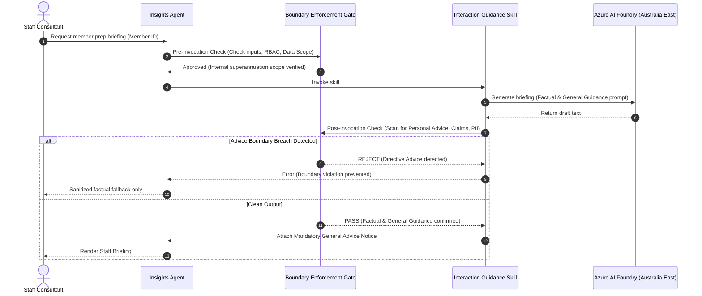

<!-- markdownlint-disable-file -->
# Skill Authority Matrix

## Authority Tiers Overview

To ensure deterministic safety and prevent autonomous drift, every skill in the AI governance harness operates under a defined authority tier:

1. **Advisory (Low Autonomy)**: Skill produces drafts, insights, summaries, or candidate talking points. A qualified human operator (consultant or analyst) must inspect, validate, and approve the output before any external or operational use.
2. **Verified (Deterministic Execution)**: Skill executes deterministic, rule-based operations (e.g., metric aggregations, schema validation, data lookups) using tested algorithms with mathematical verification.
3. **Restricted (Governed Mutation)**: Skill triggers state changes, bulk exports, model retraining, or configuration updates. Requires multi-party review, audit sign-off, or administrative privilege.

## Functional Skill Mapping

| Skill Identifier | PRD Reference | Authority Tier | Authorized Inputs | Authorized Outputs | Permitted Actions | Prohibited Actions | Escalation Trigger |
|---|---|---|---|---|---|---|---|
| `profile-insights` | `FR-001` | **Verified** (Data fetch) & **Advisory** (Summary) | Internal Member ID; internal fund registry, transactions, balances, insurance tables. | Structured profile DTO; chronological engagement timeline; balance trend summary. | Aggregate internal balances; display option allocations; show interaction history; flag data provenance. | Impute external assets; display unverified external holdings; extrapolate household net worth. | Missing data lineage; TFN or sensitive credential detected in record. |
| `movement-churn-analytics` | `FR-002` | **Advisory** | Internal transaction logs; contribution history; digital portal events; closure inquiries. | Cohort movement metrics; statistical churn correlation factors; historical pattern summaries. | Analyze contribution drop-offs relative to personal baselines; evaluate digital login dips; report cohort attrition rates. | Assert causal certainty without statistical validation; execute automated member outreach. | Anomaly in contribution data; uncalibrated lookback window (< 6 months). |
| `outflow-diagnostics` | `FR-003` | **Advisory** | Cohort aggregates; rollover request records; benefit payment records; fund balance totals. | FUM at risk estimates ($); cohort risk distributions; leading disengagement indicator lists. | Size potential fund outflow impact; identify vulnerable cohort segments; provide aggregate executive dashboards. | Generate member-specific divestment notices; execute trades or asset transfers; publish unreviewed figures. | Estimated cohort outflow exceeding executive risk threshold (> $5M single event). |
| `interaction-guidance` | `FR-004` | **Advisory** | Profile summary DTO; observed disengagement signals; staff operator role ID. | Staff interaction briefing; suggested exploratory topics; factual information cards; mandatory disclaimer. | Provide factual talking points; suggest relevant PDS links; summarize inquiry reason; frame general questions for staff. | Produce personal financial advice; recommend investment switches; message member directly; omit statutory disclaimer. | LLM output contains directive advice language ("you should", "recommend switching"). |

## Governance and Boundary Enforcement Hooks

## Boundary Exception and Escalation Procedures

When a skill encounters an edge case or boundary breach:

1. **Immediate Fail-Safe Halt**: The skill must fail closed. If an output cannot be deterministically verified as factual or general advice, it must be suppressed immediately.
2. **Deterministic Fallback**: Return raw factual account records (e.g., current balance, current option name) with zero generative narrative.
3. **Audit Log Generation**: Record boundary violation event with:
   - Timestamp (ISO 8601)
   - Skill Identifier
   - Boundary Type (`Advice`, `DataScope`, `Sovereignty`, `Channel`)
   - Violation Flag & Rule ID
   - Operator ID
4. **Compliance Notification**: If automated scans detect repetitive personal advice attempts in prompt outputs, raise an automated review flag for the AFSL Compliance Officer.
