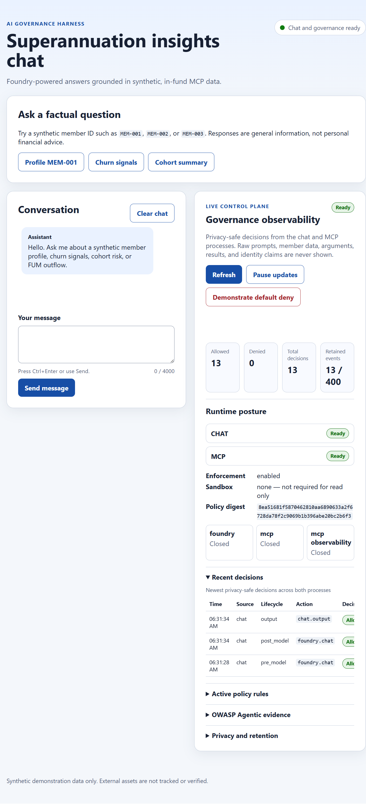
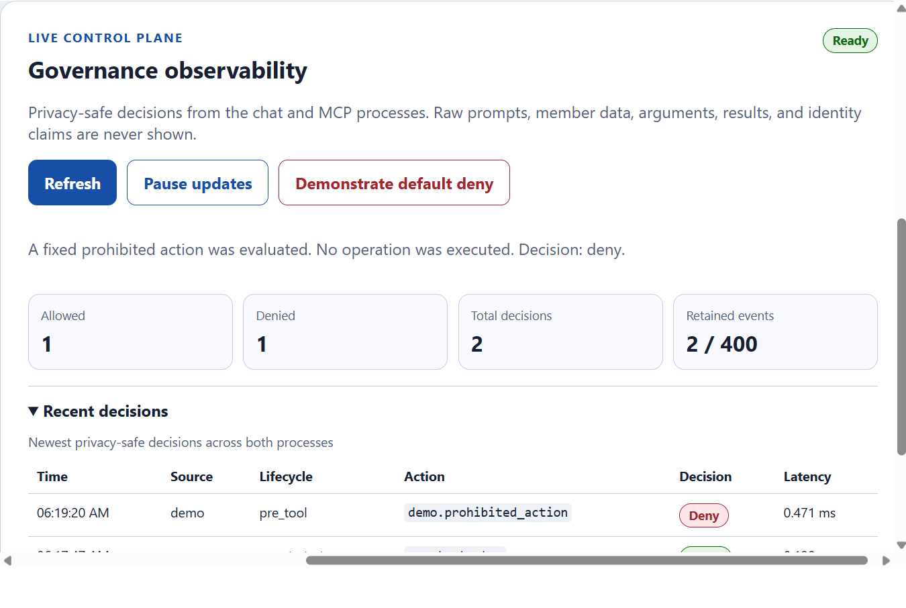
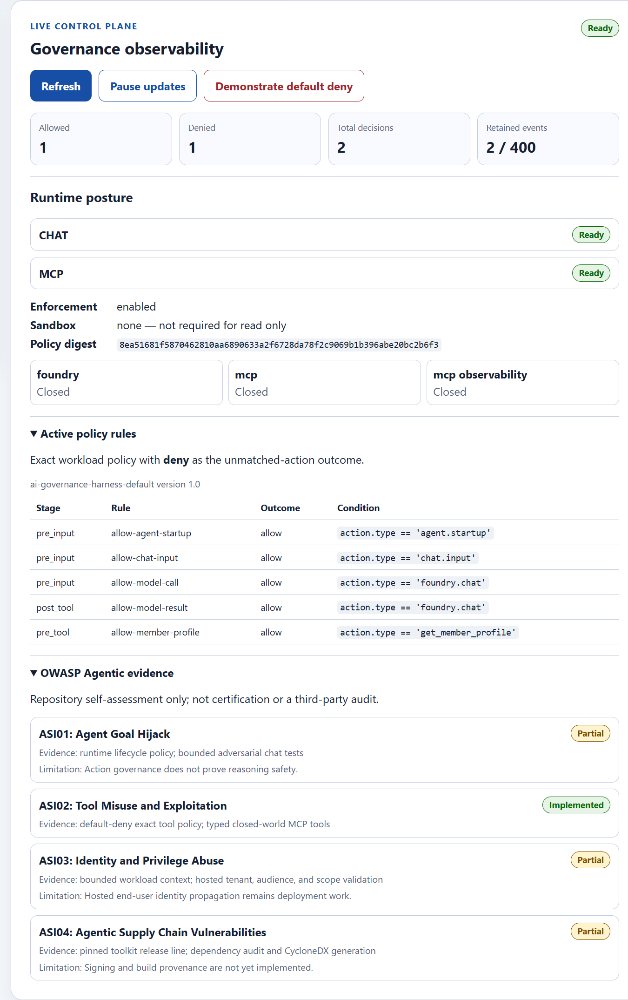

**A local-first reference implementation for observable, default-deny AI agent
governance with Azure AI Foundry, Model Context Protocol, and Microsoft Agent
Governance Toolkit.**

[](https://github.com/pw-ms-collaboration/ai-governance-harness/actions/workflows/ci.yml)
[](./LICENSE)


The harness combines a browser chat, a protocol-compatible MCP server, five
typed tools, and a shared policy gateway. Every model and tool path is governed,
observable, and designed to fail closed. The demonstration uses synthetic
superannuation data so teams can explore practical governance controls without
exposing real member information.

> [!IMPORTANT]
> This release is a synthetic-data demonstration and reference architecture,
> not a production certification. A manually deployed Azure demo is available;
> automated deployment pipelines and production readiness remain future work.

## Quick Navigation

* [Start with the detailed team guides](#team-documentation)
* [See what the project demonstrates](#what-this-project-demonstrates)
* [Tour the governance dashboard](#governance-dashboard-tour)
* [Understand the request flow](#how-it-works)
* [Review the MCP tools](#available-mcp-tools)
* [Install and configure the project](#install-the-project)
* [Start the local services](#start-mcp-and-the-chat-ui)
* [Deploy and update the Azure demo](#azure-deployment-and-updates)
* [Read the architecture decisions](#architecture-decisions)
* [Run validation](#validate-the-project)
* [Troubleshoot common problems](#troubleshooting)

## Team Documentation

Use these source-grounded guides when adopting the reference in another team.
Keep the repository's application controls separate from model-level
guardrails configured on your Azure AI Foundry deployment.

| Guide                                                            | Start here for                                                                                                                     |
| ---------------------------------------------------------------- | ---------------------------------------------------------------------------------------------------------------------------------- |
| [Getting started](./docs/getting-started.md)                     | Installation, local startup, Foundry guardrail verification, assurance commands, troubleshooting, and adoption prerequisites       |
| [Architecture and controls](./docs/architecture-and-controls.md) | Current runtime diagrams, component responsibilities, request flow, policy stages, tool contracts, limitations, and safe extension |
| [Configuration reference](./docs/configuration.md)               | Environment variables, defaults, limits, identity prerequisites, SDK caveats, telemetry, ports, and paths                          |
| [Azure deployment and updates](#azure-deployment-and-updates) | Demo resources, image builds, runtime configuration, verification, rollback, and security boundaries |

Additional Foundry model guardrails are configured outside this repository.
Their assigned risks, thresholds, and blocking actions must be verified in
Azure; the local dashboard does not inspect that configuration. See the
[Foundry guardrails overview](https://learn.microsoft.com/en-us/azure/foundry/guardrails/guardrails-overview)
and the [team verification steps](./docs/getting-started.md#verify-foundry-guardrails).

## Capabilities at a Glance

| Capability | What the repository demonstrates |
|---|---|
| Default-deny enforcement | Policy checks before and after model and tool activity across chat, MCP, and direct gateway calls |
| Observable governance | Live allow and deny decisions, active rules, runtime readiness, circuit state, sandbox posture, and OWASP Agentic evidence |
| Bounded MCP access | Five schema-validated tools over stdio and session-based Streamable HTTP, with no arbitrary paths or writes |
| Local mock identity | Signed RS256 tokens, staff personas, OBO forwarding, app-only reporting, and default-deny role rules; not real Microsoft Entra |
| Human approval | MCP form elicitation that proceeds only after validated approval and fails closed otherwise |
| Privacy-safe telemetry | Bounded events that exclude prompts, tool payloads, model responses, tokens, and identity claims |
| Reliability controls | Independent circuit breakers, timeouts, readiness checks, and sandbox capability classification |
| Reproducible assurance | Python 3.11-3.13 CI, strict policy linting, toolkit verification, dependency audit, SBOM generation, and automated tests |
| Maintainer guidance | Detailed ADRs, recovery steps, extension boundaries, screenshots, and troubleshooting guidance |

## Technology Stack

| Area | Tools and technologies | Role |
|---|---|---|
| Language and models | [Python](https://www.python.org/) 3.11-3.13, [Azure AI Foundry](https://ai.azure.com/) | Application runtime and model inference |
| Agent governance | [Microsoft Agent Governance Toolkit](https://github.com/microsoft/agent-governance-toolkit) 4.1, `agt-sandbox` | Policy enforcement, evidence verification, identity contracts, and sandbox readiness |
| Agent protocol | [Model Context Protocol](https://modelcontextprotocol.io/) Python SDK 2.x | Tool discovery, invocation, form elicitation, stdio, and Streamable HTTP |
| Web runtime | [Starlette](https://www.starlette.io/), [Uvicorn](https://www.uvicorn.org/) | Local chat API, static dashboard, health endpoints, and HTTP transport |
| Data contracts | [Pydantic](https://docs.pydantic.dev/), [PyYAML](https://pyyaml.org/) | Strict request, response, configuration, policy, and evidence schemas |
| Observability | [OpenTelemetry](https://opentelemetry.io/), Azure Monitor OpenTelemetry | Privacy-safe traces, metrics, logs, and governance events |
| Identity | [Azure Identity](https://learn.microsoft.com/python/api/overview/azure/identity-readme) | Developer and workload authentication for Azure AI Foundry |
| Quality and supply chain | [pytest](https://pytest.org/), [Ruff](https://docs.astral.sh/ruff/), `pip-audit`, CycloneDX, OpenVEX | Tests, linting, dependency review, SBOM generation, and governed exceptions |
| Automation | [GitHub Actions](https://github.com/features/actions), `uv`, Hatchling | Multi-version CI, environment synchronization, and package builds |

## What This Project Demonstrates

This repository is a runnable reference implementation for governing an
AI-assisted application, not only a collection of policy documents. It shows
how a browser chat, an Azure AI Foundry model, an MCP server, typed tools, and a
shared data gateway can operate behind one observable, default-deny governance
boundary.

The demonstration is designed to help teams:

* see where policy is evaluated before and after model and tool activity;
* prove that direct MCP and legacy callers cannot bypass the shared gateway;
* inspect allow and deny decisions without exposing prompts or business data;
* understand reliability, sandbox readiness, policy, and OWASP Agentic posture;
* reproduce the same local setup before extending it to hosted infrastructure.



*The local browser experience combines a synthetic-data chat workspace with a
live governance control plane. The green readiness indicator means the chat and
MCP services are available; it is not a claim of production certification.*

## Governance Dashboard Tour

The governance panel is intentionally visible beside the user experience so a
demonstration audience can connect an AI action with the controls and evidence
that govern it. Its main areas are:

1. **Decision controls and totals** — refresh or pause the bounded live view
   and compare allowed, denied, total, and retained event counts.
2. **Runtime posture** — inspect chat and MCP readiness, enforcement state,
   sandbox requirements, policy digest, and independent circuit-breaker state.
3. **Recent decisions** — review privacy-safe lifecycle, action, outcome, rule,
   source, and latency data without revealing prompts, arguments, results,
   member data, or identity claims.
4. **Active policy rules** — see the exact workload policy and the allow rules
   operating above the unmatched-action default deny.
5. **OWASP Agentic evidence** — distinguish implemented, partial, deferred, and
   not-applicable controls together with evidence and known limitations. This
   is a repository self-assessment, not certification or a third-party audit.
6. **Privacy and retention** — confirm that dashboard events are bounded,
   process-local, sanitized, and cleared when services restart.



*The fixed prohibited-action demonstration records a deny decision and states
that no operation was executed. The event table provides enough metadata to
understand enforcement without reproducing sensitive request content.*



*The detailed view connects service readiness and circuit state to the active
default-deny policy and a concise sample of the repository-owned OWASP Agentic
evidence. Expand the live panel to inspect the complete rule and evidence sets.*

All screenshots in this README were captured from the local synthetic
demonstration. They contain no credentials, real member information, raw
prompts, tool arguments, tool results, or identity claims.

## How It Works

The browser never calls Foundry or the data gateway directly:

1. The browser sends the bounded conversation to the local chat service.
2. The governance boundary evaluates the input and pre-model lifecycle points.
3. The chat service selects only discovered tools whose structured MCP metadata
   explicitly enables browser chat, then sends those schemas to the configured
   Azure AI Foundry model through a timeout and circuit breaker. Missing or
   malformed exposure metadata fails closed.
4. When the model selects a tool, the chat service evaluates it against the
   exact default-deny policy and calls it through MCP
   Streamable HTTP.
5. The MCP server validates the request. The shared gateway then independently
   enforces pre-tool and post-tool policy so direct legacy callers cannot
   bypass governance.
6. The tool result returns to the model, which prepares the response through
   the post-model policy point.
7. The response passes through output policy, advice, and disclosure guardrails
   before reaching the browser.

The UI and chat service do not persist conversation transcripts. Browser and
request memory are bounded, and prompts, member IDs, tool arguments, tool
results, tokens, and model responses are excluded from application telemetry.

## Available MCP Tools

| Tool | Purpose | Browser chat |
|------|---------|--------------|
| `get_member_profile` | Returns a synthetic member's internal fund profile | Enabled |
| `get_member_disengagement_signals` | Returns factual churn and disengagement signals | Enabled, role-governed |
| `get_cohort_churn_analytics` | Returns aggregate cohort churn analytics | Enabled, role-governed |
| `get_fum_outflow_summary` | Returns aggregate funds-under-management outflow risk | Enabled, role-governed |
| `prepare_member_outreach_case` | Requests MCP form approval before preparing a synthetic, read-only outreach case | Enabled |

The remote tool surface does not accept filesystem paths, arbitrary data
filters, or write operations.

Each tool owns a structured `ai_governance_harness` metadata contract declaring
its intent, browser-chat exposure, and approval requirement. Chat does not
derive authorization from natural-language descriptions or maintain a separate
tool-name allowlist. Descriptions remain mutually exclusive selection guidance:
profile requests use `get_member_profile`, while prepare/open/create/start
retention-case requests use `prepare_member_outreach_case`.

Exposure metadata does not grant access. MCP still enforces the local mock
staff-role matrix. Outreach additionally requires `routine_permitted`
eligibility and explicit approval; eligibility alone never grants access to
an anonymous caller, analyst, or reporting agent.

### MCP Form Elicitation

The `prepare_member_outreach_case` tool demonstrates the MCP server requesting
structured human approval during a tool call. An elicitation-capable MCP client
receives a primitive boolean form explaining that the case uses synthetic
disengagement signals and that no message, notification, or other external
action will occur.

The tool proceeds only when the protocol response is `accept` and the validated
`approved` field is `true`. It fails closed when the user declines, cancels,
submits invalid content, selects `false`, or uses a client without form
elicitation support. Audit telemetry records only the approval outcome and tool
name; it does not record elicited content.

The MCP SDK negotiates the interaction for the active protocol revision. Legacy
clients receive an `elicitation/create` server request during the tool call.
Modern clients receive an `InputRequiredResult` and automatically retry the
tool with the validated form response and opaque request state. The tool
function and approval policy remain the same across stdio and Streamable HTTP.
The HTTP server uses MCP sessions because the negotiated 2025-11-25 revision
requires a server-to-client request channel for form elicitation. Streaming
responses are enabled by default with `MCP_JSON_RESPONSE=false`; setting it to
`true` disables that back-channel, so approval tools fail closed.

Browser chat presents approval conversationally. After eligibility succeeds,
the assistant asks the user to reply **Approve** or **Decline** for the named
member. Only an explicit approval in the immediately following turn is supplied
to the MCP form resolver. Ambiguous answers repeat the question, and declines
stop normally without executing the outreach tool. Approval is scoped to the
member named in the preceding assistant prompt and is never inferred.

### Retention eligibility and specialist referral

Routine outreach preparation uses trusted synthetic case records from
[`retention_cases.json`](./src/ai_governance_harness/data/synthetic/retention_cases.json).
The pre-tool policy permits only
`data.retention_handling_status == 'routine_permitted'`.
It blocks duplicate open retention cases, specialist handling, completed exits,
closed accounts and unconfirmed eligibility. The member profile exposes a
bounded `retention_review` for staff and chat preflight checks; case narratives
are not included.

| Internal case state | Behaviour |
|---------------------|-----------|
| Open routine retention case | Deny duplicate preparation; continue the existing case |
| Open specialist case | Deny routine preparation; provide staff referral instructions |
| Closed routine case | Require explicit clearance plus new signals, contact eligibility and cooling-off eligibility |
| Closed specialist case | Require explicit routine clearance; otherwise retain specialist routing |
| Closed account or completed exit | Deny ordinary retention preparation |
| Missing or unknown eligibility | Deny until staff verify the internal records |

Eligibility is checked before requesting MCP approval and rechecked when
preparing the response. Approval cannot override a business-policy denial.
Chat retrieves the profile through MCP before attempting outreach and presents
a policy-denial message with the next staff action. The MCP server independently
checks its trusted records, so direct clients cannot bypass the restriction.

Specialist handoff is a fixed staff-facing referral summary containing the
approved team and existing synthetic case reference. Staff must complete the
handoff through the fund's internal process. No specialist case is created, no
notification is sent and no member is contacted. Routine preparation is also
read-only: it does not persist a new case or change existing case status.

Demo personas:

* `MEM-001`: eligible, no existing case.
* `MEM-002`: closed routine case with explicit clearance, eligible.
* `MEM-003`: open specialist case, refer to complaints.
* `MEM-004`: open routine case, continue `CASE-004`.
* `MEM-005`: closed specialist case without clearance, refer to hardship.
* `MEM-006`: completed exit, ordinary retention preparation denied.
* `MEM-007`: closed specialist case explicitly cleared, eligible.

These are illustrative company-policy facts, not approved production rules.
Contact restrictions, new signals and cooling-off are explicit eligibility
statuses; no cooling-off duration is invented. An outreach signal can still be
surfaced even when preparation is blocked. Production integration must source
these facts and routing rules from approved internal systems.

## Agent Governance Toolkit

The application uses the released Agent Governance Toolkit 4.1 line and
`agt-sandbox` policy contracts as mandatory runtime dependencies. Public
Preview APIs are isolated behind
[`src/ai_governance_harness/governance/`](./src/ai_governance_harness/governance/)
so future toolkit upgrades do not spread across the application.

The packaged
[`default.yaml`](./src/ai_governance_harness/governance/policies/default.yaml)
policy:

* Binds rules to the exact `ai-governance-harness` workload ID.
* Defaults every unmatched action to deny.
* Allows only the five current read-only tools.
* Covers startup, input, model, tool, output, and shutdown lifecycle points.
* Treats required approval without an approval flow as denied.
* Fails closed when policy loading or evaluation fails.

Tool responses are scanned in memory using the existing personal-advice pattern
guardrail, including strings nested in dictionaries and lists. The
`deny-personal-advice-tool-response` post-tool rule blocks detected personalized
financial advice. Known tool-result allow rules require
`data.advice_scan_status == 'passed'`; missing or unknown scan status is denied.
Factual information and general guidance that do not match prohibited patterns
remain permitted.

The shared gateway protects direct callers, the MCP adapter checks complete
responses (including outreach cases), and the chat service checks structured
MCP results before passing them to the model. A blocked MCP response returns a
sanitized tool error, not a successful replacement payload. Only the scan
status and result type enter policy evaluation, never the response text.
The existing final chat-response guardrail remains in place.

This deterministic output pattern scan is not a legal advice classifier and
cannot detect every generated paraphrase. It remains a separate post-tool
safety boundary from the semantic input classifier described below.
Production use requires compliance-reviewed detection and evaluation cases.

The five current tools read packaged synthetic data and do not execute
generated code, shell commands, untrusted files, or unrestricted network
requests. `GOVERNANCE_SANDBOX_PROVIDER=none` is therefore ready for the current
surface. Any future executable capability is denied unless an approved,
healthy Agent Sandbox provider is explicitly integrated. Merely setting a
provider name does not activate a privileged provider.

Policy decisions emit only allowlisted metadata: lifecycle point, outcome,
matched rule, policy name and digest, enforcement mode, and evaluation
latency. Prompts, tool arguments, results, member data, tokens, email
addresses, and raw identity claims are not emitted or persisted.

The repository has two complementary evidence files:

* [`agt-runtime-evidence.yaml`](./src/ai_governance_harness/governance/agt-runtime-evidence.yaml)
  is validated by `agt verify`.
* [`owasp-agentic.yaml`](./src/ai_governance_harness/governance/evidence/owasp-agentic.yaml)
  records the repository-specific ASI01-ASI10 posture and limitations.

Toolkit verification is an internal package-presence and runtime-evidence
self-assessment. It is not OWASP certification, a third-party audit, or proof
that model reasoning is safe. The repository matrix intentionally identifies
partial controls, including hosted principal propagation, supply-chain
provenance, external memory governance, universal human approval, and behavior
quarantine.

## Prerequisites

* Python 3.11, 3.12, or 3.13.
* Azure CLI.
* Access to an Azure AI Foundry project and model deployment.
* `uv` or standard Python packaging tools.

Confirm the selected interpreter:

```powershell
python --version
```

## Install the Project

Create and activate a virtual environment.

PowerShell:

```powershell
python -m venv .venv
.\.venv\Scripts\Activate.ps1
```

macOS or Linux:

```sh
python3 -m venv .venv
source .venv/bin/activate
```

Install the project and development dependencies.

With `uv`:

```sh
uv sync --all-extras
```

Or with standard Python packaging tools:

```sh
python -m pip install -e ".[dev]"
```

The editable installation makes the package and these commands available:

* `ai-governance-mcp`
* `ai-governance-chat`
* `ai-governance-dev`
* `ai-governance-identity` (local mock issuer)
* `ai-governance-report` (local mock reporting agent)

[pyproject.toml](./pyproject.toml) is the dependency source of truth. The
repository intentionally does not maintain a duplicate `requirements.txt`.

### Package Feeds

Public PyPI users do not need additional configuration.

On Microsoft-managed devices where public PyPI is blocked, use the approved CFS
Package Feed Proxy as the single package source. Do not combine it with public
PyPI through `--extra-index-url`.

PowerShell with `uv`:

```powershell
$env:UV_DEFAULT_INDEX = "https://packagefeedproxy.microsoft.io/pypi/simple/"
uv sync --all-extras
```

macOS or Linux with `uv`:

```sh
export UV_DEFAULT_INDEX="https://packagefeedproxy.microsoft.io/pypi/simple/"
uv sync --all-extras
```

Configure `pip` for the current user:

```sh
python -m pip config set global.index-url https://packagefeedproxy.microsoft.io/pypi/simple/
python -m pip install -e ".[dev]"
```

Inspect or remove the `pip` override:

```sh
python -m pip config get global.index-url
python -m pip config unset global.index-url
```

Clear the temporary `uv` setting with
`Remove-Item Env:UV_DEFAULT_INDEX` in PowerShell or
`unset UV_DEFAULT_INDEX` on macOS and Linux.

## Configure the Environment

Copy the example configuration:

PowerShell:

```powershell
Copy-Item .env.example .env
```

macOS or Linux:

```sh
cp .env.example .env
```

Do not commit `.env`. It may contain tenant, subscription, project, endpoint, or
credential information.

Configure these Foundry values:

```env
AZURE_TENANT_ID=<foundry-tenant-id>
AZURE_AI_PROJECT_ENDPOINT=<foundry-project-endpoint>
AZURE_AI_PROJECT_REGION=australiaeast
AZURE_AI_MODEL_DEPLOYMENT_NAME=<model-deployment-name>
```

Use the project endpoint as the recommended connection path. The source also
contains legacy connection-string and coordinate branches, but current SDKs
may not support them; see the
[SDK compatibility caveat](./docs/configuration.md#foundry-connection-and-identity).
Leave `AZURE_AI_PROJECT_CONNECTION_STRING` empty when using the endpoint; a
non-empty placeholder takes precedence over the valid endpoint.

Configure the local services:

```env
MCP_TRANSPORT=streamable-http
MCP_HOST=127.0.0.1
MCP_PORT=8001
MCP_PATH=/mcp

CHAT_HOST=127.0.0.1
CHAT_PORT=8080
MCP_SERVER_URL=http://127.0.0.1:8001/mcp
```

`MCP_PORT` and the port inside `MCP_SERVER_URL` must match. All three ports
are configurable: local mock issuer `8002`, MCP `8001`, chat `8080`.
The launcher derives the mock URLs and synthetic IDs, so an existing Foundry
`.env` still works with `uv run ai-governance-dev`. For separate terminals,
copy the local mock settings from [.env.example](./.env.example) into your
existing `.env` without overwriting its Foundry credentials. Keep the mock
tenant separate from `AZURE_TENANT_ID`, which is still your Foundry tenant.

The shared mock guard requires `MOCK_IDENTITY_ENABLED=true`, both configured
environment variables to be `local`, `development`, or `test`, no hosted
runtime indicators, and loopback service binds. It rejects conflicting
environment settings. Never relax policy to compensate for a mock token error.

Configure governance:

```env
GOVERNANCE_ENABLED=true
GOVERNANCE_ENVIRONMENT=local
GOVERNANCE_AGENT_ID=ai-governance-harness
GOVERNANCE_OPERATION_TIMEOUT_SECONDS=30
GOVERNANCE_CIRCUIT_FAILURE_THRESHOLD=3
GOVERNANCE_CIRCUIT_RECOVERY_SECONDS=30
GOVERNANCE_SANDBOX_PROVIDER=none
```

Leave `GOVERNANCE_POLICY_PATH` unset to use the policy packaged with the
application. A custom path must identify a valid toolkit YAML policy. Runtime
governance can be disabled only when `GOVERNANCE_ENVIRONMENT=test`; local,
staging, production, and hosted modes reject disabled enforcement.

## Authenticate with Azure

Sign in to the tenant containing the Foundry project:

```sh
az login --tenant <foundry-tenant-id>
```

Confirm the active tenant and subscription:

```sh
az account show --query "{tenantId:tenantId, subscriptionId:id, name:name}" -o table
```

Test Foundry client creation:

```sh
python -m ai_governance_harness.foundry_client
```

Client creation confirms that configuration and credential construction
succeeded. A model call or authorized project operation is still required to
prove end-to-end project access.

## Start MCP and the Chat UI

### Start All Three Services

The recommended local workflow is:

```sh
uv run ai-governance-dev
```

The launcher:

1. Loads configuration from `.env`.
2. Checks the local mock guard and all three ports.
3. Starts the local mock issuer and waits for its health endpoint.
4. Starts MCP and waits for governance, sandbox and JWKS readiness.
5. Starts the chat service.
6. Waits for chat readiness.
7. Opens the chat UI in the default browser.
8. Stops all three child processes when you press `Ctrl+C`.

With the default configuration, open:

```text
http://127.0.0.1:8080
```

### Start the Services Separately

Start the local mock issuer in the first terminal:

```sh
uv run ai-governance-identity
```

Start MCP in the second terminal:

```sh
uv run ai-governance-mcp
```

Start the chat service in the third terminal:

```sh
uv run ai-governance-chat
```

All commands load `.env`. Wait for each service before starting the next.
The mock issuer generates its signing key in memory and never writes it.

### Run MCP over stdio

PowerShell:

```powershell
$env:MCP_TRANSPORT = "stdio"
$env:MOCK_IDENTITY_ENABLED = "true"
$env:MOCK_IDENTITY_LOCAL_PERSONA = "retention_specialist"
uv run ai-governance-mcp
```

macOS or Linux:

```sh
export MCP_TRANSPORT=stdio
export MOCK_IDENTITY_ENABLED=true
export MOCK_IDENTITY_LOCAL_PERSONA=retention_specialist
uv run ai-governance-mcp
```

The stdio process reserves standard output for MCP protocol messages and sends
diagnostics to standard error. Connect an MCP client to this command; it is not
an interactive shell. Without `MOCK_IDENTITY_LOCAL_PERSONA`, data tools deny.
This local mock persona is token-less and needs no running issuer. `analyst`
allows only aggregates; `retention_specialist` allows member tools as well.
The other two personas deny all data tools.

## Azure Deployment and Updates

The synthetic-data demo runs chat and MCP as separate Azure Container Apps.
Chat invokes an existing Foundry Prompt Agent; APIM protects the MCP tool
endpoint and a separate governance-snapshot endpoint. Updating the container
image does not update the remote Foundry agent definition, model deployment,
or its assigned Foundry guardrails.

### Deployment resources and prerequisites

Replace all angle-bracket placeholders with your approved deployment values.
Real resource names and identifiers must stay out of public documentation.
Confirm the intended tenant and subscription before running any mutation.
Use Azure CLI with the Container Apps extension, `uv` for local
checks, and permissions to build in ACR and update the selected app.
Infrastructure provisioning and role assignments require separate permissions.

| Resource | Deployment value |
| --- | --- |
| Resource group | `<resource-group>` |
| Region | `australiaeast` |
| Container registry | `<registry-name>` |
| Image repository | `<image-repository>` |
| Container Apps environment | `<container-apps-environment>` |
| Chat app | `<chat-app-name>` |
| MCP app | `<mcp-app-name>` |
| APIM service | `<apim-service-name>` |
| Foundry Prompt Agent | `<foundry-agent-name>` |

Run the examples from the repository root in Bash or zsh:

```bash
az account show --query '{subscription:name,id:id,tenant:tenantId}' -o json
RESOURCE_GROUP='<resource-group>'
ACR_NAME='<registry-name>'
IMAGE_REPOSITORY='<image-repository>'
CHAT_APP='<chat-app-name>'
MCP_APP='<mcp-app-name>'
REGISTRY_SERVER=$(az acr show --name "$ACR_NAME" --query loginServer -o tsv)
```

### Provisioning and security boundaries

[bootstrap-acr.bicep](./infra/bootstrap-acr.bicep) creates the registry before
the image build. [main.bicep](./infra/main.bicep) references that registry and
defines the Container Apps, identities, and APIM integration. The dedicated
[MCP API template](./infra/apim-mcp-api.bicep) and
[snapshot API template](./infra/apim-governance-api.bicep) define the gateway
boundaries. Review all template parameters before provisioning another
environment.

For a new environment, bootstrap the registry with your approved prefix and
region, then build an image before applying the main template:

```bash
RESOURCE_PREFIX=yourprefix
az deployment group what-if --resource-group "$RESOURCE_GROUP" \
   --template-file infra/bootstrap-acr.bicep \
   --parameters resourcePrefix="$RESOURCE_PREFIX" location=australiaeast
az deployment group create --resource-group "$RESOURCE_GROUP" \
   --template-file infra/bootstrap-acr.bicep \
   --parameters resourcePrefix="$RESOURCE_PREFIX" location=australiaeast
```

Refresh `ACR_NAME` and `REGISTRY_SERVER` from the bootstrap outputs for that
environment. Supply the main template's reviewed parameters through an
operator-controlled parameter file outside the repository; use Key Vault
references for secrets. Do not put client secrets or connection strings in
commands, committed files, or logs.

```bash
AZURE_PARAMETERS_FILE=/path/to/approved-deployment.parameters.json
az deployment group what-if --resource-group "$RESOURCE_GROUP" \
   --template-file infra/main.bicep --parameters @"$AZURE_PARAMETERS_FILE"
```

Apply the main template with `az deployment group create` only after reviewing
the What-If and approving resource, identity, and network changes. Do not
reapply the whole template for an application-only update: existing runtime
overrides and manually configured authentication must first be reconciled.

Preserve these boundaries during provisioning, updates, and rollback:

* Run chat with `ai-governance-chat` and MCP with `ai-governance-mcp`. The
   [Dockerfile](./Dockerfile) defaults to the local combined launcher; it is not
   the hosted entrypoint.
* Keep chat protected by Entra EasyAuth. Only `/health/live` and
   `/health/ready` are excluded from authentication in the current demo.
* Keep direct MCP ingress restricted to the approved APIM egress address.
   Do not open MCP to the internet to work around authentication failures.
* Preserve `Mcp.Tools.Invoke` for the Foundry agent identity. The chat workload
   has the separate `Mcp.Governance.Read` snapshot role, not tool access.
* Keep `MCP_GOVERNANCE_SNAPSHOT_URL` pointing to the authenticated APIM snapshot
   route and `MCP_GOVERNANCE_SNAPSHOT_AUDIENCE` set to its intended audience.
* Verify the Container Apps environment permits the intended public chat
   access; public ingress alone is not proof that environment-level public
   network access is enabled.
* Preserve governance enforcement, managed identities, registry pull
   permissions, origin allowlists, and the exact EasyAuth browser redirect
   origin. Read-only tools do not justify enabling executable sandbox access.

### Build and update an application image

Review the working tree first. ACR builds the current source directory,
including uncommitted changes; the commit in an image tag does not establish
that the build was made from a clean tree. The
[build exclusions](./.dockerignore) omit `.env`, `.git`, `.venv`, tracking
artifacts, and caches. Verify that no other local secrets enter the context.

```bash
git status --short
uv run --no-sync pytest -q
uv run --no-sync ruff check src tests
```

Select the app to update and record its previous ready revision and image
before mutation. Use `TARGET_APP="$MCP_APP"` for MCP. For shared changes, roll
out MCP and verify it before updating chat to the same image digest; a
chat-only fix does not require an MCP rollout.

```bash
TARGET_APP="$CHAT_APP"
PREVIOUS_REVISION=$(az containerapp show --resource-group "$RESOURCE_GROUP" \
   --name "$TARGET_APP" --query properties.latestReadyRevisionName -o tsv)
PREVIOUS_IMAGE=$(az containerapp revision show --resource-group "$RESOURCE_GROUP" \
   --name "$TARGET_APP" --revision "$PREVIOUS_REVISION" \
   --query 'properties.template.containers[0].image' -o tsv)
IMAGE_TAG="demo-$(date -u +%Y%m%d%H%M%S)-$(git rev-parse --short HEAD)"
IMAGE_DIGEST=$(az acr build --registry "$ACR_NAME" \
   --image "$IMAGE_REPOSITORY:$IMAGE_TAG" --file Dockerfile . \
   --no-logs --only-show-errors --query 'outputImages[0].digest' -o tsv)
test -n "$IMAGE_DIGEST"
IMAGE="$REGISTRY_SERVER/$IMAGE_REPOSITORY@$IMAGE_DIGEST"
REVISION_SUFFIX="update-$(date -u +%Y%m%d%H%M%S)"
az containerapp update --resource-group "$RESOURCE_GROUP" --name "$TARGET_APP" \
   --image "$IMAGE" --revision-suffix "$REVISION_SUFFIX" \
   --query '{latest:properties.latestRevisionName,ready:properties.latestReadyRevisionName}' \
   -o json
```

Run each step only after the preceding command succeeds; never deploy an empty
digest or reuse a tag for different source. The digest pins the exact image.
The demo uses single-revision mode with 100% traffic assigned to the latest
revision. An update returning `Succeeded` does not establish that the new
revision has finished activating or that a model/tool request works.

### Change runtime configuration

Use `--set-env-vars` to change only selected settings while preserving the
others. Record previous values before changing them, and use a unique revision
suffix. Do not use `--replace-env-vars` for a targeted change because it can
remove identity, endpoint, and telemetry settings.

The deployed GPT-5 Prompt Agent uses a 4,000-token output budget; the local
default remains 1,200. Agent output tokens include reasoning as well as the
visible answer. The 1,200-token budget produced `max_output_tokens` stops in
live testing. The existing settings validation caps this budget at 4,000.

```bash
az containerapp update --resource-group "$RESOURCE_GROUP" --name "$CHAT_APP" \
   --set-env-vars CHAT_MAX_OUTPUT_TOKENS=4000 \
   --revision-suffix "config-$(date -u +%Y%m%d%H%M%S)" \
   --query '{latest:properties.latestRevisionName,ready:properties.latestReadyRevisionName}' \
   -o json
```

Keep `CHAT_USE_PROMPT_AGENT=true` and the intended `FOUNDRY_AGENT_NAME` when
using the hosted agent route. Foundry rejects request-level `reasoning`
overrides when `agent_reference` is specified; adding `reasoning.effort` to
that request is not a supported token-budget fix. The separate semantic
classifier continues to use its own bounded output setting.

### Verify and roll back

Check the selected revision directly rather than assuming an old healthy
revision proves that the update succeeded:

```bash
NEW_REVISION=$(az containerapp show --resource-group "$RESOURCE_GROUP" \
   --name "$TARGET_APP" --query properties.latestRevisionName -o tsv)
az containerapp revision show --resource-group "$RESOURCE_GROUP" \
   --name "$TARGET_APP" --revision "$NEW_REVISION" \
   --query '{health:properties.healthState,active:properties.active,traffic:properties.trafficWeight}' \
   -o json
CHAT_FQDN=$(az containerapp show --resource-group "$RESOURCE_GROUP" \
   --name "$CHAT_APP" --query properties.configuration.ingress.fqdn -o tsv)
curl --fail --silent --show-error --max-time 30 "https://$CHAT_FQDN/health/live"
curl --fail --silent --show-error --max-time 30 "https://$CHAT_FQDN/health/ready"
curl --silent --show-error --max-time 30 --output /dev/null \
   --write-out 'Unauthenticated snapshot HTTP %{http_code}\n' \
   "https://$CHAT_FQDN/api/governance/snapshot"
MCP_FQDN=$(az containerapp show --resource-group "$RESOURCE_GROUP" \
   --name "$MCP_APP" --query properties.configuration.ingress.fqdn -o tsv)
curl --silent --show-error --max-time 30 --output /dev/null \
   --write-out 'Direct MCP HTTP %{http_code}\n' "https://$MCP_FQDN/mcp"
```

Expect the new revision to be `Healthy`, both chat health endpoints to return
HTTP 200, unauthenticated snapshot access to return HTTP 401, and direct MCP
access to return HTTP 403. Readiness must show governance enforcement enabled.
Sign in through the browser and separately verify a synthetic profile request,
its confirmation, the authenticated governance snapshot, and the approved
retention workflow. Confirm successful tool-call metadata rather than relying
on a completed model response or a claim that a tool was called.

For an image rollback, create a new revision from the image recorded before
the update. These variables are per app; do not reuse the chat rollback image
or revision record for MCP.

```bash
test -n "$PREVIOUS_IMAGE"
az containerapp update --resource-group "$RESOURCE_GROUP" --name "$TARGET_APP" \
   --image "$PREVIOUS_IMAGE" --revision-suffix "rollback-$(date -u +%Y%m%d%H%M%S)" \
   --query '{latest:properties.latestRevisionName,ready:properties.latestReadyRevisionName}' \
   -o json
```

An image rollback keeps the current environment settings. Restore any changed
settings separately with `--set-env-vars`, or `--remove-env-vars` if the
setting was previously absent, then repeat verification. Never disable
governance or relax ingress restrictions as a rollback shortcut.

### Corporate proxy certificate trust

If ACR lookups, Container Apps logs, or HTTPS probes fail certificate
verification behind an approved corporate proxy, combine the standard CA
bundle with your organization's trusted certificate. Substitute paths from
your local setup; do not disable TLS verification.

```bash
SYSTEM_CA_BUNDLE=/path/to/system-ca-bundle.pem
ORGANIZATION_CA_CERTIFICATE=/path/to/organization-certificate.pem
CA_BUNDLE=$(mktemp)
cat "$SYSTEM_CA_BUNDLE" "$ORGANIZATION_CA_CERTIFICATE" > "$CA_BUNDLE"
export REQUESTS_CA_BUNDLE="$CA_BUNDLE"
export SSL_CERT_FILE="$CA_BUNDLE"
export CURL_CA_BUNDLE="$CA_BUNDLE"
```

Keep the temporary bundle until deployment and verification finish, then
unset these variables and remove it. A successful remote ACR build and a
failed local registry lookup can coexist; inspect the completed build's image
digest and fix local certificate trust before continuing.

The [observability workbook](./docs/observability/ai-governance-observability.workbook.json)
uses a placeholder Application Insights resource path. Before importing it,
replace `<subscription-id>`, `<resource-group>`, and
`<application-insights-name>` in `fallbackResourceIds` and every
`crossComponentResources` entry. Keep the configured copy outside public
documentation.

### Verification evidence

Recorded on 2026-10-15; query Azure for the current state before another update.
Keep actual image digests, resource names, and revision names in your private
deployment record rather than this README.

Both apps were healthy with 100% traffic, and chat retained
`CHAT_MAX_OUTPUT_TOKENS=4000`. Chat readiness, unauthenticated access denial,
and the direct MCP ingress block were verified during these updates.
The latest code passed 340 tests. Live classifier probes allowed the factual
profile confirmation while denying financial-advice confirmations, an
ambiguous standalone `yes`, and instruction-like assistant context.
Successful authenticated end-to-end Foundry MCP tool execution remains
unverified; neither readiness nor a completed model response proves it.

## Local Endpoints

With the default ports:

| Endpoint | Purpose |
|----------|---------|
| `http://127.0.0.1:8080` | Browser chat UI |
| `http://127.0.0.1:8080/api/chat` | Chat API used by the browser |
| `http://127.0.0.1:8080/api/mock-identity/signin` | Same-origin local mock persona sign-in |
| `http://127.0.0.1:8080/api/governance/snapshot` | Merged privacy-safe chat and MCP governance snapshot |
| `http://127.0.0.1:8080/health/live` | Chat liveness |
| `http://127.0.0.1:8080/health/ready` | Chat governance and sandbox readiness |
| `http://127.0.0.1:8001/mcp` | MCP Streamable HTTP endpoint |
| `http://127.0.0.1:8001/governance/snapshot` | MCP process governance snapshot |
| `http://127.0.0.1:8001/health/live` | MCP liveness |
| `http://127.0.0.1:8001/health/ready` | MCP governance, sandbox and JWKS readiness |
| `http://127.0.0.1:8002/healthz` | Local mock issuer health |
| `http://127.0.0.1:8002/mock/signin` | Local mock sign-in, proxied by chat |
| `http://127.0.0.1:8002/Validate` | Local mock subject-token validation |
| `http://127.0.0.1:8002/AuthorizationHeader/mcp` | Local mock OBO exchange |
| `http://127.0.0.1:8002/AuthorizationHeaderUnauthenticated/mcp` | Local mock app-only exchange |

Local mock discovery is served at
`http://127.0.0.1:8002/00000000-0000-4000-8000-000000000001/v2.0/.well-known/openid-configuration`.
Its `jwks_uri` points to the public signing key. These GUIDs are synthetic.

Chat API failures use a structured, privacy-safe error envelope:

```json
{
  "error": {
    "code": "governance_denied",
    "message": "Governance policy denied the requested operation.",
    "correlation_id": "request-reference",
    "details": {
      "lifecycle_point": "post_tool",
      "matched_rule": "deny-personal-advice-tool-response"
    }
  }
}
```

Governance denials return HTTP 403 and bounded policy metadata. Invalid requests
return HTTP 400. Model, MCP, or other upstream failures return HTTP 502 with a
different stable error code. Responses never include raw prompts, tool
arguments, tool results, credentials, or internal exception text.
Foundry response stops are differentiated from repository governance denials.
A content-filter stop returns HTTP 422 with `model_content_filtered` and bounded
details for the model `finish_reason`, filter category and severity when
available. A repeated output-budget stop returns `model_output_limit`. The
browser displays these stop conditions and the request reference without
displaying filtered model content.
MCP clients that do not support form elicitation still receive the protocol's
capability failure. Browser chat declares the capability and supplies a form
response only after the explicit conversational approval described above.
After a successful tool call, blank model output and empty JSON containers such
as `{}` receive one bounded recovery request using the already-governed
conversation and tool result. Recovery disables additional tool selection and
uses minimal reasoning with low verbosity so the bounded completion budget is
reserved for a user-facing answer. If recovery is also empty, chat returns
`invalid_model_response` rather than fabricating an answer or retrying
indefinitely.
Member profile responses take a narrower path: after the structured profile
passes tool and output governance, chat validates and renders it
deterministically. The synthetic name and account identifier are not sent back
through the hosted model, avoiding an Azure PII content-filter stop and
eliminating unnecessary post-tool model decisions for a factual profile lookup.
The browser, static assets, and API responses use `Cache-Control: no-store` so
the UI error contract and governance table cannot drift behind the running
service after an update.

Missing, malformed or expired local mock credentials return
`authentication_required` (401, with `WWW-Authenticate: Bearer`).
An unavailable local mock sidecar returns `identity_unavailable` (503).
Both use the same error envelope. Anonymous health and governance endpoints
remain available. MCP data requests require a signed local mock token.

Personalized financial-advice requests pass through a dedicated, tool-free
Foundry classifier before the primary assistant. The classifier uses strict
JSON schema, a closed intent taxonomy, minimal reasoning, low verbosity,
`store=False`, and the bounded `CHAT_CLASSIFIER_MAX_OUTPUT_TOKENS` budget.
It receives the current and immediately preceding user turns plus the assistant
turn immediately before the current user message as separately labelled,
untrusted context. This lets short confirmations such as `yes` inherit the
requested action without relying on member-ID regex routing or treating
assistant text as policy authority.

Only typed fields such as `request_intent`, `advice_subject`,
`financial_action`, `product_scope`, `confidence`, and
`classification_status` reach YAML policy. Request text and free-form model
rationale are not included in policy data or governance events. Policy rules
deny identified-member financial recommendations and external-security
recommendations; classified factual, educational, retention-outreach, and
other safe intents continue through the normal chat path. The classifier call
and result have their own `foundry.advice_classifier` lifecycle decisions and
reliability circuit, but those decisions authorize classification only, not
the user request.

Invalid schema, empty or filtered classifier output, an unavailable classifier,
unknown intent, and low confidence all stop before MCP discovery and the
primary assistant. Successfully classified unsafe intent returns the matched
governance denial. A technical or uncertain classifier stop returns
`classification_unavailable` with a bounded reason and correlation reference
rather than presenting the failure as a personal-advice denial.
Failed and denied browser turns remain visible to the user but are removed from
the active request history, so a rejected intent cannot contaminate the next
independent question.

### Business-unit policy attribution

The synthetic [BU policy source](./src/ai_governance_harness/governance/policies/superannuation-ba-policy-source.yaml)
documents `BU-SUPER-001`. Enforcement remains in
[default.yaml](./src/ai_governance_harness/governance/policies/default.yaml).
Its advice-related rules contain structured `provenance`: `layer`, `policy_id`,
`policy_version` (a quoted string), and `source` (a YAML basename, not a path).
The adapter validates these bounded identifiers at startup and attaches them
only to the matched rule. Descriptions are not parsed for attribution.

The governance panel shows policy origin in recent decisions and active rules.
Unmapped rules, default denials, and external provider denials are not attributed
to a BU policy. Tagged allow rules indicate which boundary passed, not a
compliance certification. Changing the source document alone cannot change
enforcement.

The UI labels denials without specific provenance as "System policy", including
generic scope refusals and default denials. This is a broad presentation label,
not additional policy-source metadata; specific BU provenance takes precedence.
Untagged allow rules remain "Not attributed".

Governance spans expose `governance.policy.layer`, `governance.policy.id`,
`governance.policy.version`, and `governance.policy.source`. Decision counters
and duration histograms include only layer and policy ID to avoid source/version
time-series churn. Structured decision logs allowlist `policy_layer`,
`policy_id`, `policy_version`, and `policy_source`. These values come from the
loaded policy, never prompts, member records, or caller-supplied policy data.
Existing Azure Monitor export configuration carries these OTel attributes;
no Azure credentials are needed for offline validation.

Demo chat errors and refusal notices still show the existing technical reason.
BU provenance is not added to the chat response. Hiding technical errors for a
production-facing deployment remains future work; there is no automatic
development/production presentation switch yet.

The OAuth protected-resource metadata routes support hosted authentication.
The deployed demo uses Entra authentication and APIM; local mock authentication
verifies JWTs instead of trusting caller-supplied Container Apps headers.

## Use the Chat UI

Choose a persona under **Mock identity**, then select **Sign in (mock)**.
No persona is selected initially. The token lives only in page memory; refresh,
sign-in failure or 401 clears it. Changing persona clears both displayed
messages and the conversation sent to the model.

| Local mock persona | Aggregate tools | Member tools | Outreach |
|---|---|---|---|
| Analyst | Allow | Deny | Deny |
| Retention Specialist | Allow | Allow | Requires eligibility and explicit approval, including the browser approval flow |
| Compliance Reviewer | Deny | Deny | Deny |
| Administrator | Deny | Deny | Deny |

Try the cohort example and a member profile under each persona. Inspect the
MCP `pre_tool` decisions in the panel; chat boundary decisions only identify
the interactive caller. A model may explain an MCP denial in a successful
chat response, so the panel is the authoritative record of tool authorization.
Personal-advice requests remain denied regardless of persona.

The local mock does not prove real Entra role assignment. Foundry inference
still uses your developer `az login` through `DefaultAzureCredential`.

The included dataset contains synthetic member IDs such as:

* `MEM-001`
* `MEM-002`
* `MEM-003`

Example questions:

* `Show me the profile for MEM-001.`
* `What are the churn signals for MEM-002?`
* `Summarize cohort churn risk and FUM at risk.`

Responses use synthetic in-fund data only. They do not represent a complete
financial position or personal financial advice. The response guardrails attach
the general-advice and in-fund provenance notices.

### Use the Governance Panel

The responsive governance panel beside the conversation explains the active
control plane without exposing request content. It shows:

* Allowed and denied decision totals.
* Recent policy decisions from the chat and MCP processes.
* A local mock label and each event's boundary, actor, token type and staff role.
* Runtime readiness, policy digest, circuit states, and sandbox posture.
* Active default-deny policy rules.
* Repository-specific OWASP Agentic evidence and known limitations.
* Privacy and retention guarantees.

Use **Pause updates** to stop the five-second automatic refresh or **Refresh**
to request the current snapshot. Automatic refresh runs only while the page is
visible.
**Clear chat** also resets the page's decision counters and recent-decisions
table. Subsequent refreshes show only decisions generated after that clear
action. The underlying bounded in-memory audit evidence is retained until the
services restart; clearing the browser view does not delete server telemetry.

The panel retains at most 200 sanitized events in each process and shows at
most 100 merged events. Events remain in process memory and reset when the
services restart. Raw prompts, tool arguments and results, member data,
transcripts, credentials, and raw identity claims are not included.

## Architecture Decisions

> **Heads up — architecture decision records are part of the project contract.**
> Before changing governance enforcement, telemetry, sandboxing, dependency
> policy, package feeds, or the observability topology, read the related ADR.

An architecture decision record (ADR) captures an important design choice
together with its context, alternatives, tradeoffs, consequences, risks, and
exit strategy. Keeping this reasoning beside the code is a software architecture
best practice: it helps teammates understand not only **what** was built, but
**why** it was built that way and which assumptions must be re-evaluated before
the design changes.

ADRs are especially important for this harness because several safeguards are
load-bearing. A locally convenient change could otherwise weaken default-deny
enforcement, expose sensitive telemetry, bypass the reviewed dependency
exception, or imply sandbox and hosted-identity guarantees that are not yet
implemented. The records provide:

* a recovery path when a maintainer inherits or troubleshoots the system;
* explicit boundaries between implemented, deferred, and temporary behavior;
* evidence and measurable criteria for validating future changes;
* safe extension points for new providers, tools, policies, and deployments;
* an audit trail for security, compliance, reliability, and supply-chain
  decisions.

The detailed records under [`docs/planning/adrs/`](./docs/planning/adrs/)
describe the current design:

1. [Contain Agent Governance Toolkit behind a versioned adapter](./docs/planning/adrs/0001-contain-agent-governance-toolkit-behind-a-versioned-adapter.md)
2. [Enforce default deny at every execution boundary](./docs/planning/adrs/0002-enforce-default-deny-at-every-execution-boundary.md)
3. [Minimize identity and governance telemetry](./docs/planning/adrs/0003-minimize-identity-and-governance-telemetry.md)
4. [Use local-first reliability and sandbox readiness boundaries](./docs/planning/adrs/0004-use-local-first-reliability-and-sandbox-readiness-boundaries.md)
5. [Present governance through a same-origin observability panel](./docs/planning/adrs/0005-present-governance-through-a-same-origin-observability-panel.md)
6. [Govern Toolkit dependency risk with an expiring VEX exception](./docs/planning/adrs/0006-govern-toolkit-dependency-risk-with-an-expiring-vex-exception.md)
7. [Use feed-neutral manifests and repeatable team commands](./docs/planning/adrs/0007-use-feed-neutral-manifests-and-repeatable-team-commands.md)
8. [Target Microsoft Entra Agent ID after the local mock MVP](./docs/planning/adrs/0008-use-microsoft-entra-agent-id-for-agent-identity.md)
9. [Enforce staff and agent policy context, exercised by the local mock](./docs/planning/adrs/0009-enforce-agent-and-staff-identity-through-governance-policy-context.md)
10. [Use a local-only mock Entra Agent ID issuer for the MVP](./docs/planning/adrs/0010-use-a-local-only-mock-entra-agent-id-issuer-for-the-mvp.md)

### How to Use These Records

The records are initially `proposed`. Repository maintainers should:

1. Review the evidence, alternatives, consequences, and success criteria.
2. Change an applicable record to `accepted` before treating it as
   architectural authority.
3. Link significant implementation changes to the ADRs they implement or
   affect.
4. Create a new ADR when a decision changes materially; do not rewrite the
   history of an accepted record.
5. Mark the earlier record `superseded` and link both records so future
   maintainers can follow the decision lineage.

New records should use
[`docs/planning/adrs/.adr-config.yml`](./docs/planning/adrs/.adr-config.yml) for
the next monotonic identifier. Small implementation details that do not alter a
documented architectural outcome can remain in ordinary code review rather than
requiring another ADR.

## Existing Command-Line Interface

The original deterministic CLI remains available and does not call Foundry or
cross the MCP transport. First configure its guarded local mock persona:

```powershell
$env:MOCK_IDENTITY_ENABLED = "true"
$env:MOCK_IDENTITY_LOCAL_PERSONA = "retention_specialist"
```

On macOS/Linux, use `export` for the same variables. Unset means deny.

```sh
python -m ai_governance_harness.cli profile MEM-001
python -m ai_governance_harness.cli churn MEM-002
python -m ai_governance_harness.cli prep MEM-003
python -m ai_governance_harness.cli fum-outflows
```

The `--live` option enables live configuration and sovereignty validation:

```sh
python -m ai_governance_harness.cli --live profile MEM-001
```

It still reads the local synthetic dataset and does not make a model inference
request.

### Run the Local Mock Reporting Agent

With the issuer and MCP running, and the local mock settings from
[.env.example](./.env.example) present, run:

```powershell
uv run ai-governance-report
uv run ai-governance-report --json
```

The local mock app-only agent should print:

```text
get_cohort_churn_analytics: allowed
get_fum_outflow_summary: allowed
get_member_profile: denied
```

If your older `.env` has no local mock reporting settings, set these in the
report terminal (adjust ports if needed):

```powershell
$env:MOCK_IDENTITY_ENABLED = "true"
$env:AGENT_ID_SIDECAR_URL = "http://127.0.0.1:8002"
$env:MCP_SERVER_URL = "http://127.0.0.1:8001/mcp"
$env:AGENT_ID_REPORTING_ID = "00000000-0000-4000-8000-000000000006"
uv run ai-governance-report --json
```

The command emits only tool outcomes, not data or credentials. Exit codes are
0 for completed calls (including policy denials), 1 for dependency failures,
and 2 for configuration or guard refusal. It needs no Foundry access.

## Validate the Project

Run all tests:

```sh
python -m pytest
```

Run linting:

```sh
python -m ruff check .
```

Build the package:

```sh
uv build
```

Audit installed dependencies:

```sh
ai-governance-audit
```

This command runs `pip-audit` with the temporary, reachability-backed VEX
exception in [`security/vex/`](./security/vex/). It fails closed if the
exception expires, reviewed package versions change, affected APIs become
reachable, VEX evidence drifts, or any unapproved vulnerability is found. The
current exception expires on 13 November 2026 and exists because Toolkit Core
4.1.0 requires `cryptography<49`, while clearing all three inherited advisories
requires `cryptography>=50`.

Do not force `cryptography>=50` or bypass `ai-governance-audit`. Upgrade to a
compatible released Toolkit version and remove the exception as soon as one is
available.

Run Agent Governance Toolkit checks:

```sh
agt --json doctor
agt --json lint-policy --strict src/ai_governance_harness/governance/policies/default.yaml
agt --json verify --evidence src/ai_governance_harness/governance/agt-runtime-evidence.yaml
```

On a Windows shell that is not UTF-8, set `PYTHONUTF8=1` before running `agt`.
The 4.1 CLI places `--json` before the command and does not expose a documented
`verify --strict` option; verification is strict by default.

Generate a reproducible CycloneDX SBOM:

```sh
cyclonedx-py environment --pyproject pyproject.toml --output-reproducible --output-file dist/sbom.cdx.json
```

The test suite covers direct gateway behavior, protocol discovery and tool
calls, stdio and HTTP transports, request security, configuration, telemetry
privacy, default-deny policy, legacy bypass prevention, circuit breaking,
sandbox failure, adversarial goal hijacking, chat orchestration, browser API
behavior, and launcher-related service contracts.

## Troubleshooting

### A launcher command is not found

Activate `.venv`, then reinstall the editable project:

```sh
python -m pip install -e ".[dev]"
```

Or resynchronize with `uv`:

```sh
uv sync --all-extras
```

### A configured port is already in use

Choose unused ports in `.env` and keep the MCP URL aligned:

```env
MCP_PORT=8101
CHAT_PORT=8180
MCP_SERVER_URL=http://127.0.0.1:8101/mcp
CHAT_ALLOWED_ORIGINS=http://127.0.0.1:8180,http://localhost:8180
```

Restart `ai-governance-dev` after saving the file.

### The UI opens but chat requests fail

Check:

1. `AZURE_AI_MODEL_DEPLOYMENT_NAME` matches an existing deployment.
2. `AZURE_AI_PROJECT_ENDPOINT` identifies the intended Foundry project.
3. `az account show` reports the expected tenant and subscription.
4. `MCP_SERVER_URL` matches the running MCP host, port, and path.
5. All three readiness endpoints report ready, including MCP `identity.jwks`
   equal to `loaded`.
6. A local mock persona is signed in, and its role permits the selected tool.

Restart the services after changing `.env`.

### A local mock token stops working after restart

The local mock issuer creates a new signing key at startup. Sign in again in
the UI. MCP refetches an unknown key ID at most once every five seconds, so
wait briefly or restart MCP if an immediate retry still returns 401.
User tokens expire after one hour; MCP tokens expire after ten minutes.

### MCP denies everything or reports unavailable JWKS

Check that the local mock issuer is running and the configured issuer, JWKS
URL, tenant and audience match its synthetic settings. A failed JWKS fetch
returns readiness 503 and rejects credentials. Use the combined launcher to
derive matching settings. Do not add an anonymous allow rule.

For stdio or CLI data denials, check the opt-in local mock persona separately.
For guard refusals, check both environment variables and hosting indicators.
Never unset a real hosting indicator to force the mock to run.

### Foundry authentication uses the wrong tenant

Run:

```sh
az logout
az login --tenant <foundry-tenant-id>
az account set --subscription <subscription-id>
```

Then confirm the active account before restarting the chat service.

### Public PyPI access fails

Microsoft-managed devices may require the CFS proxy described in
[Package Feeds](#package-feeds). Use one trusted index rather than combining
public and internal indexes.

### Governance startup or readiness fails

Check that the configured policy exists and passes strict linting:

```sh
agt --json lint-policy --strict src/ai_governance_harness/governance/policies/default.yaml
```

An invalid or missing policy intentionally prevents startup. If a custom policy
caused the failure, restore `GOVERNANCE_POLICY_PATH` to the last known-good
policy or unset it to use the packaged default. Do not bypass the failure by
disabling governance outside the test environment.

If readiness reports a sandbox provider as `not_ready`, restore
`GOVERNANCE_SANDBOX_PROVIDER=none` for the current read-only tool surface.
Executable capabilities must remain disabled until a privileged provider is
separately approved, configured, and tested.

## Current Scope

Implemented and locally validated:

* Python 3.11 through 3.13 project metadata and CI matrix.
* Five typed read-only MCP tools.
* stdio and session-based Streamable HTTP.
* Configurable MCP and chat hosts and ports.
* Request validation, bounded rate limiting, health routes, OAuth metadata, and
  privacy-safe telemetry.
* Agent Governance Toolkit 4.1 default-deny lifecycle and tool enforcement.
* Toolkit circuit breakers, total operation timeouts, and sandbox readiness.
* Toolkit evidence verification, strict policy linting, dependency audit, and
  CycloneDX SBOM generation in CI.
* Foundry-powered MCP tool calling.
* Accessible dependency-free browser chat.
* Separate and combined local launchers.
* Guarded local mock agent identity, signed tokens, per-request OBO, staff
  personas and app-only reporting. This is not a real Entra deployment.

Deployed demo capabilities:

* Separate Azure Container Apps for chat and MCP with digest-pinned updates.
* Entra EasyAuth for browser chat, managed identities, and APIM-restricted MCP.
* Authenticated governance snapshots with a separate reader role.
* Bicep infrastructure definitions and the manual update/rollback runbook above.

Deferred:

* Real Entra Agent ID provisioning and validation under ADR 0008; the current
  local mock does not establish hosted or role-assignment assurance.
* Privileged Docker, Azure Container Apps, or Hyperlight sandbox providers.
* A universal human-approval interface and external memory governance.
* Third-party OWASP certification or independent security audit.
* Automated infrastructure and application deployment pipelines.
* Complete authenticated browser and Foundry MCP acceptance testing.

## License

This project is available under the [MIT License](./LICENSE).
