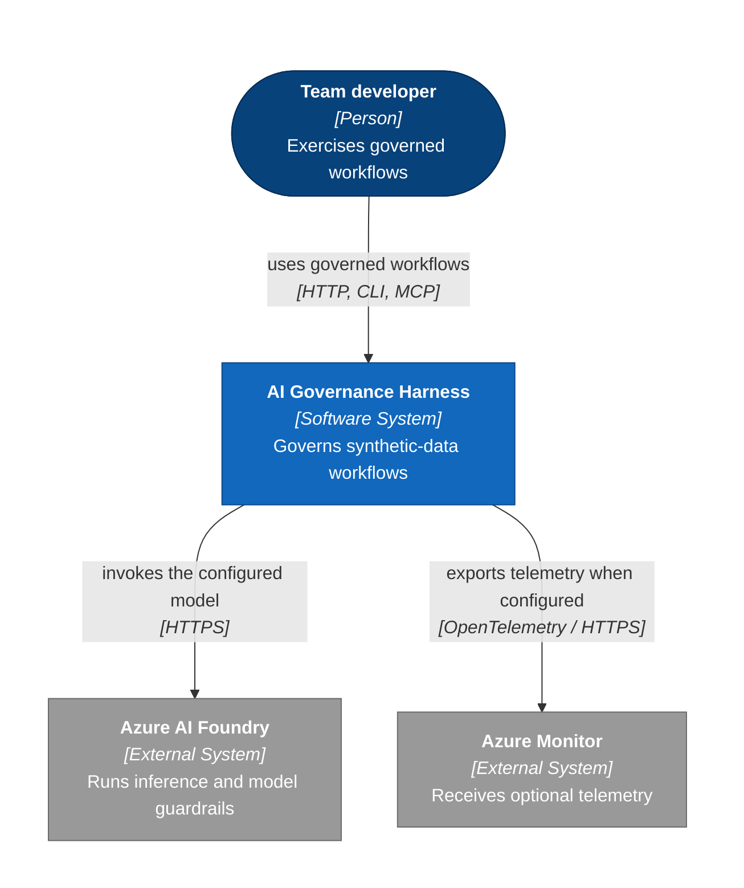
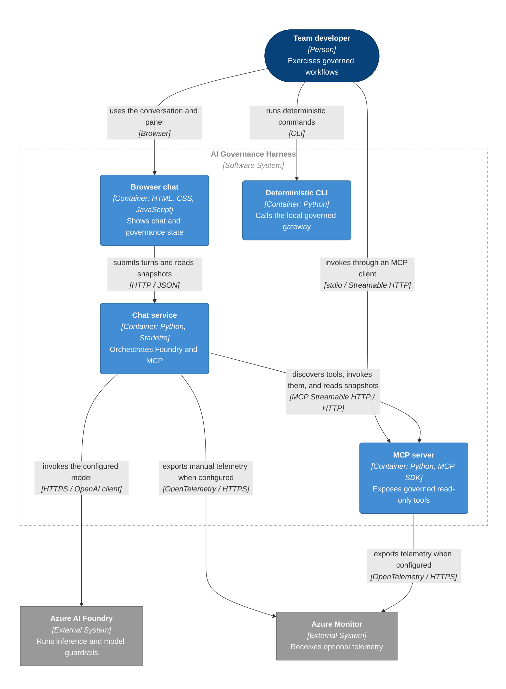
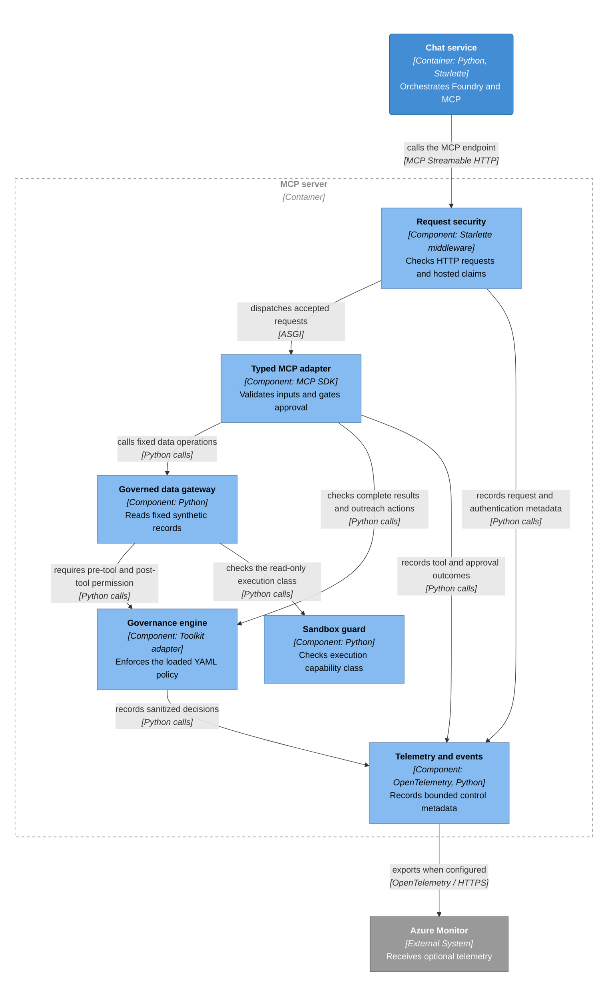

## Reference Pattern

The reusable pattern is an application-controlled model loop over a narrow
MCP tool surface, with enforcement below the transport at the shared data
gateway. Model-selected actions are proposals, not authorization. Keep
application policy, tool validation, domain checks, identity, and deployed
Foundry guardrails as separate layers.

The current implementation is local-first and uses synthetic Australian
superannuation data. The diagrams below show implemented runtime boundaries,
not an assumed Azure deployment. Azure Container Apps, deployed identity,
privileged sandbox providers, external memory, and universal approval UX are
not implemented here.

Start with [getting started](getting-started.md), then use the
[configuration reference](configuration.md) for settings and limits.

## Diagram Notation

Names, stereotypes, and shapes identify element types; color is not required
to understand the diagrams. A container is a runnable application or data
store in the C4 sense, not necessarily a Docker container. The shared Python
governance and gateway modules execute inside their callers' processes; they
are not a separate policy service.

The legend uses C4 notation. Concepts are attributed to Simon Brown's
[C4 model](https://c4model.com/), under
[CC BY 4.0](https://creativecommons.org/licenses/by/4.0/); topology and control
descriptions are specific to this repository. Syntax follows
[Mermaid flowcharts](https://mermaid.js.org/syntax/flowchart.html).

```mermaid
---
config:
  flowchart:
    subGraphTitleMargin:
      bottom: 30
---
flowchart LR
    person_legend(["`**Name**
*[Person]*
Description`"])
    sys_legend["`**Name**
*[Software System]*
Description`"]
    ctr_legend("`**Name**
*[Container]*
Description`")
    cmp_legend["`**Name**
*[Component]*
Description`"]
    ext_legend["`**Name**
*[External System]*
Description`"]
    ext_legend_store[("`**Name**
*[External Data Store]*
Description`")]
    infra_legend["`**Name**
*[Infrastructure Node]*
Description`"]

    subgraph deploy_legend["`**Parent Name** *[Deployment Node]*`"]
        subgraph deploy_nested_legend["`**Nested Name**
*[Deployment Node]*`"]
            ctr_legend_i("`**Name**
*[Container Instance]*
Description`")
        end
    end

    subgraph bnd_legend["`**Name**
*[Software System]*`"]
        ctr_legend_store[("`**Name**
*[Internal Data Store]*
Description`")]
    end

    %% Layout only: chains the entries into a single row
    person_legend ~~~ sys_legend
    sys_legend ~~~ ctr_legend
    ctr_legend ~~~ cmp_legend
    cmp_legend ~~~ ext_legend
    ext_legend ~~~ ext_legend_store
    ext_legend_store ~~~ infra_legend
    infra_legend ~~~ deploy_legend
    deploy_legend ~~~ bnd_legend

    classDef person fill:#08427b,stroke:#052e56,color:#ffffff
    classDef system fill:#1168bd,stroke:#0b4884,color:#ffffff
    classDef container fill:#438dd5,stroke:#2e6295,color:#ffffff
    classDef component fill:#85bbf0,stroke:#5d82a8,color:#000000
    classDef external fill:#999999,stroke:#6b6b6b,color:#ffffff
    classDef infrastructure fill:#b0c4de,stroke:#7b899b,color:#000000

    class person_legend person
    class sys_legend system
    class ctr_legend,ctr_legend_i,ctr_legend_store container
    class cmp_legend component
    class ext_legend,ext_legend_store external
    class infra_legend infrastructure

    style deploy_legend fill:none,stroke:#2e6295,color:#2e6295
    style deploy_nested_legend fill:none,stroke:#2e6295,color:#2e6295
    style bnd_legend fill:none,stroke:#888888,stroke-dasharray:5 5,color:#888888
```



### System Context

The team developer uses the harness's browser, CLI, or MCP interfaces. The
harness invokes a configured Foundry model deployment and can optionally
export approved telemetry to Azure Monitor. Cloud model guardrail settings
remain outside the repository boundary.



### Runtime Containers

Browser assets run in the browser and call only the chat origin. Chat and MCP
are separate Python processes. The deterministic CLI is a separate, direct
gateway caller; it does not call the MCP server process or Foundry. Both
services may export telemetry, but neither depends on a remote policy service.



### MCP Components

This component view focuses on the HTTP tool path, the main extension
boundary. stdio reaches the same typed adapter and gateway without the HTTP
middleware. The deterministic CLI reuses the gateway and governance code in
its own process, rather than traversing this server's transport.



## Component Map

Paths below are the implementation source of truth. Planning documents and
evidence explain intent but do not add runtime enforcement.

| Component                 | Source                                                                                                                                                                                                                        | Responsibility and boundary                                                                             |
| ------------------------- | ----------------------------------------------------------------------------------------------------------------------------------------------------------------------------------------------------------------------------- | ------------------------------------------------------------------------------------------------------- |
| Combined launcher         | [dev_launcher.py](../src/ai_governance_harness/dev_launcher.py)                                                                                                                                                               | Local child-process startup, port checks, readiness waits, browser launch, and shutdown                 |
| Browser chat              | [chat/static](../src/ai_governance_harness/chat/static/)                                                                                                                                                                      | Conversation UI and same-origin governance panel; no direct Foundry or gateway calls                    |
| Chat HTTP application     | [chat/app.py](../src/ai_governance_harness/chat/app.py)                                                                                                                                                                       | JSON validation, origin checks, security headers, API errors, health, and dashboard routes              |
| Model orchestration       | [chat/service.py](../src/ai_governance_harness/chat/service.py)                                                                                                                                                               | Bounded model/tool loop, local policy checks, MCP client, provider-denial recognition, output checks    |
| Foundry connection        | [foundry_client.py](../src/ai_governance_harness/foundry_client.py)                                                                                                                                                           | `DefaultAzureCredential` and project-client construction; no cloud guardrail provisioning               |
| MCP startup and HTTP      | [mcp_server/__main__.py](../src/ai_governance_harness/mcp_server/__main__.py), [http_app.py](../src/ai_governance_harness/mcp_server/http_app.py)                                                                             | Startup/shutdown policy, data initialization, stdio/HTTP selection, sessions, health, discovery         |
| Request security          | [mcp_server/security.py](../src/ai_governance_harness/mcp_server/security.py)                                                                                                                                                 | HTTP origin/content/size/protocol checks, bounded rate limiting, trusted hosted-principal validation    |
| Typed MCP adapter         | [mcp_server/server.py](../src/ai_governance_harness/mcp_server/server.py)                                                                                                                                                     | Five tools, member-ID validation, form approval, result provenance, sanitized tool errors               |
| Governed data gateway     | [mcp_server/tools.py](../src/ai_governance_harness/mcp_server/tools.py)                                                                                                                                                       | Fixed-file reads and deterministic analytics; pre/post policy also covers direct callers                |
| Governance engine         | [governance/engine.py](../src/ai_governance_harness/governance/engine.py), [default.yaml](../src/ai_governance_harness/governance/policies/default.yaml)                                                                      | Toolkit isolation, exact workload binding, deny-overrides evaluation, policy digest, fail-closed errors |
| Request context           | [governance/context.py](../src/ai_governance_harness/governance/context.py)                                                                                                                                                   | Request-local workload/environment/authentication metadata, optional hashed principal                   |
| Domain guardrails         | [advice_filter.py](../src/ai_governance_harness/guardrails/advice_filter.py), [sovereignty.py](../src/ai_governance_harness/guardrails/sovereignty.py)                                                                        | Advice-pattern checks, scope rewriting, disclosures, and selected region/endpoint validation            |
| Reliability and sandbox   | [reliability.py](../src/ai_governance_harness/governance/reliability.py), [sandbox.py](../src/ai_governance_harness/governance/sandbox.py)                                                                                    | Independent remote-call circuits/timeouts and capability classification, not general OS isolation       |
| Observability             | [events.py](../src/ai_governance_harness/governance/events.py), [snapshot.py](../src/ai_governance_harness/governance/snapshot.py), [telemetry.py](../src/ai_governance_harness/mcp_server/telemetry.py)                      | Bounded events, same-origin merged snapshots, explicit spans/metrics/audit events, optional export      |
| Deterministic CLI         | [cli.py](../src/ai_governance_harness/cli.py), [agent/orchestrator.py](../src/ai_governance_harness/agent/orchestrator.py)                                                                                                    | Local factual summaries and briefings over the shared gateway; no model inference                       |
| Active synthetic data     | [synthetic_data/generator.py](../src/ai_governance_harness/synthetic_data/generator.py), [schemas.py](../src/ai_governance_harness/synthetic_data/schemas.py), [data/synthetic](../src/ai_governance_harness/data/synthetic/) | Generates and supplies the five normalized JSON datasets consumed by the gateway                        |
| Separate profile model    | [models/member.py](../src/ai_governance_harness/models/member.py), [data/generator.py](../src/ai_governance_harness/data/generator.py)                                                                                        | Alternate nested member-profile fixtures, not the gateway's active five-file data contract              |
| Assurance and packaging   | [pyproject.toml](../pyproject.toml), [CI workflow](../.github/workflows/ci.yml), [security_audit.py](../src/ai_governance_harness/security_audit.py), [security/vex](../security/vex/)                                        | Package dependencies, tests, policy/evidence checks, build, SBOM, and expiring audit exception          |
| Container recipe          | [Dockerfile](../Dockerfile)                                                                                                                                                                                                   | Installs the package and runs the local launcher; not Azure infrastructure or a production entrypoint   |

## One Browser Turn

The following is the successful path; any denial or invalid dependency result
can stop it before completion.

1. The browser posts bounded user/assistant history to `/api/chat`. The web
   application validates JSON, message roles, sizes, and the final user turn.
2. `ChatService` evaluates `chat.input`. The advice-request classifier passes
   only a status and message count to policy, not the conversation text.
   A short member-ID follow-up also includes the preceding user intent in
   that in-memory classification.
3. The service creates the Foundry project/OpenAI clients and opens an MCP
   client. MCP `list_tools` supplies names, descriptions, and input schemas
   for model function calling.
4. Before each completion, `foundry.chat` passes pre-model policy. The model
   call uses the configured deployment, `store=False`, a completion-token
   budget, automatic tool selection, and `parallel_tool_calls=False`.
   Foundry independently applies the guardrails assigned to that deployment.
5. Explicit provider block signals become recorded external denials. Other
   successful completions pass post-model policy before the service uses
   their content or proposed tool calls.
6. Each proposed tool name passes chat pre-tool policy and must exist in the
   discovered tool set. Arguments must decode to a JSON object. MCP validates
   the tool contract; HTTP middleware validates the transport request.
7. The shared gateway independently requires pre-tool permission and the
   read-only capability class, runs the fixed operation, scans the result in
   memory, and requires post-tool permission. The MCP adapter checks the
   complete response, including added provenance and outreach-case fields.
8. Chat scans structured MCP content again and checks post-tool policy before
   adding the bounded serialized result to the next model request. A tool
   error becomes a generic error payload, not raw internal exception text.
9. When the model produces final text, scope claims are rewritten, prohibited
   advice phrasing is replaced by a factual fallback, and disclosures are
   attached. `chat.output` passes output policy before the response is sent.
10. Clients are closed at the end of the turn. Application transcripts are
    not persisted; governance events retain only allowed control metadata.

The system instruction requests tool-backed facts and limits in-fund scope.
It is guidance to the model, not a guarantee against hallucination, prompt
injection, or misuse. Authorization is enforced in code and policy below it.

### Direct MCP and CLI Paths

A direct MCP caller skips the chat model loop but still reaches the same
typed adapter, governed gateway, result scan, and policy. stdio skips HTTP
security checks and relies on the client/process access boundary; reserve
stdout for protocol traffic and use stderr for diagnostics.

The deterministic CLI uses the gateway directly in its own process. It
receives gateway pre/post enforcement and its own domain-formatting checks,
but does not run chat lifecycle checks or Foundry guardrails. Its `prep`
command generates a factual briefing; it is not the approval-gated MCP
`prepare_member_outreach_case` tool. Neither path contacts a member.

## Lifecycle Policy Contract

Source: [engine.py](../src/ai_governance_harness/governance/engine.py).
Application lifecycle names map to the Toolkit's four stages:

| Application point   | Toolkit stage   | Current action or purpose                              |
| ------------------- | --------------- | ------------------------------------------------------ |
| `startup`           | `pre_input`     | MCP `agent.startup` before initializing the data       |
| `input`             | `pre_input`     | Chat `chat.input`, including advice-request status     |
| `pre_model`         | `pre_input`     | Chat `foundry.chat` before completion                  |
| `post_model`        | `post_tool`     | Chat `foundry.chat` after completion or provider block |
| `pre_tool`          | `pre_tool`      | Proposed tool action and shared gateway entry          |
| `post_tool`         | `post_tool`     | Gateway, MCP adapter, and chat tool-result checks      |
| `output`            | `pre_output`    | Chat `chat.output` after response sanitization         |
| `shutdown`          | `pre_output`    | MCP `agent.shutdown` when stopping                     |

The policy is loaded once per process from YAML. The adapter hashes its
bytes, binds evaluation to the configured agent ID, and uses
`deny_overrides`. Unmatched actions default to deny. Evaluation failure
becomes a denial; `require_allowed` also rejects a `require_approval`
decision when no approved flow is available.

The default policy allows the current lifecycle actions and five exact tool
names. `deny-personal-advice-request` blocks matching request intent.
`deny-personal-advice-tool-response` blocks detected advice in tool results;
each known tool's result allow requires `advice_scan_status == 'passed'`.
Missing scan metadata is not an implicit allow.

Model lifecycle rules currently authorize the model action using metadata;
they are not general raw-content classifiers. Output policy likewise sees
bounded length/count metadata after domain sanitization, not the raw text.

The outreach allow rule authorizes the named action, not approval itself.
Actual approval is separately enforced by validated MCP elicitation in the
adapter. Do not infer approval from a rule name or model-generated argument.

## Tool and Data Contract

| MCP tool                            | Client input                    | Result and additional control                                      |
| ----------------------------------- | ------------------------------- | ------------------------------------------------------------------ |
| `get_member_profile`                | `member_id`, such as `MEM-001`  | Synthetic in-fund profile and recent contributions                 |
| `get_member_disengagement_signals`  | `member_id`                     | Deterministic contribution/activity/closure signals                |
| `get_cohort_churn_analytics`        | No arguments                    | Cohort risk distribution and drivers                               |
| `get_fum_outflow_summary`           | No arguments                    | Aggregate balance-at-risk figures in AUD                           |
| `prepare_member_outreach_case`      | `member_id`                     | Read-only case only after validated MCP form approval              |

Remote member IDs must match `MEM-` followed by three digits and the fixed
seven-character length. No remote tool accepts a filesystem path, arbitrary
filter, executable code, network destination, or write operation. Read-only
MCP annotations describe this contract; the gateway's implementation and
policy enforce it.

The gateway loads members, accounts, contributions, interactions, and digital
activity from packaged JSON into process memory. It computes example risk
scores from fixed rules, not a trained or validated predictive churn model.
Treat scores and outflow figures as demonstration analytics, not calibrated
probabilities or forecasts.

Pydantic models validate generated fixtures, and MCP validates tool inputs.
The gateway loads JSON dictionaries directly; it does not validate every
loaded record against the generator models. A production adapter needs a
reviewed data contract, source authorization, tenant/member scoping, and
validation at ingestion and response boundaries.

The gateway's older Python signature accepts a `cohort_filter`, but it does
not apply that filter and the remote MCP tool does not expose it. Browser
chat discovers live MCP schemas; the older static function definitions in
the gateway module are not the browser's tool-discovery source.

### Human Approval

The outreach adapter uses MCP form elicitation with an `approved` strict
boolean. A validated acceptance with `approved=true` is required. Decline,
cancel, false, invalid content, or an incapable client fails closed. The
response explicitly states that no external action occurred.

Modern MCP clients can receive `InputRequiredResult` and retry through SDK
resolution; older negotiated revisions use a server-to-client elicitation
request. HTTP sessions and streaming preserve that channel. With
`MCP_JSON_RESPONSE=true`, the approval tool cannot rely on that back-channel
and fails closed. The reference browser chat has no universal approval UI.

## Repository Controls and Their Limits

| Layer                       | Enforced here                                                          | Not established by this layer                                          |
| --------------------------- | ---------------------------------------------------------------------- | ---------------------------------------------------------------------- |
| Workload policy             | Exact action names, default deny, failure denial, lifecycle checks     | Correct model reasoning or per-member entitlement                      |
| Tool boundary               | Narrow remote contract, gateway checks for direct callers, result scan | Safety of a future operation that omits those checks                   |
| Human approval              | One synthetic read-only outreach-case tool via MCP forms               | Approval for all workflows or permission to contact real members       |
| Advice/domain checks        | Pattern-based request/result checks, final fallback, scope/disclosures | Complete legal classification, every paraphrase, regulatory sign-off   |
| HTTP security               | Origin, type, size, protocol, local rate bucket; hosted claim checks   | Independent JWT verification, chat login, cross-replica throttling     |
| Sovereignty helper          | Selected configured-region/endpoint checks                             | Actual cloud deployment residency or automatic chat-region enforcement |
| Reliability                 | Separate Foundry/MCP/observability circuits and timeout scopes         | Guaranteed upstream cancellation, transactional rollback, an SLO       |
| Sandbox classification      | Read-only class and denial of executable classes without a provider    | A running privileged sandbox or OS-level isolation for current tools   |
| Privacy-safe events         | Bounded application control metadata, no raw conversation/tool data    | A durable audit ledger or provider-side storage/retention policy       |

Only approved, minimum-necessary metadata should be passed as `policy_data`.
An extension can defeat the privacy design by adding request text to that
mapping or to log messages. Retain the allowlists and test exclusions when
adapting the code.

## Foundry Model Guardrail Layer

The project owner reports additional model-level guardrails configured in
Foundry outside the repository. Their exact names, risks, thresholds,
actions, assignments, and production coverage were not supplied or inspected.
Do not report them as verified by the local policy, tests, or dashboard.

Microsoft's [guardrails overview](https://learn.microsoft.com/en-us/azure/foundry/guardrails/guardrails-overview)
describes named guardrails containing risk controls, intervention points,
and actions. Supported model controls can cover content-harm categories,
prompt attacks, protected material, and selected preview capabilities such
as PII detection, groundedness, or task adherence. Availability depends on
the model, region, feature status, and control. None of those names is proof
that your selected deployment has the control enabled.

Model guardrails support input and output intervention points. They are not
local MCP tool authorization. Foundry Agent Service offers additional
preview agent/tool intervention points, but the locally orchestrated harness
does not become a Foundry Agent Service agent by calling a model deployment.
Even when migrating to that service, check the supported tool types and
controls; do not assume a custom MCP tool is moderated automatically.

API version, prompt formatting, and inference mode also affect applicability.
The current model call uses nonstreaming Chat Completions. Microsoft's
[configuration guidance](https://learn.microsoft.com/en-us/azure/foundry/guardrails/how-to-create-guardrails)
describes groundedness detection as streaming-only and documents special
formatting for untrusted document inputs. This harness sends structured tool
messages without that document-tagging integration. Do not assume those
controls run on every tool result merely because they are enabled in Azure;
verify effective coverage for the actual request path.

For models, annotation-only action is different from annotation-and-block.
This harness recognizes explicit block signals; it does not turn every
annotation into an application denial. Choose and verify blocking behavior
for controls your organization requires to prevent execution.

### Provider Denial Handling

`ChatService` recognizes structured OpenAI API error codes
`content_filter`, `content_policy_violation`, and
`ResponsibleAIPolicyViolation`, including supported nested error fields.
It also recognizes a completion choice with `finish_reason=content_filter`.
These produce a post-model denial with:

```json
{
  "action": "foundry.chat",
  "policy_name": "azure-ai-foundry",
  "matched_rule": "content_filter",
  "allowed": false
}
```

The browser receives HTTP 403 with the `governance_denied` error code and
bounded policy details. Rejected provider content is not returned as an
answer or forwarded to tools. Raw provider error text is not used to infer a
policy decision. Other upstream failures remain generic HTTP 502 errors and
are not counted as confirmed Foundry guardrail denials.

If you later adopt Foundry Agent Service, custom agent guardrails override
the model guardrail rather than adding an assumed second policy. Microsoft's
overview also describes inheritance when no custom agent guardrail is
assigned. Review the effective assignment at every applicable intervention
point during a migration.

Use the [Foundry setup and verification steps](getting-started.md#verify-foundry-guardrails)
to capture the deployed control configuration separately from local policy.

## Observability and Assurance

The browser polls its chat origin for a merged governance snapshot. Chat
reads the MCP process's `/governance/snapshot` server-side, validates event
fields, and merges bounded recent activity. Observability has its own circuit
so a failing snapshot endpoint does not itself open the model or tool circuit.
An unavailable remote snapshot produces a partial dashboard view.

Events exclude prompts, arguments, results, member data, tokens, transcripts,
and raw principal claims. The dashboard ring is limited to 200 events per
process; default snapshots expose 50 recent events each, merged to at most
100. Counts are policy decisions, not user-turn counts: one turn or aggregate
tool can create several checks, including nested gateway reads. Restarting a
process clears its event history and counters.

The policy digest identifies loaded policy bytes. It does not attest to the
Foundry deployment's cloud guardrail assignment. After policy changes,
restart services rather than treating the snapshot's file view as hot reload.

The [runtime evidence](../src/ai_governance_harness/governance/agt-runtime-evidence.yaml)
feeds `agt verify`. The separate
[OWASP Agentic evidence](../src/ai_governance_harness/governance/evidence/owasp-agentic.yaml)
records repository-specific implemented, partial, deferred, and
not-applicable posture. They are self-assessments, not independent audits or
certification. The dashboard does not retrieve or validate Foundry guardrail
configuration.

The [dependency audit policy](../security/vex/audit-policy.yaml) contains a
scoped exception expiring on `2026-11-13`. The audit validates the date,
reviewed versions, forbidden-symbol scan, and exact VEX advisory set before
running `pip-audit` with only those ignores. A passing gate is not a general
proof of exploit unreachability, and the exception is not transferable to an
adapted application without reassessment.

CI runs tests on Python 3.11-3.13 and quality checks on Python 3.13. It also
lints policy, verifies evidence, builds the package, produces a CycloneDX
SBOM, and audits dependencies. These local/repository checks do not establish
successful Azure deployment or effective cloud guardrails.

## Adapt the Reference to Your Team

Keep the governance architecture, but replace the demonstration-specific
business logic through reviewed changes:

1. Define the workload's permitted actions, data scope, regional constraints,
   owners, and approval requirements before adding capabilities.
2. Add an explicit policy rule for each approved action and its result at the
   appropriate stages. Retain `default_action: deny`, exact workload binding,
   deny-overrides behavior, and fail-closed evaluation.
3. Expose a narrow typed MCP tool in the adapter. Do not add arbitrary URLs,
   paths, filters, or model-selected executable payloads as convenience inputs.
4. Put pre/post checks at the owning gateway operation as well as the chat
   caller. A transport-only check leaves direct Python callers unprotected.
5. Classify the capability honestly. Code, shell, filesystem writes, and
   unrestricted network operations need an approved integrated sandbox;
   annotating them as read-only or choosing a provider name is insufficient.
6. Enforce actual human approval at the execution boundary when required.
   Neither a model's statement nor a policy rule's name constitutes approval.
7. Validate complete responses before returning them to the model or caller,
   and retain sanitized denial/error behavior. Avoid substituting a blocked
   tool result with a successful payload.
8. Replace domain-specific advice patterns and notices with reviewed controls
   for your use case. Test false positives, paraphrases, and adversarial inputs;
   do not present regex matches as comprehensive compliance detection.
9. Implement real data entitlement and hosted identity propagation before
   using nonsynthetic data. Reassess telemetry, cloud residency, rate limits,
   persistence, and client approval support.
10. Add success, denial, malformed-input, unsafe-result, approval-decline,
    missing-provider, and direct-caller tests using the existing test files.
11. Update runtime evidence, OWASP limitations, documentation, and applicable
    [architecture decisions](../README.md#architecture-decisions). Validate
    the dependency exception again when packages or capability reachability change.
12. Verify the Foundry guardrail assigned to the exact deployment used in the
    application. Keep cloud configuration ownership and evidence distinct
    from the repository policy.

This documentation is AI-assisted and describes observed implementation,
not legal, security, or production sign-off. Maintainers and the relevant
security, privacy, Responsible AI, and domain reviewers should validate
changes before organizational adoption. Mermaid source is checked; diagram
rendering is not validated because source-only validation was selected.
