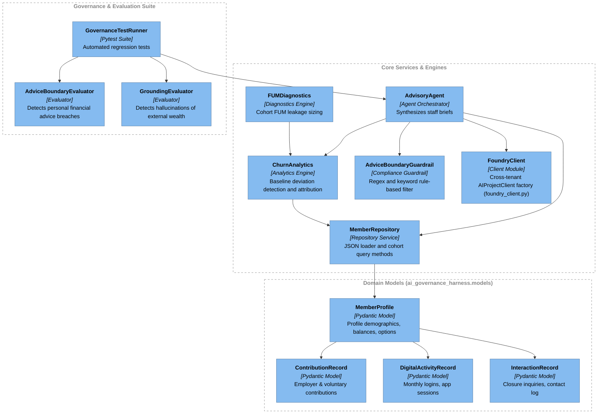
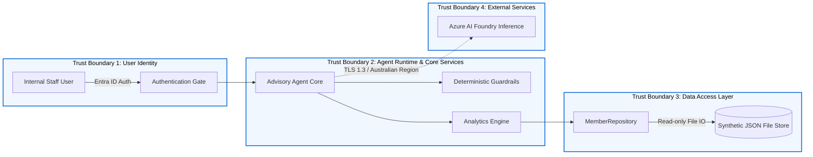
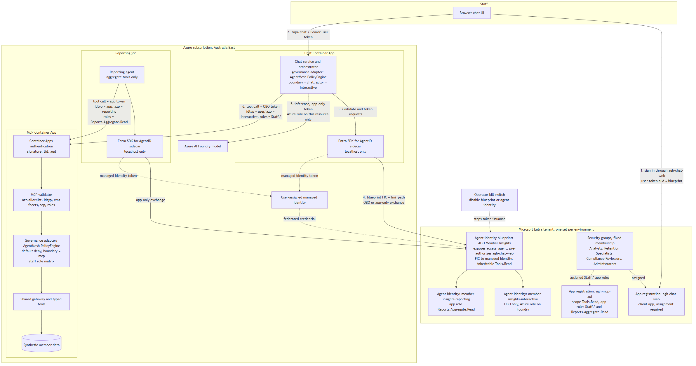
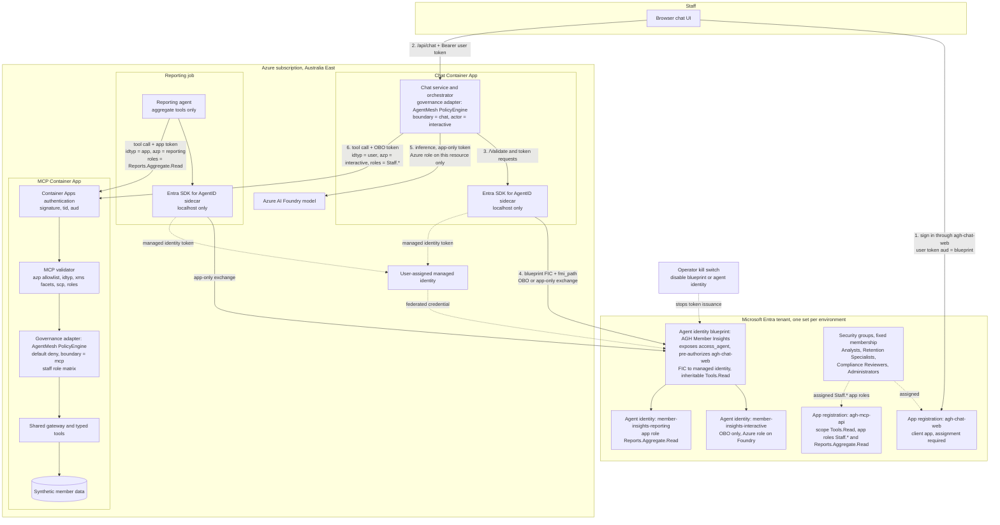
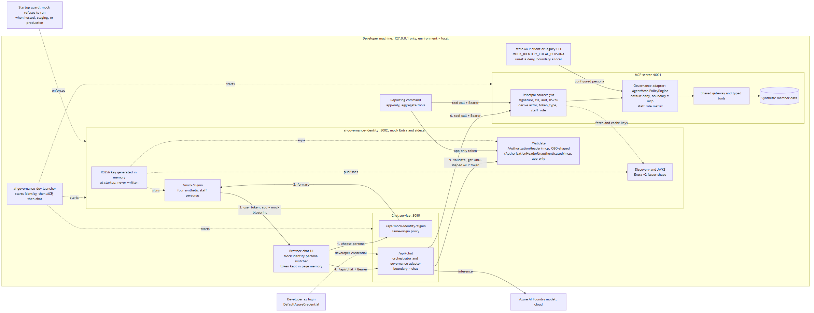
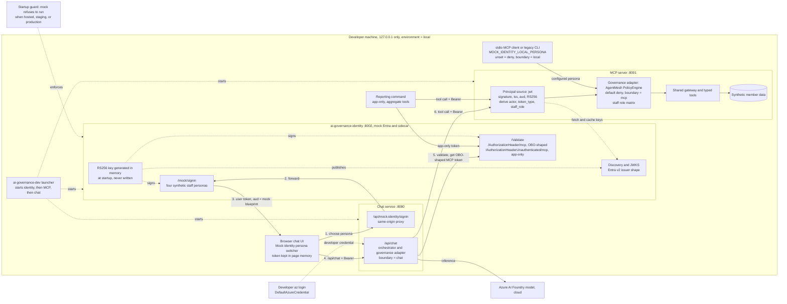
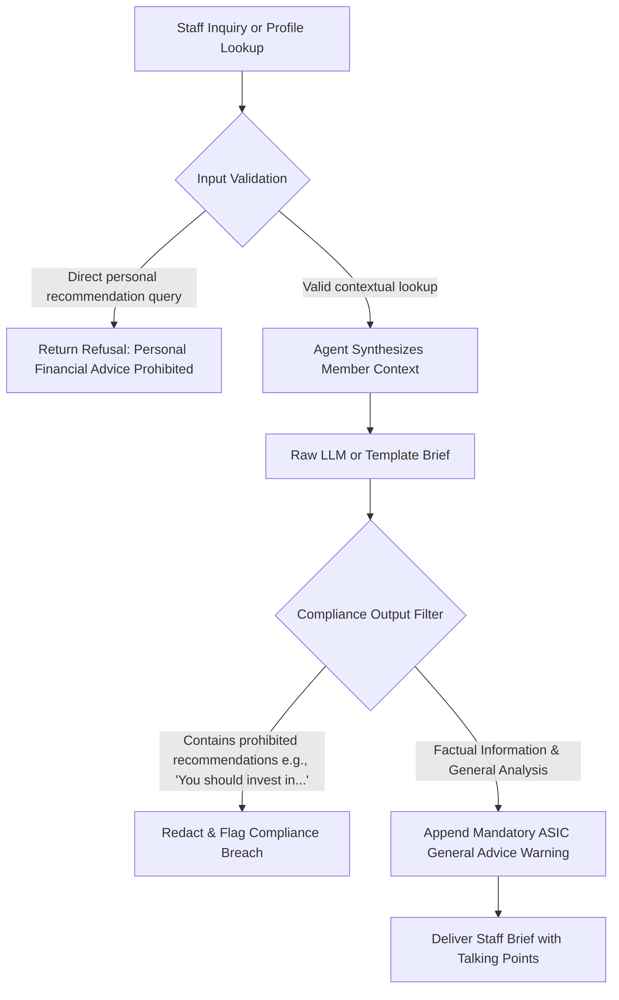

# Member Whole-of-Wealth Insights & Interaction Advisory Agent - Architecture View

> Document ID: `ARCH-2026-SUPER-001`
> Related PRD: [`docs/project-planning/member-wealth-insights-agent.md`](../project-planning/member-wealth-insights-agent.md)
> Related BRD: [`docs/project-planning/member-wealth-insights-agent-brd.md`](../project-planning/member-wealth-insights-agent-brd.md)
> Related Security Plan: [`docs/project-planning/member-wealth-insights-agent-security-plan.md`](../project-planning/member-wealth-insights-agent-security-plan.md)
> Date: 2026-10-13
> Status: Approved Architecture Baseline

---

## 1. Architecture Overview

The **Member Whole-of-Wealth Insights & Interaction Advisory Agent** is an enterprise AI co-pilot designed for internal superannuation staff (contact centre consultants, retention specialists, and business analysts). It aggregates internal superannuation account and activity profiles, diagnoses member disengagement trends and Funds Under Management (FUM) outflow risks, and generates contextual preparation briefs for staff interactions.

### Core Architectural Principles

1. **Strict Advice Boundary (ASIC RG 244 / Corporations Act 2001 (Cth)):** The agent operates solely as an internal staff advisory tool providing factual analysis and general guidance. A deterministic compliance filter blocks any personal financial advice or recommendations tailored to individual goals.
2. **Data Minimisation & Sovereignty (APRA CPS 234 / CON-002 / CON-003):** Initial MVP operates entirely on synthetic member data modeled in JSON with no real personal PII. Processing conforms to Australian sovereign boundary requirements.
3. **Dual Execution Runtime:** The system supports both offline deterministic execution (mock LLM with rule-based heuristics) for CI/CD and safety evaluations, and live cloud execution via Azure AI Foundry and Entra ID cross-tenant authentication.
4. **Governed AI Lifecycle:** The system includes an automated evaluation harness verifying advice boundaries, profile grounding, and prompt injection defense.

---

## 2. C4 Level 1: System Context Diagram

The System Context diagram illustrates the system boundaries, users, and external integrations.

```mermaid
---
config:
  flowchart:
    subGraphTitleMargin:
      bottom: 30
---
flowchart TB
    subgraph layout_top[" "]
        person_staff(["`**Superannuation Staff**
*[Person]*
Contact Centre Consultants, Retention Specialists & Business Analysts`"])
    end

    subgraph sys_boundary["`**Superannuation Fund Boundary** *[Boundary]*`"]
        sys_agent["`**Member Wealth Insights & Advisory Agent**
*[Software System]*
Aggregates internal profiles, calculates churn/FUM outflow analytics, and generates staff guidance briefs.`"]
        ext_json_store[("`**Synthetic Member Data Store**
*[Internal Data Store]*
Encrypted JSON repository of synthetic member profiles, balances, and interaction logs.`")]
    end

    subgraph layout_bottom[" "]
        ext_entra["`**Microsoft Entra ID**
*[External System]*
Identity and Access Management with cross-tenant OAuth authentication.`"]
        ext_foundry["`**Azure AI Foundry**
*[External System]*
Cloud AI model inference, agent catalog, and telemetry tracking.`"]
    end

    person_staff -->|"`Looks up member profiles, requests churn diagnostics & interaction briefs`
*[HTTPS / CLI]*"| sys_agent
    sys_agent -->|"`Authenticates staff and service principals`
*[OAuth 2.0 / MSAL]*"| ext_entra
    sys_agent -->|"`Queries member balances, contributions & interactions`
*[File I/O / JSON]*"| ext_json_store
    sys_agent -->|"`Dispatches prompt completion & model inference`
*[REST / TLS 1.3]*"| ext_foundry

    style sys_boundary fill:none,stroke:#888888,stroke-dasharray:5 5,color:#888888
    style layout_top fill:none,stroke:none
    style layout_bottom fill:none,stroke:none

    classDef person fill:#08427b,stroke:#052e56,color:#ffffff
    classDef system fill:#1168bd,stroke:#0b4884,color:#ffffff
    classDef external fill:#999999,stroke:#6b6b6b,color:#ffffff

    class person_staff person
    class sys_agent,ext_json_store system
    class ext_entra,ext_foundry external
```

---

## 3. C4 Level 2: Container Diagram

The Container diagram decomposes the system into runnable modules and services.

```mermaid
---
config:
  flowchart:
    subGraphTitleMargin:
      bottom: 30
---
flowchart TB
    person_staff(["`**Superannuation Staff**
*[Person]*`"])

    subgraph sys_agent["`**Member Wealth Insights & Advisory Agent** *[Software System]*`"]
        ctr_agent_runner("`**Advisory Agent Runner**
*[Python Application]*
Orchestrates profile retrieval, analytics dispatch, brief synthesis, and response formatting.`")
        ctr_guardrail("`**Advice Boundary Guardrail**
*[Python Service]*
Deterministic pre/post filter enforcing ASIC RG 244 General Advice warnings and blocking personal advice.`")
        ctr_analytics("`**Churn & FUM Analytics Engine**
*[Python Service]*
Calculates individual contribution/activity deviations and aggregates cohort FUM leakage.`")
        ctr_repo("`**Member Repository & Data Access**
*[Python Module]*
Provides typed querying and cohort filtering over member records.`")
        ctr_eval_harness("`**AI Governance & Evaluation Harness**
*[Python / Pytest]*
Runs safety benchmarks, advice boundary evaluators, and grounding verification.`")
        ctr_data_store[("`**Synthetic Data Store**
*[JSON File Store]*
Synthetic member profiles, contributions, digital activity, and closure inquiries.`")]
    end

    ext_foundry["`**Azure AI Foundry**
*[Cloud Service]*`"]

    person_staff -->|"`Requests consultation brief or cohort report`"| ctr_agent_runner
    ctr_agent_runner -->|"`Fetches member profile and interaction history`"| ctr_repo
    ctr_agent_runner -->|"`Invokes churn & FUM outflow diagnostics`"| ctr_analytics
    ctr_analytics -->|"`Reads contribution and activity history`"| ctr_repo
    ctr_repo -->|"`Reads synthetic JSON records`"| ctr_data_store
    ctr_agent_runner -->|"`Generates candidate brief via LLM or local template`"| ext_foundry
    ctr_agent_runner -->|"`Passes candidate output for compliance audit`"| ctr_guardrail
    ctr_guardrail -->>|"`Returns validated brief with General Advice warning`"| person_staff
    ctr_eval_harness -->|"`Evaluates guardrail and agent responses against test benchmarks`"| ctr_agent_runner

    style sys_agent fill:none,stroke:#888888,stroke-dasharray:5 5,color:#888888

    classDef person fill:#08427b,stroke:#052e56,color:#ffffff
    classDef container fill:#438dd5,stroke:#2e6295,color:#ffffff
    classDef external fill:#999999,stroke:#6b6b6b,color:#ffffff

    class person_staff person
    class ctr_agent_runner,ctr_guardrail,ctr_analytics,ctr_repo,ctr_eval_harness,ctr_data_store container
    class ext_foundry external
```

---

## 4. C4 Level 3: Component Diagram

The Component diagram details the internal Python classes, models, and services inside the application container.



---

## 5. Security & Trust Boundaries

Aligning with **Security Plan SEC-2026-SUPER-001**:



### Trust Boundary Details:

1. **User Identity Boundary:** Enforces least-privilege role-based access control (RBAC). Only authenticated staff with appropriate consultant or analyst credentials can request briefs.
2. **Agent Runtime Boundary:** All prompt templates and LLM completions pass through deterministic validation. Prompt injection patterns and system instruction overrides are blocked.
3. **Data Boundary:** Strictly synthetic data. No external financial accounts are linked. File store access is read-only.
4. **Cloud Processing Boundary:** Live inference calls to Azure AI Foundry are restricted to Australian cloud regions (Australia East / Southeast) to satisfy `CON-002` Data Sovereignty.

---

## 6. Identity Architecture (Microsoft Entra Agent ID)

The chat orchestrator is the only agent. It gets its identity from **Microsoft Entra Agent ID**, while the MCP server stays a protected resource API. Staff identity travels to the MCP boundary in validated token claims, and the shared governance policy turns those claims into allow or deny decisions. See [ADR 0008](../planning/adrs/0008-use-microsoft-entra-agent-id-for-agent-identity.md), [ADR 0009](../planning/adrs/0009-enforce-agent-and-staff-identity-through-governance-policy-context.md), and [ADR 0010](../planning/adrs/0010-use-a-local-only-mock-entra-agent-id-issuer-for-the-mvp.md).

### 6.1 Target: Azure with Entra Agent ID

One agent identity blueprint per environment holds the credential, a user-assigned managed identity federated credential. Two agent identities are created from it:

* `member-insights-interactive` acts on behalf of signed-in staff (OBO).
* `member-insights-reporting` acts as itself (app-only) and is limited to aggregate tools.

The chat service and the reporting job get tokens through the Entra SDK for AgentID sidecar. MCP validates the token claims before the AgentMesh policy engine applies the staff role matrix. Numbered edges follow one staff chat turn; dotted edges are credential, assignment, or control relationships.





### 6.2 Local MVP: mock identity service

Entra Agent ID roles are not available for the hackathon MVP. A local-only mock, `ai-governance-identity` on port 8002, stands in for Entra and the sidecar:

* It signs tokens with an in-memory RS256 key and publishes a JWKS.
* It serves the same sidecar endpoints and mints the same claim shapes as Entra.
* Staff personas are chosen in the chat UI.

MCP verifies the signatures, and the same governance policy applies. Foundry inference uses the developer's `az login`. The mock refuses to start when hosted or in staging or production.





### 6.3 Staff Role Matrix

Every combination not listed is denied by default.

| Caller | Aggregate tools | Member-level tools | Outreach case |
|--------|-----------------|--------------------|---------------|
| Analyst (OBO) | Allow | Deny | Deny |
| Retention Specialist (OBO) | Allow | Allow | Allow, MCP elicitation still required |
| Compliance Reviewer (OBO) | Deny | Deny | Deny |
| Administrator (OBO) | Deny | Deny | Deny |
| Reporting agent (app-only) | Allow | Deny | Deny |

---

## 7. Regulatory & Compliance Architecture (ASIC RG 244)

The core compliance filter enforces the statutory boundary between General Advice and Personal Advice under Australian law:



---

## 8. Next Steps & Implementation Mapping

This architecture view maps directly to the active RPI implementation phases:

* **Phase P01**: `MemberProfile` data models, synthetic JSON generator, and `MemberRepository`.
* **Phase P02**: `ChurnAnalytics` and `FUMDiagnostics`.
* **Phase P03**: `AdviceBoundaryGuardrail` and `AdvisoryAgent`.
* **Phase P04**: `AdviceBoundaryEvaluator`, `GroundingEvaluator`, and automated pytest test suites.
