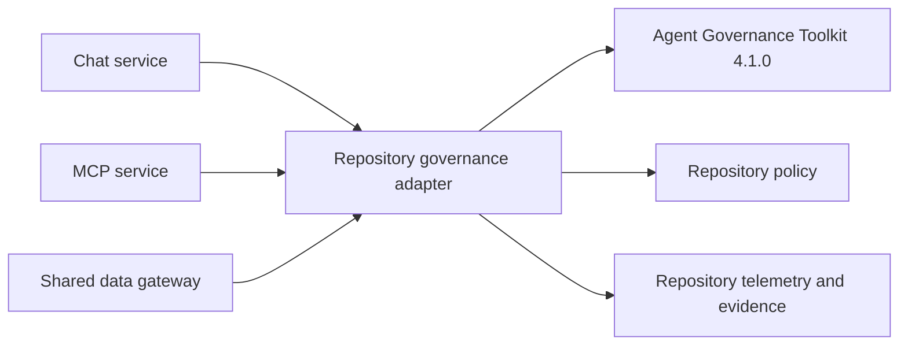

# Contain Agent Governance Toolkit behind a versioned adapter

## Context

The application needs Microsoft Agent Governance Toolkit capabilities without
coupling chat, MCP, or domain code to Public Preview implementation details.
The released 4.1 line is available from both public PyPI and Microsoft CFS,
whereas unreleased 5.x work introduces a different and incompletely portable
dependency surface.

> Evidence: [`pyproject.toml`](../../../pyproject.toml) pins the two top-level Toolkit distributions to 4.1.0.
> Evidence: [`governance/`](../../../src/ai_governance_harness/governance/) owns the typed policy, context, reliability, sandbox, telemetry, and evidence contracts.
> Evidence: [`test_governance.py`](../../../tests/test_governance.py) exercises the repository contract rather than Toolkit internals from application callers.

Toolkit 4.1 has important behavioral details: YAML parsing and activation are
separate operations, direct wildcard agent matching is unsuitable for this
workload, and its four stages do not map one-to-one to the repository lifecycle.
Those details must not spread into application code.

## Decision Drivers

* Team members must get the same released Toolkit behavior from PyPI or CFS.
* Governance must fail closed when policy loading or evaluation fails.
* Preview API changes must have a small migration surface.
* A future Toolkit upgrade must be testable and reversible.
* The repository, not the upstream package, owns lifecycle semantics.

## Considered Options

1. Pin Toolkit 4.1.0 and isolate it behind a typed repository adapter.
2. Import Toolkit APIs directly throughout chat, MCP, and gateway modules.
3. Track unreleased Toolkit source or pre-release 5.x dependencies.
4. Reimplement all governance primitives locally without the Toolkit.

## Decision Outcome

Choose option 1. Application modules use the contracts exported by
`ai_governance_harness.governance`; only that package translates Toolkit stages,
decisions, errors, and readiness.

| Driver | Versioned adapter | Direct imports | Unreleased source | Local reimplementation |
|--------|-------------------|----------------|-------------------|------------------------|
| Feed portability | Strong | Medium | Weak | Strong |
| Fail-closed consistency | Strong | Weak | Uncertain | Medium |
| Upgrade isolation | Strong | Weak | Weak | Strong |
| Toolkit capability reuse | Strong | Strong | Strong | None |
| Supportability | Strong | Medium | Weak | Weak |

### Consequences

* Good, because application code has one stable governance contract.
* Good, because Toolkit-specific workarounds are visible and testable.
* Good, because upgrading becomes an adapter migration instead of a repository-wide rewrite.
* Bad, because the adapter requires maintenance when upstream behavior changes.
* Bad, because exact 4.1.0 pins defer upstream fixes until deliberately adopted.
* Neutral, because repository lifecycle points remain richer than Toolkit stages and require documented mapping.

### Confirmation

CI must install the exact Toolkit version, run policy semantics tests, run
Toolkit doctor/lint/verify, and reject direct Toolkit imports outside the
governance package.

## Pros and Cons of the Options

### Versioned adapter

* Good, because it provides type-safe containment and rollback.
* Good, because policy failure behavior is repository-owned.
* Bad, because it adds translation code and compatibility tests.

### Direct imports

* Good, because initial integration code is smaller.
* Bad, because preview API assumptions spread across process boundaries.
* Bad, because consistent fail-closed behavior becomes harder to prove.

### Unreleased source

* Good, because it may expose newer capabilities sooner.
* Bad, because it is not a released or team-portable dependency contract.
* Bad, because its alpha dependencies may be unavailable from CFS.

### Local reimplementation

* Good, because the repository controls every API.
* Bad, because it duplicates Toolkit capability and evidence semantics.
* Bad, because it defeats the goal of demonstrating the Microsoft Toolkit.

## Architecture

## Risks and Mitigations

| Risk | Mitigation |
|------|------------|
| Toolkit stage semantics change | Pin the version and run semantic allow/deny tests before upgrading. |
| Adapter silently normalizes an unsupported result | Preserve all known decision actions and deny unknown/failure results. |
| A caller bypasses the adapter | Keep shared gateway enforcement and add import/bypass tests. |
| Version pin accumulates security debt | Apply ADR 0006 and review the pin when its exception expires. |

## Rollback / Exit Strategy

If Toolkit initialization prevents local operation, do not bypass governance in
ordinary local or hosted modes. Revert to the last validated package set and
policy, or use the explicit test-only disabled mode for isolated tests. To move
to another Toolkit version, create a superseding ADR, prove package/feed
availability, update adapter compatibility tests, and only then change pins.

## Affected Components

* `pyproject.toml` dependency declarations and entry points.
* `src/ai_governance_harness/governance/`.
* Chat, MCP, and gateway calls to the adapter.
* Toolkit validation and dependency-audit CI steps.

## Recovery and Extension Runbook

1. Confirm installed versions with `uv tree --package agent-governance-toolkit`.
2. Run `pytest tests/test_governance.py`.
3. Run strict policy lint and Toolkit evidence verification.
4. If upgrading, compare stage and decision APIs before editing application callers.
5. Keep the old environment available until local MCP and chat acceptance passes.
6. Supersede this ADR when adopting a new major or materially different adapter contract.
