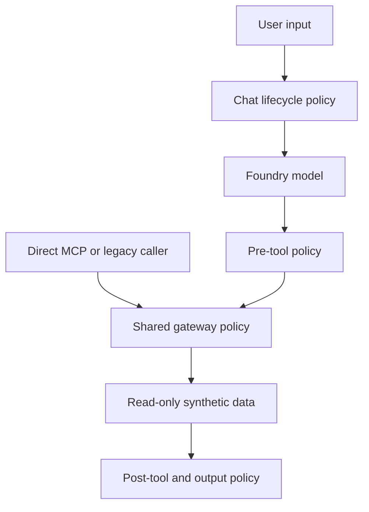

# Enforce default deny at every execution boundary

## Context

Governance is meaningful only when a denial prevents execution. The application
has several entry paths: browser chat, model-selected MCP tools, direct MCP
clients, and a legacy in-process orchestrator. Outer chat checks alone would
leave lower-level callers able to bypass policy.

> Evidence: [`default.yaml`](../../../src/ai_governance_harness/governance/policies/default.yaml) binds rules to the exact workload and defaults to deny.
> Evidence: [`tools.py`](../../../src/ai_governance_harness/mcp_server/tools.py) applies shared pre- and post-tool enforcement below MCP and legacy callers.
> Evidence: [`service.py`](../../../src/ai_governance_harness/chat/service.py) enforces input, model, tool, and output lifecycle decisions.

Toolkit 4.1 exposes fewer stages than the repository lifecycle, so the adapter
maps repository points to the closest upstream stage while preserving the
original point in evidence.

## Decision Drivers

* Denied, malformed, missing-policy, and approval-required actions must not execute.
* Direct and mediated tool callers must have equivalent enforcement.
* Existing advice, provenance, and data-scope guardrails must remain independent.
* Policy must be reviewable and packaged identically in editable and wheel installs.
* Demonstrations must make both allowed and denied paths observable.

## Considered Options

1. Enforce at outer lifecycle edges and again inside the shared gateway.
2. Enforce only in the browser chat orchestration loop.
3. Run policy in advisory mode and rely on logs for follow-up.
4. Maintain separate policies for each caller.

## Decision Outcome

Choose option 1. Use one exact-workload, default-deny policy. Apply rich
lifecycle checks in chat and MCP adapters, and place shared tool checks beneath
all callers in the data gateway.

| Driver | Layered enforcement | Chat only | Advisory only | Per-caller policies |
|--------|---------------------|-----------|---------------|---------------------|
| Bypass resistance | Strong | Weak | None | Medium |
| Decision consistency | Strong | Medium | Medium | Weak |
| Context richness | Strong | Strong | Strong | Medium |
| Reviewability | Strong | Medium | Medium | Weak |
| Operational complexity | Medium | Low | Low | High |

### Consequences

* Good, because lower-level callers cannot bypass pre-tool policy.
* Good, because unknown model-selected tools are denied before invocation.
* Good, because final output remains subject to governance and existing guardrails.
* Bad, because one operation may produce multiple legitimate lifecycle events.
* Bad, because stage mapping must be revisited when Toolkit stages change.
* Neutral, because transformation and approval actions remain modeled even when the current policy primarily allows or denies.

### Confirmation

Semantic tests must prove known allow, unknown deny, evaluation-failure deny,
direct gateway denial, adversarial unknown-tool denial, startup/shutdown checks,
and the inert UI deny demonstration.

## Pros and Cons of the Options

### Layered enforcement

* Good, because it combines contextual and non-bypassable controls.
* Bad, because it adds decision volume and requires correlation.

### Chat-only enforcement

* Good, because context is readily available.
* Bad, because direct MCP and legacy calls can avoid it.

### Advisory-only policy

* Good, because it cannot interrupt availability.
* Bad, because it is observability rather than governance.

### Per-caller policies

* Good, because each path can specialize independently.
* Bad, because policy drift creates inconsistent security outcomes.

## Architecture

## Risks and Mitigations

| Risk | Mitigation |
|------|------------|
| Policy fails to load | Fail startup/readiness and deny evaluation. |
| Unknown tool reaches MCP | Evaluate the unknown name before lookup and deny by default. |
| Duplicate checks diverge | Use one adapter and one packaged policy. |
| Sensitive content enters evidence | Apply ADR 0003's event and telemetry boundary. |

## Rollback / Exit Strategy

Rollback means restoring the last validated policy and adapter together, not
removing enforcement. Governance may be disabled only in the explicit test
environment. If a policy rule causes an outage, revert that policy change,
validate strict lint and semantic tests, and restart both processes.

## Affected Components

* Packaged policy and adapter lifecycle mapping.
* Chat model/tool orchestration.
* MCP startup, shutdown, and tool dispatch.
* Shared data gateway and legacy orchestration.
* Decision telemetry and governance panel.

## Recovery and Extension Runbook

1. Inspect readiness for policy digest and enforcement mode.
2. Run the fixed deny demonstration; verify `executed` remains false.
3. Compare the active policy digest with the packaged file.
4. When adding a tool, add its schema, policy allow rule, gateway classification, and semantic tests in one change.
5. Classify write, shell, code, and unrestricted-network tools as sandbox-required.
6. Never add a wildcard allow rule to recover from an unknown-tool denial.
