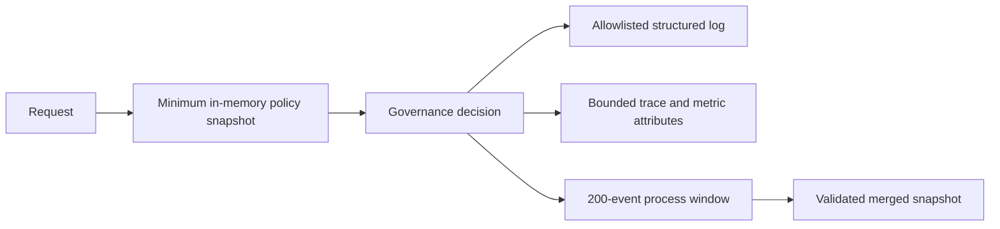

# Minimize identity and governance telemetry

## Context

Policy evaluation may need bounded request context, but emitted evidence does
not need prompts, tool payloads, member records, or raw identity claims. The
chat and MCP processes also need correlated evidence without introducing a
database or transcript store for the local demonstration.

> Evidence: [`context.py`](../../../src/ai_governance_harness/governance/context.py) exposes bounded request-scoped governance context.
> Evidence: [`events.py`](../../../src/ai_governance_harness/governance/events.py) retains sanitized decisions in a bounded process-local deque.
> Evidence: [`snapshot.py`](../../../src/ai_governance_harness/governance/snapshot.py) validates remote events and merges only known fields.

The implementation distinguishes minimum in-memory policy inputs from emitted
telemetry. This allows content-aware rules later without turning logs or the
dashboard into a sensitive-data sink.

## Decision Drivers

* Decisions must be explainable and correlated across processes.
* Raw prompts, tool inputs/results, member data, credentials, and claims must not be emitted.
* Local operation must not require a telemetry database.
* Remote process data must be treated as untrusted and schema-validated.
* Retention behavior must be visible and bounded.

## Considered Options

1. Emit a bounded metadata schema and keep recent events in process memory.
2. Emit full request/response payloads for maximum debugging detail.
3. Emit only aggregate counters with no recent event details.
4. Persist sanitized events to a local database.

## Decision Outcome

Choose option 1. Policy decisions emit lifecycle point, sanitized action,
decision, matched rule, digest, enforcement mode, source, and latency. Identity
is reduced to bounded workload metadata and an opaque principal hash.

**Amendment (2026-10-14, agent identity):**

* ADR 0009 adds four identity fields to governance context, and they may
  appear in policy decisions, events, and telemetry: `boundary`, `actor`,
  `token_type`, and `staff_role`. Each is a closed enum; no other identity
  field is added.
* `principal_hash` stays a SHA-256 of the user `oid` (OBO) or agent `oid`
  (app-only).
* Raw `oid`, `azp`, UPN, `xms_par_app_azp`, bearer tokens, and mock persona
  tokens (ADR 0010) are used only in memory and are never emitted.
* Both processes can export to Application Insights when
  `APPLICATIONINSIGHTS_CONNECTION_STRING` is set. The same allowlist applies to
  exported spans, metrics, and logs, and `Authorization` headers must never be
  recorded by HTTP instrumentation.

| Driver | Bounded metadata | Full payloads | Aggregates only | Local database |
|--------|------------------|---------------|-----------------|----------------|
| Privacy | Strong | Weak | Strong | Medium |
| Explainability | Strong | Strong | Weak | Strong |
| Operational simplicity | Strong | Medium | Strong | Weak |
| Cross-process safety | Strong | Weak | Strong | Medium |
| Demo usefulness | Strong | Strong | Medium | Strong |

### Consequences

* Good, because decisions remain understandable without exposing user content.
* Good, because process restarts naturally clear retained evidence.
* Good, because malformed MCP events cannot be reflected into the browser.
* Bad, because deep incident reconstruction requires external approved telemetry later.
* Bad, because principal hashes correlate activity within their intended scope.
* Bad, because staff role and agent actor labels, while bounded, reveal which role made each decision.
* Neutral, because metrics and traces remain useful but intentionally omit payload detail.

### Confirmation

Tests must inject sensitive-looking prompts, actions, identities, and malformed
remote events and prove they do not appear in serialized logs or snapshots.
Identity tests must also inject bearer tokens, raw `oid`/`azp` values, and
mock persona tokens and prove that only the four enum fields and the principal
hash appear.

## Pros and Cons of the Options

### Bounded metadata and memory retention

* Good, because it balances privacy and operator understanding.
* Bad, because history is intentionally ephemeral.

### Full payload telemetry

* Good, because debugging has maximal context.
* Bad, because it creates unacceptable privacy and credential risks.

### Aggregate counters only

* Good, because it minimizes data.
* Bad, because operators cannot explain individual decisions.

### Local database

* Good, because history survives restarts.
* Bad, because retention, access control, cleanup, and schema migration become new obligations.

## Architecture

## Risks and Mitigations

| Risk | Mitigation |
|------|------------|
| Action identifiers carry content | Enforce a short allowlisted character pattern and replace unsafe values. |
| Remote snapshot contains extra fields | Use strict Pydantic validation with unknown fields forbidden. |
| Event volume consumes memory | Bound each process store and merged response. |
| Hash becomes a stable cross-system identifier | Scope its use to governance correlation and never expose source claims. |
| Bearer token captured by HTTP instrumentation or exported to Application Insights | Never record `Authorization` headers; add an export test that injects a token marker. |
| Identity enum drifts into free text | Validate the four fields as closed enums before they enter context. |

## Rollback / Exit Strategy

If telemetry leakage is detected, disable the affected presentation endpoint,
clear process memory by restarting services, and preserve fail-closed policy
enforcement. Revert to aggregate-only evidence until the sanitizer and tests are
corrected. Do not disable governance to resolve an observability issue.

## Affected Components

* Request security and governance context.
* Structured logging and OpenTelemetry.
* Governance event storage and snapshot merging.
* Browser observability panel and operational endpoints.

## Recovery and Extension Runbook

1. Reproduce leakage with a synthetic marker, never real personal data.
2. Check the event model, logging allowlist, and snapshot validation boundary.
3. Restart both services after a leakage fix to clear memory.
4. For durable telemetry, write a new ADR defining retention, access, encryption, deletion, and residency.
5. Add any new field to privacy tests before exposing it.
6. The agent identity fields allowed by the 2026-10-14 amendment are `boundary`, `actor`, `token_type`, and `staff_role` only; adding another identity field requires a new ADR.
