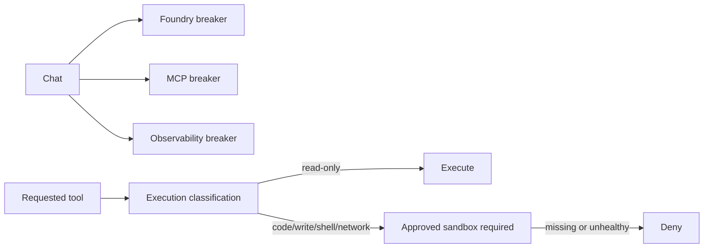

# Use local-first reliability and sandbox readiness boundaries

## Context

The current tool catalog performs bounded reads over synthetic local data. It
does not justify deploying Docker, HyperLight, native, or Azure sandbox
infrastructure. Remote Foundry and MCP operations can still fail or stall, and
future tools may introduce executable or write capabilities.

> Evidence: [`reliability.py`](../../../src/ai_governance_harness/governance/reliability.py) wraps operations in Toolkit circuit breakers and total timeouts.
> Evidence: [`sandbox.py`](../../../src/ai_governance_harness/governance/sandbox.py) classifies read-only and executable capabilities.
> Evidence: [`service.py`](../../../src/ai_governance_harness/chat/service.py) keeps separate breakers for Foundry, MCP, and MCP observability.

The architecture must demonstrate Toolkit SRE and sandbox posture now while
remaining honest that no privileged provider is active.

## Decision Drivers

* The one-command local demo must work without privileged infrastructure.
* Remote dependency failures must be bounded and diagnosable.
* Failure in one dependency must not unnecessarily open another circuit.
* Future executable capabilities must fail closed until isolation is configured.
* Provider adoption must be deliberate and testable.

## Considered Options

1. Use independent Toolkit circuit breakers/timeouts and a typed sandbox readiness gate.
2. Add retries only and allow calls to wait on client defaults.
3. Deploy a privileged sandbox provider for all current tools.
4. Omit sandbox concepts until executable tools are added.

## Decision Outcome

Choose option 1. Current read-only operations are ready with provider `none`.
Code, shell, filesystem write, or unrestricted network classifications require
an approved healthy provider before policy can allow execution.

| Driver | SRE + readiness gate | Retries only | Sandbox everything | Defer sandbox design |
|--------|----------------------|--------------|--------------------|----------------------|
| Local simplicity | Strong | Strong | Weak | Strong |
| Failure containment | Strong | Weak | Medium | Weak |
| Future safety | Strong | Weak | Strong | Weak |
| Honest readiness | Strong | Medium | Medium | Weak |
| Extension path | Strong | Medium | Strong | Weak |

### Consequences

* Good, because the demo requires no privileged runtime.
* Good, because circuit states and sandbox posture are observable.
* Good, because dangerous future capabilities default to unavailable.
* Bad, because an open circuit temporarily rejects otherwise valid work.
* Bad, because provider-specific isolation remains unproven until adopted.
* Neutral, because provider `none` means ready only for the current read-only surface.

### Confirmation

Tests must prove circuit opening, operation timeout behavior, read-only
acceptance, and executable-capability rejection without a provider.

## Pros and Cons of the Options

### Independent SRE controls and readiness gate

* Good, because failures are bounded by dependency.
* Bad, because operators must understand circuit recovery behavior.

### Retries only

* Good, because transient recovery is simple.
* Bad, because retries amplify slow or failing dependencies.

### Sandbox every tool

* Good, because isolation is uniform.
* Bad, because it adds privilege and platform dependencies without a current threat-driven need.

### Defer sandbox design

* Good, because initial code is smaller.
* Bad, because future dangerous tools could be added without a load-bearing gate.

## Architecture

## Risks and Mitigations

| Risk | Mitigation |
|------|------------|
| Shared breaker causes cascading outage | Maintain separate breaker instances per dependency. |
| Timeout cancels after side effects begin | Current tools are read-only; require idempotency and sandbox ADRs for future writes. |
| Provider `none` is misunderstood as universal readiness | Report `not_required_for_read_only` and classify every new tool. |
| Circuit tuning is too aggressive | Keep thresholds configurable and expose state in readiness/panel. |

## Rollback / Exit Strategy

If breaker behavior regresses, restore the last validated thresholds and
Toolkit version while preserving total timeouts. If a sandbox provider fails,
disable the capabilities requiring it; do not relabel them read-only. Provider
removal must return readiness to safe read-only scope.

## Affected Components

* Chat remote operation wrappers.
* Governance configuration and readiness.
* Tool execution classification.
* Operational panel circuit and sandbox status.

## Recovery and Extension Runbook

1. Check readiness and panel circuit states.
2. Confirm the dependency itself is healthy before resetting/restarting.
3. Reproduce with the focused reliability test, not repeated production calls.
4. Before adding a provider, create a superseding or related ADR covering isolation, credentials, networking, cleanup, and host support.
5. Add capability classification and provider readiness tests with every non-read-only tool.
