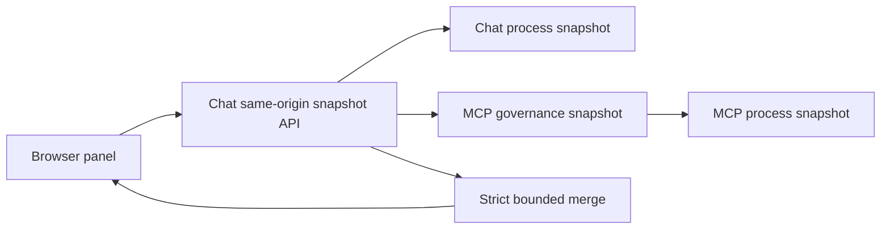

# Present governance through a same-origin observability panel

## Context

Demonstration users need to understand what governance allowed or denied, which
policy is active, and whether reliability and sandbox controls are ready. Raw
server logs are too technical and may accidentally expose data; a separate
application or cross-origin browser call would add deployment and security
complexity.

> Evidence: [`index.html`](../../../src/ai_governance_harness/chat/static/index.html) defines a complementary governance landmark beside chat.
> Evidence: [`snapshot.py`](../../../src/ai_governance_harness/governance/snapshot.py) merges strictly validated chat and MCP process views.
> Evidence: [`app.js`](../../../src/ai_governance_harness/chat/static/app.js) renders with text nodes, visible pause/refresh controls, and visibility-aware polling.

The panel must be useful for demonstration and learning while staying within
the privacy boundary in ADR 0003.

## Decision Drivers

* The panel must run with the existing one-command local workflow.
* The browser must not call MCP cross-origin.
* Allowed and denied decisions must be visible without raw logs.
* Partial dependency status must remain explicit.
* Keyboard, focus, reflow, and non-color status behavior must be built in.

## Considered Options

1. Add a responsive complementary panel to the same-origin chat application.
2. Build a separate governance dashboard application.
3. Open a popup or custom tab widget.
4. Ask users to inspect terminal logs and Toolkit CLI output.

## Decision Outcome

Choose option 1. The chat backend proxies and merges its process snapshot with
the MCP snapshot. The panel presents bounded metrics, events, policy, readiness,
circuits, sandbox posture, evidence, and privacy guarantees.

| Driver | Same-origin panel | Separate app | Popup/custom tabs | Logs only |
|--------|-------------------|--------------|-------------------|-----------|
| Local setup | Strong | Weak | Medium | Strong |
| Security simplicity | Strong | Weak | Medium | Medium |
| Accessibility | Strong | Medium | Weak | Weak |
| Demonstration clarity | Strong | Strong | Medium | Weak |
| Privacy control | Strong | Medium | Medium | Weak |

### Consequences

* Good, because users see governance next to the action it governs.
* Good, because the browser uses one origin and one security policy.
* Good, because native disclosure widgets avoid unnecessary custom ARIA.
* Bad, because wide tables require contained horizontal scrolling on narrow screens.
* Bad, because process-local history resets on restart.
* Neutral, because automatic polling is intentionally paused when the document is hidden.

### Confirmation

API tests validate privacy and partial states. Browser checks validate the inert
deny action, pause state, logical keyboard order, visible focus, accessibility
tree, axe results, and 320-pixel reflow.

## Pros and Cons of the Options

### Same-origin complementary panel

* Good, because it reuses startup, headers, and origin controls.
* Bad, because chat and observability share visual space.

### Separate application

* Good, because it can evolve independently.
* Bad, because it adds another service, port, origin, and authentication surface.

### Popup or custom tabs

* Good, because it can hide complexity until requested.
* Bad, because focus management and blocked-window behavior complicate accessibility.

### Logs only

* Good, because no UI code is required.
* Bad, because logs are unsuitable for demonstration and harder to sanitize safely.

## Architecture

## Risks and Mitigations

| Risk | Mitigation |
|------|------------|
| Snapshot contains injected markup | Render all dynamic values with `textContent`. |
| MCP is unavailable | Return a partial service state with bounded error detail. |
| Polling distracts assistive technology users | Keep the event table out of live regions and announce only user-triggered status changes. |
| Narrow layout overflows | Set grid children to `min-width: 0` and scroll tables inside labelled regions. |

## Rollback / Exit Strategy

The panel can be removed or hidden without removing governance enforcement.
Keep readiness and snapshot APIs available for diagnostics if presentation code
must be rolled back. If a privacy defect appears, disable snapshot presentation
and follow ADR 0003's recovery steps.

## Affected Components

* Browser HTML, CSS, and JavaScript.
* Chat governance APIs and MCP proxy.
* MCP operational snapshot endpoint.
* Governance event and snapshot schemas.

## Recovery and Extension Runbook

1. Verify chat and MCP readiness independently.
2. Fetch the chat snapshot API and confirm `services` shows both processes.
3. Use the inert deny button and confirm `executed: false`.
4. If rendering breaks, validate JSON first, then JavaScript syntax, then browser console/accessibility output.
5. Add new fields to the typed snapshot and privacy tests before UI rendering.
6. Add durable history or external dashboards only through a new ADR that preserves ADR 0003.
