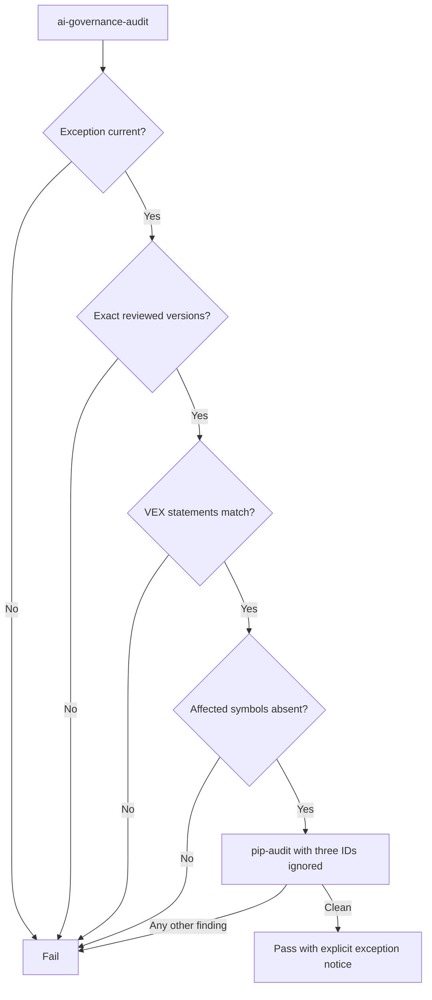

# Govern Toolkit dependency risk with an expiring VEX exception

## Context

Agent Governance Toolkit Core 4.1.0 requires
`cryptography>=46.0.7,<49.0`. The installed 48.0.1 release is reported for
three advisories whose complete remediation requires version 50 or newer.
Forcing version 50 would violate the released Toolkit contract; blocking all
local demonstration work would prevent use of already validated, unreachable
functionality.

> Evidence: [`audit-policy.yaml`](../../../security/vex/audit-policy.yaml) pins the reviewed package versions, advisory IDs, symbols, and expiry.
> Evidence: [`ai-governance-harness.openvex.json`](../../../security/vex/ai-governance-harness.openvex.json) records three reachability-backed `not_affected` statements.
> Evidence: [`security_audit.py`](../../../src/ai_governance_harness/security_audit.py) fails closed before applying narrowly scoped `pip-audit` ignores.

The affected APIs are PKCS#7 EnvelopedData decryption and the
`cryptography.x509.verification` policy builders. The application and relevant
installed dependency Python sources do not reference these entry points.

## Decision Drivers

* The team needs a runnable and reproducible local demonstration now.
* Unsupported resolver overrides must not be hidden.
* Every unrelated vulnerability must continue to fail CI.
* Exceptions must expire and be tied to exact reviewed versions and reachability.
* Human review remains accountable for the VEX determination.

## Considered Options

1. Keep the supported versions and apply a machine-validated, expiring VEX exception.
2. Force `cryptography>=50` despite Toolkit's `<49` requirement.
3. Ignore all `cryptography` vulnerabilities unconditionally.
4. Block all builds and demonstrations until an upstream Toolkit release.
5. Maintain a private patched Toolkit fork.

## Decision Outcome

Choose option 1. `ai-governance-audit` validates package versions, exception
expiry, VEX parity, and absence of affected symbols before passing exactly three
`--ignore-vuln` arguments to `pip-audit`.

| Driver | Expiring VEX gate | Force v50 | Broad ignore | Block all work | Private fork |
|--------|-------------------|-----------|--------------|----------------|--------------|
| Toolkit support contract | Strong | Weak | Strong | Strong | Weak |
| Security transparency | Strong | Medium | Weak | Strong | Medium |
| Team usability now | Strong | Medium | Strong | None | Medium |
| Automatic expiry | Strong | None | None | Not applicable | Medium |
| Maintenance cost | Medium | Medium | Low | High | High |

### Consequences

* Good, because only reviewed advisory IDs are ignored.
* Good, because expiry, version drift, evidence drift, and reachability drift fail CI.
* Good, because the supported Toolkit dependency contract remains intact.
* Bad, because the vulnerable component remains installed.
* Bad, because source-symbol analysis cannot prove behavior hidden behind native or dynamic calls with absolute certainty.
* Bad, because maintainers must reassess by 13 November 2026.
* Neutral, because VEX `not_affected` describes this product's execution path, not the component's general security.

### Confirmation

CI runs `ai-governance-audit`. Unit tests prove valid, expired, and version-drift
behavior. Maintainers review the OpenVEX statements and use the ordinary audit
without exceptions after a compatible Toolkit upgrade.

## Pros and Cons of the Options

### Expiring VEX gate

* Good, because it is narrow, evidence-backed, and self-invalidating.
* Bad, because it requires periodic human review.

### Force cryptography 50

* Good, because the advisories are fixed.
* Bad, because the combination is outside Toolkit 4.1.0 metadata and support.

### Broad ignore

* Good, because CI becomes immediately green.
* Bad, because future findings and changed reachability can pass silently.

### Block all work

* Good, because no exception is accepted.
* Bad, because a local read-only demonstration is unavailable despite bounded evidence.

### Private fork

* Good, because constraints and patches can be controlled.
* Bad, because PyPI/CFS portability and upstream support are lost.

## Architecture

## Risks and Mitigations

| Risk | Mitigation |
|------|------------|
| Exception becomes permanent | Hard expiry in CI and this ADR's review date. |
| Package upgrade changes behavior | Exact version checks fail before audit. |
| New code calls an affected API | Scan product and relevant distribution Python sources on every audit. |
| Advisory alias changes | Keep canonical PYSEC IDs in policy and aliases in OpenVEX. |
| Reachability confidence is challenged | Revert statements to `under_investigation` and block the audit until reviewed. |

## Rollback / Exit Strategy

The preferred exit is a released Toolkit version compatible with
`cryptography>=50`. Upgrade in a branch, remove the exception arguments and
policy, issue a new OpenVEX revision marking statements `fixed`, then run the
full suite and local acceptance. If evidence becomes uncertain before an
upgrade, remove the ignores and allow CI to fail.

## Affected Components

* Toolkit and cryptography dependency resolution.
* OpenVEX and operational audit policy.
* Audit entry point and CI quality job.
* Team security and upgrade documentation.

## Recovery and Extension Runbook

1. Run `ai-governance-audit` and read the first failed precondition.
2. For expiry, check for a compatible released Toolkit before extending; extension requires a new human-reviewed VEX revision and ADR update.
3. For version drift, do not edit expected versions until compatibility and reachability tests pass.
4. For symbol drift, identify the new call path and change VEX status to `under_investigation` or `affected`.
5. For a new advisory, audit it independently; never append an ID merely to make CI pass.
6. For upstream resolution, remove the exception completely and supersede this ADR.
