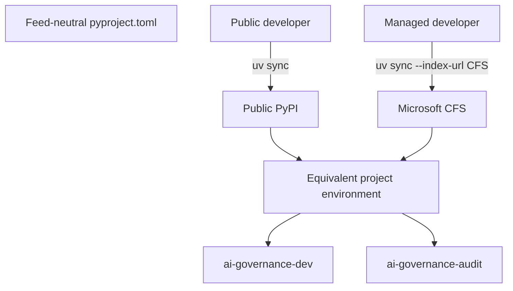

# Use feed-neutral manifests and repeatable team commands

## Context

Some teammates install from public PyPI while Microsoft-managed environments
use CFS as the single package index. Embedding either feed in project metadata
would reduce portability. At the same time, exact Toolkit behavior, predictable
virtual-environment activation, and standard service/audit commands are needed
for a repeatable demonstration.

> Evidence: [`pyproject.toml`](../../../pyproject.toml) is the only dependency and console-script contract.
> Evidence: [`.env.example`](../../../.env.example) documents safe local service and governance defaults without secrets.
> Evidence: [`README.md`](../../../README.md) documents public PyPI, CFS, startup, validation, and troubleshooting workflows.

The repository intentionally does not treat a CFS-resolved lock file as the
portable authority because it embeds feed-specific artifact URLs. Exact
Toolkit pins and fail-closed validation protect the governance boundary while
other compatible dependencies remain resolver-managed.

## Decision Drivers

* Public and Microsoft-managed developers need supported installation paths.
* Feed selection must not create dependency-confusion through mixed indexes.
* Toolkit behavior must remain exact during the temporary VEX exception.
* One command must start both services and one command must audit dependencies.
* Environment examples must be safe to commit and easy to copy.

## Considered Options

1. Keep `pyproject.toml` feed-neutral, pin Toolkit 4.1.0, and document separate single-index commands.
2. Commit a CFS-generated lock file as the universal team contract.
3. Use CFS as an extra index alongside public PyPI.
4. Maintain separate requirements files for each feed.
5. Containerize the full developer environment immediately.

## Decision Outcome

Choose option 1. Use `uv sync --all-extras` with the environment's approved
single index. Keep console scripts for MCP, chat, combined startup, and audit.
Use `.env.example` as the safe configuration template.

| Driver | Feed-neutral manifest | CFS lock | Extra index | Multiple requirements | Container |
|--------|-----------------------|----------|-------------|-----------------------|-----------|
| Public/CFS portability | Strong | Weak | Medium | Medium | Strong |
| Dependency-confusion resistance | Strong | Strong | Weak | Medium | Strong |
| Single source of truth | Strong | Strong | Weak | Weak | Medium |
| Local simplicity | Strong | Strong | Strong | Medium | Weak |
| Exact Toolkit behavior | Strong | Strong | Medium | Medium | Strong |

### Consequences

* Good, because teammates use the same project metadata and commands.
* Good, because CFS is a replacement index, never an extra index.
* Good, because exact Toolkit pins align with the VEX audit policy.
* Bad, because transitive packages can resolve differently over time when no portable lock is committed.
* Bad, because teammates must know which approved single index applies to their machine.
* Neutral, because future reproducibility improvements may introduce generated constraints or separate trusted lock artifacts.

### Confirmation

Validate clean installation from each supported feed in its appropriate
environment, package build contents, all console scripts, readiness, tests,
Toolkit checks, SBOM generation, and `ai-governance-audit`.

## Pros and Cons of the Options

### Feed-neutral manifest and commands

* Good, because the repository remains portable.
* Bad, because exact transitive reproducibility is limited.

### CFS lock as universal contract

* Good, because package hashes and versions are exact.
* Bad, because embedded internal feed URLs do not work for public users.

### Extra index

* Good, because packages can fall back across feeds.
* Bad, because mixed indexes increase dependency-confusion risk.

### Multiple requirements files

* Good, because each environment can pin independently.
* Bad, because declarations drift and duplicate `pyproject.toml`.

### Containerized development

* Good, because runtime dependencies can be fully pinned.
* Bad, because it adds tooling and image maintenance beyond the local demo need.

## Architecture

## Risks and Mitigations

| Risk | Mitigation |
|------|------------|
| Transitive drift changes behavior | Exact-pin critical Toolkit packages and fail audit on reviewed-version drift. |
| User combines indexes | Document CFS as the single index and avoid `--extra-index-url`. |
| Local `.env` leaks secrets | Commit only `.env.example`; keep `.env` ignored. |
| Console script is stale after edits | Run `uv sync --all-extras` before demonstration. |
| Port conflict breaks launcher | Preflight configured ports and document separate-service troubleshooting. |

## Rollback / Exit Strategy

If a feed cannot resolve the supported set, preserve `pyproject.toml` and use
the other approved single feed temporarily; do not introduce a mixed-index
fallback. Revert critical version changes to the last validated set. A future
portable lock strategy must be adopted through a superseding ADR.

## Affected Components

* Dependency and build metadata.
* Virtual environment and VS Code configuration.
* Environment template and local launcher.
* CI installation, validation, SBOM, and audit commands.

## Recovery and Extension Runbook

1. Delete no shared files; create or repair `.venv` with the approved Python 3.11-3.13 interpreter.
2. Public users run `uv sync --all-extras`; managed users select CFS as the sole index.
3. Copy `.env.example` to `.env` and add only local values; never commit `.env`.
4. Run `ai-governance-audit`, focused tests, then `ai-governance-dev`.
5. Verify both readiness endpoints before opening the panel.
6. When adding a critical dependency, decide whether it needs an exact pin and update audit evidence.
7. Supersede this ADR if the team adopts a portable lock, container, or centrally managed environment.
