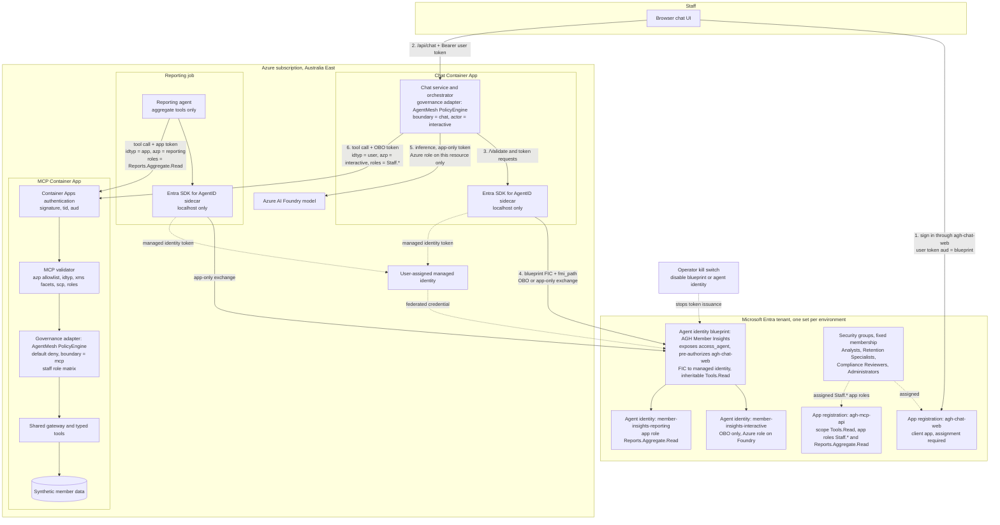

# Use Microsoft Entra Agent ID for agent identity

## Context

The harness has one reasoning agent, the chat orchestrator, which calls an
Azure AI Foundry model and chooses MCP tools that read synthetic member data.
Today it sends no credential to MCP, the toolkit evidence marks hosted principal
validation as deferred, and OWASP ASI03 is partial because end-user identity is
not propagated. The security plan requires Entra ID for all staff, agent access
inherited from the signed-in user, four staff roles, and authorization enforced
outside the model.

Microsoft Entra Agent ID gives agents a dedicated identity type: a blueprint
holds credentials and policy, and agent identities created from it act on
behalf of users (OBO) or autonomously. Microsoft guidance says not to represent
an agent with an app registration, a plain service principal, or a user
account.

> Evidence: [`security.py`](../../../src/ai_governance_harness/mcp_server/security.py) validates hosted Easy Auth headers (`tid`, `aud`, `scp`) but no roles or actor.
> Evidence: [`agt-runtime-evidence.yaml`](../../../src/ai_governance_harness/governance/agt-runtime-evidence.yaml) records `hosted_principal_validation: deferred`.
> Evidence: [Plan your agent identity architecture](https://learn.microsoft.com/en-us/entra/agent-id/how-to-plan-agent-identity-architecture) recommends one blueprint per trust boundary and one agent identity per logical agent.

How should the harness identify its agents and carry staff identity to the MCP
boundary when it is hosted?

## Decision Drivers

* Staff identity must reach MCP so authorization uses the staff member's role (security plan §5).
* Each agent needs least privilege, its own audit trail, and an independent kill switch.
* Agents must not be modeled as app registrations, service principals, or users (Microsoft guidance).
* The in-process default-deny governance gateway must stay in the request path (ADR 0001, ADR 0002).
* No client secrets in hosted environments; credentials isolated per environment.
* The Python runtime must be supported without hand-written token exchange.

## Considered Options

1. Self-hosted orchestrator with a repository-provisioned blueprint per environment, two agent identities, and the Entra SDK for AgentID sidecar.
2. Move orchestration to Foundry Agent Service and use its auto-provisioned agent identity.
3. Use a managed identity or app registration per service as the agent's identity.
4. One agent identity per environment that performs both OBO and app-only calls.

## Decision Outcome

Chosen option: "Self-hosted orchestrator with a repository-provisioned
blueprint", because it is the only option that follows Agent ID guidance while
keeping the governance gateway in the request path.

Per environment (development, production):

* **Blueprint** `AGH Member Insights ({env})`:
  * a user sponsor and technical owners;
  * a user-assigned managed identity as its federated credential;
  * exposes `access_agent`, and pre-authorizes the chat client app;
  * the MCP `Tools.Read` scope as an inheritable delegated permission.
* **Agent identity** `member-insights-interactive`:
  * acts on behalf of signed-in staff (OBO) to call MCP;
  * holds an inference-only Azure role on the Foundry resource.
* **Agent identity** `member-insights-reporting`:
  * calls MCP app-only with the `Reports.Aggregate.Read` app role;
  * limited to the aggregate tools.
* **Chat client app registration** `agh-chat-web`:
  * staff sign in through it and receive a user token for the blueprint;
  * assignment required, assigned to the four staff security groups.
* **MCP API app registration** `agh-mcp-api`:
  * a protected resource API, not an agent;
  * `Tools.Read` scope, `Staff.*` app roles assigned to security groups, and the `Reports.Aggregate.Read` app role.
* **Token acquisition:** the chat service and the reporting job use the Entra
  SDK for AgentID sidecar on localhost (`/Validate`, `/AuthorizationHeader`,
  `/AuthorizationHeaderUnauthenticated`).
* **MCP validation:** checks `tid`, `aud`, `scp` or `roles`, the `azp` allowlist,
  `idtyp`, and the `xms_act_fct`/`xms_sub_fct` facets before governance runs.
* **Deferred:** Conditional Access for agents needs Microsoft 365 E7 or
  Agent 365 plus Entra P1/E3, which the tenant does not have.

| Driver | Self-hosted + blueprint | Foundry Agent Service | Managed identity or app registration | Single agent identity |
|--------|-------------------------|-----------------------|--------------------------------------|-----------------------|
| Staff identity at MCP | Strong | Strong | Weak | Strong |
| Follows Agent ID guidance | Strong | Strong | None | Medium |
| Least privilege per agent | Strong | Medium | Weak | Weak |
| Governance gateway in path | Strong | Weak | Strong | Strong |
| Implementation effort | Medium | Low | Low | Medium |

### Consequences

* Good, because staff role and agent identity reach MCP in validated token claims.
* Good, because the interactive identity never holds the aggregate app role, so a hijacked chat turn cannot switch to app-only access.
* Good, because disabling the blueprint or one agent identity stops its tokens.
* Good, because no client secrets exist in any environment.
* Bad, because the repository owns provisioning, and the role requests and admin consent it depends on.
* Bad, because the sidecar adds a container per service, and hosting it on Azure Container Apps is undocumented.
* Bad, because the earlier plan to use the chat managed identity for the MCP token is replaced and must be re-planned.
* Neutral, because Conditional Access for agents can be added later without changing the topology.

### Confirmation

* Hosted acceptance proves that a staff OBO token reaches MCP with
  `idtyp=user` and the interactive `azp`, and that the reporting app-only token
  carries `idtyp=app`.
* An identity admin confirms in a production handshake: the blueprint, sponsor,
  consent, managed-identity credential, and the absence of secrets.

## Pros and Cons of the Options

### Self-hosted orchestrator with a repository-provisioned blueprint

* Good, because it follows Agent ID guidance and keeps governance in-process.
* Bad, because tenant roles (Agent ID Developer) and admin consent are prerequisites.

### Foundry Agent Service identity

* Good, because Foundry provisions the blueprint and handles token exchange.
* Bad, because orchestration leaves the harness, and unpublished agents share one project identity.

### Managed identity or app registration as the agent

* Good, because it is familiar and needs no sidecar.
* Bad, because it has no sponsor, no agent-specific audit, and no blueprint lifecycle, and Microsoft guidance rejects it.

### Single agent identity for both patterns

* Good, because there are fewer directory objects.
* Bad, because the interactive path would hold aggregate app-only access, and the audit trail mixes both patterns.

## Architecture

Numbered edges follow one staff chat turn. Dotted edges are credential,
assignment, or control relationships.

## Risks and Mitigations

| Risk | Mitigation |
|------|------------|
| No Agent ID Developer role or admin consent in the tenant | Use the local mock (ADR 0010) until access is granted; alternatively, an admin creates the blueprints and adds a developer as owner. |
| Sidecar unsupported on Azure Container Apps | Run a development spike first; fall back to AKS with Workload ID. |
| The browser cannot obtain a blueprint-audience token through Container Apps authentication | Fall back to MSAL authorization code with PKCE in the browser. |
| `xms_*` claims missing from MCP tokens | Inspect development tokens; configure optional claims on the MCP API registration; MCP denies when they are absent. |
| Conditional Access for agents not licensed | Rely on the blueprint kill switch, sponsors, sign-in alerts, and MCP enforcement. |

## Rollback / Exit Strategy

Disable the affected agent identity or blueprint in Entra; MCP then rejects its
tokens and the harness fails closed. Do not fall back to anonymous or managed
identity access to MCP. To leave Agent ID entirely, write a superseding ADR.

## Affected Components

* Chat service token acquisition and Bearer handling.
* MCP request security, hosted settings, and claim normalization.
* Foundry client credential in hosted mode.
* Toolkit runtime evidence and OWASP ASI03 evidence.
* Infrastructure as code for Entra objects, managed identity, and Container Apps.

## Recovery and Extension Runbook

1. Check that the blueprint and both agent identities are enabled and have current sponsors.
2. Confirm that the managed-identity federated credential matches the hosting environment.
3. Decode a development MCP token and confirm `aud`, `azp`, `idtyp`, `scp` or `roles`, and `xms_act_fct`.
4. To add an agent, create an agent identity under the same blueprint when it shares the runtime; create a new blueprint when it crosses a trust boundary.
5. Never add a client secret to fix an authentication failure in a hosted environment.
