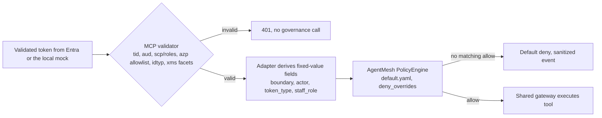

# Enforce agent and staff identity through governance policy context

## Context

The governance adapter evaluates every decision with
`agentmesh.governance.PolicyEngine` (Agent Governance Toolkit 4.1) against a
snapshot of `action`, a bounded `governance` context, and optional `data`.
Today the policy conditions on `action.type` and `data.advice_*` fields only,
and the context carries a workload ID, environment, authentication outcome, and
principal hash. ADR 0008 brings validated agent and staff identity to the chat
and MCP processes, and the security plan requires a role-based tool matrix
enforced outside the model.

AgentMesh also ships an identity layer: agent identifiers (DIDs),
`EntraAgentRegistry`, `EntraAgentID`, and a trust-gated MCP server. Its Entra
support maps an AgentMesh identifier to a managed identity or app registration.
It does not implement the Agent ID blueprint token exchange or OBO, and token
checks there are claim-level only. The toolkit's own reference architecture
assigns identity to Entra and per-action authorization to the toolkit.

> Evidence: [`engine.py`](../../../src/ai_governance_harness/governance/engine.py) loads the policy into `PolicyEngine(conflict_strategy="deny_overrides")`.
> Evidence: [`context.py`](../../../src/ai_governance_harness/governance/context.py) defines the bounded `GovernanceContext`.
> Evidence: [Tutorial 31 — Bridging AGT Identity with Microsoft Entra Agent ID](https://microsoft.github.io/agent-governance-toolkit/tutorials/31-entra-agent-id-bridge/) lists claim-level-only token verification and one-way manual lifecycle sync as known gaps.

How should validated identity drive governance decisions, and which parts of
AgentMesh should the harness use?

## Decision Drivers

* Authorization must happen outside the model, at both the chat and MCP boundaries (ADR 0002, security plan).
* Missing or unrecognised identity must result in deny.
* Public Preview toolkit APIs must stay inside the adapter (ADR 0001).
* Chat and MCP load the same policy file, but only MCP receives staff roles.
* Telemetry must not carry raw identity claims (ADR 0003).
* Entra must remain the only identity authority.

## Considered Options

1. Add fixed-value identity fields to the governance context and write identity-aware policy rules; use no AgentMesh identity APIs.
2. Option 1 plus an `EntraAgentRegistry` correlation bridge that gives each Entra agent identity an AgentMesh identifier.
3. Adopt full AgentMesh identity: AgentMesh identifiers, trust handshakes, and the trust-gated MCP server.
4. Enforce identity in MCP code only, with no identity conditions in policy.

## Decision Outcome

Chosen option: "Fixed-value identity fields in policy context", because it uses
the AgentMesh engine already in place, fails closed when identity is missing,
and keeps Entra as the only identity authority.

The adapter derives four fields from validated claims and adds them to
`GovernanceContext`. Raw `oid`, `azp`, and UPN never leave memory.

| Field | Values | Derived from | Available in |
|-------|--------|--------------|--------------|
| `governance.boundary` | `chat`, `mcp`, `local` | Process configuration; `local` for token-less stdio and CLI callers | All |
| `governance.actor` | `interactive`, `reporting` | `azp` matched against the environment's allowlisted agent identity IDs | MCP; chat knows its own actor |
| `governance.token_type` | `user`, `app` | `idtyp`, `xms_act_fct`/`xms_sub_fct` containing `11`, and not `xms_sub_fct` containing `13` | MCP |
| `governance.staff_role` | `analyst`, `retention_specialist`, `compliance_reviewer`, `administrator`, `none` | `Staff.*` values in the MCP API `roles` claim | MCP |

The MCP-boundary pre-tool allow rules implement this staff role matrix.
Everything else stays default deny.

| Caller | Aggregate tools | Member-level tools | Outreach case |
|--------|-----------------|--------------------|---------------|
| Analyst (OBO) | Allow | Deny | Deny |
| Retention Specialist (OBO) | Allow | Allow | Allow, MCP elicitation still required |
| Compliance Reviewer (OBO) | Deny | Deny | Deny |
| Administrator (OBO) | Deny | Deny | Deny |
| Reporting agent (app-only) | Allow | Deny | Deny |

Rule conventions:

* Staff rules and reporting rules are separate. The condition parser splits on
  ` or ` before ` and ` and has no parentheses.
* Chat-side pre-tool rules check `boundary == 'chat'` and the actor only.
  Staff roles are enforced at the MCP boundary.
* Existing `data.advice_scan_status` post-tool conditions are unchanged.

```yaml
- name: allow-member-profile-retention-specialist
  stage: pre_tool
  condition: "action.type == 'get_member_profile' and governance.boundary == 'mcp' and governance.actor == 'interactive' and governance.token_type == 'user' and governance.staff_role == 'retention_specialist'"
  action: allow
- name: allow-cohort-analytics-reporting
  stage: pre_tool
  condition: "action.type == 'get_cohort_churn_analytics' and governance.boundary == 'mcp' and governance.actor == 'reporting' and governance.token_type == 'app'"
  action: allow
```

AgentMesh identity APIs (`agentmesh.identity.*`, Citadel `EntraIdentityBridge`,
`TrustGatedMCPServer`) are not imported.

| Driver | Policy-context fields | Plus registry bridge | Full AgentMesh identity | MCP code only |
|--------|-----------------------|----------------------|-------------------------|---------------|
| Fails closed on missing identity | Strong | Strong | Medium | Strong |
| Entra as only identity authority | Strong | Medium | Weak | Strong |
| Preview API exposure | Low | Medium | High | Low |
| Policy reviewability | Strong | Strong | Medium | Weak |
| Effort | Medium | Medium | High | Low |

### Consequences

* Good, because the role matrix is one reviewable policy file, evaluated by the existing engine.
* Good, because a missing identity field evaluates false, so identity-aware allow rules fall through to default deny.
* Good, because no new preview APIs or per-process identity state are introduced.
* Bad, because the `boundary` field is required, and chat and MCP need different rule sets in the same file.
* Bad, because AgentMesh treats a condition-evaluation error as a match, which fails open for an allow rule; fields must stay validated enums.
* Bad, because existing anonymous tests and README flows need tokens or the local persona from ADR 0010.
* Neutral, because AgentMesh trust handshakes can be reconsidered if a second agent is added.

### Confirmation

* Matrix tests cover every role, actor, token type, and boundary for each tool.
* Negative tests prove that missing, unknown, or malformed identity fields are denied.
* `agt lint-policy --strict` passes on the updated policy.
* An import test asserts that no `agentmesh.identity` imports exist.

## Pros and Cons of the Options

### Policy-context fields

* Good, because it extends the current adapter contract with the smallest change.
* Bad, because rule authors must remember the `boundary` field.

### Registry correlation bridge

* Good, because toolkit audit records would carry Entra object IDs.
* Bad, because the registry is per-process, in-memory state that drifts from Entra, and duplicates the Entra disable switch.

### Full AgentMesh identity

* Good, because it offers multi-agent trust features.
* Bad, because it runs a parallel identity system next to Entra and replaces OAuth at MCP with trust scores; its MCP support is Alpha.

### MCP code only

* Good, because it is simple to implement.
* Bad, because authorization logic leaves the reviewable policy and governance evidence.

## Architecture



## Risks and Mitigations

| Risk | Mitigation |
|------|------------|
| Condition-evaluation error counted as a match on an allow rule | Keep fields as validated enums; add negative tests for every identity-aware rule. |
| Role-conditioned rule written without `boundary` | Review checklist, plus a test that runs the same policy in both processes. |
| `agt lint-policy --strict` rejects new conditions | Run lint during planning; simplify the conditions if needed. |
| AgentMesh preview upgrade changes the condition grammar | ADR 0001 version pin and adapter compatibility tests. |

## Rollback / Exit Strategy

Revert the policy file and adapter changes together; tools return to the
pre-identity allow rules under default deny. Do not remove default deny or
widen allow rules to work around an identity defect.

## Affected Components

* Governance context model and adapter snapshot.
* Packaged default policy.
* MCP and chat request middleware that populate the context.
* Policy, privacy, and import-boundary tests.

## Recovery and Extension Runbook

1. Reproduce a denial with the governance panel and the matched-rule field.
2. Confirm the four identity fields in the in-memory context (tests only; never log raw claims).
3. When adding a tool, add its allow rule for each permitted role and actor at the MCP boundary, plus negative tests.
4. When adding a role, add a `Staff.*` app role, a `staff_role` enum value, matrix rules, and tests in one change.
