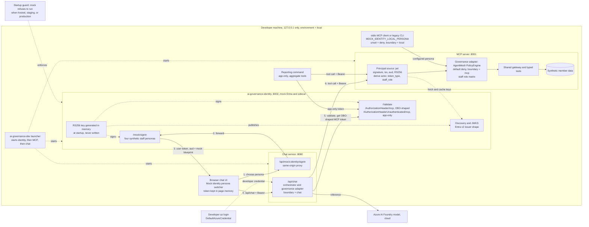

# Use a local-only mock Entra Agent ID issuer for the MVP

## Context

ADR 0008 selects Microsoft Entra Agent ID, and ADR 0009 makes governance
decisions depend on validated agent and staff identity. Creating agent identity
blueprints requires the Agent ID Developer role and admin consent of Agent ID
Graph permissions. The developer has neither and cannot obtain them for the
hackathon. The MVP still needs to demonstrate staff identity reaching MCP,
OBO and app-only agent tokens, and the staff role matrix.

> Evidence: [Create an agent identity blueprint](https://learn.microsoft.com/en-us/entra/agent-id/create-blueprint) requires Agent ID Developer or Agent ID Administrator, and admin consent of `AgentIdentityBlueprint.Create`.
> Evidence: [`security.py`](../../../src/ai_governance_harness/mcp_server/security.py) treats non-hosted requests as `local-development` with no authentication, which is the seam for a pluggable principal source.
> Evidence: [Token claims reference for agent IDs](https://learn.microsoft.com/en-us/entra/agent-id/agent-token-claims) defines the OBO and app-only claim shapes the mock reproduces.

How can the MVP prove the identity design without tenant access, without
creating a production bypass?

## Decision Drivers

* Demonstrate staff OBO, reporting app-only, and the staff role matrix end to end.
* Exercise the same signature, claim, and policy code paths that real Entra will use.
* Switch to real Entra Agent ID by configuration, not by rewriting validation.
* The mock must never run in hosted, staging, or production environments.
* Keep the browser same-origin (ADR 0005) and keep tokens out of storage and telemetry (ADR 0003).
* Keep stdio MCP and the legacy CLI usable without bypassing the role matrix.

## Considered Options

1. A signed-token mock issuer as a separate local service, with sidecar-compatible endpoints and a public signing key (JWKS).
2. An unsigned in-process claims stub trusted in local mode.
3. Faked Container Apps authentication headers injected by a local proxy.
4. A mock issuer embedded in the chat process.

## Decision Outcome

Chosen option: "Signed-token mock issuer as a separate local service", because
it is the only option that exercises real signature and claim validation while
keeping the signing key out of the chat and MCP processes.

**`ai-governance-identity`** on `127.0.0.1:8002`, started first by `ai-governance-dev`:

* An RS256 key generated in memory at startup and never written.
* Entra v2-shaped discovery and JWKS.
* `/mock/signin` for four synthetic staff personas.
* Sidecar-compatible `/Validate`, `/AuthorizationHeader/mcp` (OBO-shaped),
  `/AuthorizationHeaderUnauthenticated/mcp` (app-only), and `/healthz`.
* Tokens carry the claim shapes from ADR 0008: `aud`, `azp`, `idtyp`, `scp` or
  `roles`, and `xms_act_fct`/`xms_sub_fct`.
* Unknown agent identities, and agent identities used on the wrong endpoint,
  are rejected.

**Chat:**

* The browser chooses a persona through a labelled "Mock identity" switcher and
  `/api/mock-identity/signin`, a same-origin route that forwards to the mock.
* The token is kept in page memory and sent as a Bearer token to `/api/chat`.
* Chat validates the token through `/Validate`, and gets an OBO-shaped MCP
  token for each tool call.

**MCP:** a principal-source setting chooses `easy_auth` (hosted, existing) or
`jwt`. The `jwt` source verifies the signature against the JWKS, pins issuer,
audience and algorithm, and derives the ADR 0009 identity fields. Anything
missing or unrecognised is denied.

**Token-less callers:** stdio MCP and the legacy CLI use an opt-in
`MOCK_IDENTITY_LOCAL_PERSONA` with `boundary = local`. When it is unset, they
are denied.

**Reporting:** a small app-only reporting command demonstrates the second agent
identity.

**Guard:** the identity service, the chat mock routes, and the MCP `jwt` mock
trust all refuse to start unless the environment is `local`, `development`, or
`test` and the service is not hosted. All identifiers are synthetic, and the UI
and governance panel label the identity as mock.

**Foundry:** Foundry inference keeps `DefaultAzureCredential` (developer
sign-in), because the mock cannot issue Azure tokens. ADR 0008's agent identity
for Foundry waits for real Entra.

**Exit criterion:** supersede this ADR when Agent ID Developer access or
blueprint ownership is available and ADR 0008's development environment passes
acceptance.

| Driver | Signed mock service | Unsigned stub | Faked headers proxy | Mock in chat |
|--------|---------------------|---------------|---------------------|--------------|
| Real validation exercised | Strong | None | Weak | Strong |
| Switch to Entra by configuration | Strong | Weak | Medium | Medium |
| Key isolation from callers | Strong | Not applicable | Not applicable | Weak |
| Demonstrates OBO and app-only | Strong | Medium | Weak | Strong |
| Effort | Medium | Low | Medium | Medium |

### Consequences

* Good, because the hackathon demo shows real allow and deny outcomes driven by signed identity.
* Good, because the MCP `jwt` source and claim normalization carry over unchanged to real Entra.
* Good, because the signing key never leaves the identity process, and resets on restart.
* Bad, because a service that issues any persona is an authentication bypass if the guard is defeated.
* Bad, because the demo proves role enforcement, not role assignment, consent, Conditional Access, or Foundry agent identity.
* Bad, because a third local process and a direct `PyJWT[crypto]` dependency are added, and `cryptography` must stay below 49 (ADR 0006).
* Neutral, because restarting the identity service invalidates earlier tokens and the UI must sign in again.

### Confirmation

* Tests assert that every mock component refuses to start when hosted, `staging`, or `production`.
* Tests reject unsigned, expired, wrong-issuer, wrong-audience, and unknown-agent tokens.
* Tests deny each persona outside the ADR 0009 matrix.
* `ai-governance-audit` passes after adding the dependency.
* The README, governance panel, and OWASP ASI03 evidence state "mock identity", and toolkit evidence keeps `hosted_principal_validation: deferred`.

## Pros and Cons of the Options

### Signed-token mock service

* Good, because it mirrors the real process boundaries and sidecar API.
* Bad, because it adds a service to start, test, and document.

### Unsigned claims stub

* Good, because it is the fastest to build.
* Bad, because it proves no validation and normalizes trusting unsigned identity.

### Faked authentication headers

* Good, because it reuses the hosted Easy Auth validator.
* Bad, because it skips the chat OBO flow and turns on header trust locally.

### Mock in chat

* Good, because there is one fewer process.
* Bad, because the chat service would hold the key for tokens it is meant to obtain from elsewhere.

## Architecture

## Risks and Mitigations

| Risk | Mitigation |
|------|------------|
| Mock runs outside local mode | Startup guards in all three services, bind to `127.0.0.1`, and tests for every disallowed environment. |
| Demo read as a real Entra integration | Label the identity as mock in the UI, governance panel, README, and OWASP evidence. |
| Existing tests and README flows break under role rules | Fixtures mint mock tokens or set `MOCK_IDENTITY_LOCAL_PERSONA`; update README examples. |
| Identity service down at MCP startup | The launcher starts identity first; MCP readiness reports the JWKS state and fails closed. |
| Dependency audit drift | Pin a `PyJWT[crypto]` version compatible with `cryptography<49`; run `ai-governance-audit`. |

## Rollback / Exit Strategy

* To retire the mock:
  * switch the MCP principal source to `easy_auth`, or to `jwt` against the real Entra JWKS;
  * point chat at the real Entra SDK sidecar and remove the persona switcher;
  * remove the identity service from the launcher;
  * supersede this ADR.
* If the guard is ever found bypassable: stop the identity service, remove the
  mock routes, and restore default deny for all tool calls until it is fixed.

## Affected Components

* New local identity service and its launcher entry point.
* Chat API authentication, mock sign-in route, and UI persona switcher.
* MCP principal source configuration and `jwt` validation.
* Dependency manifest and audit.
* Tests, README, governance panel, and OWASP evidence wording.

## Recovery and Extension Runbook

1. If the UI reports an invalid token after a restart, sign in again; the signing key is regenerated on every start.
2. If MCP denies everything, check that the identity service is ready and that MCP readiness reports the JWKS as loaded.
3. To add a persona, add a synthetic persona, the matching `Staff.*` role value, and the ADR 0009 matrix rules and tests.
4. Never set a mock environment variable in a hosted deployment; the guard must reject it.
