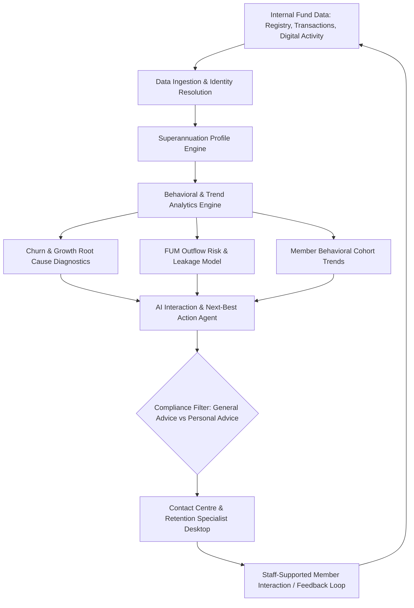

# Member Whole-of-Wealth Insights & Interaction Advisory Agent BRD

> **BRD-2026-SUPER-001** | Status: draft | Version: 0.1.0 | Last Updated: 2026-10-13

## Executive Summary

This Business Requirements Document (BRD) outlines the business requirements for an AI-powered Member Whole-of-Wealth Insights and Interaction Advisory Agent for an Australian Superannuation provider.

The superannuation fund faces member churn and significant outflow of Funds Under Management (FUM) as members transition between life stages (e.g., career moves, home purchases, retirement transition, or consolidation into self-managed super funds (SMSFs) or competing retail/industry funds). Business analysts, retention teams, and member service consultants currently lack a unified, real-time understanding of customer behavior and holistic wealth indicators, leading to reactive and sub-optimal customer engagements.

This initiative delivers an intelligence capability that aggregates member profiles and behavior signals, performs root-cause analytics on member growth and attrition, diagnoses FUM flow drivers, detects macro and cohort behavioral trends, and provides tailored analysis and recommendations based on a member's current appetite and wealth profile.

The intended business outcome and measurable success targets remain to be confirmed with the business sponsor. No attrition, FUM, or engagement target has been approved at this stage.

---

## Business Context

The Australian superannuation industry operates under extensive regulatory oversight (APRA prudential standards, ASIC licensing and disclosure, and the Corporations Act 2001 (Cth)). Over recent years, regulatory changes (such as "Your Future, Your Super" stapling reforms, Retirement Income Covenant (RIC), and Delivering Better Financial Outcomes (DBFO) legislation) have heightened competitive pressure on member retention and fund performance transparency.

Key market and organizational dynamics include:

1. **Member Portability & Inactive Account Churn:** Stapling rules and seamless rollover mechanisms (SuperMatch, ATO consolidation) allow members to switch funds with minimal friction.
2. **Funds Under Management (FUM) Volatility:** Outflows are driven by retirement drawdowns, external SMSF rollovers, non-concessional withdrawals, and proactive poaching by retail platforms.
3. **Information Asymmetry:** The initial scope is limited to data held in the fund's internal systems; it will not provide a complete view of external assets, mortgages, or accounts held outside the fund.
4. **Advice Regulatory Boundaries:** Providing "recommendations and advice" in Australian financial services is strictly governed by the distinction between Factual Information, General Advice, and Personal Advice under Chapter 7 of the Corporations Act 2001 (Cth) and ASIC Regulatory Guide 244 (RG 244).

---

## Stakeholders

| Stakeholder Role | Mendelow Power | Mendelow Interest | Engagement Strategy | Key Responsibilities |
|---|---|---|---|---|
| **Head of Member Growth & Retention** | High | High | Manage Closely | Executive Sponsor; owns member retention targets and FUM preservation. |
| **Business Analysis & Product Team** | High | High | Manage Closely | Authors requirements, defines behavioral metrics, validates analytics. |
| **Legal, Risk & Compliance (AFSL Compliance)** | High | High | Manage Closely | Ensures advice guardrails (General vs Personal advice), APPs, and APRA compliance. |
| **Member Service Operations / Contact Centre** | Medium | High | Consult and co-design | Primary users; apply agent insights while supporting member interactions. |
| **Data Engineering & Analytics Architecture** | Medium | Medium | Keep Satisfied | Data integration (registry, CRM, digital footprint, external feeds). |
| **Superannuation Fund Members** | Low | High | Keep Informed | End beneficiaries; receive relevant, timely, and compliant interactions. |

---

## Design Decisions

| ID | Title | Scope & Decision Summary | Downstream Impact |
|---|---|---|---|
| `DD-001` | Advice Boundary Baseline | Agent outputs are limited to analysis, factual information, and general guidance; personalized financial advice is out of scope. | Directs agent response phrasing, guardrails, and compliance review. |
| `DD-002` | Initial Data Scope | Profile construction uses internal superannuation data only. External financial data sources are out of scope for the initial release. | Limits the profile to information held in fund systems; any future external data expansion requires separate scope and privacy review. |
| `DD-003` | Retention Outcome Comparison | Assess outreach outcomes by comparing members who received proactive staff outreach with similar flagged members who did not. Compare six-month exit or rollover outcomes from the outreach or matched index date. Interpret results as an association, not proof that outreach caused the difference. | Use available internal member, signal, outreach, and retention records; document the cohort-matching method. |

---

## Business Goals

```text
BG-001: Improve member retention through more effective staff interactions and proactive outreach informed by tailored analysis of members' appetite and internal superannuation profiles.
Priority: MUST
KPI: Compare exit or rollover rates for members showing early disengagement signals who received proactive staff outreach with similar flagged members who did not. Interpret the comparison as an association, not proof of causation. Supporting measures: staff interaction effectiveness and proactive outreach.
Baseline: To be established.
Target: Provisional 5% relative reduction in the six-month exit or rollover rate versus the matched comparison group; validate feasibility against historical data before approval.
Timeframe: Compare exit or rollover outcomes during the six months after outreach or the matched comparison group's index date.
Measurement source: Internal member registry and staff interaction records, which the business stakeholder confirms can identify outreach, comparison cohorts, and subsequent exit or rollover outcomes.
Owner: Business sponsor to be identified.
```

**SMART Evaluation**:

- [x] **S**pecific: Improve retention through effective staff interactions and proactive outreach informed by member appetite and internal superannuation profiles.
- [ ] **M**easurable: The primary KPI is identified; signal definitions, baseline, target, and attribution method remain to be agreed.
- [ ] **A**chievable: Requires assessment after target and delivery scope are confirmed.
- [ ] **R**Relevant: To be validated with the business sponsor.
- [ ] **T**ime-bound: Timeframe is not yet defined.

**Status**: deferred (assessed at Define→Govern gate)

### Outcome Hypothesis Handoff Provenance

| Handoff ID | Source artifact | Source SHA-256 | KPI measurement source | Receipt status |
|---|---|---|---|---|
| `N/A` | Direct Discover intake | `N/A` | Member Registry & FUM Reporting Data Warehouse | `Accepted` |

---

## Business Rules

* `BR-001`: Financial Advice Regulatory Guardrails
  * **Category**: Regulatory (Corporations Act 2001 (Cth) Chapter 7, ASIC RG 244).
  * **Rationale**: Agent outputs must remain within the agreed business scope of analysis, factual information, and general guidance. The agent must not generate personalized financial advice. Compliance must validate the implementation and applicable disclosures before use.
  * **Enforceability**: Mandatory.
  * **Enforcing FRs**: `FR-004`.
* `BR-002`: Privacy & Authorized Use of Internal Member Data
  * **Category**: Regulatory / Operational (Privacy Act 1988 (Cth), Australian Privacy Principles, and fund privacy policies).
  * **Rationale**: Internal member information must be accessed and used only for authorized purposes, with appropriate access controls and privacy safeguards. External financial data ingestion is not in the initial scope.
  * **Enforceability**: Mandatory.
  * **Enforcing FRs**: `FR-001`.
* `BR-003`: APRA Prudential Compliance (CPS 234 Information Security & SPS 515 Strategic Planning)
  * **Category**: Regulatory.
  * **Rationale**: Member financial data processed by AI models must maintain strict confidentiality, access controls, and operational resilience.
  * **Enforceability**: Mandatory.
  * **Enforcing FRs**: `FR-001`, `FR-002`.

---

## Functional Requirements

- `FR-001`: Internal Superannuation Profile Aggregation
  - **Statement**: The system shall aggregate and synthesize member data held in internal fund systems—including account balance history, contributions, investment option allocations, insurance status, and interaction history—into a unified analytical view. External financial data sources are excluded.
  - **Actor**: Business Analyst, Retention Specialist, Advisory Agent Engine.
  - **Trigger**: Batch synchronization, event-driven account changes, or consultant profile lookup.
  - **Expected Outcome**: Produces an up-to-date superannuation profile with clear data provenance. The profile does not represent the member's complete wealth outside the fund.
  - **Acceptance Criteria**: Links to `AC-001`.
  - **Business Goals**: Links to `BG-001`.

- `FR-002`: Member Movement & Churn Root-Cause Analytics
  - **Statement**: The system shall analyze internal member transaction and interaction data, including contributions reduced relative to a member's usual pattern, stopped contributions, digital activity declining relative to a member's usual pattern, closure inquiries, and completed rollovers, to diagnose why members are departing, becoming inactive, or consolidating balances into the fund.
  - **Actor**: Business Analyst, Marketing/Retention Lead.
  - **Trigger**: Scheduled reporting runs or ad-hoc cohort analysis requests.
  - **Expected Outcome**: Generates root-cause attribution scores (e.g., fee sensitivity, poor digital engagement, retirement transition, life event trigger) for member growth and attrition.
  - **Acceptance Criteria**: Links to `AC-002`.
  - **Business Goals**: Links to `BG-001`.

- `FR-003`: Funds Under Management (FUM) Outflow Diagnostic & Predictive Modeling
  - **Statement**: The system shall use selected internal disengagement signals, including contributions and digital activity reduced relative to a member's usual pattern, stopped contributions, and closure inquiries, to identify and categorize potential FUM outflow events and estimate FUM at risk across member cohorts.
  - **Actor**: Business Analyst, Executive Management.
  - **Trigger**: Weekly analytics refresh or member risk threshold breach.
  - **Expected Outcome**: Delivers an interactive FUM leakage breakdown with leading risk indicators and cohort impact sizing.
  - **Acceptance Criteria**: Links to `AC-003`.
  - **Business Goals**: Links to `BG-001`.

- `FR-004`: Staff-Facing Contextual Interaction Recommendations
  - **Statement**: The system shall provide internal staff with tailored analysis, factual information, and general guidance for member interactions based on the member's profile and behavioral trends, including opportunities for proactive outreach. It shall not generate personalized financial advice.
  - **Actor**: Member service consultant or retention specialist.
  - **Trigger**: Staff member opens a member profile, prepares for a member interaction, reviews members flagged for proactive outreach, or an internal closure inquiry is recorded.
  - **Expected Outcome**: Provides staff with synthesized talking points, suggested engagement topics, and timely outreach opportunities based on the member's profile and behavioral trends, with applicable compliance guidance. A closure inquiry alone is sufficient to surface an outreach opportunity. The agent supports staff and does not communicate recommendations directly to members or provide personalized financial advice.
  - **Acceptance Criteria**: Links to `AC-004`.
  - **Business Goals**: Links to `BG-001`.

---

## Non-Functional Requirements

### Functional Suitability

- `NFR-001`: Model Explainability & Auditability
  - Rationale and attribution factors for churn risk or interaction recommendations must be inspectable by business analysts and compliance reviewers.

### Performance Efficiency

- `NFR-002`: Recommendation Latency
  - When invoked by an operator during an active interaction, the agent shall generate profile insights and guidance within 2.5 seconds (95th percentile).

### Compatibility

- `NFR-003`: Core Registry & CRM Interoperability
  - The solution shall integrate seamlessly with fund registry systems, CRM platforms, and data lakehouses via secure REST/GraphQL APIs.

### Usability

- `NFR-004`: Business User Experience
  - Analytical insights and cohort segmentation visualizations shall be accessible to non-technical business analysts without requiring manual SQL authoring.

### Reliability

- `NFR-005`: System Availability
  - The analytical and advisory recommendation service shall maintain 99.9% uptime during core business operating hours (7:00 AM – 8:00 PM AEST).

### Security

- `NFR-006`: Data Protection & APRA CPS 234 Conformance
  - All member personally identifiable information (PII) and financial balances must be encrypted in transit (TLS 1.3) and at rest (AES-256), with role-based access control (RBAC).

### Maintainability

- `NFR-007`: Model Governance & Drift Monitoring
  - Churn prediction models and recommendation algorithms must support quarterly retraining, drift logging, and versioned rollback capabilities.

### Portability

- `NFR-008`: Cloud Infrastructure Portability
  - Analytics pipelines and agent microservices shall run on containerized or managed enterprise cloud architectures conforming to standard deployment templates.

---

## Constraints

* `CON-001`: Australian Regulatory Jurisdiction
  * **Imposing source**: Australian Securities and Investments Commission (ASIC) and Australian Prudential Regulation Authority (APRA).
  * **Affected boundary**: Compliance, interaction guidance, and system operational rules.
  * **Non-negotiability**: Non-negotiable legal obligation under Australian law.
  * **Category**: Regulatory.
  * **Impact**: All advice must feature unambiguous classification and audit logging.
* `CON-002`: Data Sovereignty
  * **Imposing source**: Fund Security Policy and APRA Prudential Guidance.
  * **Affected boundary**: Infrastructure and cloud hosting regions.
  * **Non-negotiability**: All member data and AI processing must remain within Australian sovereign boundaries (e.g., Australia East / Southeast regions).
  * **Category**: Technical / Compliance.
  * **Impact**: Cloud models and databases must be provisioned strictly in Australian data centers.

---

## Process Models



---

## Acceptance Criteria

- `AC-001`: Internal Superannuation Profile Verification
  - **Given** a registered superannuation member with active super balance and historical contributions,
  - **When** the profile is requested by the agent or business analyst,
  - **Then** the system displays a unified superannuation profile including balance trajectory, contribution consistency, and data provenance within 2 seconds, without implying coverage of external wealth.
  - **Covers**: `FR-001`.
  - **Status**: Not Started.

- `AC-002`: Churn Root-Cause Attribution
  - **Given** a designated member cohort that rolled out balances or closed accounts over the trailing 6 months,
  - **When** a business analyst runs the member attrition diagnostic,
  - **Then** the system reports contributing factors, including contribution changes, declining digital engagement, and closure inquiries where present, and distinguishes observed evidence from inferred causes.
  - **Covers**: `FR-002`.
  - **Status**: Not Started.

- `AC-003`: FUM Outflow Prediction and Cohort Risk
  - **Given** active members with contributions reduced relative to their usual pattern, stopped contributions, declining digital engagement, or a closure inquiry,
  - **When** the FUM predictive risk model evaluates the member base,
  - **Then** it identifies members who meet thresholds agreed for these signals and presents estimated potential FUM outflow and the observed risk indicators. The contribution baseline, reduction threshold, and observation window remain to be defined.
  - **Covers**: `FR-003`.
  - **Status**: Not Started.

- `AC-004`: Staff Interaction and Proactive Outreach Guidance
  - **Given** an internal member record contains a closure inquiry and no other disengagement signal,
  - **When** a member service consultant reviews the member's profile,
  - **Then** the agent surfaces an outreach opportunity with relevant context and applicable compliance guidance, without contacting the member or providing personalized financial advice.
  - **Covers**: `FR-004`.
  - **Status**: Not Started.

---

## Traceability Matrix

### FR-to-AC Coverage

| Functional Requirement | Acceptance Criteria | Coverage Status |
|---|---|---|
| `FR-001` | `AC-001` | Covered |
| `FR-002` | `AC-002` | Covered |
| `FR-003` | `AC-003` | Covered |
| `FR-004` | `AC-004` | Covered |

*Coverage*: 100.0% (4 of 4 FRs linked to at least one AC).

### FR-to-BG Alignment

| Functional Requirement | Business Goal | Alignment Status |
|---|---|---|
| `FR-001` | `BG-001` | Aligned |
| `FR-002` | `BG-001` | Aligned |
| `FR-003` | `BG-001` | Aligned |
| `FR-004` | `BG-001` | Aligned |

*Coverage*: 100.0% (4 of 4 FRs linked to BG-001).

### BR-to-FR Enforcement

| Business Rule | Enforcing Functional Requirement |
|---|---|
| `BR-001` (Advice Regulatory Guardrails) | `FR-004` |
| `BR-002` (Privacy & Authorized Use of Internal Member Data) | `FR-001` |
| `BR-003` (APRA CPS 234 Security) | `FR-001`, `FR-002` |

---

## Risks and Assumptions

### Key Assumptions

| ID | Assumption | Evidence status | Impact if false | Mitigation | Source |
|---|---|---|---|---|---|
| `ASM-001` | Internal data registry and CRM logs contain sufficient historical event granularity to train churn and FUM attrition models. | Untested | High | Conduct rapid data feasibility audit on historical transaction logs. | BRD Discovery |
| `ASM-002` | Interaction advice will operate primarily within General Advice or Intra-fund Simple Advice boundaries without triggering complex full Statement of Advice (SOA) mandates. | Partially supported | Critical | Review guidance rules directly with AFSL Compliance team. | BRD Discovery |
| `ASM-003` | Internal fund systems contain sufficiently current member appetite and preference information to support tailored analysis. | Untested | Medium | Validate the availability, quality, and recency of appetite and preference data with data owners. | BRD Discovery |

### Risk Register

| Risk Statement | Probability | Impact | Mitigation Action |
|---|---|---|---|
| **Regulatory Misclassification:** Agent-generated recommendations could be deemed unlicensed Personal Advice under ASIC RG 244. | Medium | High | Implement strict output filtering, deterministic prompt guardrails, and mandatory disclaimer banners verified by AFSL Compliance. |
| **Data Quality & Sparsity:** Fragmented member transaction logs could lead to inaccurate behavioral attribution or false churn alarms. | High | Medium | Establish a Minimum Data Completeness threshold before triggering automated risk scoring or consultant nudges. |
| **Consultant Adoption Resistance:** Contact centre staff may bypass AI recommendations if rationale is opaque or workflow is intrusive. | Medium | Medium | Co-design UI recommendations with frontline consultants and provide transparent "why this recommendation" attribution. |

---

## Open Questions

| ID | Question or gap | Why it matters | Owner | Target date | Status | Rationale for deferral | Target phase | Source |
|---|---|---|---|---|---|---|---|---|
| `Q-001` | Will the agent be solely internal or also interact directly with members? | Dictates conversational safety controls, authentication depth, and UI scope. | Business Analyst / Product Lead | 2026-10-20 | Resolved | Initial scope is an internal staff co-pilot; it will not communicate directly with members. | — | BRD Discovery |
| `Q-002` | Should external financial data sources be considered in a future release? | Could expand profile coverage and would require separate scope, privacy, and consent assessment. | Product Lead / Data Architect | 2026-10-25 | Deferred | External data sources are excluded from the initial release. | Future-Release | BRD Discovery |
| `Q-003` | Has Compliance validated that the agreed analysis, factual information, and general guidance boundary is appropriate for this use? | Confirms that output scope and controls align with the fund's obligations. | AFSL Compliance Officer | 2026-10-22 | Open | — | — | BRD Discovery |
| `Q-004` | What member-relative contribution reduction threshold and observation window should trigger a disengagement signal? | The threshold and baseline period must distinguish meaningful changes from normal contribution variation. | Retention Lead / Data Analytics Lead | 2026-10-27 | Open | Calibrate criteria using historical fund data and validate them with the retention team. | — | BRD Discovery |
| `Q-005` | What digital activity decline threshold and observation window should trigger a disengagement signal? | The comparison should account for each member's usual activity and distinguish meaningful decline from normal usage variation. | Digital Product Lead / Data Analytics Lead | 2026-10-27 | Open | Calibrate the threshold and observation window using historical fund data and validate them with the digital product and analytics teams. | — | BRD Discovery |
| `Q-006` | Do internal systems record staff outreach and subsequent member exit or rollover outcomes? | The selected comparison approach depends on reliable records of outreach exposure and retention outcomes. | Retention Lead / CRM Data Owner | 2026-10-29 | Resolved | Business stakeholder confirms internal systems reliably identify members who received outreach and whether they later exited or rolled over. | — | BRD Discovery |
| `Q-007` | Can internal data identify comparable flagged members who did not receive staff outreach? | Needed to construct the selected comparison group without misclassifying members or overstating outreach impact. | Retention Lead / CRM Data Owner | 2026-10-30 | Resolved | Business stakeholder confirms internal data can identify similar flagged members who did not receive staff outreach. | — | BRD Discovery |
| `Q-008` | Is the provisional 5% relative reduction target feasible and approved after baseline review? | The provisional target must be tested against fund experience before it becomes a committed success criterion. | Business Sponsor / Retention Lead | 2026-11-03 | Open | Business stakeholder selected 5% provisionally; validate against the historical baseline before approval. | — | BRD Discovery |
| `Q-009` | What historical lookback period should be used to establish the retention baseline and validate the provisional target? | The lookback period affects cohort size, seasonality, and relevance to current member behavior. | Retention Lead / Data Analytics Lead | 2026-11-05 | Open | — | — | BRD Discovery |

---

## Glossary

| Term or Abbreviation | Definition | Context or Examples |
|---|---|---|
| **APRA** | Australian Prudential Regulation Authority | Financial services prudential regulator responsible for superannuation standards (e.g., CPS 234, SPS 515). |
| **ASIC** | Australian Securities and Investments Commission | Corporate and financial services regulator governing conduct, disclosure, and licensing. |
| **CDR** | Consumer Data Right | Australian open data regime enabling consumers to securely share banking and financial data with accredited providers. |
| **DBFO** | Delivering Better Financial Outcomes | Australian legislative package reforming financial advice, member engagement, and retirement advice delivery. |
| **FUM** | Funds Under Management | The total market value of financial assets managed by the superannuation fund on behalf of its members. |
| **General Advice** | Financial product advice that does not take into account the member's personal objectives, financial situation, or needs. | Governed under Chapter 7 of Corporations Act 2001 (Cth) and ASIC RG 244. |
| **Personal Advice** | Financial product advice tailored to an individual's specific financial situation, goals, or needs. | Requires a Statement of Advice (SOA) or authorized financial adviser under current law. |
| **SMSF** | Self-Managed Super Fund | A private superannuation fund regulated by the ATO that members manage themselves; a frequent destination for FUM rollovers. |
| **Stapling** | Australian reform linking a super fund to an individual employee so the fund follows them when changing jobs. | Implemented under the "Your Future, Your Super" legislative reforms. |

---

## Sign-Off

### Approval Checklist

* Business Sponsor: [Pending Identification] - Approves business case and strategic alignment.
* Product Owner: [Pending Identification] - Approves requirements completeness and feasibility.
* Technical Lead: [Pending Identification] - Approves technical feasibility and constraints.
* Quality Lead: [Pending Identification] - Approves quality criteria and acceptance test coverage.
* Legal/Compliance: [Pending Identification] - Approves regulatory and policy compliance when required.

Approval date: Pending Define/Govern signoff

### Waivers

*None active.*

### Handoff Readiness

*Status: In Progress (Discover phase).* Gate assessment will occur upon completion of Define phase.

---

## Disclaimer

> [!CAUTION]
> **Disclaimer:** This agent is an assistive tool only. It does not provide business approval, regulatory compliance validation, or executive sign-off and does not replace business analysts, stakeholder representatives, compliance teams, or other qualified human reviewers. The output consists of suggested business requirements, objectives, and scope definitions to support a user's own business analysis and decision-making. All Business Requirements Documents, business objectives, stakeholder analysis, and requirement traceability generated by this tool must be independently reviewed and validated by appropriate business and compliance reviewers before adoption. Outputs from this tool do not constitute business approval, requirements sign-off, or stakeholder commitment.

---

## Document Metadata

* Template Version: 1.0.0.
* Canonical Template: `requirements-author/templates/brd/brd-full.md`.
* License: CC-BY 4.0 (Microsoft HVE-Core).
* Attribution: Microsoft HVE-Core Team.
