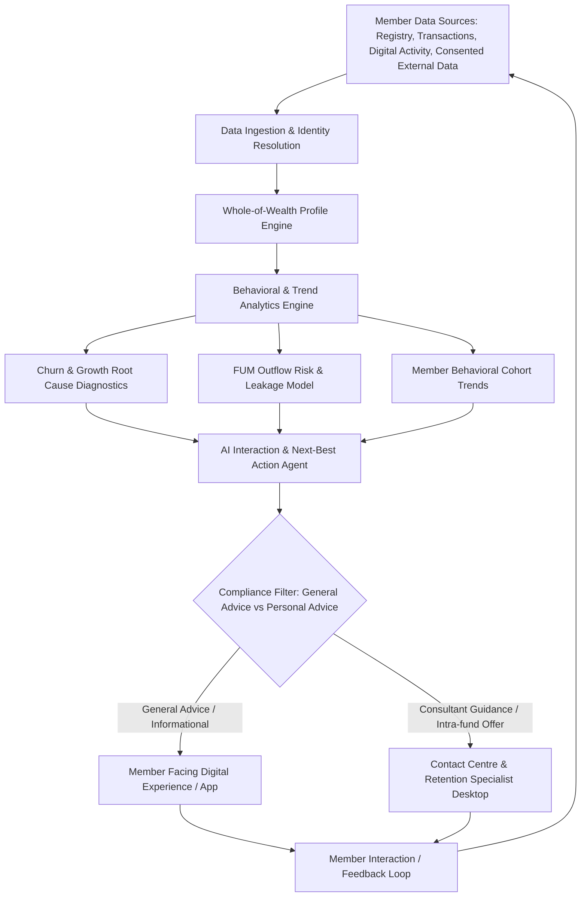

# Member Whole-of-Wealth Insights & Interaction Advisory Agent BRD

> **BRD-2026-SUPER-001** | Status: draft | Version: 0.1.0 | Last Updated: 2026-10-13

## Executive Summary

This Business Requirements Document (BRD) outlines the business requirements for an AI-powered Member Whole-of-Wealth Insights and Interaction Advisory Agent for an Australian Superannuation provider.

The superannuation fund faces member churn and significant outflow of Funds Under Management (FUM) as members transition between life stages (e.g., career moves, home purchases, retirement transition, or consolidation into self-managed super funds (SMSFs) or competing retail/industry funds). Business analysts, retention teams, and member service consultants currently lack a unified, real-time understanding of customer behavior and holistic wealth indicators, leading to reactive and sub-optimal customer engagements.

This initiative delivers an intelligence capability that aggregates member profiles and behavior signals, performs root-cause analytics on member growth and attrition, diagnoses FUM flow drivers, detects macro and cohort behavioral trends, and provides compliant, contextual recommendations for future member interactions.

Primary success metrics include reducing avoidable member attrition by 15%, curbing net negative FUM outflows by 20%, and increasing proactive member engagement effectiveness across key decision moments within 12 months of deployment.

---

## Business Context

The Australian superannuation industry operates under extensive regulatory oversight (APRA prudential standards, ASIC licensing and disclosure, and the Corporations Act 2001 (Cth)). Over recent years, regulatory changes (such as "Your Future, Your Super" stapling reforms, Retirement Income Covenant (RIC), and Delivering Better Financial Outcomes (DBFO) legislation) have heightened competitive pressure on member retention and fund performance transparency.

Key market and organizational dynamics include:

1. **Member Portability & Inactive Account Churn:** Stapling rules and seamless rollover mechanisms (SuperMatch, ATO consolidation) allow members to switch funds with minimal friction.
2. **Funds Under Management (FUM) Volatility:** Outflows are driven by retirement drawdowns, external SMSF rollovers, non-concessional withdrawals, and proactive poaching by retail platforms.
3. **Information Asymmetry:** Most super funds possess deep data on superannuation balances and contributions but lack visibility into external assets, mortgages, external super accounts, or life milestones (whole-of-wealth profile).
4. **Advice Regulatory Boundaries:** Providing "recommendations and advice" in Australian financial services is strictly governed by the distinction between Factual Information, General Advice, and Personal Advice under Chapter 7 of the Corporations Act 2001 (Cth) and ASIC Regulatory Guide 244 (RG 244).

---

## Stakeholders

| Stakeholder Role | Mendelow Power | Mendelow Interest | Engagement Strategy | Key Responsibilities |
|---|---|---|---|---|
| **Head of Member Growth & Retention** | High | High | Manage Closely | Executive Sponsor; owns member retention targets and FUM preservation. |
| **Business Analysis & Product Team** | High | High | Manage Closely | Authors requirements, defines behavioral metrics, validates analytics. |
| **Legal, Risk & Compliance (AFSL Compliance)** | High | High | Manage Closely | Ensures advice guardrails (General vs Personal advice), APPs, and APRA compliance. |
| **Member Service Operations / Contact Centre** | Medium | High | Keep Informed & Consult | Primary users of agent interaction recommendations and member context summaries. |
| **Data Engineering & Analytics Architecture** | Medium | Medium | Keep Satisfied | Data integration (registry, CRM, digital footprint, external feeds). |
| **Superannuation Fund Members** | Low | High | Keep Informed | End beneficiaries; receive relevant, timely, and compliant interactions. |

---

## Design Decisions

| ID | Title | Scope & Decision Summary | Downstream Impact |
|---|---|---|---|
| `DD-001` | Advice Boundary Baseline | System defaults to factual insights and General Advice / Next Best Action prompts for operators until intra-fund personal advice compliance parameters are finalized. | Directs agent response phrasing, guardrails, and compliance approval paths. |
| `DD-002` | Whole-of-Wealth Data Sourcing | Profile construction combines internal fund data (registry, transaction, portal behavior) with consented external data (CDR / Open Banking / voluntary disclosure). | Informs consent management requirements, data freshness SLAs, and privacy architecture. |

---

## Business Goals

```text
BG-001: Reduce net avoidable member attrition and preserve Funds Under Management (FUM).
Priority: MUST
KPI: Net annualized member churn rate and monthly net FUM outflow rate.
Baseline: Current member churn of 7.5% per annum; net FUM outflow of $180M/quarter across targeted retention cohorts.
Target: Reduce member churn to ≤ 6.0% (a 20% relative reduction) and decrease net avoidable FUM outflow by 15% within 12 months.
Timeframe: Within 12 months of production deployment.
Measurement source: Member Registry Data Warehouse and Finance FUM Reconciliation Dashboard.
Owner: Head of Member Growth & Retention.
```

**SMART Evaluation**:

- [x] **S**pecific: Focuses directly on member attrition reduction and FUM outflow mitigation.
- [x] **M**easurable: Quantified by churn percentage and dollar FUM outflow metrics.
- [x] **A**chievable: 15-20% improvement aligns with industry benchmarks for predictive retention interventions.
- [x] **R**elevant: Directly targets fund viability, scale benefits, and lower fee ratios for remaining members.
- [x] **T**ime-bound: 12-month post-launch assessment window.

**Status**: deferred (assessed at Define→Govern gate)

### Outcome Hypothesis Handoff Provenance

| Handoff ID | Source artifact | Source SHA-256 | KPI measurement source | Receipt status |
|---|---|---|---|---|
| `N/A` | Direct Discover intake | `N/A` | Member Registry & FUM Reporting Data Warehouse | `Accepted` |

---

## Business Rules

* `BR-001`: Financial Advice Regulatory Guardrails
  * **Category**: Regulatory (Corporations Act 2001 (Cth) Chapter 7, ASIC RG 244).
  * **Rationale**: Providing financial product advice requires clear licensing parameters. Automated recommendations delivered directly to consumers or staff must adhere strictly to General Advice warnings or meet statutory Best Interests Duty / DBFO intra-fund advice requirements.
  * **Enforceability**: Mandatory.
  * **Enforcing FRs**: `FR-004`.
* `BR-002`: Privacy & Consumer Consent (APPs & CDR Rules)
  * **Category**: Regulatory (Privacy Act 1988 (Cth), Australian Privacy Principles).
  * **Rationale**: Aggregation of whole-of-wealth data (banking, external super, debt) requires explicit, informed member consent and purpose-limitation controls.
  * **Enforceability**: Mandatory.
  * **Enforcing FRs**: `FR-001`.
* `BR-003`: APRA Prudential Compliance (CPS 234 Information Security & SPS 515 Strategic Planning)
  * **Category**: Regulatory.
  * **Rationale**: Member financial data processed by AI models must maintain strict confidentiality, access controls, and operational resilience.
  * **Enforceability**: Mandatory.
  * **Enforcing FRs**: `FR-001`, `FR-002`.

---

## Functional Requirements

- `FR-001`: Whole-of-Wealth Profile Aggregation
  - **Statement**: The system shall aggregate and synthesize member profile data—including account balance history, voluntary contributions, investment option allocations, insurance status, interaction logs, and consented external financial assets—into a unified analytical view.
  - **Actor**: Business Analyst, Retention Specialist, Advisory Agent Engine.
  - **Trigger**: Batch synchronization, event-driven account changes, or consultant profile lookup.
  - **Expected Outcome**: Produces an up-to-date, multi-dimensional whole-of-wealth profile with clear data provenance and consent indicators.
  - **Acceptance Criteria**: Links to `AC-001`.
  - **Business Goals**: Links to `BG-001`.

- `FR-002`: Member Movement & Churn Root-Cause Analytics
  - **Statement**: The system shall analyze historical and real-time member transaction events, rollovers-out, portal activity drops, and life-stage indicators to diagnose why members are departing, inactive, or consolidating balances into the fund.
  - **Actor**: Business Analyst, Marketing/Retention Lead.
  - **Trigger**: Scheduled reporting runs or ad-hoc cohort analysis requests.
  - **Expected Outcome**: Generates root-cause attribution scores (e.g., fee sensitivity, poor digital engagement, retirement transition, life event trigger) for member growth and attrition.
  - **Acceptance Criteria**: Links to `AC-002`.
  - **Business Goals**: Links to `BG-001`.

- `FR-003`: Funds Under Management (FUM) Outflow Diagnostic & Predictive Modeling
  - **Statement**: The system shall identify, categorize, and predict high-risk FUM outflow events (e.g., partial rollovers to SMSFs, large lump-sum drawdowns, contribution cessation) and calculate estimated FUM at risk across segmented member cohorts.
  - **Actor**: Business Analyst, Executive Management.
  - **Trigger**: Weekly analytics refresh or member risk threshold breach.
  - **Expected Outcome**: Delivers an interactive FUM leakage breakdown with leading risk indicators and cohort impact sizing.
  - **Acceptance Criteria**: Links to `AC-003`.
  - **Business Goals**: Links to `BG-001`.

- `FR-004`: Contextual Interaction Recommendations & Next-Best Action
  - **Statement**: The system shall generate tailored, context-aware interaction guidance and next-best actions (e.g., educational nudges, contribution health-checks, intra-fund advice appointment offers) for future member communications.
  - **Actor**: Member Service Consultant, Digital Journey Engine.
  - **Trigger**: Inbound contact event or outbound trigger notification.
  - **Expected Outcome**: Displays synthesized talking points, suggested engagement topics, and mandatory compliance disclaimers based on the member's profile and behavioral trend.
  - **Acceptance Criteria**: Links to `AC-004`.
  - **Business Goals**: Links to `BG-001`.

---

## Non-Functional Requirements

### Functional Suitability

- `NFR-001`: Model Explainability & Auditability
  - Rationale and attribution factors for churn risk or interaction recommendations must be inspectable by business analysts and compliance reviewers.

### Performance Efficiency

- `NFR-002`: Recommendation Latency
  - When invoked by an operator during an active interaction, the agent shall generate profile insights and guidance within 2.5 seconds (95th percentile).

### Compatibility

- `NFR-003`: Core Registry & CRM Interoperability
  - The solution shall integrate seamlessly with fund registry systems, CRM platforms, and data lakehouses via secure REST/GraphQL APIs.

### Usability

- `NFR-004`: Business User Experience
  - Analytical insights and cohort segmentation visualizations shall be accessible to non-technical business analysts without requiring manual SQL authoring.

### Reliability

- `NFR-005`: System Availability
  - The analytical and advisory recommendation service shall maintain 99.9% uptime during core business operating hours (7:00 AM – 8:00 PM AEST).

### Security

- `NFR-006`: Data Protection & APRA CPS 234 Conformance
  - All member personally identifiable information (PII) and financial balances must be encrypted in transit (TLS 1.3) and at rest (AES-256), with role-based access control (RBAC).

### Maintainability

- `NFR-007`: Model Governance & Drift Monitoring
  - Churn prediction models and recommendation algorithms must support quarterly retraining, drift logging, and versioned rollback capabilities.

### Portability

- `NFR-008`: Cloud Infrastructure Portability
  - Analytics pipelines and agent microservices shall run on containerized or managed enterprise cloud architectures conforming to standard deployment templates.

---

## Constraints

* `CON-001`: Australian Regulatory Jurisdiction
  * **Imposing source**: Australian Securities and Investments Commission (ASIC) and Australian Prudential Regulation Authority (APRA).
  * **Affected boundary**: Compliance, interaction guidance, and system operational rules.
  * **Non-negotiability**: Non-negotiable legal obligation under Australian law.
  * **Category**: Regulatory.
  * **Impact**: All advice must feature unambiguous classification and audit logging.
* `CON-002`: Data Sovereignty
  * **Imposing source**: Fund Security Policy and APRA Prudential Guidance.
  * **Affected boundary**: Infrastructure and cloud hosting regions.
  * **Non-negotiability**: All member data and AI processing must remain within Australian sovereign boundaries (e.g., Australia East / Southeast regions).
  * **Category**: Technical / Compliance.
  * **Impact**: Cloud models and databases must be provisioned strictly in Australian data centers.

---

## Process Models



---

## Acceptance Criteria

- `AC-001`: Whole-of-Wealth Synthesis Verification
  - **Given** a registered superannuation member with active super balance and historical contributions,
  - **When** the profile is requested by the agent or business analyst,
  - **Then** the system displays a unified whole-of-wealth profile including balance trajectory, contribution consistency, and consent status for external asset markers within 2 seconds.
  - **Covers**: `FR-001`.
  - **Status**: Not Started.

- `AC-002`: Churn Root-Cause Attribution
  - **Given** a designated member cohort that rolled out balances or closed accounts over the trailing 6 months,
  - **When** a business analyst runs the member attrition diagnostic,
  - **Then** the system outputs ranked contributing factors (e.g., fees, negative performance perception, competitive rollover, lack of digital engagement) with statistical significance indicators.
  - **Covers**: `FR-002`.
  - **Status**: Not Started.

- `AC-003`: FUM Outflow Prediction and Cohort Risk
  - **Given** active members with declining voluntary contributions or frequent withdrawal page visits,
  - **When** the FUM predictive risk model evaluates the member base,
  - **Then** it flags members in the top 10% risk decile with estimated potential FUM outflow values and primary risk drivers.
  - **Covers**: `FR-003`.
  - **Status**: Not Started.

- `AC-004`: Compliant Interaction Guidance Generation
  - **Given** a member flagged with moderate churn risk due to life-stage transition (e.g., turning 60),
  - **When** a member service consultant opens the member's profile during an inquiry,
  - **Then** the agent presents 2-3 tailored talking points, transition-to-retirement educational resources, and the mandatory General Advice warning statement.
  - **Covers**: `FR-004`.
  - **Status**: Not Started.

---

## Traceability Matrix

### FR-to-AC Coverage

| Functional Requirement | Acceptance Criteria | Coverage Status |
|---|---|---|
| `FR-001` | `AC-001` | Covered |
| `FR-002` | `AC-002` | Covered |
| `FR-003` | `AC-003` | Covered |
| `FR-004` | `AC-004` | Covered |

*Coverage*: 100.0% (4 of 4 FRs linked to at least one AC).

### FR-to-BG Alignment

| Functional Requirement | Business Goal | Alignment Status |
|---|---|---|
| `FR-001` | `BG-001` | Aligned |
| `FR-002` | `BG-001` | Aligned |
| `FR-003` | `BG-001` | Aligned |
| `FR-004` | `BG-001` | Aligned |

*Coverage*: 100.0% (4 of 4 FRs linked to BG-001).

### BR-to-FR Enforcement

| Business Rule | Enforcing Functional Requirement |
|---|---|
| `BR-001` (Advice Regulatory Guardrails) | `FR-004` |
| `BR-002` (Privacy & Consumer Consent) | `FR-001` |
| `BR-003` (APRA CPS 234 Security) | `FR-001`, `FR-002` |

---

## Risks and Assumptions

### Key Assumptions

| ID | Assumption | Evidence status | Impact if false | Mitigation | Source |
|---|---|---|---|---|---|
| `ASM-001` | Internal data registry and CRM logs contain sufficient historical event granularity to train churn and FUM attrition models. | Untested | High | Conduct rapid data feasibility audit on historical transaction logs. | BRD Discovery |
| `ASM-002` | Interaction advice will operate primarily within General Advice or Intra-fund Simple Advice boundaries without triggering complex full Statement of Advice (SOA) mandates. | Partially supported | Critical | Review guidance rules directly with AFSL Compliance team. | BRD Discovery |
| `ASM-003` | Members will consent to sharing external financial account signals via CDR or voluntary input if tangible engagement value is provided. | Untested | Medium | Provide progressive value exchange and fall back to internal-only behavioral models when external data is absent. | BRD Discovery |

### Risk Register

| Risk Statement | Probability | Impact | Mitigation Action |
|---|---|---|---|
| **Regulatory Misclassification:** Agent-generated recommendations could be deemed unlicensed Personal Advice under ASIC RG 244. | Medium | High | Implement strict output filtering, deterministic prompt guardrails, and mandatory disclaimer banners verified by AFSL Compliance. |
| **Data Quality & Sparsity:** Fragmented member transaction logs could lead to inaccurate behavioral attribution or false churn alarms. | High | Medium | Establish a Minimum Data Completeness threshold before triggering automated risk scoring or consultant nudges. |
| **Consultant Adoption Resistance:** Contact centre staff may bypass AI recommendations if rationale is opaque or workflow is intrusive. | Medium | Medium | Co-design UI recommendations with frontline consultants and provide transparent "why this recommendation" attribution. |

---

## Open Questions

| ID | Question or gap | Why it matters | Owner | Target date | Status | Rationale for deferral | Target phase | Source |
|---|---|---|---|---|---|---|---|---|
| `Q-001` | Will the advisory agent be solely internal (assisting frontline consultants) or will it also interact directly with members via web/mobile portal? | Dictates conversational safety controls, authentication depth, and UI scope. | Business Analyst / Product Lead | 2026-10-20 | Open | — | — | BRD Discovery |
| `Q-002` | What external data sources constitute the target "Whole-of-Wealth" view (e.g., CDR Open Banking, credit bureau, manual self-reporting, ATO linked super)? | Determines integration architecture, consent flows, and privacy boundaries. | Data Architect | 2026-10-25 | Open | — | — | BRD Discovery |
| `Q-003` | Under the Delivering Better Financial Outcomes (DBFO) legislation, what specific advice license tier (General Advice vs Intra-fund Advice) is designated for this release? | Affects whether personal circumstances can be taken into account for recommendations. | AFSL Compliance Officer | 2026-10-22 | Open | — | — | BRD Discovery |

---

## Glossary

| Term or Abbreviation | Definition | Context or Examples |
|---|---|---|
| **APRA** | Australian Prudential Regulation Authority | Financial services prudential regulator responsible for superannuation standards (e.g., CPS 234, SPS 515). |
| **ASIC** | Australian Securities and Investments Commission | Corporate and financial services regulator governing conduct, disclosure, and licensing. |
| **CDR** | Consumer Data Right | Australian open data regime enabling consumers to securely share banking and financial data with accredited providers. |
| **DBFO** | Delivering Better Financial Outcomes | Australian legislative package reforming financial advice, member engagement, and retirement advice delivery. |
| **FUM** | Funds Under Management | The total market value of financial assets managed by the superannuation fund on behalf of its members. |
| **General Advice** | Financial product advice that does not take into account the member's personal objectives, financial situation, or needs. | Governed under Chapter 7 of Corporations Act 2001 (Cth) and ASIC RG 244. |
| **Personal Advice** | Financial product advice tailored to an individual's specific financial situation, goals, or needs. | Requires a Statement of Advice (SOA) or authorized financial adviser under current law. |
| **SMSF** | Self-Managed Super Fund | A private superannuation fund regulated by the ATO that members manage themselves; a frequent destination for FUM rollovers. |
| **Stapling** | Australian reform linking a super fund to an individual employee so the fund follows them when changing jobs. | Implemented under the "Your Future, Your Super" legislative reforms. |

---

## Sign-Off

### Approval Checklist

* Business Sponsor: [Pending Identification] - Approves business case and strategic alignment.
* Product Owner: [Pending Identification] - Approves requirements completeness and feasibility.
* Technical Lead: [Pending Identification] - Approves technical feasibility and constraints.
* Quality Lead: [Pending Identification] - Approves quality criteria and acceptance test coverage.
* Legal/Compliance: [Pending Identification] - Approves regulatory and policy compliance when required.

Approval date: Pending Define/Govern signoff

### Waivers

*None active.*

### Handoff Readiness

*Status: In Progress (Discover phase).* Gate assessment will occur upon completion of Define phase.

---

## Disclaimer

> [!CAUTION]
> **Disclaimer:** This agent is an assistive tool only. It does not provide business approval, regulatory compliance validation, or executive sign-off and does not replace business analysts, stakeholder representatives, compliance teams, or other qualified human reviewers. The output consists of suggested business requirements, objectives, and scope definitions to support a user's own business analysis and decision-making. All Business Requirements Documents, business objectives, stakeholder analysis, and requirement traceability generated by this tool must be independently reviewed and validated by appropriate business and compliance reviewers before adoption. Outputs from this tool do not constitute business approval, requirements sign-off, or stakeholder commitment.

---

## Document Metadata

* Template Version: 1.0.0.
* Canonical Template: `requirements-author/templates/brd/brd-full.md`.
* License: CC-BY 4.0 (Microsoft HVE-Core).
* Attribution: Microsoft HVE-Core Team.
