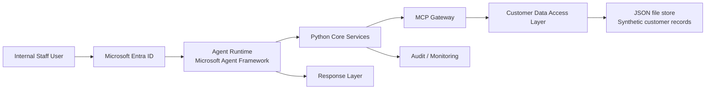

# Member Whole-of-Wealth Insights & Interaction Advisory Agent Security Plan

> **SEC-2026-SUPER-001** | Status: draft | Version: 0.1.0 | Last Updated: 2026-10-13

## 1. Purpose and scope

This security plan defines the minimum controls for the MVP of the member wealth insights and interaction advisory agent. The MVP uses Microsoft Agent Framework with a Python core, inherits identity from Microsoft Entra ID, and reads synthetic customer data stored as JSON files through an MCP data layer. The design is intended for internal staff workflows and operational pilot use, not broad public exposure.

This document covers:

- identity and access management
- data classification and handling
- secure architecture boundaries
- MCP and tool trust boundaries
- prompt and agent safety controls
- logging, monitoring, and incident response
- compliance and governance for the MVP

This plan is aligned to the product constraints in the BRD and PRD, including: internal-only data scope, no personalized financial advice, and staff-facing interaction support rather than direct member communication.

## 2. Security objectives

The system must protect member confidentiality, prevent unauthorized data access, limit the agent to approved business actions, and maintain a clear audit trail for all queries and outputs.

Primary security objectives:

1. Enforce least privilege for all users and service identities.
2. Ensure all access to synthetic customer data flows through approved MCP endpoints with authorisation checks.
3. Prevent prompt injection, prompt leakage, and unsafe tool usage from causing unauthorized actions or data exposure.
4. Keep synthetic data isolated from production member data and limit exposure to approved pilot environments.
5. Preserve clear evidence for compliance review and operational accountability.

## 3. Trust boundaries and architecture

### 3.1 MVP architecture overview

### 3.2 Trust boundaries

- User trust boundary: internal staff user accounts managed by Entra ID.
- Agent runtime trust boundary: Python core services, orchestration logic, memory, and tool invocation layer.
- MCP trust boundary: approved read/write tools and schema validation for file access.
- Data trust boundary: synthetic customer JSON files located in a restricted, private storage location.
- Audit trust boundary: telemetry, security logs, access logs, and review records.

## 4. Data classification and data minimisation

### 4.1 Data classification

The MVP uses synthetic customer data, which mimics member information but should still be treated as confidential business data because it reflects customer behaviors, account characteristics, or retention patterns.

Recommended classification:

- Data type: internal / confidential (not public)
- Sensitivity: moderate to high due to customer and operational context
- Usage: restricted to internal staff and approved pilot roles only
- Retention: align to project pilot requirements; no indefinite retention without approval

### 4.2 Data minimisation requirements

- Store only the minimum fields needed for staff insight generation.
- Do not store production credentials, tokens, or secrets inside JSON files.
- Ensure synthetic records do not contain real personal data or live identifiers.
- Use customer IDs or synthetic keys that are not linkable to real customers.
- Default to read-only file permissions for the data layer and restrict writes to designated admin workflows.

## 5. Identity and access management

### 5.1 Identity model

The MVP must use Entra ID as the primary identity source and allow the agent to inherit user identity context when relevant.

Required controls:

- Microsoft Entra ID for all user authentication.
- Conditional Access for pilot or higher-risk access scenarios.
- Group-based or role-based access for staff personas: Analyst, Retention Specialist, Compliance Reviewer, and Administrator.
- No shared user accounts or generic service accounts for interactive staff operations.
- Managed identity or workload identity for platform-to-platform service access where supported.

### 5.2 Access model

The agent should not be able to access all customer records by default. Instead, access must be constrained by:

- user role
- approved business use case
- customer or cohort scope
- explicit request context
- policy filtering in the MCP layer

Recommended RBAC model:

| Role | Access | Notes |
|---|---|---|
| Analyst | Read-only access to approved cohort data | No write-back to source files |
| Retention Specialist | Read-only access to relevant prospects or flagged members | Operational scope limited to pilot workflow |
| Compliance Reviewer | Read access to audit logs, evidence, and metadata | No raw data export without approval |
| Administrator | Config and environment management | Restricted to platform operators |

### 5.3 Session and token security

- Prefer OAuth 2.0 / OIDC-based identity flows for all API calls.
- Keep tokens out of logs and prompt content.
- Require short-lived access tokens and refresh workflows aligned to Entra best practice.
- Enforce per-request authorisation checks before MCP data retrieval.

## 6. MCP and data access security

Because the agent accesses synthetic data through MCP, the MCP layer is the main control point for data access and must be treated as a critical trust boundary.

### 6.1 MCP controls

- Restrict MCP tools to explicit, necessary functions only.
- Require schema validation for every request and response payload.
- Enforce allowlists for customer identifiers, file paths, and lookup patterns.
- Reject requests exceeding approved scope or access policy.
- Do not expose raw file-system paths to the agent when a logical data abstraction is sufficient.

### 6.2 File store controls

- Store JSON files in an isolated secure folder or storage account with limited access.
- Apply least-privilege ACLs and storage permissions.
- Use encryption at rest and in transit.
- Validate path traversal protections before file access.
- Use read-only data access for the agent unless a controlled admin workflow is necessary.

### 6.3 Data-access policy examples

The system should require policy checks such as:

- user must have `retention-analyst` role
- request must include approved customer ID or cohort scope
- request must be within allowed portal or business context
- file must be in allowed dataset namespace
- action must be read-only for the MVP

If any policy check fails, the agent must return a refusal message and audit the event.

## 7. Prompt security and AI-specific risks

The agent is exposed to prompt injection and unsafe prompt manipulation because staff users can ask for operational summaries and may provide external or untrusted context.

### 7.1 Key AI risks

- prompt injection via untrusted document text, user-supplied metadata, or MCP query content
- indirect prompt injection through third-party content or data sources
- data exfiltration through requests that ask the agent to reveal raw synthetic records or hidden metadata
- over-broad retrieval from the JSON store
- model output that exceeds approved guidance boundaries or accidentally gives regulated financial advice
- tool misuse where the agent invokes an MCP tool outside approved workflows

### 7.2 Mitigations

- Treat all data retrieved through MCP as untrusted operational content.
- Separate system instructions from user-controlled content.
- Validate tool invocations against an allowlist before execution.
- Add refusals for requests asking for disallowed outputs or unauthorized customer exposure.
- Add clear system prompts that limit the agent to analysis and general guidance only.
- Keep all financial advice disclaimers visible in the output contract.
- Log the exact tool calls and retrieved record scopes used to generate any answer.

## 8. Security controls for the MVP

### 8.1 Authentication and authorization

- Entra ID authentication for all human users.
- Role-based access to cohorts and tool actions.
- Access decisions enforced at both the UI and MCP layer.
- No business logic relying on agent self-authorization.

### 8.2 Data protection

- Encryption at rest and in transit.
- Strict storage isolation for synthetic JSON data.
- Exclusion of real personal data from the MVP environment.
- Secure file permission model and restricted admin-only write paths.

### 8.3 Monitoring and audit logging

- Log user identity, role, tool invocation, data scope, timestamp, and outcome.
- Capture prompt and tool-level telemetry without storing secrets or raw tokens.
- Alert on abnormal access spikes, bulk export requests, or policy violations.
- Maintain a simple evidence trail suitable for compliance review.

### 8.4 Change management and secure development

- Run static security scanning and dependency checks on the Python core.
- Perform secret scanning in repository workflows.
- Require code review for all changes touching identity, data access, or MCP logic.
- Separate development, pilot, and production-like environments.

## 9. Threat model summary

### 9.1 Primary threats

| Threat | Scenario | Risk level | Mitigation |
|---|---|---|---|
| Unauthorized data access | User accesses customer records outside role scope | High | Entra role checks + MCP policy enforcement |
| Prompt injection | User or data includes malicious instructions | High | Prompt isolation, tool allowlists, data trust boundary |
| Over-permissive tool access | MCP exposes unrestricted file reads | High | Restrict tool surface and enforce schema validation |
| Data exfiltration | Agent reveals raw JSON or customer data in answers | High | Output guardrails and access policies |
| Advice boundary violation | Agent produces personal financial advice | High | Explicit policy, disclaimers, human review controls |
| Denial of service | Large bulk dataset or repeated query flood | Medium | Rate limiting and query quotas |
| Insider misuse | Approved user uses broad access inappropriately | Medium | Audit logs and monitoring |

## 10. Security design decisions for this MVP

1. Identity is inherited from Entra ID; the agent does not maintain a separate authoritative identity model for staff access.
2. Synthetic customer datasets are treated as confidential internal data, not public data.
3. The MCP layer is the primary access enforcement boundary for file-based data retrieval.
4. The GPT/agent core is not trusted to decide authorization on its own; policy enforcement must happen outside the model.
5. The audience is internal staff only; direct member communication, external access, and public AI exposure are out of scope for the MVP.

## 11. Security backlog and exit criteria

### Planned security work items

- SEC-001: Define Entra ID app registrations and role assignments for pilot users.
- SEC-002: Implement MCP access policy for approved customer, cohort, and file access only.
- SEC-003: Add schema validation and allowlist enforcement for all JSON and MCP operations.
- SEC-004: Add output guardrails to prevent financial advice and unauthorized data exposure.
- SEC-005: Add audit logging and anomaly detection for data access and tool invocation.
- SEC-006: Perform pilot security review of the Python agent and MCP data layer before production use.

### MVP exit criteria

The MVP should be considered ready for initial internal pilot when:

- all user identities are authenticated through Entra ID
- least-privilege access is documented and tested
- MCP access policy denies unauthorized customer-file access
- synthetic data is stored in a restricted environment with encryption and access controls
- all tool calls are logged with identity and scope metadata
- prompt injection and output-boundary tests pass for common attack patterns
- compliance review confirms advice and disclosure boundaries are acceptable

## 12. Governance and review

This plan must be reviewed by:

- security engineering
- product ownership
- legal / compliance / risk
- data governance or privacy reviewers

A formal sign-off is required before the MVP expands beyond internal pilot use or before any live customer data is introduced.

## 13. Status and next actions

Current status: draft

Next actions:

1. Validate identity and RBAC model against the pilot user personas.
2. Define the exact JSON data schema and storage location for synthetic customer records.
3. Confirm the MCP tool contract and security review gate for file reads.
4. Record an operational incident response flow for unauthorized access or prompt-policy breach.
5. Obtain compliance sign-off for the advice boundaries and internal-only deployment model.

## 14. Security disclaimers

This document is a planning artifact intended to support internal security review. It does not replace formal compliance, legal, or technical security assessment. Any deployment beyond the synthetic data MVP must undergo a fresh review against the operational environment, access controls, and data protection obligations.
