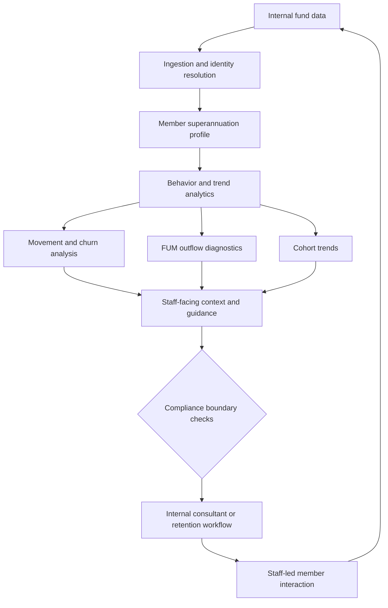

<!-- markdownlint-configure-file
{
  "MD013": {
    "line_length": 80,
    "tables": false,
    "code_blocks": false
  }
}
-->
<!-- markdownlint-disable MD025 -->

# Member Whole-of-Wealth Insights & Interaction Advisory Agent

<!-- markdownlint-enable MD025 -->

> **PRD-2026-SUPER-001** | Status: draft | Version: 0.1.0 | Last Updated:
> 2026-10-13

## Executive Summary

This PRD translates the business needs in
[BRD-2026-SUPER-001](./member-wealth-insights-agent-brd.md) into an initial
product scope for an AI-supported member insights and interaction advisory
capability for an Australian superannuation provider. Internal business
analysts, retention specialists, and member service consultants need a more
unified view of member superannuation data and behavior to understand movement,
identify potential outflows, and prepare timely staff-led interactions.

The initial product scope covers internal superannuation profiles, member
movement and churn analysis, Funds Under Management (FUM) outflow diagnostics,
and staff-facing interaction guidance. It uses internal fund data only, does not
contact members directly, and must not provide personalized financial advice.
Any presentation of profile information must not imply that it represents a
member's complete wealth outside the fund.

The product goal is to support improved member retention through more effective
staff interactions and proactive outreach. The BRD proposes a 5% relative
reduction in six-month exits or rollovers compared with a matched group of
similar flagged members who did not receive outreach. This is a provisional
target, not an approved commitment. A six-month historical lookback is the
working choice for establishing the baseline and validating the target. Data
sufficiency, per-signal thresholds and observation windows, target feasibility,
and sponsor approval remain open. Contribution and digital-activity windows will
be calibrated separately using historical data, rather than assumed to match the
retention KPI lookback.

This is an initial draft based on a BRD that is itself marked draft (version
0.1.0). No BRD-to-PRD governance handoff was found in the BRD session state.
Product scope and requirements therefore remain subject to business, product,
technical, and compliance review.

## Product Context

The source BRD describes member portability, FUM volatility, and information
asymmetry as business drivers. Fund staff currently lack a unified, timely view
of internal member behavior and superannuation indicators, limiting their
ability to diagnose growth and attrition patterns and prepare proactive
interactions.

The product will combine relevant internal registry, contribution, investment,
insurance, interaction, transaction, and digital-activity information into
analytical views. It will support cohort analysis and member-level preparation
for staff interactions. Observed data and inferred causes or risks must be
distinguishable. The product does not represent a complete whole-of-wealth
picture because external assets and accounts are outside the initial data scope.

The initial user experience and operating model are for internal staff. A
closure inquiry alone is sufficient to surface a staff outreach opportunity, but
the system does not contact the member. Advice boundaries, privacy controls,
APRA obligations, and Australian data sovereignty are material constraints.
Regulatory interpretation and implementation controls require qualified
compliance review before use.

## Users and Personas

### Member service consultant / retention specialist

- **Jobs to be done**: Prepare for member interactions, understand relevant
  member context, and identify appropriate staff-led outreach opportunities.
- **Pain points**: Member information and behavioral indicators may be
  fragmented; it can be difficult to identify why a member may be disengaging.
- **Success outcome**: Receives clear, relevant profile context and general
  interaction guidance with visible rationale and compliance boundaries, without
  personalized financial advice.

### Business analyst / retention lead

- **Jobs to be done**: Analyze member movement and churn drivers, compare
  cohorts, and understand potential FUM outflows.
- **Pain points**: Needs consistent access to internal signals and cohort-level
  views without relying on ad-hoc manual analysis.
- **Success outcome**: Can inspect signal evidence, distinguish observation from
  inference, and assess outreach outcomes using a documented comparison method.

### Compliance and risk reviewer

- **Jobs to be done**: Review advice classifications, disclosures, access
  safeguards, and auditability.
- **Pain points**: Needs inspectable explanations and evidence that product
  behavior remains within approved boundaries.
- **Success outcome**: Can review the basis for recommendations, relevant
  controls, and audit records before the product is used.

## Design Decisions

| ID     | Decision             | Current direction                                                                                                                                                                    | Source / status                                 |
| ------ | -------------------- | ------------------------------------------------------------------------------------------------------------------------------------------------------------------------------------ | ----------------------------------------------- |
| DD-001 | Advice boundary      | Limit outputs to analysis, factual information, and general guidance; personalized financial advice is out of scope. Compliance validation is required before use.                   | BRD DD-001; draft pending review                |
| DD-002 | Initial data scope   | Use internal superannuation data only. External financial data is excluded from the initial release.                                                                                 | BRD DD-002; draft pending review                |
| DD-003 | Retention comparison | Compare six-month exit or rollover outcomes for members receiving outreach with similar flagged members who did not; interpret the result as an association, not proof of causation. | BRD DD-003; method details remain to be defined |

## Product Goals

```text
GOAL-001: Improve member retention through effective staff interactions and proactive outreach informed by internal superannuation profiles and member behavior.
Priority: MUST
KPI: Compare six-month exit or rollover rates for members with early disengagement signals who received proactive staff outreach against similar flagged members who did not.
Baseline: Six-month historical lookback using internal member and outreach
records; data sufficiency, seasonality, and cohort counts remain to be
validated.
Target: Provisional 5% relative reduction versus the matched comparison group; validate feasibility and obtain approval before treating as committed.
Timeframe: Six months after outreach or the matched comparison group's index date.
Measurement source: Internal member registry and staff interaction records; source BRD states these can identify outreach, comparison cohorts, and subsequent exit or rollover outcomes.
Owner: Business sponsor to be identified.
```

The result is an association between outreach and subsequent outcomes, not proof
that outreach caused the difference. The BRD marks its business goal SMART
status as deferred. The six-month baseline lookback is selected for this draft;
data sufficiency, signal definitions, target feasibility, sponsor ownership, and
approval remain unresolved.

**SMART Evaluation (initial)**:

- [x] **S**pecific: Improve retention through staff interactions and proactive
      outreach.
- [ ] **M**easurable: The comparison KPI and provisional target are stated;
      baseline and signal definitions remain open.
- [ ] **A**chievable: Historical validation is pending.
- [ ] **R**Relevant: Business sponsor confirmation is pending.
- [ ] **T**Time-bound: Outcome window is six months; overall target
      review/release horizon is not yet set.

**Status**: deferred

## Functional Requirements

- `FR-001`: Internal superannuation profile
  - **Statement**: The product shall present an up-to-date analytical profile
    using member information held in internal fund systems, including account
    balance history, contributions, investment option allocations, insurance
    status, and interaction history.
  - **Actor**: Member service consultant, retention specialist, business
    analyst.
  - **Trigger**: Staff profile lookup, batch synchronization, or an internal
    account-change event.
  - **Expected outcome**: A unified profile with data provenance that does not
    imply coverage of external wealth.
  - **Priority**: MUST.
  - **Acceptance criteria**: AC-001.
  - **Product goals**: GOAL-001.
  - **Source**: BRD FR-001.

- `FR-002`: Member movement and churn analysis
  - **Statement**: The product shall analyze internal transaction and
    interaction data, including contribution changes, digital activity changes,
    closure inquiries, and completed rollovers, to identify and explain member
    movement, inactivity, and attrition patterns.
  - **Actor**: Business analyst, marketing or retention lead.
  - **Trigger**: Scheduled analysis or an ad-hoc cohort analysis request.
  - **Expected outcome**: A root-cause analysis that distinguishes observed
    evidence from inferred causes and presents the contributing indicators.
    Contribution and digital-activity windows are calibrated separately using
    historical data.
  - **Priority**: MUST.
  - **Acceptance criteria**: AC-002.
  - **Product goals**: GOAL-001.
  - **Source**: BRD FR-002.

- `FR-003`: FUM outflow diagnostics
  - **Statement**: The product shall use selected internal disengagement
    signals, including reduced or stopped contributions, declining digital
    activity, and closure inquiries, to identify potential FUM outflow events
    and estimate FUM at risk across cohorts.
  - **Actor**: Business analyst, executive management.
  - **Trigger**: Weekly analytics refresh or a member-risk threshold being met.
  - **Expected outcome**: A cohort-level FUM outflow view with leading
    indicators and impact sizing; contribution and digital-activity thresholds
    and observation windows are calibrated separately using historical data
    before operational use.
  - **Priority**: MUST.
  - **Acceptance criteria**: AC-003.
  - **Product goals**: GOAL-001.
  - **Source**: BRD FR-003.

- `FR-004`: Staff-facing interaction guidance
  - **Statement**: The product shall provide internal staff with
    member-contextual analysis, factual information, and general guidance for
    preparing interactions and identifying proactive outreach opportunities. It
    shall not communicate directly with members or generate personalized
    financial advice.
  - **Actor**: Member service consultant, retention specialist.
  - **Trigger**: Staff opens a profile, prepares for an interaction, reviews an
    outreach list, or an internal closure inquiry is recorded.
  - **Expected outcome**: Relevant context, suggested engagement topics, and
    applicable compliance guidance. A closure inquiry alone is sufficient to
    surface an outreach opportunity.
  - **Priority**: MUST.
  - **Acceptance criteria**: AC-004.
  - **Product goals**: GOAL-001.
  - **Source**: BRD FR-004.

## Non-Functional Requirements

### Performance and Capacity

- `NFR-001`: Profile response time
  - The product shall display the requested unified profile within 2 seconds
    under the conditions represented by the acceptance scenario. The load
    profile and measurement boundary require confirmation.
  - **Source**: BRD AC-001.
- `NFR-002`: Interaction guidance latency
  - During an active operator interaction, the product shall generate profile
    insights and guidance within 2.5 seconds at the 95th percentile. The load
    profile requires confirmation.
  - **Source**: BRD NFR-002.

### Reliability and Resilience

- `NFR-003`: Availability
  - The analytical and advisory service shall maintain 99.9% availability during
    core business hours, defined by the BRD as 7:00 AM–8:00 PM AEST. The
    measurement period, exclusions, and recovery objectives require
    confirmation.
  - **Source**: BRD NFR-005.

### Security

- `NFR-004`: Protection of member information
  - Member personally identifiable information and financial balances shall be
    encrypted in transit using TLS 1.3 and at rest using AES-256, with
    role-based access control.
  - **Source**: BRD NFR-006; security design and compliance review required.

### Privacy

- `NFR-005`: Authorized internal data use
  - The product shall use member information only for authorized purposes and
    apply appropriate access controls and privacy safeguards. External financial
    data ingestion is excluded from the initial release.
  - **Source**: BRD BR-002.

### Maintainability and Operability

- `NFR-006`: Model governance
  - Churn and recommendation models shall support quarterly retraining, drift
    logging, and versioned rollback.
  - **Source**: BRD NFR-007.

### Observability

- `NFR-007`: Model explainability and auditability
  - Rationale and attribution factors for churn risks and interaction guidance
    shall be inspectable by business analysts and compliance reviewers. Required
    audit events, retention periods, and access to records remain to be
    specified.
  - **Source**: BRD NFR-001 and BR-001.

### Usability and Accessibility

- `NFR-008`: Business-user access
  - Analytical insights and cohort visualizations shall be usable by
    non-technical business analysts without requiring manual SQL authoring.
    Usability measures and accessibility conformance target remain to be
    defined.
  - **Source**: BRD NFR-004.

### Compatibility and Interoperability

- `NFR-009`: Core-system integration
  - The product shall integrate with fund registry systems, CRM platforms, and
    data lakehouses using secure REST or GraphQL APIs, subject to confirmation
    of supported systems and interfaces.
  - **Source**: BRD NFR-003.

### Portability

- `NFR-010`: Deployment portability
  - Analytics pipelines and agent services shall run on containerized or managed
    enterprise-cloud architectures conforming to standard deployment templates.
  - **Source**: BRD NFR-008.

## Constraints

- `CON-001`: Australian regulatory jurisdiction
  - **Imposing source**: Applicable Australian law and relevant ASIC/APRA
    obligations, as identified by the source BRD.
  - **Affected boundary**: Advice classification, interaction guidance,
    disclosures, access, and operational controls.
  - **Non-negotiability**: Regulatory obligations are mandatory.
  - **Category**: Regulatory.
  - **Impact**: Compliance must validate applicable advice boundaries,
    disclosures, and audit requirements before use. This PRD does not make a
    legal or compliance determination.
- `CON-002`: Australian data sovereignty
  - **Imposing source**: Fund security policy and APRA prudential guidance as
    recorded in the source BRD.
  - **Affected boundary**: Hosting, data storage, and AI processing.
  - **Non-negotiability**: Member data and AI processing must remain within
    Australian sovereign boundaries.
  - **Category**: Technical / compliance.
  - **Impact**: Hosting locations and processing services must be verified
    against the fund's requirements before selection.
- `CON-003`: Internal-data-only initial release
  - **Imposing source**: BRD DD-002.
  - **Affected boundary**: Profile coverage and data integrations.
  - **Non-negotiability**: External financial-data sources are out of scope for
    this release.
  - **Category**: Scope.
  - **Impact**: Product views must not represent internal fund data as the
    member's complete wealth.
- `CON-004`: No direct member communication or personalized financial advice
  - **Imposing source**: BRD DD-001 and FR-004.
  - **Affected boundary**: Product outputs and interaction channel.
  - **Non-negotiability**: Initial scope is an internal staff co-pilot.
  - **Category**: Regulatory / scope.
  - **Impact**: The product supports staff-led interactions only and must not
    generate personalized financial advice.

## Process Models



## Acceptance Criteria

- `AC-001`: Internal profile display
  - **Given** a registered member with an active superannuation balance and
    historical contributions,
  - **When** an authorized staff user requests the member profile,
  - **Then** the product displays a unified profile with balance trajectory,
    contribution consistency, and data provenance within 2 seconds, without
    implying coverage of external wealth.
  - **Covers**: FR-001.
  - **Status**: Not Started.

- `AC-002`: Churn root-cause analysis
  - **Given** a designated cohort that rolled out balances or closed accounts
    during the trailing six months,
  - **When** a business analyst runs the member attrition diagnostic,
  - **Then** the product reports contributing factors, including contribution
    changes, declining digital engagement, and closure inquiries where present,
    and distinguishes observed evidence from inferred causes.
  - **Covers**: FR-002.
  - **Status**: Not Started.

- `AC-003`: FUM outflow risk analysis
  - **Given** active members with reduced or stopped contributions, declining
    digital engagement, or a closure inquiry,
  - **When** the product evaluates the member base using thresholds agreed for
    those signals,
  - **Then** it identifies members meeting the thresholds and presents estimated
    potential FUM outflow and observed risk indicators. Contribution baselines,
    reduction thresholds, and observation windows must be calibrated separately
    before this criterion can be fully validated.
  - **Covers**: FR-003.
  - **Status**: Not Started.

- `AC-004`: Staff outreach guidance
  - **Given** an internal member record contains a closure inquiry and no other
    disengagement signal,
  - **When** a member service consultant reviews the member's profile,
  - **Then** the product surfaces an outreach opportunity with relevant context
    and applicable compliance guidance, without contacting the member or
    providing personalized financial advice.
  - **Covers**: FR-004.
  - **Status**: Not Started.

## Traceability Matrix

### FR-to-AC Coverage

| Functional requirement | Acceptance criteria | Coverage                             |
| ---------------------- | ------------------- | ------------------------------------ |
| FR-001                 | AC-001              | Covered                              |
| FR-002                 | AC-002              | Covered                              |
| FR-003                 | AC-003              | Covered, with threshold details open |
| FR-004                 | AC-004              | Covered                              |

**Coverage**: 100% (4 of 4 FRs linked to at least one AC; threshold details for
FR-003 remain an open validation dependency).

### FR-to-GOAL Alignment

| Functional requirement | Product goal | Alignment |
| ---------------------- | ------------ | --------- |
| FR-001                 | GOAL-001     | Aligned   |
| FR-002                 | GOAL-001     | Aligned   |
| FR-003                 | GOAL-001     | Aligned   |
| FR-004                 | GOAL-001     | Aligned   |

**Coverage**: 100% (4 of 4 FRs linked to GOAL-001).

### Business-rule alignment

| Source business rule                                       | Product coverage                  |
| ---------------------------------------------------------- | --------------------------------- |
| BR-001: Advice regulatory guardrails                       | FR-004, CON-001, CON-004, NFR-008 |
| BR-002: Privacy and authorized use of internal member data | FR-001, NFR-005, CON-003          |
| BR-003: APRA prudential compliance                         | NFR-004, CON-001, CON-002         |

No feasibility-to-PRD handoff was supplied or found; no feasibility candidate
disposition register applies to this draft.

## MVP and Release Framing

### Initial release scope

- Internal superannuation profile using internal fund data only.
- Movement and churn analysis using member-relative contribution and
  digital-activity signals, closure inquiries, and completed rollovers.
- Cohort-level FUM outflow diagnostics, with thresholds and windows for
  contribution and digital-activity signals calibrated separately from the
  retention KPI lookback.
- Staff-facing interaction context and general guidance, including an outreach
  opportunity triggered by a closure inquiry alone.
- Explainable outputs, compliance review, and staff-led interactions only.

### Explicit non-goals

- Direct member-facing agent interactions or automated outreach.
- Personalized financial advice.
- External wealth aggregation or ingestion of external financial data.
- Treating observed association between outreach and retention outcomes as
  causal proof.

Release horizon, prioritization within the initial scope, and deferred feature
candidates are not yet confirmed.

## Success Metrics

| Metric                                                            | Definition                                                                                                                         | Baseline                                                   | Target                                                                               | Window / source                                                                                          | Goal     |
| ----------------------------------------------------------------- | ---------------------------------------------------------------------------------------------------------------------------------- | ---------------------------------------------------------- | ------------------------------------------------------------------------------------ | -------------------------------------------------------------------------------------------------------- | -------- |
| Six-month exit or rollover rate among early-disengagement members | Compare members who received proactive outreach with similar flagged members who did not. Interpret as association, not causation. | To be established; six-month historical lookback selected. | Provisional 5% relative reduction versus the matched comparison group; not approved. | Six months after outreach or matched index date; internal member registry and staff interaction records. | GOAL-001 |
| Outreach and interaction effectiveness                            | Supporting measures of staff interaction effectiveness and proactive outreach; definitions not yet specified.                      | To be established.                                         | To be defined with the sponsor and Retention team.                                   | Internal staff interaction records; measurement window to be defined.                                    | GOAL-001 |

## Risks and Assumptions

### Key Assumptions

| ID      | Assumption                                                                                                                                  | Evidence status                                                                    | Impact if false | Mitigation                                                                           | Source                   |
| ------- | ------------------------------------------------------------------------------------------------------------------------------------------- | ---------------------------------------------------------------------------------- | --------------- | ------------------------------------------------------------------------------------ | ------------------------ |
| ASM-001 | Internal registry and CRM records contain sufficient historical event detail for churn and FUM analysis.                                    | Untested                                                                           | High            | Validate historical data completeness and event granularity before confirming scope. | Source BRD               |
| ASM-002 | Advice outputs can remain within the approved analysis, factual information, and general guidance boundary.                                 | Partially supported; compliance review pending                                     | Critical        | Obtain AFSL Compliance review of use cases, outputs, and disclosures before use.     | Source BRD               |
| ASM-003 | Internal systems contain sufficiently current member appetite and preference information.                                                   | Untested                                                                           | Medium          | Confirm availability, quality, recency, and authorized use with data owners.         | Source BRD               |
| ASM-004 | Internal systems can reliably identify outreach exposure, a comparable flagged group without outreach, and later exit or rollover outcomes. | Evidenced by business stakeholder per source BRD; not independently validated here | High            | Verify definitions, data quality, and cohort construction during product discovery.  | Source BRD Q-006 / Q-007 |

### Research Finding Dispositions

No separate Research segment or Research findings have been considered for this
initial PRD draft.

### Risk Register

| Risk                                                                                                            | Probability | Impact | Mitigation                                                                                                      |
| --------------------------------------------------------------------------------------------------------------- | ----------- | ------ | --------------------------------------------------------------------------------------------------------------- |
| Regulatory misclassification could cause outputs to be interpreted as unlicensed personalized financial advice. | Medium      | High   | Obtain compliance approval; validate output boundaries, controls, and disclosures before use.                   |
| Fragmented or sparse member data could produce inaccurate attribution or false risk flags.                      | High        | Medium | Define minimum data completeness and validate signal quality before operational scoring.                        |
| Staff may not trust or adopt outputs if rationale is opaque or workflows are intrusive.                         | Medium      | Medium | Co-design with frontline staff and present transparent evidence and rationale.                                  |
| The provisional retention target or matched comparison may not be feasible or reliable.                         | Medium      | High   | Validate six-month data sufficiency, cohort method, baseline, and target approval with Retention and Analytics. |

## Glossary

| Term            | Definition                                                                                                                | Context                                                                                   |
| --------------- | ------------------------------------------------------------------------------------------------------------------------- | ----------------------------------------------------------------------------------------- |
| APRA            | Australian Prudential Regulation Authority.                                                                               | Prudential oversight referenced by the source BRD.                                        |
| ASIC            | Australian Securities and Investments Commission.                                                                         | Conduct, disclosure, and licensing context referenced by the source BRD.                  |
| FUM             | Funds Under Management.                                                                                                   | Financial assets managed by the superannuation fund for members.                          |
| General advice  | Financial product advice that does not take into account the member's personal objectives, financial situation, or needs. | The source BRD identifies this as an intended boundary, subject to compliance validation. |
| Personal advice | Financial product advice that takes into account an individual's specific financial situation, goals, or needs.           | Explicitly out of scope.                                                                  |
| SMSF            | Self-Managed Super Fund.                                                                                                  | A potential destination for member rollovers.                                             |

## Sign-Off

### Approval Checklist

- Product Sponsor: Pending identification.
- Product Owner: Pending identification.
- Technical Lead: Pending identification.
- Quality Lead: Pending identification.
- Legal/Compliance: AFSL Compliance review pending.

Approval date: Pending review.

### Waivers

None recorded. The provisional target and open definition/coverage questions are
not approved waivers.

### Handoff Readiness

**Status**: Draft; not ready for implementation handoff. The source BRD is
draft, no BRD-to-PRD handoff payload was found, and product goals, thresholds,
compliance approval, and non-functional measurement details require review.

## Disclaimer

> [!CAUTION] **Disclaimer:** This agent is an assistive tool only. It does not
> provide product management approval, technical feasibility validation, or
> business sign-off and does not replace product managers, engineering leads,
> business stakeholders, or other qualified human reviewers. The output consists
> of suggested requirements, acceptance criteria, and product specifications to
> support a user's own product planning and decision-making. All Product
> Requirements Documents, functional requirements, non-functional requirements,
> and constraint definitions generated by this tool must be independently
> reviewed and validated by appropriate product and engineering reviewers before
> adoption. Outputs from this tool do not constitute product approval,
> requirements sign-off, or engineering commitment.

## Document Metadata

- Template Version: 1.0.0.
- Canonical Template: `requirements-author/templates/prd/prd-full.md`.
- License: CC-BY 4.0 (Microsoft HVE-Core).
- Attribution: Microsoft HVE-Core Team.
- Source artifact:
  [member-wealth-insights-agent-brd.md](./member-wealth-insights-agent-brd.md),
  draft version 0.1.0.
